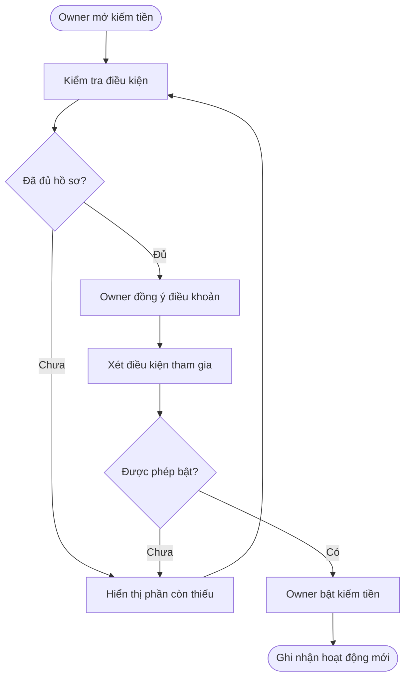
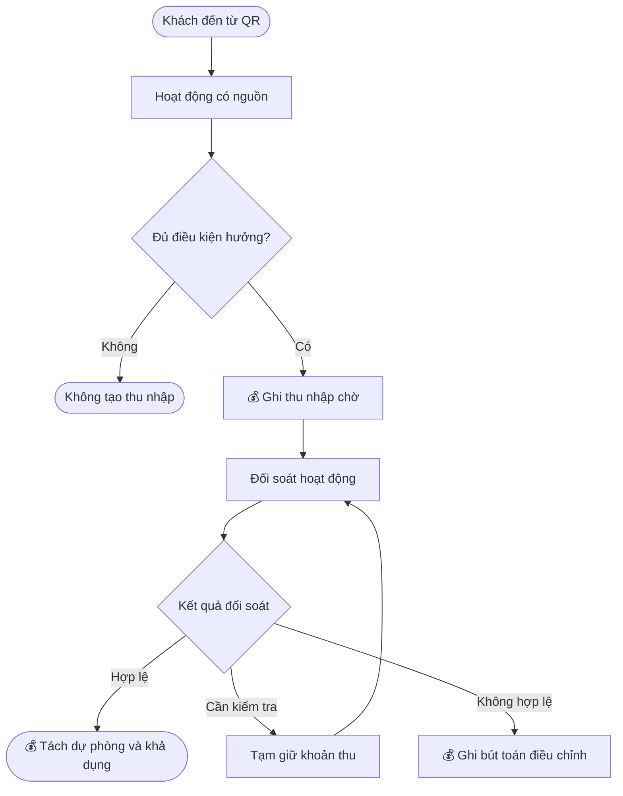
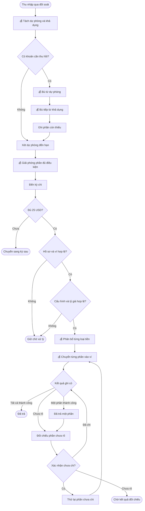
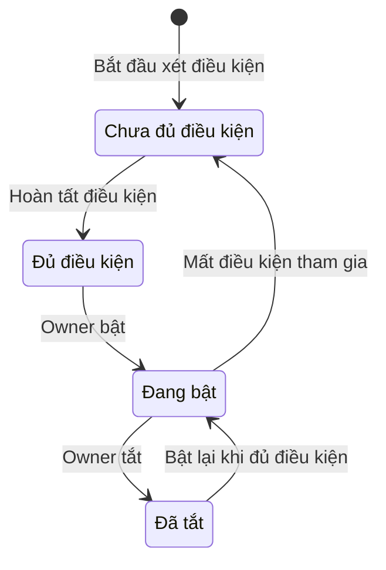
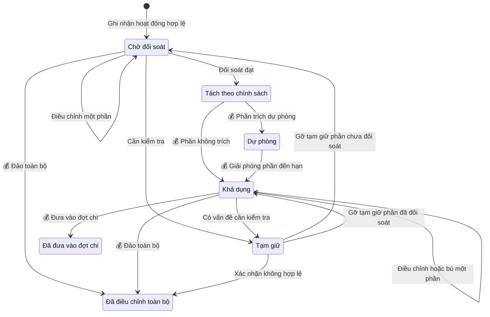
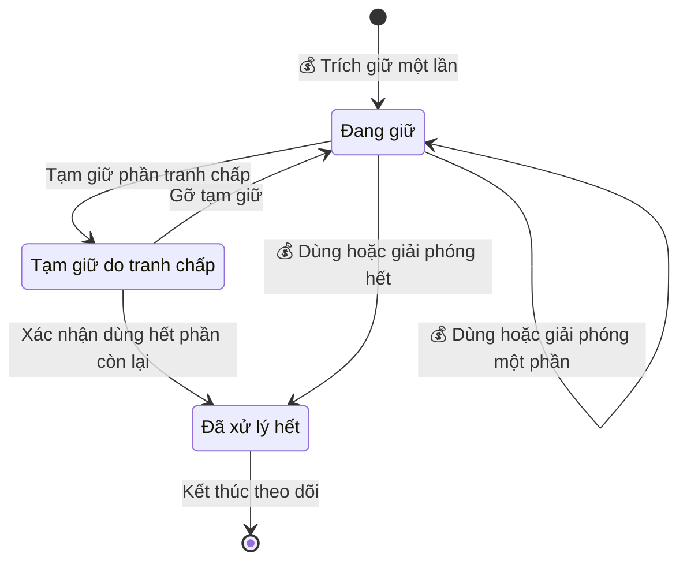
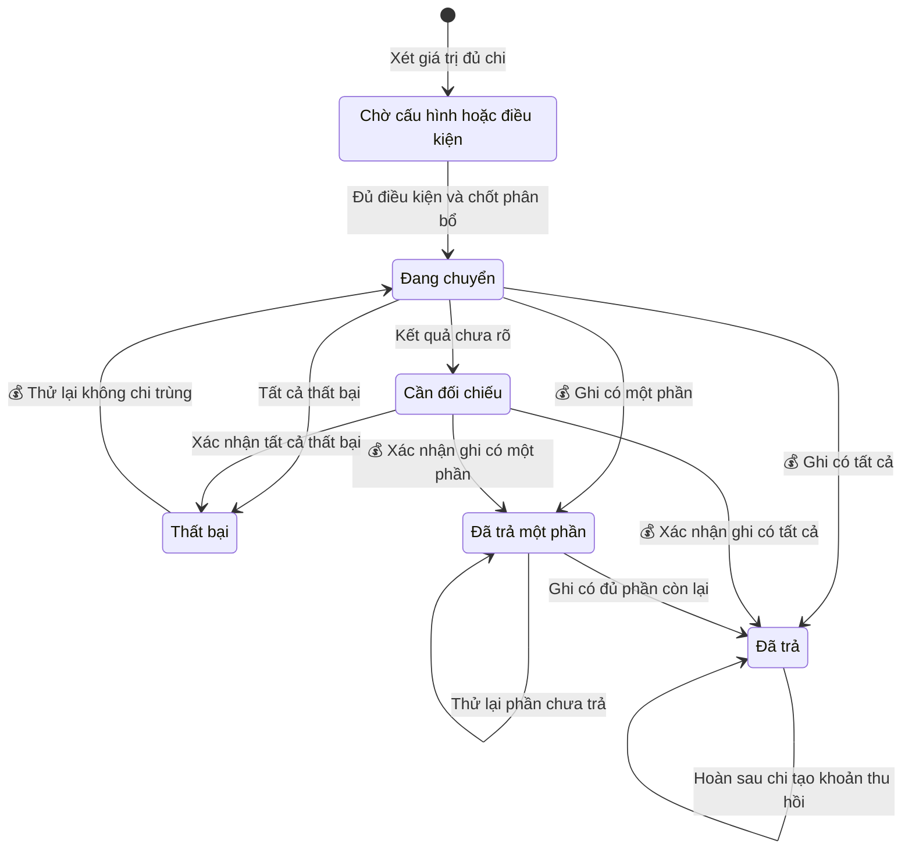
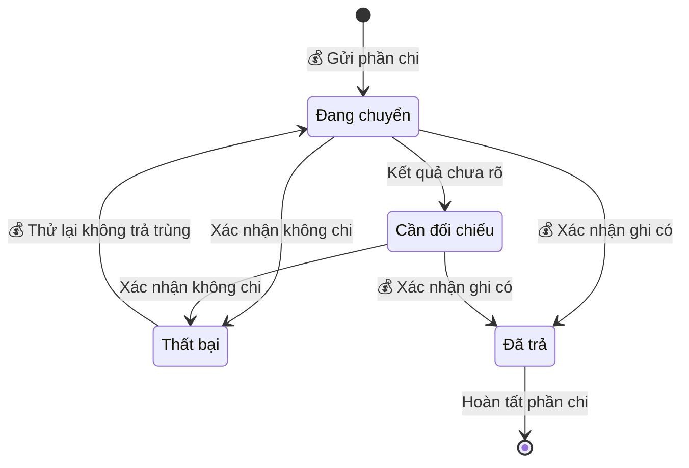
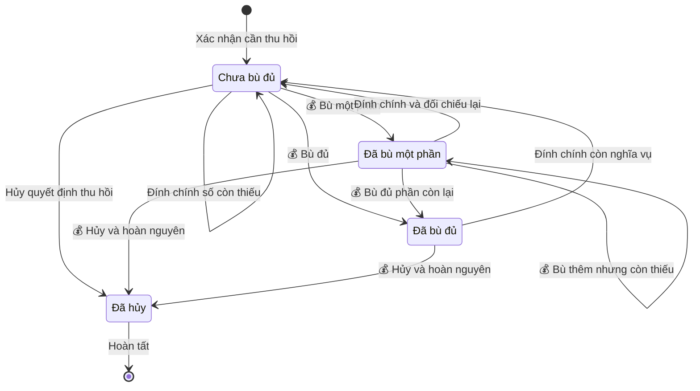

## Business OneQR — Kiếm tiền từ QR, đối soát và nhận tiền

**Cập nhật lần cuối:** 12 tháng 10 năm 2026
**Đối tượng đọc:** Chủ doanh nghiệp (Business Owner), Admin vận hành, Product, BA, QA, Support, đội phát triển
**Trạng thái:** Đang rà soát
**Ticket:** [#1599](https://github.com/vlink-group/vlink-nexora/issues/1599)

---

### Tóm tắt nhanh

Business OneQR giúp doanh nghiệp **kiếm tiền từ khách do QR của mình dẫn tới**, rồi nhận tiền vào ví VlinkPay của Business. Đây là **yêu cầu cần triển khai**; code hiện chưa có chức năng này.

| Chặng | Điều gì xảy ra | Tiền đã vào ví chưa? |
| :--- | :--- | :--- |
| 1. Chờ đối soát | Hệ thống ghi nhận hoạt động hợp lệ và chờ kiểm tra (mặc định 14 ngày) | Chưa |
| 2. Tách dự phòng | Hệ thống giữ lại một phần làm dự phòng, phần còn lại thành khả dụng | Chưa |
| 3. Giải phóng dự phòng | Hết hạn giữ, phần dự phòng không vướng mắc chuyển sang khả dụng | Chưa |
| 4. Xét chi | Thứ Ba 00:00 giờ Chicago, nếu khả dụng sau khấu trừ đạt $25 | Chưa |
| 5. Chi trả | Hệ thống chia theo loại tiền và chuyển vào ví Business | Có, khi VlinkPay xác nhận ghi có |

Không được hiểu sai:
- Quét QR hay mở menu không tạo ra tiền.
- Dự phòng là tiền tạm giữ, không phải phí bị mất.
- Owner chỉ xem; Admin vận hành cấu hình mọi thông số tiền.

---

### Tổng quan

Business OneQR Earnings nhằm cho doanh nghiệp có thêm thu nhập từ QR của mình, bằng cách chia cho chủ QR một phần phí mà nhà quảng cáo trả cho click hợp lệ hoặc dịch vụ hoàn tất. Hệ thống ghi nhận thu nhập theo nguồn, đối soát, giữ dự phòng cho hoàn tiền và tranh chấp, khấu trừ khoản cần thu hồi, rồi chi phần đủ điều kiện vào ví VlinkPay liên kết SSO của Business. Admin vận hành cấu hình thời gian đối soát, chính sách dự phòng, loại tiền nhận và tỷ lệ từng loại. Business Owner bật/tắt kiếm tiền, theo dõi nguồn thu và đối chiếu tiền thực nhận.

**Phạm vi**

| | Nội dung |
| :--- | :--- |
| Trong phạm vi | Bật/tắt kiếm tiền; kế thừa KYB và yêu cầu thuế; ghi nhận và đối soát thu nhập trực tiếp của Business; dự phòng; khấu trừ khoản cần thu hồi; cấu hình loại tiền nhận; chi trả vào ví VlinkPay SSO; lịch sử |
| Ngoài phạm vi | Personal; Sponsor Override và cấp Sponsor; nạp Ads Credit; xây mới Campaign Manager, Discovery, bộ lọc ngành, KYB; bán voucher trả trước; rút tiền từ VlinkPay về ngân hàng |

Campaign, Discovery, KYB và ví VlinkPay là các hệ thống liên quan được tích hợp, không xây lại trong tài liệu này.

---

### Khái niệm chính

#### Các bên

| Thuật ngữ | Ý nghĩa |
| :--- | :--- |
| Chủ QR (QR Host / Publisher) | Business sở hữu QR hoặc nguồn truy cập hợp lệ dẫn khách tới hoạt động đủ điều kiện |
| Nhà quảng cáo (Advertiser) | Doanh nghiệp trả phí theo campaign; có thể khác chủ QR |
| Ví nhận | Ví VlinkPay của đúng tài khoản Business, xác định qua liên kết SSO đã được hệ thống xác nhận |

#### Các khoản trong sổ thu nhập

Một khoản thu đi lần lượt qua các trạng thái sau. Chỉ "Đã nhận" mới là tiền trong ví.

| Thuật ngữ | Ý nghĩa |
| :--- | :--- |
| Publisher Share | Phần chủ QR được chia từ phí hợp lệ mà nhà quảng cáo trả. Không phải toàn bộ giá trị dịch vụ khách thanh toán |
| Thu nhập chờ đối soát | Khoản đã ghi nhận, đang trong thời gian đối soát |
| Dự phòng (Reserve) | Phần được trích giữ sau đối soát để xử lý hoàn tiền và tranh chấp. Có ngày giải phóng dự kiến |
| Khả dụng | Phần đã qua đối soát, không thuộc dự phòng hay tạm giữ, chưa đưa vào đợt chi |
| Giá trị đủ chi | Phần khả dụng còn lại sau khi bù khoản cần thu hồi; dùng để xét ngưỡng $25 |
| Đã nhận | Số đơn vị từng loại tiền mà VlinkPay xác nhận đã ghi có vào ví |

#### Các khái niệm dễ nhầm

| | Dự phòng (Reserve) | Tạm giữ (Hold) |
| :--- | :--- | :--- |
| Áp dụng cho | Mọi khoản thu mới qua đối soát, theo tỷ lệ | Một khoản cụ thể đang có vấn đề |
| Lý do | Phòng rủi ro chung | Có tranh chấp hoặc nghi gian lận cụ thể |
| Kết thúc | Tự giải phóng khi đến hạn | Khi có kết luận kiểm tra |

| | Đối soát | Giữ dự phòng |
| :--- | :--- | :--- |
| Áp dụng cho | Toàn bộ khoản thu | Chỉ phần được trích |
| Mặc định | 14 ngày | *chưa chốt* |
| Tính từ | Lúc ghi nhận chờ đối soát | Lúc trích, ngay sau đối soát |
| Hết hạn thì | Khoản thu tách thành dự phòng và khả dụng | Phần dự phòng sang khả dụng |

| | Tỷ lệ Publisher Share | Tỷ lệ dự phòng | Tỷ lệ phân bổ loại tiền |
| :--- | :--- | :--- | :--- |
| Trả lời câu hỏi | Chủ QR được chia bao nhiêu? | Giữ lại bao nhiêu? | Nhận bằng loại tiền nào? |
| Tính trên | Phí hợp lệ của nhà quảng cáo | Publisher Share | Giá trị đủ chi |

#### Chi trả

| Thuật ngữ | Ý nghĩa |
| :--- | :--- |
| Kỳ chi | Mốc xét chi thứ Ba 00:00 America/Chicago |
| Đợt chi (Payout) | Một lần chi cho một Business trong một kỳ; gồm một hoặc nhiều phần chi |
| Phần chi | Phần của đợt chi theo một loại tiền; có tham chiếu và kết quả riêng |
| Khoản cần thu hồi | Phần thưởng đã chi nhưng sau đó được xác nhận mất quyền hưởng |

---

### Vai trò

| Vai trò | Làm gì |
| :--- | :--- |
| Business Owner | Đồng ý điều khoản, hoàn thiện điều kiện, bật/tắt kiếm tiền, theo dõi thu nhập và đợt chi |
| Khách quét QR | Tạo ra hoạt động có nguồn; không cần biết cách chia tiền |
| Admin vận hành | Cấu hình đối soát, dự phòng, loại tiền và tỷ lệ; xử lý tạm giữ, gian lận, điều chỉnh, khiếu nại theo quyền |
| Support | Tra cứu và giải thích cho Owner; không mặc nhiên được sửa cấu hình tiền |
| VlinkPay | Xác nhận ví nhận, loại tiền hỗ trợ và kết quả ghi có từng phần chi |

Portal Admin đầy đủ không nằm trong phạm vi tài liệu này.

---

### Luồng nghiệp vụ

#### Luồng 1: Đăng ký và bật/tắt kiếm tiền

**Người thực hiện chính:** Business Owner
**Bắt đầu:** Owner mở OneQR → Kiếm tiền
**Kết quả:** Business đủ điều kiện tự bật được kiếm tiền và luôn thấy việc còn phải làm

**Câu chuyện người dùng**
- Là Owner, tôi muốn dùng lại kết quả KYB đã có, để không phải làm lại bước đã được duyệt.
- Là Owner, tôi muốn thấy lý do và cách bổ sung khi hồ sơ thiếu hoặc bị từ chối, để hoàn thiện điều kiện.
- Là Owner, tôi muốn tự bật/tắt kiếm tiền và biết ảnh hưởng tới khoản đã ghi nhận, để kiểm soát việc tham gia.

| Bước | Ai | Hành động | Hệ thống phản hồi | Quy tắc |
| :--- | :--- | :--- | :--- | :--- |
| 1 | Owner | Mở mục Kiếm tiền | Hệ thống hiện Business, trạng thái tham gia, chính sách và điều kiện còn thiếu | A1 |
| 2 | Hệ thống | Kiểm tra KYB, thuế, quyền sở hữu QR, bảo mật, liên kết ví | Hệ thống dùng kết quả xác minh sẵn có và dẫn tới luồng xác minh hiện có nếu cần bổ sung | A3 |
| 3 | Owner | Đọc và đồng ý điều khoản | Hệ thống hiện tỷ lệ và thời hạn dự phòng, thứ tự thu hồi; lưu bản đồng ý | A4 |
| 4 | Owner | Bật kiếm tiền | Hệ thống hiện "đã bật", "chờ xét" hoặc "cần bổ sung" kèm lý do | A3 |
| 5 | Owner | Tắt kiếm tiền | Hệ thống ngừng ghi nhận hoạt động mới và giữ nguyên các khoản đã khóa | A5 |

#### Luồng 2: Ghi nhận nguồn và đối soát thu nhập

**Người thực hiện chính:** Hệ thống; Owner theo dõi kết quả
**Bắt đầu:** Khách từ OneQR của Business tạo một hoạt động
**Kết quả:** Mỗi khoản thu đúng nguồn, đúng chính sách và truy được lý do của mọi thay đổi

**Câu chuyện người dùng**
- Là Owner, tôi muốn biết hoạt động nào từ QR tạo ra thu nhập và trạng thái từng khoản, để đánh giá hiệu quả QR.
- Là Owner, tôi muốn thấy lý do một khoản bị tạm giữ, bị loại hoặc bị điều chỉnh, để đối chiếu được.

| Bước | Ai | Hành động | Hệ thống phản hồi | Quy tắc |
| :--- | :--- | :--- | :--- | :--- |
| 1 | Khách | Quét QR, mở quảng cáo hoặc deal | Hệ thống giữ nguồn Business trong suốt hành trình | B1 |
| 2 | Hệ thống | Kiểm tra hoạt động, campaign, nguồn, quyền hưởng, gian lận | Hệ thống loại hoạt động trùng hoặc không hợp lệ | B2, B3, F1 |
| 3 | Hệ thống | Với dịch vụ: khóa nguồn khi booking/order được xác nhận | Hệ thống lưu nguồn và phiên bản chính sách của giao dịch | B4 |
| 4 | Hệ thống | 💰 Ghi nhận Publisher Share | Hệ thống tạo khoản chờ đối soát gắn hoạt động, campaign, nguồn và cách tính | B5, C1 |
| 5 | Hệ thống / Admin | 💰 Đối soát | Khoản hợp lệ được tách thành dự phòng và khả dụng; khoản sai được ghi bút toán điều chỉnh | C2, F2 |
| 6 | Owner | Xem tổng quan và chi tiết | Hệ thống hiện riêng từng loại: chờ, dự phòng, khả dụng, tạm giữ, đã chi, điều chỉnh | F4 |

#### Luồng 3: Dự phòng, khấu trừ và nhận tiền vào ví

**Người thực hiện chính:** Hệ thống và VlinkPay; Owner theo dõi
**Bắt đầu:** Khoản thu qua đối soát, có hoàn tiền/tranh chấp, dự phòng đến hạn, hoặc tới kỳ chi
**Kết quả:** Owner thấy rõ tiền đang giữ, ngày giải phóng, khoản khấu trừ và số đã nhận trong đúng ví Business

**Câu chuyện người dùng**
- Là Owner, tôi muốn biết số tiền đang giữ dự phòng, tỷ lệ và ngày giải phóng dự kiến, để chủ động theo dõi.
- Là Owner, tôi muốn thấy khoản bị điều chỉnh, phần dự phòng đã dùng và số còn phải bù, để đối chiếu thu nhập.
- Là Owner, tôi muốn biết mình nhận loại tiền nào, tỷ lệ, tỷ giá, phí và số đơn vị thực nhận, để đối chiếu với ví.
- Là Owner, tôi muốn thấy kết quả từng phần khi chuyển tiền thất bại hoặc chưa rõ, để biết phần nào đã nhận mà không bị trả trùng.

| Bước | Ai | Hành động | Hệ thống phản hồi | Quy tắc |
| :--- | :--- | :--- | :--- | :--- |
| 1 | Hệ thống | 💰 Trích dự phòng khi khoản thu qua đối soát | Hệ thống ghi số dự phòng, phần khả dụng và ngày giải phóng dự kiến | C2, C3 |
| 2 | Hệ thống / Admin | Xử lý hoàn tiền hoặc tranh chấp | Hệ thống tạm giữ phần liên quan; khi có kết luận thì đảo phần chưa chi | D1, D2 |
| 3 | Hệ thống | 💰 Bù khoản cần thu hồi | Hệ thống bù theo thứ tự dự phòng → khả dụng → kỳ sau | D3 |
| 4 | Hệ thống | 💰 Giải phóng dự phòng đến hạn | Hệ thống chuyển phần không bị tạm giữ sang khả dụng | C4 |
| 5 | Hệ thống | Xét kỳ chi | Hệ thống tính giá trị đủ chi; dưới $25 thì chuyển sang kỳ sau | E1 |
| 6 | Hệ thống | Kiểm tra hồ sơ và ví nhận | Hệ thống giữ đợt chi kèm lý do nếu ví hoặc hồ sơ chưa hợp lệ | E2 |
| 7 | Hệ thống | Phân bổ theo loại tiền | Hệ thống chốt cấu hình, tỷ lệ, tỷ giá, phí và số đơn vị dự kiến cho đợt chi | E3, E4, E5 |
| 8 | Hệ thống | 💰 Chuyển từng phần chi vào ví Business | Mỗi phần chi có tham chiếu và trạng thái riêng | E6 |
| 9 | VlinkPay | 💰 Xác nhận ghi có | Hệ thống đánh dấu "đã trả" hoặc "đã trả một phần"; đối chiếu phần chưa rõ trước khi thử lại | E6, E7 |
| 10 | Owner | Xem chi tiết đợt chi | Hệ thống hiện thu nhập, dự phòng, khấu trừ, giá trị đủ chi, từng loại tiền và giao dịch ví | F4 |

---

### Cấu hình và quản trị

**Câu chuyện người dùng**
- Là Admin vận hành, tôi muốn cấu hình số ngày đối soát, để điều chỉnh thời gian chờ theo chính sách vận hành.
- Là Admin vận hành, tôi muốn cấu hình tỷ lệ dự phòng, số ngày giữ, nhóm Business áp dụng và ngày hiệu lực, để kiểm soát rủi ro hoàn tiền.
- Là Admin vận hành, tôi muốn chọn loại tiền nhận và tỷ lệ từng loại, xem trước phân bổ và đặt ngày hiệu lực, để quản lý chính sách chi trả thống nhất.
- Là Admin vận hành, tôi muốn xem khoản cần thu hồi chưa bù theo Business, số tiền và tuổi nợ, để xử lý sớm thay vì chờ vô thời hạn.
- Là Admin vận hành, tôi muốn tra cứu một hoạt động xuyên suốt các lần ghi nhận, điều chỉnh và chi trả, để xử lý khiếu nại mà không sửa lịch sử.

| Cấu hình | Mặc định | Chốt theo | Quy tắc |
| :--- | :--- | :--- | :--- |
| Số ngày đối soát | 14 ngày | Từng khoản thu, lúc ghi nhận | C1 |
| Tỷ lệ dự phòng, số ngày giữ, nhóm Business áp dụng | *chưa chốt* | Từng khoản thu, lúc ghi nhận | C3 |
| Loại tiền nhận và tỷ lệ từng loại | *chưa chốt* | Từng đợt chi, lúc tạo đợt chi | E3, E4 |
| Ngưỡng cảnh báo khoản cần thu hồi | *chưa chốt* | — | D5 |

Quyền sửa cấu hình và lịch sử thay đổi theo quy tắc F3. Giao diện Business đọc mọi giá trị từ hệ thống theo quy tắc F5.

**Màn hình cấu hình loại tiền** cần có:
- Chọn loại tiền từ danh mục VlinkPay hỗ trợ.
- Nhập tỷ lệ cho từng loại.
- Xem trước phân bổ với một giá trị đủ chi mẫu.
- Đặt ngày giờ hiệu lực.
- Báo lỗi cụ thể khi cấu hình vi phạm quy tắc E3.

---

### Vòng đời trạng thái

Các nhãn dưới đây là trạng thái nghiệp vụ, chưa phải tên trạng thái API. Một khoản thu có thể vừa có phần khả dụng vừa có phần dự phòng, nên hai phần này được theo dõi riêng.

#### 1. Trạng thái tham gia kiếm tiền

| Từ | Khi nào | Sang |
| :--- | :--- | :--- |
| Chưa đủ điều kiện | Hồ sơ và điều kiện được xác nhận | Đủ điều kiện |
| Đủ điều kiện | Owner bật (đã đồng ý điều khoản) | Đang bật |
| Đang bật | Owner tắt | Đã tắt |
| Đã tắt | Owner bật lại khi còn đủ điều kiện | Đang bật |
| Đang bật | Business mất điều kiện tham gia | Chưa đủ điều kiện |

#### 2. Trạng thái khoản thu

| Từ | Khi nào | Sang | Quy tắc |
| :--- | :--- | :--- | :--- |
| — | Hoạt động đủ điều kiện hưởng | Chờ đối soát | B2 |
| Chờ đối soát | Đối soát đạt | Tách thành Dự phòng và Khả dụng | C2 |
| Chờ đối soát / Khả dụng | Phát hiện vấn đề cần kiểm tra | Tạm giữ | D1 |
| Tạm giữ | Gỡ tạm giữ | Về đúng trạng thái trước khi tạm giữ | D1 |
| Chờ đối soát / Khả dụng / Tạm giữ | Xác nhận mất quyền hưởng | Điều chỉnh một phần hoặc toàn bộ | D2, F2 |
| Dự phòng | Đến hạn giải phóng | Khả dụng | C4 |
| Khả dụng | Đạt điều kiện kỳ chi | Đã đưa vào đợt chi | E1, F1 |

#### 3. Trạng thái phần dự phòng

| Từ | Khi nào | Sang | Quy tắc |
| :--- | :--- | :--- | :--- |
| — | Khoản thu qua đối soát | Đang giữ | C2 |
| Đang giữ | Dùng để bù hoặc giải phóng một phần | Đang giữ (phần còn lại) | C4, D3 |
| Đang giữ | Phát sinh tranh chấp | Tạm giữ do tranh chấp (chỉ phần liên quan) | C4 |
| Tạm giữ do tranh chấp | Gỡ tạm giữ | Đang giữ, không khởi động lại thời hạn | C4 |
| Đang giữ / Tạm giữ do tranh chấp | Dùng, đảo hoặc giải phóng hết | Đã xử lý hết | C4 |

#### 4. Trạng thái đợt chi

| Từ | Khi nào | Sang | Quy tắc |
| :--- | :--- | :--- | :--- |
| Chờ cấu hình hoặc điều kiện | Cấu hình, tỷ giá và ví đều hợp lệ | Đang chuyển | E4, E8 |
| Đang chuyển / Cần đối chiếu | VlinkPay xác nhận ghi có tất cả phần chi | Đã trả | E6 |
| Đang chuyển / Cần đối chiếu | VlinkPay xác nhận ghi có một số phần chi | Đã trả một phần | E6 |
| Đang chuyển | Chưa phần nào được xác nhận, kết quả chưa rõ | Cần đối chiếu | E7 |
| Đang chuyển / Cần đối chiếu | Xác nhận tất cả phần chi thất bại | Thất bại | E7 |
| Thất bại / Đã trả một phần | Thử lại phần đã xác nhận chưa chi | Đang chuyển / Đã trả | E7 |
| Đã trả | Xác nhận hoàn tiền sau khi chi | Giữ nguyên "Đã trả", tạo khoản cần thu hồi riêng | D3 |

#### 5. Trạng thái phần chi (theo loại tiền)

| Từ | Khi nào | Sang | Quy tắc |
| :--- | :--- | :--- | :--- |
| — | Đợt chi được chốt | Đang chuyển | E6 |
| Đang chuyển / Cần đối chiếu | VlinkPay xác nhận ghi có | Đã trả (lưu số đơn vị thực nhận) | E6 |
| Đang chuyển | Kết quả chưa rõ | Cần đối chiếu | E7 |
| Đang chuyển / Cần đối chiếu | Xác nhận không chi | Thất bại | E7 |
| Thất bại | Thử lại hợp lệ | Đang chuyển | E7 |

#### 6. Trạng thái khoản cần thu hồi

| Từ | Khi nào | Sang | Quy tắc |
| :--- | :--- | :--- | :--- |
| — | Admin xác nhận phần đã chi mất quyền hưởng | Chưa bù đủ | D1, D3 |
| Chưa bù đủ | Hệ thống bù từ dự phòng, khả dụng hoặc thu nhập kỳ sau | Đã bù một phần / Đã bù đủ | D3 |
| Đã bù một phần | Có thu nhập đủ điều kiện tiếp theo | Đã bù một phần / Đã bù đủ | D3 |
| Bất kỳ | Quyết định thu hồi bị hủy hoặc đính chính | Đã hủy / Điều chỉnh lại | D4 |

---

### Quy tắc nghiệp vụ

Đây là nơi duy nhất phát biểu đầy đủ từng quy tắc. Các phần khác trích dẫn bằng mã.

> 💡 **Quan trọng:** các quy tắc có 💰 ảnh hưởng trực tiếp tới tiền.

#### A. Chủ thể và điều kiện tham gia

1. **A1 — Đúng chủ thể:** thu nhập, đồng ý điều khoản, điều chỉnh và đợt chi đều thuộc đúng một Business. Owner chỉ thao tác trên Business mình có quyền. Hệ thống không gộp hay bù chéo với Personal, Business khác, tiền tip hoặc Ads Credit.
2. **A2 — Bật là tùy chọn:** Business được bật kiếm tiền mà không cần mua quảng cáo hay giới thiệu thêm tài khoản.
3. **A3 — Điều kiện bật:** hệ thống kế thừa kết quả KYB và yêu cầu thuế hiện có, kiểm tra thêm quyền sở hữu QR, bảo mật và liên kết ví. Owner chỉ bật được khi hệ thống xác nhận đủ điều kiện. Đăng nhập SSO thành công chưa đủ để coi ví là đủ điều kiện nhận tiền.
4. **A4 — Đồng ý điều khoản:** Owner phải chủ động tick ô đồng ý; ô này không được chọn sẵn. Hệ thống lưu người đồng ý, thời điểm và phiên bản chính sách.
5. **A5 — Tắt kiếm tiền:** hệ thống ngừng ghi nhận hoạt động mới. Tiện ích OneQR (Nearby, Search) và bộ lọc đối thủ vẫn chạy. Các khoản đã khóa hợp lệ và khoản cần thu hồi vẫn được xử lý theo chính sách gốc. Click phát sinh lúc đang tắt không được cộng khi bật lại.

#### B. Ghi nhận thu nhập

1. **B1 — Hoạt động không tạo tiền:** quét QR, mở menu, xem danh sách, impression, click organic và nội dung Internal của chính chủ QR không tạo Publisher Share.
2. **B2 — Hoạt động được hưởng:** hoạt động phải đủ cả bốn điều kiện: nguồn QR hợp lệ; campaign đủ điều kiện và còn ngân sách; Business có quyền hưởng; vượt qua kiểm tra trùng lặp và gian lận. Tự giao dịch không được thưởng.
3. **B3 — Bộ lọc đối thủ:** quảng cáo trả phí cũng phải tuân theo bộ lọc đối thủ trong phiên OneQR của doanh nghiệp. Hệ thống nhận kết quả phân phối hợp lệ từ phần Discovery/Campaign.
4. **B4 — Khóa nguồn dịch vụ:** hệ thống lấy nguồn hợp lệ cuối cùng trong 30 ngày trước khi booking/order được xác nhận, và khóa nguồn đó tối đa 60 ngày tới khi hoàn tất/thanh toán. Quét QR khác sau đó không đổi nguồn đã khóa. Thưởng dịch vụ chỉ phát sinh khi dịch vụ hoàn tất và thanh toán được xác minh.
5. 💰 **B5 — Cách tính (Chính sách Ads/Referral ngày 21 tháng 9 năm 2026, mã `ONEQR-ADS-REF-REV-2026-09-21-v1`):**

   | Hoạt động | Phí nhà quảng cáo trả | Publisher Share |
   | :--- | :--- | :--- |
   | Click banner tài trợ hợp lệ | $0.40/click | 40% phí hợp lệ |
   | Click card tài trợ Nearby/Explore | $0.25/click | 35% phí hợp lệ |
   | Click card tài trợ Search Deals | $0.30/click | 35% phí hợp lệ |
   | Dịch vụ hoàn tất, khách mới đủ điều kiện | 10% giá trị dịch vụ sau giảm giá | 50% performance fee |
   | Dịch vụ, khách quay lại sau ít nhất 90 ngày (nếu campaign bật) | 5% giá trị dịch vụ sau giảm giá | 50% performance fee |

   Hệ thống lưu giá trị theo phiên bản chính sách và campaign. Tỷ lệ 70% của chính sách ngày 20/09 và các tỷ lệ trong prototype không được dùng.
6. **B6 — Giá trị dịch vụ tính phí:** chỉ gồm giá dịch vụ sau giảm giá đủ điều kiện. Thuế, tip, phụ phí, retail, gift card lúc bán và phần đã hoàn được loại ra.
7. **B7 — Chống click trùng:** banner được tính tối đa 1 click hợp lệ cho mỗi khách/phiên × nhà quảng cáo × 24 giờ. Card tài trợ được tính tối đa 1 click hợp lệ cho mỗi khách/phiên × deal × 24 giờ. Dịch vụ chống trùng theo booking/order.
8. **B8 — Một hành trình, một mô hình phí:** hệ thống chỉ cộng cả phí click và phí dịch vụ trên cùng hành trình khi campaign đã chấp thuận mô hình đó.

#### C. Đối soát và dự phòng

1. **C1 — Đối soát:** thời gian mặc định là 14 ngày, dùng chung cho click và dịch vụ; Admin vận hành cấu hình được. Thời gian tính từ lúc khoản thu được ghi nhận: với click là sau khi xác nhận hợp lệ, với dịch vụ là sau khi hoàn tất và thanh toán được xác nhận. Mỗi khoản thu giữ thời hạn có hiệu lực lúc ghi nhận. Hết thời gian đối soát không tự gỡ tạm giữ.
2. 💰 **C2 — Trích dự phòng đúng một lần:** khi một khoản Publisher Share mới qua đối soát, hệ thống trích dự phòng theo tỷ lệ đã lưu cho khoản đó; phần còn lại thành khả dụng. Hệ thống không bao giờ trích lại trên số chuyển kỳ, dự phòng vừa giải phóng hay đợt chi thử lại.
3. **C3 — Chính sách dự phòng:** tỷ lệ tính trên Publisher Share, không tính trên doanh thu dịch vụ hay tiền nạp Ads. Admin cấu hình tỷ lệ, số ngày giữ, nhóm Business áp dụng và ngày hiệu lực. Mỗi khoản thu giữ chính sách có hiệu lực lúc ghi nhận. Giảm hoặc tắt chính sách chỉ tác động khoản mới; khoản cũ chạy tiếp theo lịch đã lưu.
4. 💰 **C4 — Giải phóng dự phòng:** khi đến hạn, hệ thống bù các khoản cần thu hồi đã xác nhận trước, rồi chuyển phần còn lại sang khả dụng. Chỉ phần đang tranh chấp tiếp tục bị tạm giữ, kèm lý do. Gỡ tạm giữ không khởi động lại thời hạn giữ. Dự phòng vẫn giải phóng đúng lịch khi Owner đã tắt kiếm tiền.
5. **C5 — Phương trình đối chiếu dự phòng:** với mỗi khoản, số đã trích = số còn giữ + số đã dùng hoặc đảo + số đã giải phóng.
6. **C6 — Dự phòng chưa phải tiền trong ví:** dự phòng nằm trong sổ thu nhập Nexora. Owner được xem tỷ lệ, lý do và ngày giải phóng dự kiến.

#### D. Hoàn tiền, tranh chấp và thu hồi

1. **D1 — Khiếu nại chưa kết luận:** hệ thống chỉ tạm giữ phần liên quan để kiểm tra. Admin xác nhận kết luận rồi hệ thống mới điều chỉnh hoặc tạo khoản cần thu hồi.
2. 💰 **D2 — Đảo phần chưa chi trước:** khi xác nhận mất quyền hưởng, hệ thống đảo phần chưa chi của chính khoản đó (dự phòng và khả dụng). Chỉ phần đã chi còn thiếu mới trở thành khoản cần thu hồi. Hoàn một phần chỉ điều chỉnh phần thưởng tương ứng, không thu hồi cả giá trị hóa đơn.
3. 💰 **D3 — Bù khoản cần thu hồi:** hệ thống bù theo thứ tự (1) dự phòng còn lại được phép dùng của cùng Business, (2) khả dụng chưa đưa vào đợt chi, (3) thu nhập đủ điều kiện các kỳ sau. Mỗi lần bù ghi số tiền, lý do, giao dịch gốc, nguồn bù và số còn thiếu. **Hệ thống không bao giờ tự trừ số dư ví VlinkPay.**
4. 💰 **D4 — Hủy hoặc đính chính thu hồi:** hệ thống tạo bút toán hoàn nguyên liên kết giao dịch gốc. Số đã bù được trả về đúng phần dự phòng hoặc khả dụng đã lấy, theo thời hạn còn hiệu lực, không bị trích dự phòng mới.
5. **D5 — Theo dõi khoản cần thu hồi:** mỗi khoản có số tiền, ngày phát sinh, tuổi nợ và trạng thái xử lý; Admin nhận cảnh báo khi vượt ngưỡng cấu hình. Khoản này vẫn còn khi Business tắt kiếm tiền hay không còn thu nhập mới.
6. **D6 — Thu hồi theo giá trị gốc:** số cần thu hồi tính theo phần thưởng gốc mất quyền hưởng, không theo biến động giá của loại tiền đã nhận.

#### E. Kỳ chi và chi trả

1. 💰 **E1 — Kỳ chi và ngưỡng:** hệ thống xét chi vào thứ Ba 00:00 America/Chicago. Giá trị đủ chi từ $25 trở lên được đưa vào đợt chi; dưới $25 thì chuyển sang kỳ sau. Ngày hết đối soát hay giải phóng dự phòng không phải ngày tiền về ví.
2. **E2 — Ví nhận:** hệ thống chi vào ví VlinkPay liên kết SSO của Business và xác nhận quyền sở hữu, điều kiện nhận tiền trước khi chi. Ví chưa xác định được thì hệ thống giữ đợt chi kèm lý do.
3. **E3 — Loại tiền và tỷ lệ:** Admin chọn một hoặc nhiều loại tiền VlinkPay hỗ trợ theo mã định danh, không trùng. Mỗi tỷ lệ lớn hơn 0 và tổng đúng 100%. Hệ thống chia trên giá trị đủ chi, và ngưỡng $25 chỉ xét trên tổng trước khi chia.
4. **E4 — Chốt cấu hình loại tiền theo đợt chi:** đợt chi mới dùng cấu hình đang hiệu lực lúc tạo. Đợt chi đã tạo giữ cấu hình đó, kể cả khi thử lại. Khi có nhiều nhóm Business, mỗi đợt chi chỉ áp dụng một cấu hình theo thứ tự ưu tiên.
5. 💰 **E5 — Quy đổi và phí:** hệ thống phân bổ giá trị USD trước, rồi tính số đơn vị từng loại theo tỷ giá, thời điểm chốt, độ chính xác và phí do tích hợp xác nhận. Tổng giá trị USD các phần chi phải khớp giá trị đủ chi. Hệ thống không mặc định tỷ giá 1:1 và không cộng số đơn vị của các loại tiền khác nhau.
6. 💰 **E6 — Đã nhận chỉ khi được xác nhận:** mỗi phần chi có tham chiếu và kết quả riêng. **Chỉ phần VlinkPay xác nhận ghi có mới là đã nhận.** Đợt chi là "đã trả" khi tất cả phần chi được ghi có, và "đã trả một phần" khi chỉ một số phần được ghi có.
7. 💰 **E7 — Thử lại an toàn:** khi kết quả chưa rõ, hệ thống đối chiếu với VlinkPay trước. Hệ thống chỉ thử lại phần đã được xác nhận là chưa chi, với đúng cấu hình đã chốt. Timeout được coi là "chưa rõ", không phải "thất bại". Báo giá hết hạn khi thử lại được xử lý theo quy tắc quy đổi đã duyệt và lưu lịch sử.
8. **E8 — Thiếu cấu hình hoặc khả năng nhận:** hệ thống giữ đợt chi hoặc phần chi liên quan ở trạng thái chờ, kèm lý do và bên xử lý. Admin xử lý thủ công; hệ thống không tự đổi loại tiền hay tỷ lệ. Ghi nhận thu nhập vẫn chạy bình thường.

#### F. Toàn vẹn dữ liệu và quyền

1. **F1 — Chống ghi trùng:** gửi lại sự kiện, xác nhận ví hay kiểm tra trạng thái chỉ được ghi một lần cho mỗi khoản thu, lần trích, dùng hay giải phóng dự phòng, khoản cần thu hồi và đợt chi. Một khoản tiền chỉ thuộc một đợt chi.
2. **F2 — Lịch sử bất biến:** mọi điều chỉnh được ghi bằng bút toán mới có lý do và người thực hiện; lịch sử gốc được giữ nguyên.
3. **F3 — Quyền cấu hình:** chỉ Admin vận hành được phân quyền mới sửa được cấu hình tiền; Owner chỉ xem. Mỗi thay đổi lưu người sửa, lý do, giá trị trước/sau và thời điểm hiệu lực. Thay đổi không tính lại giao dịch đã khóa theo phiên bản cũ.
4. **F4 — Dữ liệu hiển thị cho Owner:** Owner chỉ thấy dữ liệu thuộc Business mình; thông tin khách và hóa đơn chỉ hiện trong phạm vi quyền.
5. **F5 — Không hardcode:** giao diện Business đọc thời hạn đối soát, chính sách dự phòng và cấu hình loại tiền từ hệ thống.

---

### Ví dụ minh họa

**Minh họa — không phải giá trị đã cấu hình.** Tỷ lệ dự phòng 20%, thời hạn giữ 30 ngày và tỷ lệ loại tiền A 70% / B 30% chỉ dùng để tính thử. Mỗi dòng là một tình huống độc lập.

#### Dự phòng, khấu trừ và ngưỡng

| Tình huống | Kết quả | Quy tắc |
| :--- | :--- | :--- |
| $100 qua đối soát, chưa có khoản cần thu hồi | 💰 Trích $20 dự phòng, $80 khả dụng để xét chi | C2 |
| $20 dự phòng đến hạn, không có số khả dụng khác | 💰 $20 sang khả dụng, chưa chi vì dưới $25, không trích lại. Thêm $10 khả dụng thì kỳ sau xét chi $30 | C4, E1 |
| Có $20 dự phòng và $80 khả dụng; cần thu hồi $30 | 💰 Bù $20 từ dự phòng + $10 từ khả dụng; còn $70 xét chi | D3 |
| Khoản $100 đã chi $80, còn $20 dự phòng; xác nhận $50 mất quyền hưởng | 💰 Đảo $20 chưa chi; khoản cần thu hồi còn $30 | D2 |
| Cần thu hồi $4, hết dự phòng, kỳ sau có $30 khả dụng | 💰 Bù $4, còn $26, đủ ngưỡng xét chi | D3, E1 |
| Cần thu hồi $4, hết dự phòng, kỳ sau có $3 khả dụng | 💰 Bù $3, không chi kỳ này, còn $1 bù kỳ sau | D3 |
| Cần thu hồi $4, hết dự phòng, kỳ sau có $27 khả dụng | 💰 Bù $4, còn $23, chuyển sang kỳ sau | D3, E1 |
| $20 dự phòng đến hạn, $5 đang tranh chấp | 💰 Giải phóng $15; tạm giữ riêng $5 kèm lý do | C4, D1 |
| Business tắt kiếm tiền, không có thu nhập mới | Dự phòng giải phóng đúng lịch; khoản cần thu hồi vẫn hiển thị | A5, C4, D5 |

#### Cách tính Publisher Share

| Tình huống | Kết quả | Quy tắc |
| :--- | :--- | :--- |
| 1 click banner hợp lệ | $0.40 × 40% = $0.16 | B5 |
| Khách mới, dịch vụ $50 sau giảm giá, tip $10 | Phí $50 × 10% = $5; Publisher Share $5 × 50% = $2.50; tip không tính | B5, B6 |

#### Phân bổ loại tiền

Giả định thêm: chưa có khoản cần thu hồi, phí quy đổi bằng 0, 1 A = $2, 1 B = $0.50.

| Bước | Kết quả | Quy tắc |
| :--- | :--- | :--- |
| $100 qua đối soát | Giữ $20 dự phòng; $80 đủ chi | C2, E1 |
| Chia $80 theo 70/30 | A nhận $56, B nhận $24. Phần B vẫn được chi dù dưới $25 vì ngưỡng xét trên tổng | E3 |
| Quy đổi | Dự kiến 28 A và 48 B; giá trị gốc vẫn là $80 | E5 |
| 28 A thành công, 48 B thất bại | Đợt chi "đã trả một phần"; chỉ thử lại phần B | E6, E7 |
| Admin đổi sang 60/40 | Chỉ áp dụng đợt chi mới; đợt $80 vẫn giữ $56 / $24 | E4 |

---

### Tiêu chí nghiệm thu

#### Quyền và điều kiện tham gia
- [ ] Owner chỉ thấy và thao tác trên Business mình có quyền. (A1)
- [ ] Personal và Sponsor không xuất hiện trong luồng này. (A1)
- [ ] Màn hình hiện trạng thái KYB, thuế, liên kết ví và chính sách dự phòng áp dụng. (A3, C6)
- [ ] Nút bật bị khóa khi hệ thống chưa xác nhận đủ điều kiện, và hiện lý do. (A3)
- [ ] Ô đồng ý điều khoản không được chọn sẵn. (A4)
- [ ] Bản đồng ý lưu người đồng ý, thời điểm và phiên bản chính sách. (A4)
- [ ] Sau khi tắt, Nearby, Search và bộ lọc đối thủ vẫn hoạt động. (A5)
- [ ] **Given** Business đã tắt kiếm tiền, **when** khách click quảng cáo rồi Owner bật lại, **then** click đó không được tính. (A5)

#### Ghi nhận thu nhập
- [ ] Quét QR, mở menu, impression, click organic và Internal không tạo khoản thu. (B1)
- [ ] Hoạt động trùng, tự giao dịch, gian lận hoặc campaign không đủ điều kiện không tạo khoản thu. (B2)
- [ ] **Given** booking đã khóa nguồn QR A, **when** khách quét QR B, **then** nguồn vẫn là QR A. (B4)
- [ ] Booking chưa hoàn tất và chưa thanh toán không tạo thưởng dịch vụ. (B4)
- [ ] Publisher Share khớp bảng cách tính và các ví dụ tính toán. (B5, B6)
- [ ] Click banner thứ hai cùng khách × nhà quảng cáo trong 24 giờ không được tính. (B7)
- [ ] Mỗi khoản thu hiện loại hoạt động, nguồn QR, campaign, thời điểm, cách tính, trạng thái. (F4)
- [ ] Khoản bị tạm giữ hoặc điều chỉnh hiện lý do. (D1, F2)

#### Hiển thị số dư
- [ ] Tổng quan hiện riêng: chờ đối soát, dự phòng, khả dụng, tạm giữ, đang chi, đã trả, điều chỉnh. (F4)
- [ ] Một khoản vừa thuộc dự phòng vừa bị tạm giữ chỉ được tính một lần trong tổng. (C5)
- [ ] Số "đã nhận" chỉ hiện sau khi VlinkPay xác nhận ghi có. (E6)
- [ ] Chi tiết đợt chi hiện dự phòng mới trích, còn giữ, đã dùng, đã giải phóng và ngày giải phóng. (C4, C6)
- [ ] Chi tiết đợt chi hiện khấu trừ và số còn phải bù, truy được giao dịch gốc. (D3)
- [ ] Mỗi loại tiền hiện tỷ lệ, giá trị USD, tỷ giá, phí, số đơn vị dự kiến và đã nhận. (E5)
- [ ] Số đơn vị các loại tiền khác nhau không bị cộng thành một tổng. (E5)
- [ ] Owner lọc lịch sử theo kỳ và mở chi tiết có mã giao dịch Nexora/VlinkPay. (F2)
- [ ] Kết quả trên giao diện khớp mọi dòng trong phần Ví dụ minh họa.

#### Đối soát và dự phòng
- [ ] Thời hạn đối soát mặc định 14 ngày cho cả click và dịch vụ. (C1)
- [ ] **Given** Admin đổi số ngày đối soát, **when** xem khoản thu đã ghi nhận trước đó, **then** khoản đó giữ thời hạn cũ. (C1)
- [ ] Dự phòng được trích đúng một lần trên mỗi khoản thu mới qua đối soát. (C2)
- [ ] Số chuyển kỳ, dự phòng đã giải phóng và đợt chi thử lại không bị trích dự phòng. (C2)
- [ ] **Given** Admin giảm tỷ lệ dự phòng, **when** khoản cũ đến hạn, **then** khoản cũ giải phóng theo lịch đã lưu, không sớm hơn. (C3)
- [ ] Khi đến hạn, phần không bị tạm giữ chuyển sang khả dụng. (C4)
- [ ] Khi đến hạn, chỉ phần đang tranh chấp còn bị giữ. (C4)
- [ ] Dự phòng vẫn giải phóng đúng lịch sau khi Owner tắt kiếm tiền. (C4)
- [ ] Với mỗi khoản, đã trích = còn giữ + đã dùng/đảo + đã giải phóng. (C5)

#### Hoàn tiền, tranh chấp và thu hồi
- [ ] Khiếu nại chưa kết luận chỉ tạo tạm giữ, không tạo khoản cần thu hồi. (D1)
- [ ] Khi xác nhận mất quyền hưởng, phần chưa chi được đảo trước phần đã chi. (D2)
- [ ] Không có số tiền nào vừa bị đảo vừa bị tính vào khoản cần thu hồi. (D2)
- [ ] Khoản cần thu hồi được bù theo thứ tự dự phòng → khả dụng → kỳ sau. (D3)
- [ ] Số dư ví VlinkPay không bị trừ trong mọi tình huống thu hồi. (D3)
- [ ] Hủy quyết định thu hồi tạo bút toán hoàn nguyên đúng nguồn. (D4)
- [ ] Hủy quyết định thu hồi không tạo khoản thu mới hay lần trích dự phòng mới. (D4)
- [ ] Admin thấy số tiền, ngày phát sinh và tuổi nợ của từng khoản cần thu hồi. (D5)
- [ ] Admin nhận cảnh báo khi khoản cần thu hồi vượt ngưỡng cấu hình. (D5)

#### Chi trả
- [ ] Giá trị đủ chi dưới $25 được chuyển sang kỳ sau, không bị mất. (E1)
- [ ] Đợt chi vào đúng ví VlinkPay SSO của Business. (E2)
- [ ] Ví chưa hợp lệ, bị hạn chế hoặc hồ sơ chưa đủ thì đợt chi chờ kèm lý do và bước xử lý. (E2)
- [ ] Một phần chi thành công thì đợt chi hiện "đã trả một phần". (E6)
- [ ] Đợt chi chỉ hiện "đã trả" khi tất cả phần chi được ghi có. (E6)
- [ ] **Given** một phần chi timeout, **when** hệ thống xử lý, **then** phần đó chuyển "cần đối chiếu", không được thử lại ngay. (E7)
- [ ] Thử lại chỉ gửi phần đã xác nhận chưa chi, không gửi lại phần thành công. (E7)
- [ ] Thử lại dùng đúng cấu hình đã chốt cho đợt chi. (E4, E7)
- [ ] Sự kiện gửi lặp không tạo thêm đợt chi, lần trích, giải phóng hay khấu trừ. (F1)
- [ ] Thiếu cấu hình, tỷ giá, phí hoặc ví không nhận được loại tiền thì đợt chi chờ kèm lý do, số dư không mất. (E8)

#### Cấu hình loại tiền
- [ ] Admin được phân quyền chọn được loại tiền, nhập tỷ lệ, xem trước và đặt hiệu lực. (E3, F3)
- [ ] Hệ thống chặn cấu hình có tổng khác 100%. (E3)
- [ ] Hệ thống chặn loại tiền trùng, tỷ lệ bằng 0 hoặc loại không được hỗ trợ. (E3)
- [ ] $80 chia 70/30 cho $56 / $24, phần $24 không bị chặn vì dưới $25. (E3)
- [ ] Đổi cấu hình chỉ áp dụng cho đợt chi tạo sau thời điểm hiệu lực. (E4)
- [ ] Owner không sửa được bất kỳ cấu hình tiền nào. (F3)
- [ ] Mỗi thay đổi cấu hình lưu người sửa, giá trị trước/sau và thời điểm hiệu lực. (F3)

#### Giao diện
- [ ] Màn hình dùng được trên điện thoại và desktop.
- [ ] Có đủ tiếng Anh và tiếng Việt; ngày tiếng Việt viết đầy đủ chữ "tháng".
- [ ] Có trạng thái rõ ràng cho: chưa có dữ liệu, đang tải, lỗi kết nối.
- [ ] Thời hạn đối soát và chính sách dự phòng hiển thị theo giá trị hệ thống trả về. (F5)

---

### Tình huống ngoại lệ

| Tình huống | Cách xử lý | Bên xử lý | Quy tắc |
| :--- | :--- | :--- | :--- |
| KYB hoặc hồ sơ chưa đạt | Hiện phần thiếu và dẫn tới luồng xác minh hiện có | Owner | A3 |
| Mất liên kết ví hoặc ví chưa đủ điều kiện | Giữ đợt chi kèm lý do; xác nhận lại ví trước khi chi | Owner / VlinkPay | E2 |
| Booking hủy, no-show, hết hạn | Không tạo thưởng dịch vụ | Hệ thống | B4 |
| Hoàn tiền trước hoặc sau khi chi | Đảo phần chưa chi, rồi bù phần đã chi | Hệ thống / Admin | D2, D3 |
| Dự phòng đến hạn khi còn tranh chấp | Giải phóng phần không liên quan, tạm giữ phần liên quan | Hệ thống | C4 |
| Giá trị đủ chi dưới $25 | Chuyển sang kỳ sau | Hệ thống | E1 |
| Khoản cần thu hồi tồn lâu hoặc vượt ngưỡng | Cảnh báo Admin để xử lý | Admin | D5 |
| Quyết định thu hồi bị hủy | Hoàn nguyên bằng bút toán liên kết | Hệ thống / Admin | D4 |
| Đợt chi chậm, thất bại hoặc chưa rõ | Đối chiếu với VlinkPay trước khi thử lại | VlinkPay / Admin | E7 |
| Một loại tiền thành công, loại khác thất bại | Chỉ thử lại phần thất bại đã xác nhận | VlinkPay / Admin | E6, E7 |
| Cấu hình loại tiền sai hoặc chưa có | Chặn áp dụng; đợt chi chờ kèm lý do | Admin | E3, E8 |
| Ví không nhận được một loại tiền | Giữ phần chi đó chờ xử lý | VlinkPay / Admin | E8 |
| Admin đổi tỷ lệ khi đợt chi đang chuyển | Đợt chi đó giữ cấu hình đã chốt | Hệ thống | E4 |
| Hoạt động nghi gian lận | Tạm giữ khoản liên quan, xử lý theo kết quả xác minh | Admin | D1 |
| Owner thắc mắc khoản điều chỉnh | Tra hoạt động, chính sách và lịch sử | Support | F2 |

---

### Câu hỏi thường gặp

**Code hiện tại đã có chức năng này chưa?**
Chưa. Tài liệu này là yêu cầu cần triển khai. Xem Phụ lục → Hiện trạng mã nguồn.

**Quét QR là có tiền ngay?**
Không. Chỉ hoạt động đủ điều kiện của campaign mới được thưởng (B1, B2).

**Phải nạp Ads Credit hoặc mời người khác thì mới được bật kiếm tiền?**
Không (A2). Mua quảng cáo và Sponsor là nghiệp vụ khác.

**Tiền chờ đối soát hoặc đang giữ dự phòng đã nằm trong ví chưa?**
Chưa. Tiền chỉ vào ví khi VlinkPay xác nhận ghi có (E6).

**Tắt kiếm tiền có mất khoản đang chờ không?**
Không. Khoản đã khóa vẫn được xử lý và dự phòng vẫn giải phóng đúng lịch (A5, C4).

**Dự phòng có phải phí bị trừ mất không?**
Không. Đây là tiền tạm giữ; phần không dùng đến được giải phóng theo lịch (C4, C6).

**Đã chờ đối soát 14 ngày rồi thì còn chờ thêm bao lâu?**
Chỉ phần dự phòng phải chờ thêm theo số ngày Admin cấu hình. Phần khả dụng được xét ở kỳ chi kế tiếp (C2, E1).

**Đã nhận tiền mà khách được hoàn thì sao?**
Hệ thống bù từ dự phòng, rồi khả dụng, rồi thu nhập các kỳ sau. Số dư ví không bị trừ (D3).

**Ai quyết định nhận bằng loại tiền nào?**
Admin vận hành; Owner chỉ xem (E3, F3).

**Một loại tiền đã vào ví, loại còn lại chưa vào thì sao?**
Đợt chi hiện "đã trả một phần". Hệ thống chỉ thử lại phần chưa vào (E6, E7).

---

### Tính năng liên quan

| Tính năng | Liên hệ |
| :--- | :--- |
| [Promotion và quảng cáo](https://raw.githubusercontent.com/vlink-group/VlinkPay/main/nexora/docs/business/promotion-publishing-ads.md) | Cung cấp hoạt động quảng cáo và giao dịch đủ điều kiện làm căn cứ ghi nhận thu nhập |
| [Ads Credit](https://raw.githubusercontent.com/vlink-group/VlinkPay/main/nexora/docs/business/merchant-ads-credit.md) | Tiền nhà quảng cáo dùng để chạy quảng cáo; quản lý tách biệt với thu nhập OneQR |
| OneQR và Discovery | Xác định nguồn giới thiệu và nơi phân phối nội dung |
| Xác minh doanh nghiệp (KYB) | Cung cấp kết quả xác minh để xét điều kiện tham gia |
| Ví VlinkPay liên kết SSO | Nhận tiền và trả kết quả ghi có từng phần chi |
| [Sponsor Override](https://raw.githubusercontent.com/vlink-group/VlinkPay/main/nexora/docs/business/oneqr-sponsor-override.md) | Thu nhập theo quan hệ giới thiệu; chính sách riêng, ngoài phạm vi tài liệu này |

---

### Phụ lục

#### Các điểm chưa chốt

| Hạng mục | Cần quyết định | Bên chốt |
| :--- | :--- | :--- |
| Tỷ lệ và thời hạn dự phòng | Tỷ lệ trích, số ngày giữ, nhóm Business/nhóm rủi ro áp dụng | PO |
| Ngưỡng cảnh báo khoản cần thu hồi | Số tiền và tuổi nợ kích hoạt cảnh báo | PO / Vận hành |
| Loại tiền nhận | Danh mục loại tiền và tỷ lệ thực tế; phạm vi và thứ tự ưu tiên khi có nhiều nhóm Business. Không tự chọn USDV hay USDT chỉ vì giao diện có phương thức crypto | PO / VlinkPay |
| Giới hạn cấu hình đối soát | Giá trị nhỏ nhất và lớn nhất Admin được nhập | PO |
| Làm tròn | Phần lẻ dưới một cent của Publisher Share; độ chính xác tỷ lệ và đơn vị từng loại tiền; phần quy đổi dưới mức tối thiểu VlinkPay cho phép | PO / VlinkPay |
| Phí và báo giá | Quy tắc phí quy đổi, thời hạn hiệu lực báo giá, cách xử lý báo giá hết hạn khi thử lại | VlinkPay |
| Điều kiện tham gia | Mapping KYB hiện có với quyền bật kiếm tiền và nhận tiền; yêu cầu thuế và 2FA; khi nào xác minh lại hoặc giữ chi | PO / KYB |
| Hoàn tiền khi đang chuyển | Phối hợp trạng thái phần chi và điều chỉnh để chọn giữa đảo phần chưa chi hay tạo khoản cần thu hồi | TL |
| Nhận diện khách | Cách nhận diện khách guest/login cho chống click trùng | Tracking |
| Contract kiếm tiền | API cho trạng thái, đồng ý, bật/tắt, tổng quan, chi tiết, dự phòng, điều chỉnh, khoản cần thu hồi, lịch sử đợt chi | TL |
| Khả năng của VlinkPay | Định danh ví qua SSO, loại tiền hỗ trợ, nguồn tỷ giá, mã và trạng thái từng phần chi, chống trùng, đối chiếu. Không mặc định VlinkPay đã có chức năng dự phòng | VlinkPay |

#### Hiện trạng mã nguồn

Rà soát chỉ đọc ngày 5 tháng 10 năm 2026 trên nhánh `staging`: frontend [`27c5ebc`](https://github.com/vlink-group/vlink-nexora-fe/commit/27c5ebcaa4d86b30bc2e965e7c3df8cfee06fc8e), backend [`a7a46d3`](https://github.com/vlink-group/vlink-nexora/commit/a7a46d314036f9d83c910aead411182480249bea). Chưa kiểm thử trên môi trường triển khai.

| Phần | Code đã có | Vì sao chưa đủ cho Earnings |
| :--- | :--- | :--- |
| OneQR doanh nghiệp | Cấu hình, menu công khai, ghi nhận bấm module, báo cáo truy cập | Lượt bấm là analytics, không phải quảng cáo đã duyệt để tính tiền |
| Promotion và POS | Danh mục ưu đãi, banner, lịch, kiểm tra điều kiện | Chưa có nguồn quảng cáo được khóa, performance fee hay Publisher Share |
| Ads Credit | Nạp, số dư, lịch sử, biên nhận | Đây là tiền chi cho quảng cáo, ngược chiều với thu nhập |
| KYB và ví SSO | Điểm tích hợp xác minh và ví | Chưa có mapping với quyền kiếm tiền, chưa có contract chi thu nhập vào ví |
| Earnings | Không có | Toàn bộ là phần cần xây |

| Nguồn mã | Chứng minh được gì |
| :--- | :--- |
| [merchantOneQr.ts](https://github.com/vlink-group/vlink-nexora-fe/blob/27c5ebcaa4d86b30bc2e965e7c3df8cfee06fc8e/src/data/repositories/merchantOneQr.ts) | Đọc/ghi cấu hình OneQR; không quản lý thu nhập |
| [publicOneQr.ts](https://github.com/vlink-group/vlink-nexora-fe/blob/27c5ebcaa4d86b30bc2e965e7c3df8cfee06fc8e/src/data/repositories/publicOneQr.ts) | Lấy menu, gửi tracking bấm module; không tính Publisher Share |
| [TrackOneQrModuleClickCommand.cs](https://github.com/vlink-group/vlink-nexora/blob/a7a46d314036f9d83c910aead411182480249bea/backend/src/Application/Features/Public/OneQr/Commands/TrackOneQrModuleClick/TrackOneQrModuleClickCommand.cs) | Tracking và chống lặp analytics; không có bút toán thu nhập |
| [KybTab.tsx](https://github.com/vlink-group/vlink-nexora-fe/blob/27c5ebcaa4d86b30bc2e965e7c3df8cfee06fc8e/src/components/settings/tabs/KybTab.tsx) | Giao diện KYB để kế thừa |
| [profileSettings.ts](https://github.com/vlink-group/vlink-nexora-fe/blob/27c5ebcaa4d86b30bc2e965e7c3df8cfee06fc8e/src/data/repositories/profileSettings.ts) | Điểm mở ví SSO; chưa ghi có thu nhập |
| [PurchaseAdsCreditWithWalletCommand.cs](https://github.com/vlink-group/vlink-nexora/blob/a7a46d314036f9d83c910aead411182480249bea/backend/src/Application/Features/AdsCredit/Commands/PurchaseAdsCreditWithWallet/PurchaseAdsCreditWithWalletCommand.cs) | Thanh toán VlinkPay để mua credit; chiều tiền ngược với chi thu nhập |
| [specification.json](https://github.com/vlink-group/vlink-nexora/blob/a7a46d314036f9d83c910aead411182480249bea/backend/src/Web/wwwroot/api/specification.json) | Chưa có endpoint Earnings OneQR |

#### Tài liệu nguồn

Các nguồn sau là bản mẫu dùng để đối chiếu, không phải bằng chứng chức năng đã có.

| Nguồn | Dùng phần nào |
| :--- | :--- |
| [Chính sách Ads/Referral 21/09](https://raw.githubusercontent.com/vlink-group/VlinkPay/main/nexora/docs/business/references/NEXORA-OneQR-Ads-Referral-Revenue-Policy.html) | Nguồn chuẩn cho cách tính (B5) |
| [Menu Placement](https://raw.githubusercontent.com/vlink-group/VlinkPay/main/nexora/docs/business/references/NEXORA-OneQR-Menu-Placement.html) | Onboarding, chi trả, hành vi khi tắt; bỏ tỷ lệ 70% cũ |
| [Monetization & Sponsor Terms](https://raw.githubusercontent.com/vlink-group/VlinkPay/main/nexora/docs/business/references/NEXORA-OneQR-Monetization-Sponsor-Terms.html) | Điều kiện chủ QR; bỏ tỷ lệ minh họa và phần Sponsor |
| [Business Verification / KYB](https://raw.githubusercontent.com/vlink-group/VlinkPay/main/nexora/docs/business/references/NEXORA-OneQR-Business-Verification-KYB.html) | Bối cảnh xác minh; các level chỉ là đề xuất |
| [Five-Part Pilot](https://raw.githubusercontent.com/vlink-group/VlinkPay/main/nexora/docs/business/references/NEXORA-OneQR-Five-Part-Pilot.html) | Không cộng click lúc tắt; bỏ tỷ lệ demo |

Các file `NEXORA-Promotion-Owner-Guide.html`, `NEXORA-Salon-Research-and-Template-Brief.md` và `OneQR-2.2-Prototype.html` được nhắc tới trong nguồn HTML nhưng chưa có trong bộ nguồn, nên không được dùng.
