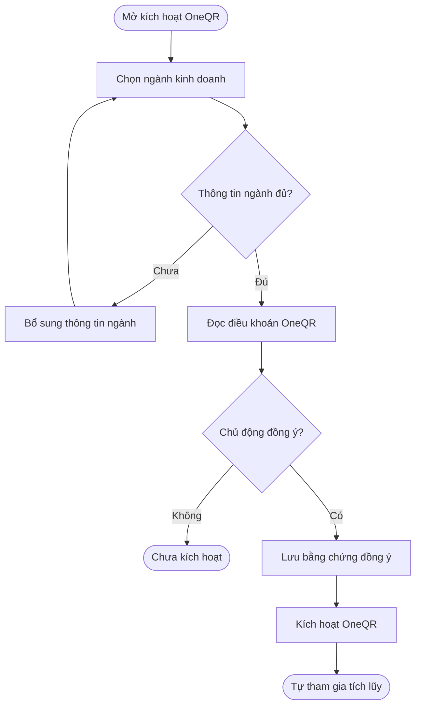
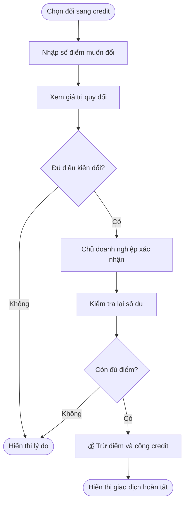
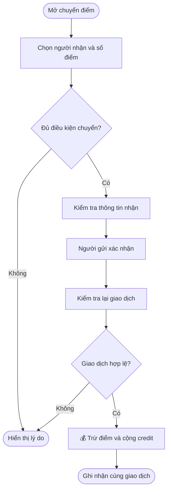
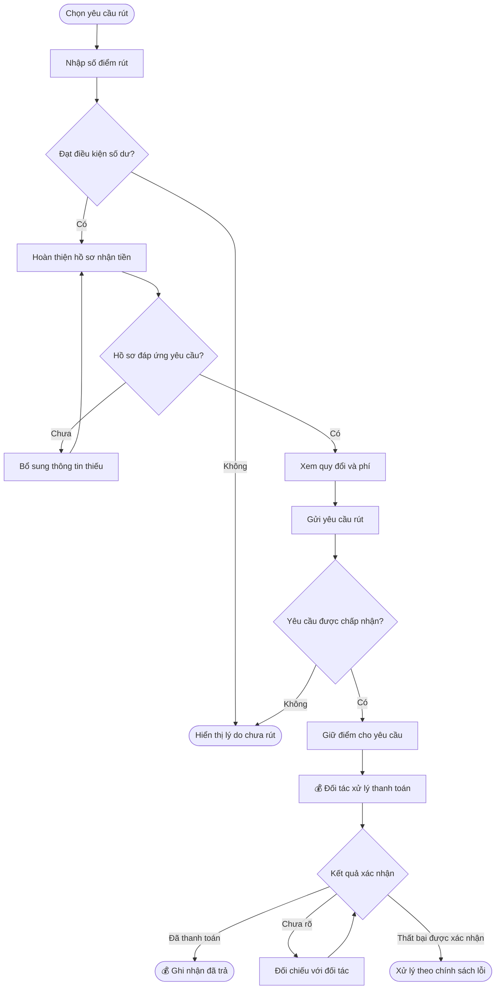
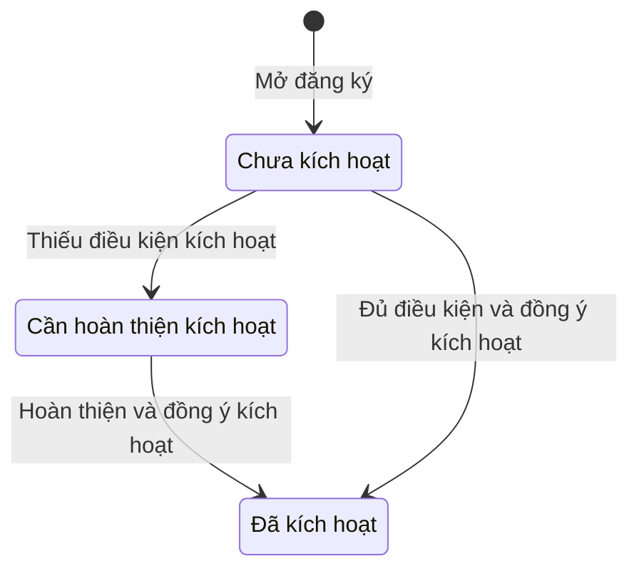
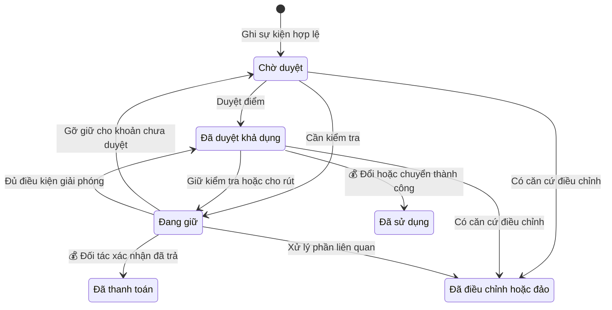
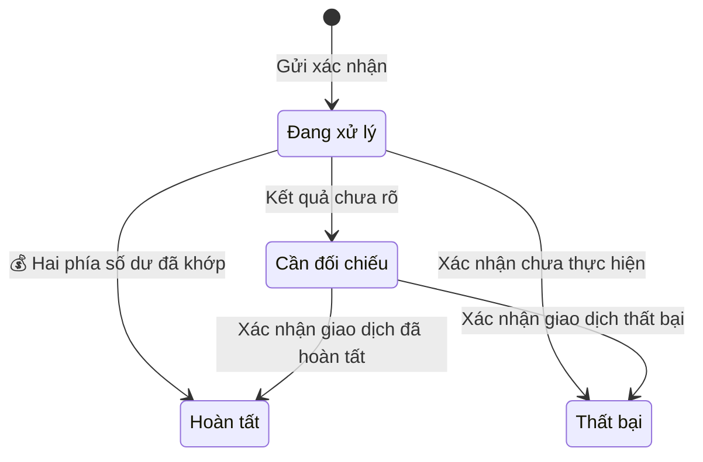
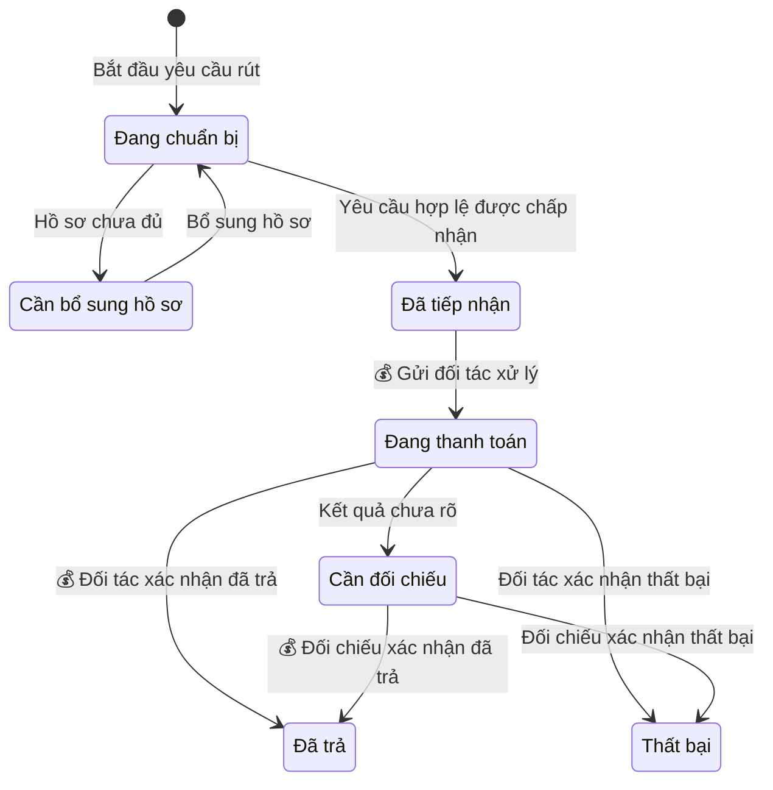

## Business OneQR — Tham gia, tích lũy, đổi điểm và rút tiền

**Cập nhật lần cuối:** 28 tháng 10 năm 2026

**Đối tượng đọc:** Chủ doanh nghiệp (Business Owner), quản trị viên vận hành, người phụ trách sản phẩm, BA, QA, bộ phận hỗ trợ và đội phát triển

**Trạng thái:** Đang rà soát

**Bản chia sẻ:** [Tài liệu trên GitHub](https://github.com/vlink-group/VlinkPay/blob/docs/1599-oneqr-earnings-points/nexora/docs/business/business-oneqr-earnings.md)

**Ticket liên quan:** [#1599](https://github.com/vlink-group/vlink-nexora/issues/1599)

### Tóm tắt nhanh

| Giai đoạn | Kết quả và điều cần phân biệt |
| :--- | :--- |
| Tham gia | Chủ doanh nghiệp chọn ngành và chủ động đồng ý điều khoản để kích hoạt OneQR; doanh nghiệp tự tham gia tích lũy, không có nút bật kiếm tiền riêng. |
| Tích lũy | Hoạt động quảng cáo hợp lệ tạo điểm chờ duyệt; chỉ điểm đã duyệt còn khả dụng mới được dùng. Quét QR hoặc mở danh sách không tự tạo điểm. |
| Đổi hoặc chuyển điểm | Điểm rời ví thu nhập để trở thành credit trong ví sử dụng của mình hoặc người nhận. Credit này không phải tiền đã rút. |
| Yêu cầu rút tiền | Khi đủ ngưỡng, chủ doanh nghiệp mới hoàn thiện thông tin người nhận, thuế, xác minh và phương thức nhận tiền. Chỉ xác nhận đã trả khi đối tác thanh toán xác nhận. |

Tài liệu mô tả **yêu cầu theo bộ PO ngày 27 tháng 10 năm 2026**, chưa phải xác nhận tính năng đã vận hành. Các tỷ lệ quy đổi và ngưỡng áp dụng nằm tại quy tắc D14, D16 và E19.

### Tổng quan

Business OneQR giúp doanh nghiệp tích lũy thu nhập từ hoạt động quảng cáo hợp lệ của khách đến từ OneQR. Hệ thống ghi nhận bằng ONEQR Points, duyệt điểm và cho phép đổi thành credit sử dụng, chuyển cho tài khoản khác hoặc yêu cầu rút tiền. Chủ doanh nghiệp kích hoạt và theo dõi số dư; quản trị viên quản lý ngành, chính sách chiến dịch và điều chỉnh; đối tác thanh toán xử lý yêu cầu rút.

Phạm vi gồm kích hoạt, đồng ý điều khoản, bảo vệ doanh nghiệp cùng ngành, ghi nhận và duyệt điểm, hai số dư ví, đổi điểm, chuyển điểm, yêu cầu rút và lịch sử giao dịch. Chương trình thưởng giới thiệu (referral) và quyền tắt quảng cáo trong gói trả phí tương lai chưa được mở. Nạp credit và sử dụng credit tại từng sản phẩm là nghiệp vụ liên quan; tài liệu này xác định nguồn và giới hạn số dư, không tự đặt danh mục sản phẩm được dùng.

### Khái niệm chính

| Thuật ngữ | Ý nghĩa |
| :--- | :--- |
| Chủ doanh nghiệp | Người có thẩm quyền thao tác trên Business và chấp thuận điều khoản của doanh nghiệp đó. |
| Chủ QR | Doanh nghiệp sở hữu OneQR khởi đầu phiên khám phá của khách. |
| Nhà quảng cáo | Doanh nghiệp có nội dung được xem xét phân phối trong phiên OneQR. |
| ONEQR Points / điểm | Đơn vị ghi nhận thu nhập OneQR; số điểm là số nguyên. Giá trị quy đổi không đồng nghĩa đã có tiền trong tài khoản thanh toán. |
| Điểm chờ duyệt | Điểm đã ghi nhận từ hoạt động cần đối soát; chưa được đổi, chuyển hoặc rút. |
| Điểm khả dụng | Điểm đã duyệt, chưa dùng và không bị giữ cho giao dịch hoặc kiểm tra; đây là số dư được xét khi thao tác. |
| Điểm đang giữ | Phần điểm tạm không khả dụng, chẳng hạn đã dành cho một yêu cầu rút được chấp nhận. Lý do giữ phải được theo dõi riêng. |
| Credit | Giá trị dùng cho sản phẩm, dịch vụ được hỗ trợ trong ví sử dụng; quyền dùng phụ thuộc nguồn credit và chính sách áp dụng. |
| Yêu cầu rút tiền (payout) | Yêu cầu chuyển giá trị điểm đủ điều kiện thành khoản thanh toán qua đối tác; khác với đổi điểm sang credit. |
| Ngành chính và ngành phụ | Các ngành doanh nghiệp thực sự kinh doanh, dùng để xác định nội dung cạnh tranh cần chặn. |

#### Phân biệt hai số dư ví

| Nội dung | Ví thu nhập | Ví sử dụng |
| :--- | :--- | :--- |
| Đơn vị | ONEQR Points. | Credit. |
| Nguồn | Điểm doanh nghiệp tự kiếm từ quảng cáo hợp lệ; nguồn bổ sung chỉ được ghi khi đã có chính sách cho phép. | Credit đổi từ điểm của mình, credit nhận từ người khác và credit đã nạp; từng nguồn được ghi riêng. |
| Mục đích | Theo dõi điểm và dùng phần khả dụng cho các thao tác tại D14–E24. | Theo dõi giá trị sử dụng theo nguồn tại C12–C13. |
| Cách đối chiếu | Xem nguồn sự kiện, trạng thái duyệt, giữ và sử dụng điểm. | Xem nguồn credit và giao dịch đổi, nhận hoặc nạp tương ứng. |

### Vai trò người dùng

| Vai trò | Trách nhiệm |
| :--- | :--- |
| Chủ doanh nghiệp | Chọn ngành, đồng ý và kích hoạt OneQR; xem điểm, đổi hoặc chuyển điểm; hoàn thiện hồ sơ khi yêu cầu rút. |
| Khách sử dụng OneQR | Khám phá nội dung và thực hiện hoạt động có thể đủ điều kiện theo chiến dịch. |
| Người nhận chuyển điểm | Kiểm tra credit nhận trong ví sử dụng và dùng theo chính sách của nguồn này. |
| Quản trị viên vận hành / hỗ trợ | Quản lý danh mục ngành, duyệt phân loại, chính sách điểm, xử lý điều chỉnh và khiếu nại theo quyền. |
| Đối tác thanh toán | Xác định yêu cầu hồ sơ, phương thức nhận tiền và xác nhận kết quả thanh toán. |

### Luồng nghiệp vụ đầu cuối

#### Luồng: Kích hoạt và tự tham gia tích lũy

**Người thực hiện chính:** Chủ doanh nghiệp.

**Điểm bắt đầu:** Chủ doanh nghiệp mở phần kích hoạt OneQR.

**Kết quả:** OneQR được kích hoạt và doanh nghiệp tham gia chương trình theo A1–A5.

**Nhu cầu người dùng:**

- Là chủ doanh nghiệp, tôi muốn chọn ngành và đồng ý điều khoản để bắt đầu dùng OneQR và tích lũy điểm.
- Là chủ doanh nghiệp, tôi muốn dùng lại hồ sơ sẵn có để không nhập lại thông tin đã lưu.
- Là chủ doanh nghiệp chưa đồng ý điều khoản, tôi muốn biết lý do chưa kích hoạt được để tự quyết định việc tham gia.

| Bước | Người thực hiện | Hành động | Phản hồi hệ thống |
| :--- | :--- | :--- | :--- |
| 1 | Chủ doanh nghiệp | Mở phần kích hoạt. | Hệ thống dùng lại hồ sơ và hiển thị ngành đang có, nếu có. |
| 2 | Chủ doanh nghiệp | Chọn ngành chính, các ngành phụ liên quan; mô tả nếu chọn Khác. | Hệ thống kiểm tra thông tin, ghi trạng thái phân loại theo A2–A3. |
| 3 | Chủ doanh nghiệp | Đọc điều khoản và chủ động tích ô đồng ý. | Hệ thống công bố vị trí quảng cáo và việc tự tham gia; ô đồng ý ban đầu chưa được chọn theo A1, A4. |
| 4 | Chủ doanh nghiệp | Chọn Đồng ý & kích hoạt OneQR. | Hệ thống kiểm tra điều kiện, lưu bằng chứng đồng ý và kích hoạt. Nếu còn thiếu, hệ thống nêu phần cần bổ sung. |
| 5 | Hệ thống | Mở trải nghiệm OneQR đã kích hoạt. | Doanh nghiệp tự tham gia tích lũy; việc hiển thị quảng cáo tuân thủ bộ lọc ngành tại B6–B7. |

#### Luồng: Phân phối quảng cáo và ghi nhận điểm

**Người thực hiện chính:** Khách tạo hoạt động; hệ thống lọc nội dung, ghi nhận và duyệt điểm.

**Điểm bắt đầu:** Khách mở phiên từ OneQR của doanh nghiệp.

**Kết quả:** Nội dung được lọc theo ngành; hoạt động đủ điều kiện có lịch sử điểm đúng nguồn, đúng trạng thái.

**Nhu cầu người dùng:**

- Là chủ doanh nghiệp, tôi muốn nội dung của đối thủ cùng ngành được chặn để bảo vệ doanh nghiệp trong phiên OneQR của mình.
- Là chủ doanh nghiệp, tôi muốn biết hoạt động nào tạo điểm và lý do điểm chưa được duyệt hoặc bị điều chỉnh để đối chiếu thu nhập.

| Bước | Người thực hiện | Hành động | Phản hồi hệ thống |
| :--- | :--- | :--- | :--- |
| 1 | Khách / hệ thống | Mở OneQR và chuyển giữa các màn hình khám phá. | Hệ thống giữ nguồn doanh nghiệp chủ QR và ngành đã xác nhận. |
| 2 | Hệ thống | Xem xét nội dung tại Deal Nearby, Search Deals và Khám phá. | Hệ thống loại nội dung cạnh tranh hoặc chưa xác định an toàn; nội dung tài trợ có nhãn theo B6–B7. |
| 3 | Khách | Thực hiện hành động với nội dung được phép hiển thị. | Hệ thống xét điều kiện chiến dịch, nguồn và trùng lặp theo B8. |
| 4 | Hệ thống | Ghi điểm từ sự kiện đủ điều kiện. | Hệ thống tạo một khoản chờ duyệt, lưu căn cứ theo B9. |
| 5 | Hệ thống / vận hành | Đối soát và duyệt hoặc điều chỉnh. | Hệ thống cập nhật điểm khả dụng hoặc lý do chưa được dùng; chủ doanh nghiệp có kênh khiếu nại theo B10. |

#### Luồng: Đổi điểm sang credit của mình

**Người thực hiện chính:** Chủ doanh nghiệp.

**Điểm bắt đầu:** Chủ doanh nghiệp chọn Đổi sang credit trong ví thu nhập.

**Kết quả:** Điểm và credit được cập nhật cùng giao dịch theo D14–D15.

**Nhu cầu người dùng:**

- Là chủ doanh nghiệp, tôi muốn đổi điểm đã duyệt sang credit để sử dụng tại các sản phẩm được hỗ trợ.
- Là chủ doanh nghiệp, tôi muốn biết số điểm sẽ trừ và credit sẽ nhận để kiểm tra trước khi xác nhận.
- Là chủ doanh nghiệp, tôi muốn thao tác lỗi hoặc gửi lại không làm mất điểm hay cộng credit hai lần để số dư luôn khớp.

| Bước | Người thực hiện | Hành động | Phản hồi hệ thống |
| :--- | :--- | :--- | :--- |
| 1 | Chủ doanh nghiệp | Chọn đổi và nhập số điểm. | Hệ thống hiển thị điểm khả dụng và giá trị credit tương ứng. |
| 2 | Hệ thống | Kiểm tra số điểm, số dư và chính sách đổi. | Hệ thống báo phần chưa hợp lệ; chỉ cho tiếp tục khi đủ điều kiện tại D14–D15. |
| 3 | Chủ doanh nghiệp | Kiểm tra và xác nhận. | Hệ thống kiểm tra lại số dư để xử lý cả trường hợp có giao dịch đồng thời. |
| 4 | Hệ thống | 💰 Trừ điểm và cộng credit vào ví sử dụng của chính doanh nghiệp. | Hệ thống hoàn tất hai phía cùng giao dịch, ghi nguồn credit và lịch sử; điểm đã đổi rời số dư khả dụng. |
| 5 | Chủ doanh nghiệp | Xem kết quả. | Hệ thống hiển thị số điểm đã dùng, credit đã nhận, thời gian và mã giao dịch. |

#### Luồng: Chuyển điểm cho tài khoản khác

**Người thực hiện chính:** Chủ doanh nghiệp gửi điểm.

**Điểm bắt đầu:** Người gửi chọn Chuyển điểm.

**Kết quả:** Người gửi dùng điểm thu nhập; người nhận có credit trong ví sử dụng theo D16–D18.

**Nhu cầu người dùng:**

- Là người gửi, tôi muốn kiểm tra đúng tài khoản người nhận và giá trị nhận để tránh chuyển nhầm.
- Là người nhận, tôi muốn thấy credit và nguồn chuyển để hiểu số dư mình có thể sử dụng.
- Là người gửi, tôi muốn biết khi chuyển bị từ chối hoặc chưa rõ kết quả để không gửi lại gây trùng.

| Bước | Người thực hiện | Hành động | Phản hồi hệ thống |
| :--- | :--- | :--- | :--- |
| 1 | Người gửi | Chọn tài khoản nhận và nhập số điểm. | Hệ thống kiểm tra tài khoản nhận, số điểm nguyên, ngưỡng và số dư theo D16. |
| 2 | Người gửi | Xem lại danh tính người nhận và số credit tương ứng. | Hệ thống giải thích quyền sử dụng credit nhận theo C12; yêu cầu xác nhận trước khi gửi. |
| 3 | Người gửi | Xác nhận chuyển. | Hệ thống kiểm tra lại điều kiện và chống xử lý trùng theo D17. |
| 4 | Hệ thống | 💰 Trừ điểm người gửi, cộng credit vào ví sử dụng người nhận. | Hệ thống ghi hai phía cùng giao dịch và liên kết nguồn; không ghi thu nhập quảng cáo cho người nhận. |
| 5 | Người gửi / người nhận | Kiểm tra lịch sử. | Hệ thống hiển thị số lượng, nguồn, thời gian và trạng thái; trường hợp chưa rõ được đối chiếu theo D18. |

#### Luồng: Yêu cầu rút tiền và hoàn thiện hồ sơ nhận tiền

**Người thực hiện chính:** Chủ doanh nghiệp.

**Điểm bắt đầu:** Chủ doanh nghiệp chọn yêu cầu rút từ ví thu nhập.

**Kết quả:** Yêu cầu hợp lệ được tiếp nhận, giữ điểm và theo dõi đến khi đối tác xác nhận kết quả theo E19–E24.

**Nhu cầu người dùng:**

- Là chủ doanh nghiệp đủ ngưỡng, tôi muốn hoàn thiện thông tin nhận tiền ngay trong luồng rút để không phải làm hồ sơ này khi kích hoạt OneQR.
- Là chủ doanh nghiệp, tôi muốn xem điểm sẽ dùng, phí và số tiền thực nhận để kiểm tra trước khi gửi yêu cầu.
- Là chủ doanh nghiệp, tôi muốn biết điểm đang giữ và trạng thái thanh toán để không dùng lại số điểm đã dành cho yêu cầu rút.
- Là chủ doanh nghiệp có thanh toán lỗi hoặc chưa rõ, tôi muốn được đối chiếu đúng giao dịch để không bị trừ điểm hoặc chi trả trùng.

| Bước | Người thực hiện | Hành động | Phản hồi hệ thống |
| :--- | :--- | :--- | :--- |
| 1 | Chủ doanh nghiệp | Mở yêu cầu rút và chọn số điểm. | Hệ thống kiểm tra điểm đã duyệt còn khả dụng, ngưỡng và số điểm yêu cầu theo E19. |
| 2 | Chủ doanh nghiệp | Hoàn thiện hoặc xác nhận lại hồ sơ nhận tiền. | Hệ thống thu hoặc dùng lại thông tin người nhận, thuế, xác minh và phương thức nhận theo E20. Hồ sơ thiếu được chỉ rõ để bổ sung. |
| 3 | Hệ thống | Hiển thị bản xem lại. | Chủ doanh nghiệp thấy số điểm dùng, quy đổi, phí đã được duyệt nếu có, số tiền nhận và phương thức nhận theo E21. |
| 4 | Chủ doanh nghiệp / hệ thống | Gửi và kiểm tra yêu cầu. | Hệ thống chỉ tiếp nhận khi yêu cầu hợp lệ; lúc được chấp nhận mới giữ điểm theo E22. |
| 5 | Hệ thống / đối tác thanh toán | 💰 Xử lý thanh toán. | Hệ thống lưu mã yêu cầu và trạng thái đối tác; số điểm đã giữ không tham gia giao dịch khác. |
| 6 | Đối tác thanh toán / hệ thống | Xác nhận kết quả hoặc đối chiếu phần chưa rõ. | Hệ thống chỉ ghi đã trả khi có xác nhận; xử lý điểm đang giữ theo kết quả và chính sách tại E23–E24. |
| 7 | Chủ doanh nghiệp | Mở chi tiết yêu cầu. | Hệ thống hiển thị lịch sử, số điểm, giá trị, phí, kết quả và hướng xử lý nếu cần. |

### Cấu hình và quản trị

- Là quản trị viên vận hành, tôi muốn quản lý danh mục ngành song ngữ và duyệt các trường hợp Khác để bộ lọc dùng đúng ngành của doanh nghiệp.
- Là quản trị viên vận hành, tôi muốn quản lý điều kiện sự kiện, mức điểm và phiên bản chính sách để mỗi khoản điểm có căn cứ đối chiếu.
- Là người hỗ trợ được phân quyền, tôi muốn tra cứu nguồn điểm, lịch sử đổi, chuyển và rút để giải thích số dư và xử lý khiếu nại.
- Là quản trị viên, tôi muốn quản lý nội dung điều khoản tiếng Việt và tiếng Anh để người dùng chấp thuận đúng phiên bản.

Các cấu hình phải tuân thủ quy tắc F25–F28. Danh sách thông số chưa được cung cấp chỉ nằm trong Phụ lục → Các nội dung cần hoàn thiện trước phát hành.

### Vòng đời trạng thái

Các trạng thái dưới đây mô tả nghiệp vụ, chưa phải tên trạng thái API đã được xác nhận.

#### Trạng thái kích hoạt OneQR

| Trạng thái hiện tại | Sự kiện | Trạng thái mới |
| :--- | :--- | :--- |
| Chưa kích hoạt | Kiểm tra thấy thiếu ngành hoặc chưa đồng ý | Cần hoàn thiện kích hoạt |
| Chưa kích hoạt / Cần hoàn thiện kích hoạt | Đủ thông tin ngành và chủ động đồng ý; kích hoạt thành công | Đã kích hoạt, tự tham gia tích lũy |

Trạng thái phân loại ngành được theo dõi riêng. Ngành đang xét không được coi là căn cứ an toàn để phân phối quảng cáo cạnh tranh; áp dụng B7.

#### Trạng thái điểm

| Trạng thái hiện tại | Sự kiện | Trạng thái mới |
| :--- | :--- | :--- |
| Chưa ghi nhận | Hoạt động quảng cáo đủ điều kiện | Chờ duyệt |
| Chờ duyệt | Đối soát đạt và không bị giữ | Đã duyệt, khả dụng |
| Chờ duyệt / Đã duyệt | Cần kiểm tra khoản điểm liên quan | Đang giữ |
| Đã duyệt, khả dụng | Yêu cầu rút hợp lệ được chấp nhận | Đang giữ cho rút tiền |
| Đã duyệt, khả dụng | Đổi hoặc chuyển thành công | Đã sử dụng |
| Đang giữ | Kết quả cho phép giải phóng theo chính sách | Về trạng thái phù hợp trước khi giữ |
| Đang giữ cho rút tiền | Đối tác xác nhận thanh toán | Đã thanh toán |
| Chờ duyệt / Đã duyệt / Đang giữ | Có căn cứ điều chỉnh hoặc đảo | Đã điều chỉnh / đảo phần liên quan |

Điều chỉnh một phần phải giữ được số còn lại và lịch sử gốc; không chuyển cả khoản thành đã đảo nếu chỉ một phần mất điều kiện. Nếu điểm đã sử dụng hoặc thanh toán, áp dụng B10 và E24; không tự trừ số dư khác.

#### Trạng thái giao dịch đổi hoặc chuyển

| Trạng thái hiện tại | Sự kiện | Trạng thái mới |
| :--- | :--- | :--- |
| Chưa gửi | Người dùng xác nhận và hệ thống kiểm tra | Đang xử lý |
| Đang xử lý | Hai phía số dư được ghi nhận cùng giao dịch | Hoàn tất |
| Đang xử lý | Xác nhận giao dịch không được thực hiện | Thất bại |
| Đang xử lý | Mất phản hồi, chưa biết kết quả | Cần đối chiếu |
| Cần đối chiếu | Xác nhận kết quả giao dịch gốc | Hoàn tất / Thất bại |

#### Trạng thái yêu cầu rút

| Trạng thái hiện tại | Sự kiện | Trạng thái mới |
| :--- | :--- | :--- |
| Đang chuẩn bị | Chưa đủ hồ sơ nhận tiền | Cần bổ sung hồ sơ; chưa giữ điểm |
| Đang chuẩn bị / Cần bổ sung hồ sơ | Yêu cầu hợp lệ được chấp nhận | Đã tiếp nhận; điểm được giữ |
| Đã tiếp nhận | Đối tác bắt đầu xử lý | Đang thanh toán |
| Đang thanh toán / Cần đối chiếu | Đối tác xác nhận đã thanh toán | Đã trả |
| Đang thanh toán | Chưa rõ kết quả | Cần đối chiếu |
| Đang thanh toán / Cần đối chiếu | Đối tác xác nhận thất bại | Thất bại; điểm xử lý theo E24 |

### Quy tắc nghiệp vụ

#### A. Điều kiện tham gia và kích hoạt

- **A1. Quảng cáo và tham gia:** Gói OneQR hiện tại bao gồm quảng cáo tại Deal Nearby, Search Deals và Khám phá. Khi chủ doanh nghiệp đồng ý và kích hoạt, doanh nghiệp tự tham gia chương trình tích lũy; không có nút bật/tắt kiếm tiền riêng. Nếu không đồng ý, doanh nghiệp chưa thể kích hoạt theo gói này. Quyền tắt quảng cáo ở gói trả phí tương lai chưa được cung cấp.
- **A2. Ngành kinh doanh:** Chủ doanh nghiệp phải chọn ngành chính và có thể chọn nhiều ngành phụ thực sự kinh doanh. Nếu chọn Khác, chủ doanh nghiệp nhập mô tả để vận hành phân loại. Hệ thống dùng lại hồ sơ sẵn có; thay đổi ngành phải được xác nhận phân loại và lưu lịch sử.
- **A3. Danh mục ngành:** Vận hành quản lý danh mục có thể mở rộng với tên tiếng Việt và tiếng Anh, bao phủ làm đẹp, ăn uống, y tế, dịch vụ nhà cửa, xe cộ, bán lẻ, dịch vụ chuyên môn, du lịch, sự kiện, giáo dục, gia đình và thú cưng. Hệ thống hiển thị trạng thái phân loại và kênh báo sai cho chủ doanh nghiệp.
- **A4. Đồng ý điều khoản:** Hệ thống hiển thị điều khoản hiện hành và ô đồng ý chưa chọn sẵn, nêu rõ quảng cáo và tự tham gia tích lũy. Khi chủ doanh nghiệp đồng ý, hệ thống lưu doanh nghiệp, tài khoản có thẩm quyền, thời điểm, phiên bản điều khoản và các ngành đã chọn.
- **A5. Hồ sơ nhận tiền chỉ yêu cầu khi rút:** Hệ thống không đặt hồ sơ thuế, xác minh nhận tiền hoặc phương thức nhận tiền làm điều kiện kích hoạt và bắt đầu tích lũy. Các yêu cầu đó được thu hoặc dùng lại trong luồng rút theo E20; không thêm bước xét duyệt kiếm tiền riêng trước khi tham gia.

#### B. Bảo vệ doanh nghiệp và ghi nhận điểm

- **B6. Chặn cùng ngành:** Trong phiên xuất phát từ OneQR của doanh nghiệp, hệ thống loại doanh nghiệp bên thứ ba cùng ngành chính hoặc ngành phụ đã xác nhận khỏi các vị trí Deal Nearby, Search Deals và Khám phá. Quảng cáo trả phí không được vượt bộ lọc. Hệ thống giữ nguồn chủ QR khi khách chuyển màn hình và gắn nhãn nội dung tài trợ.
- **B7. Phân loại chưa chắc chắn:** Khi thiếu ngành, ngành đang xét hoặc chưa xác định được nội dung có cạnh tranh hay không, hệ thống tạm không hiển thị nội dung bên thứ ba chưa được xác định an toàn trong phiên đó. Vận hành quản lý quan hệ giữa các ngành, lưu quyết định lọc và xử lý báo sai; thay đổi danh mục không được âm thầm làm sai phân loại đã có.
- **B8. Sự kiện tạo điểm:** Hệ thống chỉ ghi điểm cho hành động hợp lệ theo chính sách chiến dịch, có nguồn và vượt kiểm tra trùng lặp. Quét QR, mở danh sách hoặc một lượt hiển thị riêng lẻ không tự tạo điểm. Hệ thống chưa cộng điểm giới thiệu hoặc cấp quyền đổi, chuyển, rút cho nguồn này khi chương trình chưa được xác định và phê duyệt.
- **B9. Sổ điểm và duyệt:** Hệ thống ghi điểm nguyên vào trạng thái chờ duyệt, sau đó xét theo chính sách chiến dịch. Lịch sử phải truy được nguồn chương trình, mã sự kiện, doanh nghiệp, thời điểm, phiên bản mức điểm hoặc chính sách, số điểm và trạng thái. Sự kiện gửi lại không tạo khoản điểm mới.
- **B10. Điều chỉnh và khiếu nại:** Hệ thống lưu lý do khi từ chối, giữ, điều chỉnh hoặc đảo điểm do trùng lặp, gian lận, hoàn tiền hay sai sót. Hệ thống dùng giao dịch điều chỉnh liên kết, giữ lịch sử gốc và cung cấp kênh khiếu nại. Cách thu hồi khi điểm đã dùng phải được xác định theo chính sách; không tự trừ số dư không liên quan.

#### C. Nguồn và quyền sử dụng số dư

- **C11. Ví thu nhập:** Hệ thống chỉ cộng điểm doanh nghiệp tự kiếm từ quảng cáo đủ điều kiện và các nguồn bổ sung đã được bật theo chính sách riêng. Chỉ phần đã duyệt còn khả dụng được dùng; điểm chờ duyệt, đang giữ, đã dùng hoặc đã thanh toán không tham gia số dư thao tác.
- **C12. Credit nhận từ người khác:** Hệ thống cộng vào ví sử dụng và ghi riêng nguồn nhận. Trong giai đoạn đầu, người nhận chỉ được sử dụng credit này, không được rút tiền hoặc chuyển tiếp. Credit nhận không vào ví thu nhập và không được tính là điểm tự kiếm.
- **C13. Các nguồn credit còn lại:** Hệ thống ghi riêng credit đổi từ điểm của mình và credit đã nạp. Credit đã đổi không quay lại số dư đủ điều kiện rút; quyền của credit đã nạp theo chính sách nạp tương ứng. Hệ thống không gộp các nguồn để mở rộng quyền rút hoặc chuyển.

#### D. Đổi và chuyển điểm

- **D14. 💰 Quy đổi:** Hệ thống áp dụng **100 ONEQR Points = 1 credit = $1 giá trị quy đổi hoặc sử dụng**. Khi doanh nghiệp đổi điểm, hệ thống trừ điểm khả dụng và cộng credit vào ví sử dụng của chính doanh nghiệp cùng một giao dịch; không hoàn tất chỉ một phía. Hệ thống không tự áp mức tối thiểu chuyển điểm cho thao tác đổi.
- **D15. Điều kiện mở đổi:** Trước khi mở thao tác đổi và sử dụng credit, vận hành phải xác định sản phẩm được hỗ trợ, độ chính xác credit, cách xử lý phần lẻ và chính sách hoàn hoặc đổi ngược. Hệ thống không tự coi giới hạn nhập của bản mô phỏng là quy tắc sản phẩm. Khi đã đổi thành công, phần điểm đó không còn được rút.
- **D16. Ngưỡng chuyển:** Người gửi phải chọn tài khoản nhận đủ điều kiện và nhập ít nhất **1.000 điểm nguyên đã duyệt còn khả dụng** mỗi lần, tương đương $10. Hệ thống từ chối số dư thiếu, số điểm dưới ngưỡng hoặc tài khoản nhận không hợp lệ.
- **D17. 💰 Ghi nhận chuyển:** Trước xác nhận, hệ thống cho người gửi kiểm tra danh tính người nhận và số credit tương ứng. Khi thành công, hệ thống đồng thời trừ điểm ví thu nhập người gửi và cộng credit ví sử dụng người nhận theo D14. Hệ thống lưu hai bên, số lượng, nguồn, thời điểm, trạng thái và mã chống xử lý trùng; một yêu cầu không được ghi nhận hai lần.
- **D18. Chuyển lỗi hoặc tranh chấp:** Hệ thống hiển thị kết quả rõ ràng và đối chiếu yêu cầu gốc nếu chưa biết kết quả. Trước phát hành, vận hành phải có cách xử lý chuyển nhầm, tranh chấp và đảo giao dịch. Hệ thống không tự lấy tiền không liên quan để bù hoặc mặc định chuyển lại khi chưa xác định kết quả.

#### E. Yêu cầu rút tiền

- **E19. Ngưỡng và nguồn rút:** Chủ doanh nghiệp chỉ được bắt đầu yêu cầu rút khi có từ **10.000 điểm đã duyệt, chưa dùng và còn khả dụng, tương đương $100**. Số điểm yêu cầu phải đạt ngưỡng và không vượt phần khả dụng. Credit trong ví sử dụng không được tính vào ngưỡng, kể cả credit nhận từ người khác.
- **E20. Hồ sơ tại bước rút:** Khi chủ doanh nghiệp yêu cầu rút, hệ thống thu hoặc dùng lại thông tin người nhận, mã số thuế, mẫu thuế phù hợp, thông tin xác minh và phương thức nhận tiền theo yêu cầu. Dữ liệu cụ thể và thời điểm kiểm tra trong luồng rút phụ thuộc đối tác thanh toán và yêu cầu áp dụng. Hệ thống không bắt làm lại thông tin còn giá trị và bảo vệ dữ liệu nhạy cảm theo F27.
- **E21. Xem trước:** Trước xác nhận, hệ thống hiển thị số điểm sẽ dùng, giá trị quy đổi, phí đã được duyệt nếu có, số tiền nhận và phương thức nhận. Hệ thống không tự đặt phí, loại tiền, tỷ lệ chia hoặc cam kết thời gian nhận tiền chưa có chính sách.
- **E22. Giữ điểm đúng lúc:** Hệ thống chỉ giữ điểm khi yêu cầu hợp lệ được chấp nhận; việc mở màn hình hoặc bổ sung hồ sơ chưa làm giữ điểm. Sau khi giữ, cùng số điểm không được đổi, chuyển hoặc dùng cho yêu cầu rút khác. Hệ thống kiểm tra lại số dư tại thời điểm chấp nhận.
- **E23. 💰 Xác nhận thanh toán:** Hệ thống chỉ hiển thị đã trả khi đối tác thanh toán xác nhận. Hệ thống lưu mã yêu cầu, mã tham chiếu, trạng thái đối tác, số điểm, giá trị, phí và lịch sử xử lý. Timeout hoặc chưa có phản hồi là kết quả cần đối chiếu, chưa phải bằng chứng thanh toán thất bại.
- **E24. Lỗi và đảo sau rút:** Hệ thống hoàn tất hoặc giải phóng điểm đang giữ theo kết quả cuối cùng và chính sách lỗi, đảo đã được phê duyệt. Hệ thống không vừa trả tiền vừa hoàn điểm cho cùng nghĩa vụ, không chi trùng khi nhận phản hồi lặp và không tự thu hồi từ khoản tiền không liên quan. Trường hợp thanh toán từng phần cần chính sách xử lý trước khi hỗ trợ.

#### F. Quản trị, điều khoản và ngôn ngữ

- **F25. Chính sách và quyền:** Chỉ người được phân quyền mới được quản lý ngành, mức điểm, quyền của từng nguồn, điều chỉnh và điều khoản. Hệ thống lưu người sửa, thời điểm, nội dung trước/sau và phiên bản áp dụng; thay đổi chính sách không được ghi đè lịch sử giao dịch.
- **F26. Chống dùng trùng:** Hệ thống kiểm soát các thao tác đổi, chuyển và rút đồng thời trên cùng điểm. Mỗi giao dịch có mã nhận diện; lần gửi lại hoặc kiểm tra trạng thái không làm trừ điểm, cộng credit, giữ điểm hay thanh toán thêm lần nữa.
- **F27. Dữ liệu và điều khoản:** Chủ doanh nghiệp chỉ thao tác dữ liệu thuộc quyền. Hệ thống giới hạn quyền truy cập dữ liệu thuế và danh tính. Điều khoản kích hoạt phải bao phủ quảng cáo, ngành, điểm, quy đổi, chuyển, ví sử dụng, rút, điều chỉnh, khiếu nại, thay đổi chính sách, đóng tài khoản và số dư còn lại; hoàn thiện câu chữ áp dụng trước phát hành.
- **F28. Ngôn ngữ:** Hệ thống cung cấp đầy đủ tiếng Việt và tiếng Anh đã được rà soát cho các luồng, lỗi và thay đổi chính sách. Ngôn ngữ khác có thể dùng Google Dịch tùy chọn, được ghi rõ là dịch tự động. Khi dịch vụ dịch không hoạt động, hai ngôn ngữ chính vẫn dùng được; điều khoản cuối cùng phải xác định ngôn ngữ có giá trị áp dụng.

### Ví dụ

Các phép quy đổi và ngưỡng dưới đây áp dụng quy tắc đã chốt; số dư và số điểm thao tác là tình huống minh họa độc lập.

| Tình huống | Kết quả |
| :--- | :--- |
| Doanh nghiệp đã chọn ngành chính, chủ động đồng ý điều khoản nhưng chưa có hồ sơ nhận tiền | Doanh nghiệp có thể kích hoạt và tham gia tích lũy theo A1–A5; hồ sơ nhận tiền được yêu cầu khi rút theo E20. |
| Có 2.000 điểm khả dụng, đổi 1.000 điểm | 💰 Ví thu nhập còn 1.000 điểm; ví sử dụng của mình tăng 10 credit, tương đương $10. |
| Có 2.000 điểm khả dụng, chuyển 1.000 điểm cho tài khoản hợp lệ | 💰 Người gửi còn 1.000 điểm; người nhận có thêm 10 credit trong ví sử dụng. |
| Người gửi nhập 999 điểm | Hệ thống từ chối do chưa đạt D16; hai phía không thay đổi số dư. |
| Có 9.999 điểm khả dụng và 300 credit nhận từ người khác | Chủ doanh nghiệp chưa đạt E19; credit nhận không bù vào ngưỡng rút. |
| Có 10.000 điểm khả dụng, bắt đầu rút nhưng hồ sơ nhận tiền còn thiếu | Chủ doanh nghiệp được bắt đầu hoàn thiện hồ sơ; hệ thống chưa giữ điểm trước khi yêu cầu hợp lệ được chấp nhận. |
| Có 12.000 điểm khả dụng, yêu cầu rút 10.000 điểm được chấp nhận | Hệ thống giữ 10.000 điểm, tương đương $100 trước phí nếu có; còn 2.000 điểm khả dụng. Chưa ghi đã trả khi thiếu xác nhận đối tác. |
| Có 12.000 điểm khả dụng; yêu cầu rút 10.000 điểm vừa được chấp nhận, đồng thời gửi lệnh đổi 3.000 điểm | Lệnh đổi bị từ chối vì chỉ còn 2.000 điểm khả dụng; hệ thống không dùng lại phần đang giữ. |

### Tiêu chí nghiệm thu

#### Kích hoạt và ngành

- [ ] Hệ thống chặn kích hoạt khi thiếu ngành chính theo A2.
- [ ] Hệ thống chặn kích hoạt khi chủ doanh nghiệp chưa chủ động đồng ý theo A4.
- [ ] Hệ thống lưu đúng người, doanh nghiệp và phiên bản đồng ý theo A4.
- [ ] Kích hoạt thành công tự đưa doanh nghiệp vào chương trình theo A1.
- [ ] Hệ thống không yêu cầu hồ sơ nhận tiền trước khi tham gia theo A5.
- [ ] Hệ thống chặn nội dung cạnh tranh, kể cả trả phí, theo B6.
- [ ] Hệ thống giữ lại nội dung chưa xác định an toàn theo B7.

#### Điểm và số dư

- [ ] Sự kiện hợp lệ tạo đúng một khoản chờ duyệt theo B8–B9.
- [ ] Quét QR hoặc mở danh sách riêng lẻ không tạo điểm theo B8.
- [ ] Nguồn giới thiệu chưa được phê duyệt không tạo điểm theo B8.
- [ ] Chủ doanh nghiệp xem được căn cứ và lý do điều chỉnh theo B9–B10.
- [ ] Hệ thống chỉ cho thao tác trên điểm khả dụng theo C11.
- [ ] Các nguồn credit được ghi riêng theo C12–C13.
- [ ] Credit nhận không được rút hoặc chuyển tiếp theo C12.

#### Đổi và chuyển

- [ ] Đổi điểm cho kết quả đúng tỷ lệ tại D14.
- [ ] Giao dịch đổi cập nhật đủ hai phía theo D14.
- [ ] Hệ thống không tự áp giới hạn của prototype theo D15.
- [ ] Số điểm chuyển dưới ngưỡng bị từ chối theo D16.
- [ ] Người gửi được kiểm tra đúng người nhận trước xác nhận theo D17.
- [ ] Giao dịch chuyển cộng credit đúng ví sử dụng người nhận theo D17.
- [ ] Kết quả chưa rõ được đối chiếu theo D18.

#### Rút tiền

- [ ] Hệ thống kiểm tra ngưỡng và nguồn điểm theo E19.
- [ ] Hồ sơ nhận tiền được thu hoặc dùng lại tại luồng rút theo E20.
- [ ] Hồ sơ thiếu có chỉ dẫn bổ sung rõ ràng.
- [ ] Chủ doanh nghiệp xem được bản quy đổi và phí theo E21.
- [ ] Hệ thống chỉ giữ điểm sau khi chấp nhận yêu cầu hợp lệ theo E22.
- [ ] Kết quả đã trả có xác nhận đối tác theo E23.
- [ ] Điểm của yêu cầu lỗi được xử lý theo chính sách tại E24.

#### Quản trị và giao diện

- [ ] Các thao tác đồng thời không dùng cùng điểm hai lần theo F26.
- [ ] Phản hồi hoặc yêu cầu lặp không làm thay đổi số dư thêm lần nữa theo F26.
- [ ] Dữ liệu thuế và danh tính chỉ hiển thị cho người có quyền theo F27.
- [ ] Tiếng Việt và tiếng Anh thể hiện cùng quy tắc theo F28.
- [ ] Dịch tự động lỗi không làm gián đoạn hai ngôn ngữ chính theo F28.
- [ ] Giao diện trên điện thoại và máy tính có trạng thái đang tải, chưa có dữ liệu và lỗi kết nối rõ ràng.

### Tình huống ngoại lệ và cách xử lý

| Tình huống | Cách xử lý | Bên xử lý |
| :--- | :--- | :--- |
| Chủ doanh nghiệp chưa đồng ý điều khoản | Hệ thống giữ trạng thái chưa kích hoạt theo A1, A4. | Chủ doanh nghiệp |
| Ngành Khác hoặc phân loại đang xét | Vận hành duyệt ngành; hệ thống chỉ phân phối nội dung đã xác định an toàn theo B7. | Vận hành |
| Sự kiện trùng hoặc bị loại sau kiểm tra | Hệ thống giữ lịch sử và lý do theo B9–B10. | Hệ thống / vận hành |
| Điểm không đủ khi xác nhận đổi hoặc chuyển | Hệ thống từ chối thao tác và cập nhật số dư hiển thị theo C11, F26. | Hệ thống |
| Người nhận không hợp lệ | Hệ thống yêu cầu chọn lại theo D16. | Người gửi |
| Chuyển nhầm hoặc có tranh chấp | Hỗ trợ tiếp nhận, đối chiếu theo D18; không tự lấy số dư khác để bù. | Hỗ trợ / vận hành |
| Chủ doanh nghiệp đủ ngưỡng nhưng thiếu hồ sơ nhận tiền | Hệ thống hướng dẫn bổ sung theo E20, chưa giữ điểm theo E22. | Chủ doanh nghiệp / đối tác thanh toán |
| Mất phản hồi của giao dịch | Hệ thống tra cứu giao dịch gốc theo D18 hoặc E23 trước khi xử lý tiếp. | Hệ thống / đối tác |
| Thanh toán thất bại hoặc bị đảo | Hệ thống áp chính sách tại E24 và giữ lịch sử liên kết. | Vận hành / đối tác thanh toán |
| Đóng tài khoản còn số dư hoặc giao dịch chưa xong | Vận hành xử lý theo điều khoản đã công bố tại F27; không tự coi số dư đã hết quyền. | Vận hành |
| Google Dịch không hoạt động | Hệ thống duy trì hai ngôn ngữ chính theo F28. | Hệ thống |

### Câu hỏi thường gặp

**Có phải làm hồ sơ thuế và xác minh nhận tiền trước khi tham gia không?**

Không. Doanh nghiệp tham gia qua bước kích hoạt tại A1–A5; hồ sơ nhận tiền chỉ được yêu cầu trong luồng rút tại E20.

**Có cần bật kiếm tiền riêng sau khi kích hoạt OneQR không?**

Không. Gói hiện tại tự đưa doanh nghiệp vào chương trình theo A1.

**Đổi điểm và chuyển điểm khác nhau ở đâu?**

Đổi điểm đưa credit vào ví sử dụng của mình; chuyển điểm đưa credit vào ví sử dụng của người nhận. Cách ghi nhận nằm tại D14 và D17.

**Credit người khác gửi có được rút hoặc chuyển tiếp không?**

Không trong giai đoạn đầu; quyền của nguồn này nằm tại C12.

**Đạt ngưỡng rút là tiền đã được trả chưa?**

Chưa. Chủ doanh nghiệp cần hoàn thiện luồng yêu cầu rút; hệ thống xác nhận kết quả theo E20–E24.

### Tính năng liên quan

| Tính năng | Mối liên hệ với tài liệu này |
| :--- | :--- |
| [Promotion và quảng cáo](https://github.com/vlink-group/VlinkPay/blob/main/nexora/docs/business/promotion-publishing-ads.md) | Cung cấp chiến dịch và hoạt động làm căn cứ xét điểm. Nội dung cũ về chia tiền cần được đối chiếu với chính sách điểm trong bản này trước khi tích hợp. |
| [Ads Credit](https://github.com/vlink-group/VlinkPay/blob/main/nexora/docs/business/merchant-ads-credit.md) | Là nghiệp vụ nạp và sử dụng ngân sách quảng cáo; không tự đồng nhất số dư cũ với hai ví OneQR khi chưa có chính sách tích hợp. |
| [Sponsor Override](https://github.com/vlink-group/VlinkPay/blob/main/nexora/docs/business/oneqr-sponsor-override.md) | Là chính sách thu nhập theo quan hệ giới thiệu riêng; không tự chuyển thành nguồn điểm giới thiệu hoặc quyền rút trong bản này. |
| OneQR và Discovery | Giữ nguồn chủ QR và áp bộ lọc ngành trong phiên khám phá. Chưa có tài liệu kèm theo được chọn làm nguồn cho thay đổi lần này. |
| Xác minh và đối tác thanh toán | Cung cấp hồ sơ, điều kiện nhận tiền và kết quả khi rút. Chưa có tài liệu tích hợp kèm theo trong bộ PO mới. |

### Phụ lục

#### Các nội dung cần hoàn thiện trước phát hành

Quyết định sản phẩm tại A1–F28 đã được chốt theo bộ PO. Các chi tiết dưới đây chưa được cung cấp; chức năng phụ thuộc chỉ được mở sau khi có chính sách và cấu hình tương ứng.

| Nội dung | Cần hoàn thiện | Phụ trách |
| :--- | :--- | :--- |
| Tạo và duyệt điểm | Điều kiện, mức điểm từng sự kiện, lịch đối soát và thời điểm duyệt. | PO / vận hành |
| Nguồn giới thiệu | Mức thưởng, điều kiện, thời gian duyệt và quyền đổi, chuyển, rút; hiện chưa bật nguồn này. | PO |
| Đổi và sử dụng credit | Sản phẩm được dùng, độ chính xác credit, phần lẻ, điều kiện hoàn và đổi ngược. Không áp giới hạn bội số từ prototype thành mặc định. | PO / vận hành |
| Chuyển điểm | Đối tượng nhận đủ điều kiện, giới hạn ngoài mức tối thiểu đã chốt, xử lý chuyển nhầm, tranh chấp và đảo. | PO / vận hành / đối tác |
| Rút tiền | Đối tác, phương thức và loại tiền nhận, phí, lịch xử lý, dữ liệu và thời điểm kiểm tra hồ sơ trong luồng rút. | PO / đối tác thanh toán |
| Lỗi và điều chỉnh | Khi nào giải phóng điểm, cách xử lý thanh toán từng phần, thu hồi khi điểm đã dùng hoặc đã rút và bảo đảm không xử lý trùng. | PO / vận hành / đối tác |
| Điều khoản cuối cùng | Câu chữ áp dụng, thay đổi chính sách, ngôn ngữ có giá trị áp dụng, đóng tài khoản và số dư còn lại. | PO / bộ phận phụ trách điều khoản |
| Dữ liệu cũ | Nếu đã có số dư hoặc nghĩa vụ theo chính sách cũ, cần phương án chuyển đổi và đối chiếu trước khi áp dụng mô hình điểm. | PO / vận hành / đội phát triển |

#### Nguồn PO và thứ tự áp dụng

| Nguồn | Vai trò |
| :--- | :--- |
| [Yêu cầu phát triển song ngữ ngày 27/10](references/oneqr-points/NEXORA_ONEQR_Dev_Requirements_EN_VI.docx) | Nguồn chính cho quy tắc sản phẩm; phần Việt và Anh mô tả cùng hành vi. |
| [Yêu cầu phát triển tiếng Anh ngày 27/10](references/oneqr-points/NEXORA_ONEQR_Developer_Requirements.docx) | Bản tiếng Anh dùng đối chiếu thuật ngữ và yêu cầu triển khai. |
| [Chính sách và ví — prototype](references/oneqr-points/NEXORA_ONEQR_Chinh_sach_Va_Vi.html) | Minh họa vị trí, điều khoản, hai ví và thao tác; số dư mẫu, giới hạn nhập và giao dịch mô phỏng không chứng minh chức năng đã triển khai. |

Các nguồn trên được cung cấp trong bộ PO `quang-cao`. Khi prototype và tài liệu yêu cầu khác nhau về độ chi tiết, dùng tài liệu yêu cầu làm căn cứ hành vi. Bản cập nhật này áp dụng đồng bộ bộ PO ngày 27 tháng 10; hồ sơ nhận tiền được yêu cầu tại bước rút theo A5 và E20.

Bản này thay mô hình bật/tắt kiếm tiền riêng và ghi nhận tiền trực tiếp của tài liệu cũ bằng kích hoạt kèm tham gia và hai số dư điểm/credit. Ngưỡng chi $25 theo kỳ thứ Ba không còn áp dụng; dùng yêu cầu rút tại E19. Không lấy thời gian đối soát 14 ngày, tỷ lệ chia tiền, dự phòng hoặc phân bổ loại tiền của bản cũ làm cấu hình mặc định cho mô hình mới khi bộ PO mới chưa xác nhận các thông số đó. Tài liệu liên quan giữ vai trò tham chiếu, không ghi đè quy tắc mới tại đây.

#### Tham chiếu mã nguồn và giới hạn xác minh

Đối chiếu chỉ đọc ngày 28 tháng 10 năm 2026 trên các nhánh `origin/staging` sẵn có tại máy, không fetch lại remote trong lần cập nhật tài liệu này:

| Nguồn | Revision và nội dung đã đọc |
| :--- | :--- |
| Frontend | [`0ff77bcd`](https://github.com/vlink-group/vlink-nexora-fe/commit/0ff77bcd2c0286d67ce3ca00e74c364ec97ef6af): đã đọc cấu hình OneQR và điểm tích hợp hồ sơ/KYB/ví. |
| Backend | [`86c3f94c`](https://github.com/vlink-group/vlink-nexora/commit/86c3f94c7d2ccf660761867b34153a04c6afe88e): tìm trong phần chức năng ứng dụng và API contract để đối chiếu các tên của ví điểm OneQR. |

Chưa tìm thấy các tên ví điểm/kiếm tiền OneQR trong phạm vi tìm kiếm trên; kết quả này không thay cho kiểm thử toàn bộ hệ thống. Chưa kiểm thử API hoặc giao dịch thật cho mô hình mới. Các luồng và trạng thái trong tài liệu là yêu cầu từ PO, không phải cam kết chức năng đã có trên staging.

Thuật ngữ đã được đối chiếu với glossary của workspace. ONEQR Points và credit sử dụng ở đây theo bộ PO mới; chưa có căn cứ đồng nhất chúng với token hoặc VPC Credit của VlinkPay.
