## OneQR — Tham gia, tích lũy, đổi điểm và rút tiền

**Cập nhật lần cuối:** 28 tháng 10 năm 2026

**Đối tượng đọc:** Người dùng cá nhân (Personal), chủ doanh nghiệp (Business Owner), quản trị viên vận hành, người phụ trách sản phẩm, BA, QA, bộ phận hỗ trợ và đội phát triển

**Trạng thái:** Đang rà soát

**Bản chia sẻ:** [Tài liệu trên GitHub](https://github.com/vlink-group/VlinkPay/blob/docs/1599-oneqr-earnings-points/nexora/docs/business/business-oneqr-earnings.md)

**Ticket liên quan:** [#1599](https://github.com/vlink-group/vlink-nexora/issues/1599)

### Tóm tắt nhanh

| Giai đoạn | Kết quả và điều cần phân biệt |
| :--- | :--- |
| Tham gia | Cá nhân và doanh nghiệp trên Nexora đều được dùng OneQR và tham gia quảng cáo. Chủ tài khoản chọn ngành, đồng ý điều khoản và kích hoạt theo A1–A5. |
| Tích lũy | Hoạt động quảng cáo hợp lệ tạo điểm chờ duyệt; chỉ điểm đã duyệt còn khả dụng mới được dùng. Quét QR hoặc mở danh sách không tự tạo điểm. |
| Đổi hoặc chuyển điểm | Điểm rời ví thu nhập để trở thành credit trong ví sử dụng của mình hoặc người nhận. Credit này không phải tiền đã rút. |
| Yêu cầu rút tiền | Khi đủ ngưỡng OneQR, chủ tài khoản hoàn thiện hoặc dùng lại hồ sơ cá nhân/doanh nghiệp bên VlinkPay. Chỉ ghi đã trả khi VlinkPay xác nhận kết quả. |

Tài liệu ưu tiên **bộ PO ngày 27 tháng 10 năm 2026** và bổ sung phạm vi cá nhân/doanh nghiệp ngày 28 tháng 10. Phần bộ mới chưa đề cập được kế thừa từ nguồn cũ tương thích tại G29–G43. Đây là yêu cầu triển khai, chưa phải xác nhận tính năng đã vận hành.

### Tổng quan

OneQR giúp cá nhân và doanh nghiệp trên Nexora sử dụng QR của mình để phân phối nội dung và tích lũy thu nhập từ hoạt động quảng cáo hợp lệ. Hai loại tài khoản đều được dùng OneQR, tham gia hiển thị quảng cáo và đăng nội dung quảng cáo theo chính sách của kênh. Nexora ghi nhận ONEQR Points, duyệt điểm, quản lý đổi/chuyển và yêu cầu rút; VlinkPay xử lý rút tiền. Chủ tài khoản quản lý nội dung và số dư; vận hành quản lý ngành, chính sách và điều chỉnh.

Phạm vi áp dụng cho cả tài khoản cá nhân (Personal) và doanh nghiệp (Business) của Nexora, gồm quản lý OneQR, đồng ý điều khoản, quảng cáo, bảo vệ chủ QR theo ngành, ghi nhận và duyệt điểm, hai số dư ví, đổi/chuyển, rút tiền qua VlinkPay và lịch sử giao dịch. Chương trình thưởng giới thiệu (referral) và quyền tắt quảng cáo trong gói trả phí tương lai chưa được mở. Nạp credit và sử dụng credit tại từng sản phẩm là nghiệp vụ liên quan; tài liệu này xác định nguồn và giới hạn số dư, không tự đặt danh mục sản phẩm được dùng.

### Khái niệm chính

| Thuật ngữ | Ý nghĩa |
| :--- | :--- |
| Tài khoản tham gia | Tài khoản cá nhân (Personal) hoặc doanh nghiệp (Business) trên Nexora sở hữu OneQR và số dư tương ứng. |
| Chủ tài khoản | Cá nhân thao tác trên tài khoản Personal của mình hoặc người có thẩm quyền thao tác trên tài khoản Business của Nexora. |
| Chủ QR | Cá nhân hoặc doanh nghiệp sở hữu OneQR khởi đầu phiên khám phá của khách. |
| Nhà quảng cáo | Cá nhân hoặc doanh nghiệp đăng và quản lý nội dung để phân phối theo chính sách quảng cáo. Vai trò này khác chủ QR nhận điểm từ hoạt động quảng cáo của khách. |
| ONEQR Points / điểm | Đơn vị ghi nhận thu nhập OneQR; số điểm là số nguyên. Giá trị quy đổi không đồng nghĩa đã có tiền trong tài khoản thanh toán. |
| Điểm chờ duyệt | Điểm đã ghi nhận từ hoạt động cần đối soát; chưa được đổi, chuyển hoặc rút. |
| Điểm khả dụng | Điểm đã duyệt, chưa dùng và không bị giữ cho giao dịch hoặc kiểm tra; đây là số dư được xét khi thao tác. |
| Điểm đang giữ | Phần điểm tạm không khả dụng, chẳng hạn đã dành cho một yêu cầu rút được chấp nhận. Lý do giữ phải được theo dõi riêng. |
| Credit | Giá trị dùng cho sản phẩm, dịch vụ được hỗ trợ trong ví sử dụng; quyền dùng phụ thuộc nguồn credit và chính sách áp dụng. |
| Yêu cầu rút tiền (payout) | Yêu cầu chuyển giá trị điểm đủ điều kiện thành khoản thanh toán qua VlinkPay; khác với đổi điểm sang credit. |
| Hồ sơ nhận tiền VlinkPay | Hồ sơ của người hưởng cá nhân hoặc doanh nghiệp, gồm chứng từ thuế/danh tính và đích nhận tiền cần được duyệt theo E20. |
| Ngành chính và ngành phụ | Ngành hoặc lĩnh vực hoạt động của chủ QR, dùng để xác định nội dung cạnh tranh cần chặn. |
| Nguồn sự kiện | Chủ QR và hành trình đã được hệ thống xác minh cho hoạt động đang xét điểm; khác mã giới thiệu tài khoản đầu tiên. |
| Nguồn giao dịch dịch vụ | Nguồn được chọn và khóa cho một lịch hẹn hoặc đơn hàng; theo dõi riêng với nguồn của lượt bấm mới. |

#### Phân biệt hai số dư ví

| Nội dung | Ví thu nhập | Ví sử dụng |
| :--- | :--- | :--- |
| Đơn vị | ONEQR Points. | Credit. |
| Nguồn | Điểm tài khoản tự kiếm từ quảng cáo hợp lệ; nguồn bổ sung chỉ được ghi khi đã có chính sách cho phép. | Credit đổi từ điểm của mình, credit nhận từ người khác và credit đã nạp; từng nguồn được ghi riêng. |
| Mục đích | Theo dõi điểm và dùng phần khả dụng cho các thao tác tại D14–E24. | Theo dõi giá trị sử dụng theo nguồn tại C12–C13. |
| Cách đối chiếu | Xem nguồn sự kiện, trạng thái duyệt, giữ và sử dụng điểm. | Xem nguồn credit và giao dịch đổi, nhận hoặc nạp tương ứng. |

ONEQR Points là điểm thu nhập quảng cáo. Điểm Loyalty của khách, Referral Rewards tại POS, credit SMS, tiền tip và lương thợ thuộc các nghiệp vụ riêng.

### Vai trò người dùng

| Vai trò | Trách nhiệm |
| :--- | :--- |
| Chủ tài khoản Personal / Business | Quản lý OneQR của tài khoản Nexora; chọn ngành, đồng ý và kích hoạt; xem điểm, đổi/chuyển và yêu cầu rút. |
| Nhà quảng cáo Personal / Business | Đăng, quản lý nội dung và ngân sách nếu kênh áp dụng thu phí; theo dõi kết quả theo A1, G32, G39–G40. |
| Khách sử dụng OneQR | Khám phá nội dung và thực hiện hoạt động có thể đủ điều kiện theo chiến dịch. |
| Người nhận chuyển điểm | Kiểm tra credit nhận trong ví sử dụng và dùng theo chính sách của nguồn này. |
| Quản trị viên vận hành / hỗ trợ | Quản lý danh mục ngành, duyệt phân loại, chính sách điểm, xử lý điều chỉnh và khiếu nại theo quyền. |
| Nexora | Xác định chủ QR, ghi điểm và số dư; kiểm tra điều kiện yêu cầu rút, giữ điểm và đối chiếu kết quả VlinkPay. |
| VlinkPay | Quản lý hồ sơ nhận tiền, điều kiện và hạn mức theo loại tài khoản/phương thức; xử lý rút và cung cấp kết quả. |

### Luồng nghiệp vụ đầu cuối

#### Luồng: Kích hoạt và tự tham gia tích lũy

**Người thực hiện chính:** Chủ tài khoản.

**Điểm bắt đầu:** Chủ tài khoản mở OneQR trong tài khoản Personal hoặc Business của Nexora.

**Kết quả:** OneQR được kích hoạt và tài khoản tham gia chương trình theo A1–A5.

**Nhu cầu người dùng:**

- Là chủ tài khoản, tôi muốn chọn ngành và đồng ý điều khoản để bắt đầu dùng OneQR và tích lũy điểm.
- Là người dùng cá nhân, tôi muốn có OneQR gắn với tài khoản của mình để tham gia theo A1 mà không phải tạo Business theo A5.
- Là chủ tài khoản, tôi muốn dùng lại hồ sơ sẵn có để không nhập lại thông tin đã lưu.
- Là chủ tài khoản chưa đồng ý điều khoản, tôi muốn biết lý do chưa kích hoạt được để tự quyết định việc tham gia.

| Bước | Người thực hiện | Hành động | Phản hồi hệ thống |
| :--- | :--- | :--- | :--- |
| 1 | Chủ tài khoản Personal / Business | Mở OneQR trên Nexora. | Hệ thống xác định đúng tài khoản và quyền quản lý, dùng lại hồ sơ và hiển thị ngành đang có, nếu có. |
| 2 | Chủ tài khoản | Chọn ngành chính, các ngành phụ liên quan; mô tả nếu chọn Khác. | Hệ thống kiểm tra thông tin, ghi trạng thái phân loại theo A2–A3. |
| 3 | Chủ tài khoản | Đọc điều khoản và chủ động tích ô đồng ý. | Hệ thống công bố vị trí quảng cáo và việc tự tham gia; ô đồng ý ban đầu chưa được chọn theo A1, A4. |
| 4 | Chủ tài khoản | Chọn Đồng ý & kích hoạt OneQR. | Hệ thống kiểm tra điều kiện, lưu bằng chứng đồng ý và cấp/kích hoạt QR thuộc đúng tài khoản. Cá nhân thực hiện theo A5; thiếu thông tin được chỉ rõ để bổ sung. |
| 5 | Hệ thống | Mở OneQR đã kích hoạt và phần theo dõi thu nhập. | Hệ thống áp dụng A1, B6–B7; QR và số dư thuộc đúng chủ tài khoản theo F27. |

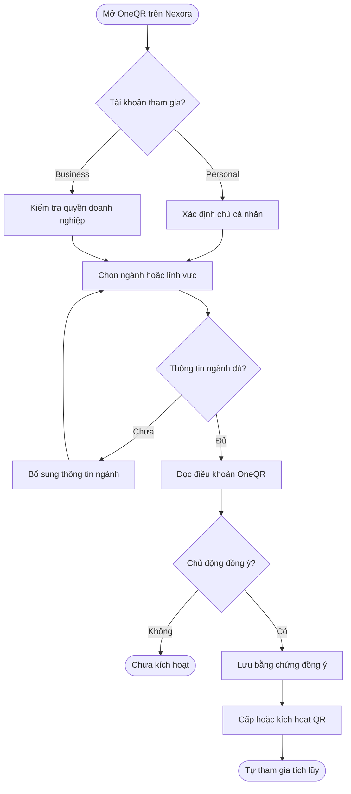

#### Luồng: Đăng và quản lý nội dung quảng cáo

**Người thực hiện chính:** Nhà quảng cáo Personal hoặc Business trên Nexora.

**Điểm bắt đầu:** Nhà quảng cáo mở phần quản lý nội dung của kênh được hỗ trợ.

**Kết quả:** Nội dung được lưu đúng chủ sở hữu và chỉ được phân phối khi đáp ứng chính sách của kênh.

**Nhu cầu người dùng:**

- Là nhà quảng cáo cá nhân, tôi muốn đăng và quản lý nội dung của mình để tiếp cận khách theo phạm vi tại A1.
- Là người có quyền quản lý doanh nghiệp, tôi muốn quản lý nội dung thuộc doanh nghiệp để không sử dụng nhầm tài khoản.
- Là nhà quảng cáo, tôi muốn biết nội dung chưa đủ điều kiện hoặc hết ngân sách để điều chỉnh trước khi tiếp tục phân phối.

| Bước | Người thực hiện | Hành động | Phản hồi hệ thống |
| :--- | :--- | :--- | :--- |
| 1 | Nhà quảng cáo | Mở phần quản lý quảng cáo của tài khoản Nexora. | Hệ thống xác định chủ nội dung và quyền thao tác theo A1, F27. |
| 2 | Nhà quảng cáo | Tạo hoặc sửa nội dung, chọn kênh và thiết lập phân phối được hỗ trợ. | Hệ thống kiểm tra thông tin và điều kiện của kênh; thông báo rõ phần cần bổ sung. |
| 3 | Nhà quảng cáo / hệ thống | Xác nhận chính sách và ngân sách nếu kênh thu phí. | Hệ thống áp dụng G32, G39–G40; ghi nhận quyền phân phối theo chính sách đang hiệu lực. |
| 4 | Hệ thống | Xét và phân phối nội dung đủ điều kiện. | Hệ thống áp bộ lọc B6–B7; quyền đăng quảng cáo không bảo đảm mọi phiên OneQR đều hiển thị nội dung đó. |
| 5 | Nhà quảng cáo | Theo dõi, sửa hoặc dừng nội dung theo quyền của kênh. | Hệ thống lưu lịch sử theo F25, F27 và cập nhật khả năng phân phối. |

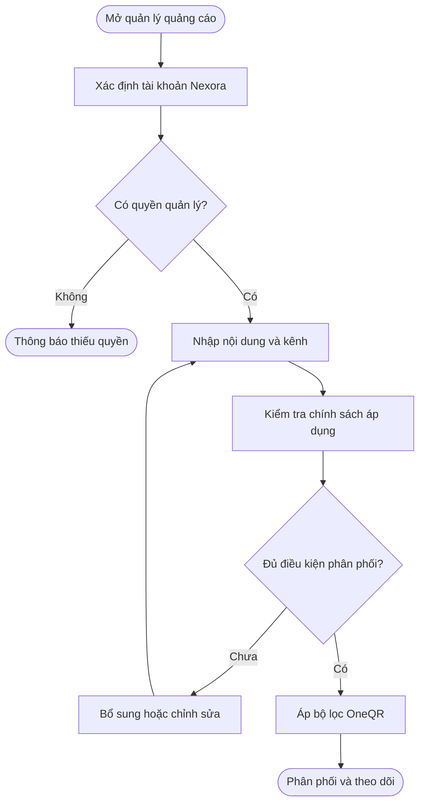

#### Luồng: Phân phối quảng cáo và ghi nhận điểm

**Người thực hiện chính:** Khách tạo hoạt động; hệ thống lọc nội dung, ghi nhận và duyệt điểm.

**Điểm bắt đầu:** Khách mở phiên từ OneQR của cá nhân hoặc doanh nghiệp.

**Kết quả:** Nội dung được lọc theo ngành; hoạt động đủ điều kiện có lịch sử điểm đúng nguồn, đúng trạng thái.

**Nhu cầu người dùng:**

- Là chủ tài khoản, tôi muốn nội dung của đối thủ cùng ngành được chặn để hạn chế quảng cáo cạnh tranh trong phiên OneQR của mình.
- Là chủ tài khoản, tôi muốn biết hoạt động nào tạo điểm và lý do điểm chưa được duyệt hoặc bị điều chỉnh để đối chiếu thu nhập.

| Bước | Người thực hiện | Hành động | Phản hồi hệ thống |
| :--- | :--- | :--- | :--- |
| 1 | Khách / hệ thống | Mở OneQR và chuyển giữa các màn hình khám phá. | Hệ thống xác minh nguồn, ngành và giữ ngữ cảnh theo G29–G30. |
| 2 | Hệ thống | Xem xét nội dung tại Deal Nearby, Search Deals và Khám phá. | Hệ thống loại nội dung cạnh tranh hoặc chưa xác định an toàn; nội dung tài trợ có nhãn theo B6–B7. |
| 3 | Khách | Thực hiện hành động với nội dung được phép hiển thị. | Hệ thống xét điều kiện chiến dịch, nguồn và trùng lặp theo B8. |
| 4 | Hệ thống | Ghi điểm từ sự kiện đủ điều kiện. | Hệ thống tạo khoản chờ duyệt cho tài khoản Nexora sở hữu QR đã được xác minh theo B9, F27; không lấy người đang xem làm chủ hưởng. |
| 5 | Hệ thống / vận hành | Đối soát và duyệt hoặc điều chỉnh. | Hệ thống áp thời hạn phù hợp tại G34, cập nhật điểm khả dụng hoặc lý do chưa được dùng; chủ tài khoản có kênh khiếu nại theo B10, G37. |

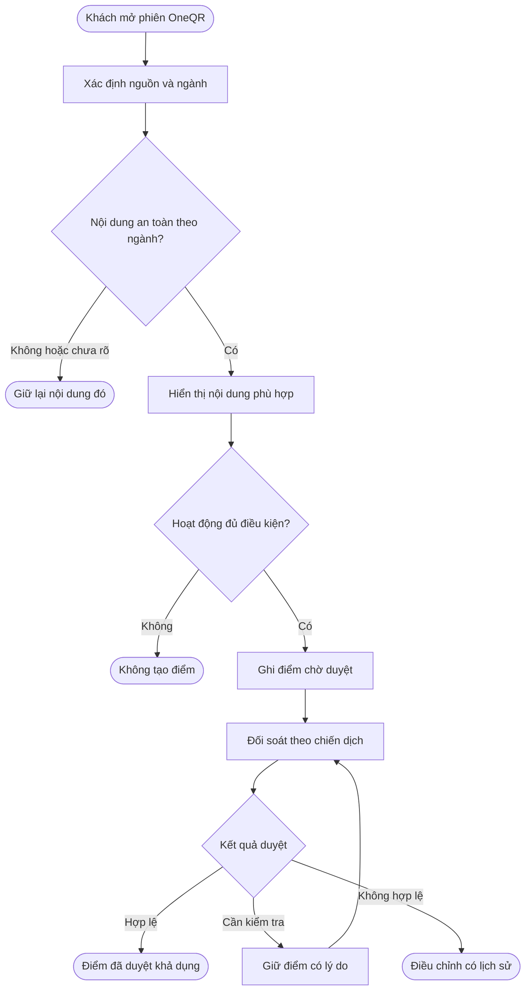

#### Luồng: Ghi nhận nguồn cho chiến dịch dịch vụ

**Người thực hiện chính:** Khách thực hiện giao dịch; hệ thống chọn nguồn và kiểm tra kết quả dịch vụ.

**Điểm bắt đầu:** Khách từ hành trình OneQR mở một dịch vụ hoặc ưu đãi thuộc chiến dịch áp dụng mô hình này.

**Kết quả:** Giao dịch có nguồn đã khóa và chỉ được xét điểm khi đủ điều kiện tại G33–G34.

**Nhu cầu người dùng:**

- Là chủ tài khoản, tôi muốn nguồn của giao dịch được giữ sau khi khách đặt lịch để việc quét QR khác không đổi quyền lợi đã khóa.
- Là chủ tài khoản, tôi muốn giao dịch hủy, hết hạn hoặc được hoàn tiền có kết quả đối chiếu rõ ràng để không ghi điểm sai.

| Bước | Người thực hiện | Hành động | Phản hồi hệ thống |
| :--- | :--- | :--- | :--- |
| 1 | Khách / hệ thống | Mở đích dịch vụ từ nguồn hợp lệ. | Hệ thống ghi nguồn ứng viên theo G29, G33. |
| 2 | Khách / hệ thống | Xác nhận lịch hẹn hoặc đơn hàng. | Hệ thống chọn nguồn, khóa và 💰 giữ ngân sách theo G33, G41–G42. |
| 3 | Khách / doanh nghiệp cung cấp dịch vụ | Hoàn tất dịch vụ và thanh toán. | Hệ thống xác minh kết quả và 💰 trừ phí nếu giao dịch thuộc luồng thu phí tại G40, G42. |
| 4 | Hệ thống | Đối soát khoản đủ điều kiện. | Hệ thống xét thời hạn dịch vụ tại G34 và chính sách đã lưu. |
| 5 | Hệ thống / vận hành | Xử lý hủy, hết hạn hoặc hoàn tiền. | Hệ thống 💰 giải phóng phần giữ chỗ hoặc điều chỉnh theo G33, G43. |

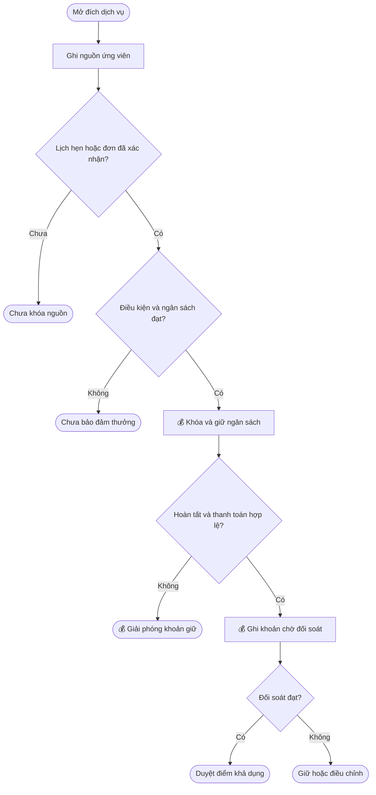

#### Luồng: Đổi điểm sang credit của mình

**Người thực hiện chính:** Chủ tài khoản.

**Điểm bắt đầu:** Chủ tài khoản chọn Đổi sang credit trong ví thu nhập.

**Kết quả:** Điểm và credit được cập nhật cùng giao dịch theo D14–D15.

**Nhu cầu người dùng:**

- Là chủ tài khoản, tôi muốn đổi điểm đã duyệt sang credit để sử dụng tại các sản phẩm được hỗ trợ.
- Là chủ tài khoản, tôi muốn biết số điểm sẽ trừ và credit sẽ nhận để kiểm tra trước khi xác nhận.
- Là chủ tài khoản, tôi muốn thao tác lỗi hoặc gửi lại không làm mất điểm hay cộng credit hai lần để số dư luôn khớp.

| Bước | Người thực hiện | Hành động | Phản hồi hệ thống |
| :--- | :--- | :--- | :--- |
| 1 | Chủ tài khoản | Chọn đổi và nhập số điểm. | Hệ thống hiển thị điểm khả dụng và giá trị credit tương ứng. |
| 2 | Hệ thống | Kiểm tra số điểm, số dư và chính sách đổi. | Hệ thống báo phần chưa hợp lệ; chỉ cho tiếp tục khi đủ điều kiện tại D14–D15. |
| 3 | Chủ tài khoản | Kiểm tra và xác nhận. | Hệ thống kiểm tra lại số dư để xử lý cả trường hợp có giao dịch đồng thời. |
| 4 | Hệ thống | 💰 Trừ điểm và cộng credit vào ví sử dụng của chính tài khoản đó. | Hệ thống hoàn tất hai phía cùng giao dịch, ghi nguồn credit và lịch sử; điểm đã đổi rời số dư khả dụng. |
| 5 | Chủ tài khoản | Xem kết quả. | Hệ thống hiển thị số điểm đã dùng, credit đã nhận, thời gian và mã giao dịch. |

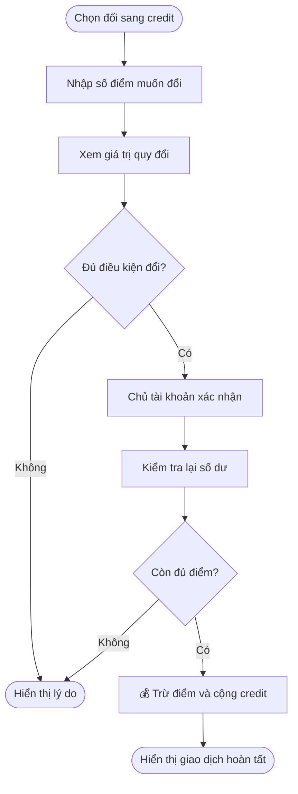

#### Luồng: Chuyển điểm cho tài khoản khác

**Người thực hiện chính:** Chủ tài khoản gửi điểm.

**Điểm bắt đầu:** Người gửi chọn Chuyển điểm.

**Kết quả:** Người gửi dùng điểm thu nhập; người nhận có credit trong ví sử dụng theo D16–D18.

**Nhu cầu người dùng:**

- Là người gửi, tôi muốn kiểm tra đúng tài khoản người nhận và giá trị nhận để tránh chuyển nhầm.
- Là người nhận, tôi muốn thấy credit và nguồn chuyển để hiểu số dư mình có thể sử dụng.
- Là người gửi, tôi muốn biết khi chuyển bị từ chối hoặc chưa rõ kết quả để không gửi lại gây trùng.

| Bước | Người thực hiện | Hành động | Phản hồi hệ thống |
| :--- | :--- | :--- | :--- |
| 1 | Người gửi | Chọn tài khoản nhận và nhập số điểm. | Hệ thống kiểm tra tài khoản nhận, số điểm nguyên, ngưỡng và số dư theo D16. |
| 2 | Người gửi | Xem lại danh tính người nhận và số credit tương ứng. | Hệ thống giải thích quyền sử dụng credit nhận theo C12; yêu cầu xác nhận trước khi gửi. |
| 3 | Người gửi | Xác nhận chuyển. | Hệ thống kiểm tra lại điều kiện và chống xử lý trùng theo D17. |
| 4 | Hệ thống | 💰 Trừ điểm người gửi, cộng credit vào ví sử dụng người nhận. | Hệ thống ghi hai phía cùng giao dịch và liên kết nguồn; không ghi thu nhập quảng cáo cho người nhận. |
| 5 | Người gửi / người nhận | Kiểm tra lịch sử. | Hệ thống hiển thị số lượng, nguồn, thời gian và trạng thái; trường hợp chưa rõ được đối chiếu theo D18. |

#### Luồng: Yêu cầu rút tiền qua VlinkPay

**Người thực hiện chính:** Chủ tài khoản.

**Điểm bắt đầu:** Chủ tài khoản chọn yêu cầu rút từ ví thu nhập.

**Kết quả:** Hồ sơ đúng chủ hưởng đáp ứng điều kiện VlinkPay; yêu cầu hợp lệ được tiếp nhận, giữ điểm và theo dõi kết quả theo E19–E24.

**Nhu cầu người dùng:**

- Là chủ tài khoản cá nhân đủ ngưỡng, tôi muốn hoàn thiện hồ sơ nhận tiền của cá nhân theo E20 để rút qua VlinkPay.
- Là chủ tài khoản doanh nghiệp đủ ngưỡng, tôi muốn dùng hồ sơ nhận tiền của doanh nghiệp theo E20 để rút đúng chủ hưởng.
- Là chủ tài khoản đã có hồ sơ VlinkPay còn giá trị, tôi muốn dùng lại hồ sơ đó để không phải nộp lại khi rút từ OneQR.
- Là chủ tài khoản có hồ sơ đang chờ duyệt hoặc bị từ chối, tôi muốn thấy trạng thái và phần cần sửa để tiếp tục sau khi được duyệt.
- Là chủ tài khoản, tôi muốn xem điểm sẽ dùng, phí và số tiền thực nhận để kiểm tra trước khi gửi yêu cầu.
- Là chủ tài khoản, tôi muốn biết điểm đang giữ và trạng thái thanh toán để không dùng lại số điểm đã dành cho yêu cầu rút.
- Là chủ tài khoản có thanh toán lỗi hoặc chưa rõ, tôi muốn được đối chiếu đúng giao dịch để không bị trừ điểm hoặc chi trả trùng.

| Bước | Người thực hiện | Hành động | Phản hồi hệ thống |
| :--- | :--- | :--- | :--- |
| 1 | Chủ tài khoản / Nexora | Mở yêu cầu rút và chọn số điểm. | Nexora kiểm tra ngưỡng điểm theo E19; đạt ngưỡng chưa đồng nghĩa đã đủ điều kiện VlinkPay. |
| 2 | Chủ tài khoản / Nexora | Xác nhận tài khoản nhận tiền VlinkPay. | Hệ thống đối chiếu đúng chủ hưởng theo F27 và xác định hồ sơ cá nhân hoặc doanh nghiệp theo E20. |
| 3 | Chủ tài khoản / VlinkPay | Dùng lại hồ sơ hoặc bổ sung giấy tờ còn thiếu. | VlinkPay áp dụng nhánh hồ sơ tương ứng tại E20; Nexora hiển thị phần cần hoàn thiện. |
| 4 | VlinkPay | Kiểm tra trạng thái duyệt hồ sơ. | Hồ sơ thiếu, chờ duyệt hoặc bị từ chối được xử lý theo E20; yêu cầu OneQR chưa được chấp nhận và chưa giữ điểm. |
| 5 | Chủ tài khoản / VlinkPay | Chọn và xác minh đích nhận tiền của phương thức được hỗ trợ. | VlinkPay kiểm tra đích nhận và hạn mức theo E19–E20; phần chưa đạt được hướng dẫn bổ sung. |
| 6 | Nexora / chủ tài khoản | Xem lại và xác nhận yêu cầu. | Chủ tài khoản thấy số điểm, quy đổi, phí và số tiền nhận theo E21. Hệ thống kiểm tra lại điều kiện trước khi chấp nhận. |
| 7 | Nexora | Giữ điểm khi yêu cầu hợp lệ được chấp nhận. | Nexora áp dụng E22 và xếp xử lý theo G34. |
| 8 | Nexora / VlinkPay | 💰 Xử lý yêu cầu rút theo kỳ chi và phương thức đã được hỗ trợ. | Nexora liên kết giao dịch với tham chiếu VlinkPay theo E23. |
| 9 | VlinkPay / Nexora | Xác nhận kết quả hoặc đối chiếu phần chưa rõ. | Nexora cập nhật kết quả theo E23–E24; chủ tài khoản xem được lịch sử và hướng xử lý. |

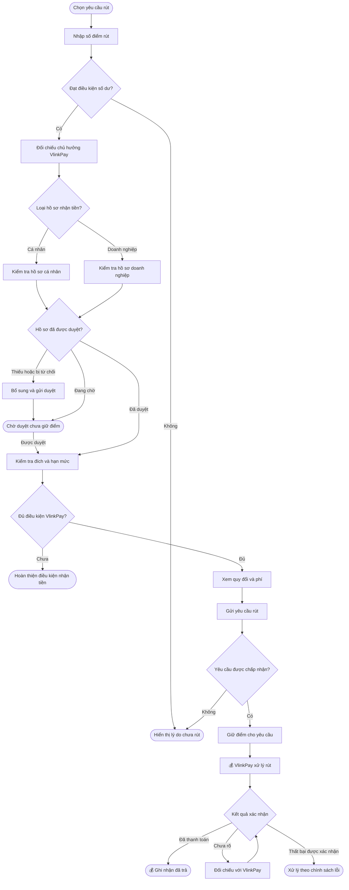

### Cấu hình và quản trị

- Là quản trị viên vận hành, tôi muốn quản lý danh mục ngành song ngữ và duyệt các trường hợp Khác để bộ lọc dùng đúng ngành của chủ QR.
- Là quản trị viên vận hành, tôi muốn quản lý điều kiện sự kiện, mức điểm và phiên bản chính sách để mỗi khoản điểm có căn cứ đối chiếu.
- Là người hỗ trợ được phân quyền, tôi muốn tra cứu nguồn điểm, lịch sử đổi, chuyển và rút để giải thích số dư và xử lý khiếu nại.
- Là quản trị viên, tôi muốn quản lý nội dung điều khoản tiếng Việt và tiếng Anh để người dùng chấp thuận đúng phiên bản.
- Là người hỗ trợ được phân quyền, tôi muốn phân biệt điều kiện điểm OneQR với hồ sơ và hạn mức VlinkPay để hướng dẫn đúng phần chủ tài khoản còn thiếu.

Các cấu hình phải tuân thủ quy tắc F25–F28. Danh sách thông số chưa được cung cấp chỉ nằm trong Phụ lục → Các nội dung cần hoàn thiện trước phát hành.

### Vòng đời trạng thái

Các trạng thái dưới đây mô tả nghiệp vụ, chưa phải tên trạng thái API đã được xác nhận.

#### Trạng thái kích hoạt OneQR

| Trạng thái hiện tại | Sự kiện | Trạng thái mới |
| :--- | :--- | :--- |
| Chưa kích hoạt | Kiểm tra thấy thiếu ngành hoặc chưa đồng ý | Cần hoàn thiện kích hoạt |
| Chưa kích hoạt / Cần hoàn thiện kích hoạt | Đủ thông tin ngành và chủ động đồng ý; kích hoạt thành công | Đã kích hoạt, tự tham gia tích lũy |

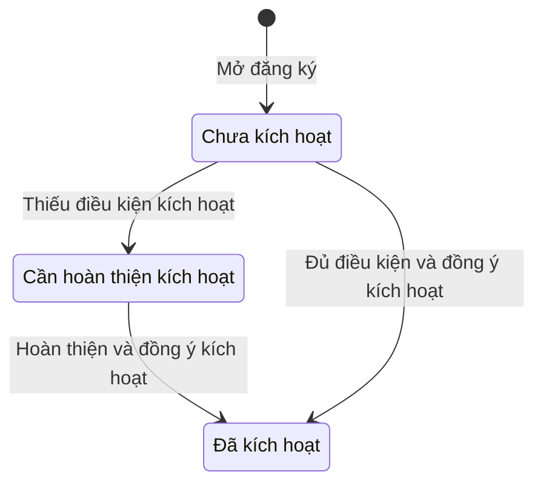

Trạng thái phân loại ngành được theo dõi riêng. Ngành đang xét không được coi là căn cứ an toàn để phân phối quảng cáo cạnh tranh; áp dụng B7.

#### Trạng thái nguồn giao dịch dịch vụ

| Trạng thái hiện tại | Sự kiện | Trạng thái mới |
| :--- | :--- | :--- |
| Chưa ghi nguồn | Khách mở đích đủ điều kiện | Nguồn ứng viên |
| Nguồn ứng viên | Lịch hẹn hoặc đơn hàng được xác nhận và đủ điều kiện | Nguồn đã khóa |
| Nguồn ứng viên | Hết thời hạn tại G33 | Hết hạn |
| Nguồn đã khóa | Dịch vụ hoàn tất, thanh toán được xác minh | Chuyển xét khoản thu |
| Nguồn đã khóa | Hủy hoặc quá hạn hoàn tất tại G33 | Đã giải phóng |

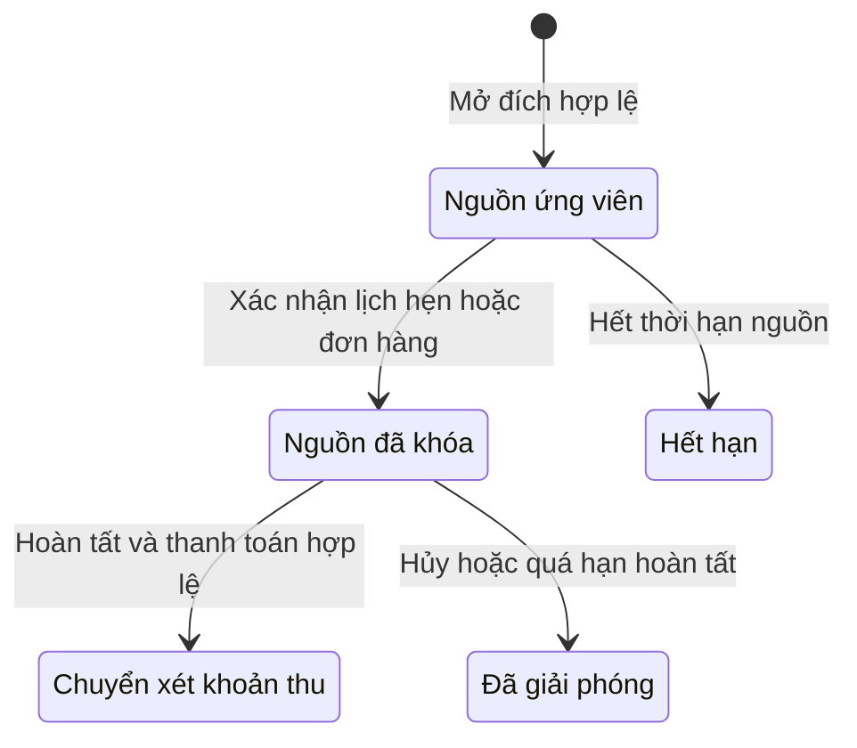

#### Trạng thái điểm

| Trạng thái hiện tại | Sự kiện | Trạng thái mới |
| :--- | :--- | :--- |
| Chưa ghi nhận | Hoạt động quảng cáo đủ điều kiện | Chờ duyệt |
| Chờ duyệt | Đối soát đạt và không bị giữ | Đã duyệt, khả dụng |
| Chờ duyệt / Đã duyệt | Cần kiểm tra khoản điểm liên quan | Đang giữ |
| Đã duyệt, khả dụng | Yêu cầu rút hợp lệ được chấp nhận | Đang giữ cho rút tiền |
| Đã duyệt, khả dụng | Đổi hoặc chuyển thành công | Đã sử dụng |
| Đang giữ | Kết quả cho phép giải phóng theo chính sách | Về trạng thái phù hợp trước khi giữ |
| Đang giữ cho rút tiền | VlinkPay xác nhận thanh toán | Đã thanh toán |
| Chờ duyệt / Đã duyệt / Đang giữ | Có căn cứ điều chỉnh hoặc đảo | Đã điều chỉnh / đảo phần liên quan |

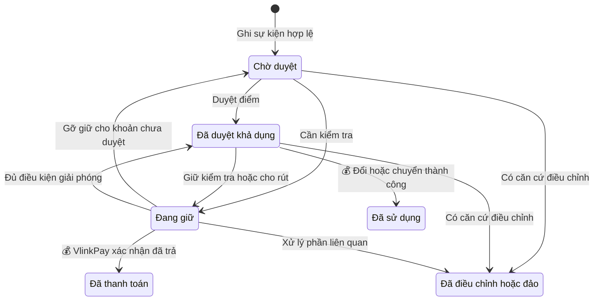

Điều chỉnh một phần phải giữ được số còn lại và lịch sử gốc; không chuyển cả khoản thành đã đảo nếu chỉ một phần mất điều kiện. Nếu điểm đã sử dụng hoặc thanh toán, áp dụng B10 và E24; không tự trừ số dư khác.

#### Trạng thái giao dịch đổi hoặc chuyển

| Trạng thái hiện tại | Sự kiện | Trạng thái mới |
| :--- | :--- | :--- |
| Chưa gửi | Người dùng xác nhận và hệ thống kiểm tra | Đang xử lý |
| Đang xử lý | Hai phía số dư được ghi nhận cùng giao dịch | Hoàn tất |
| Đang xử lý | Xác nhận giao dịch không được thực hiện | Thất bại |
| Đang xử lý | Mất phản hồi, chưa biết kết quả | Cần đối chiếu |
| Cần đối chiếu | Xác nhận kết quả giao dịch gốc | Hoàn tất / Thất bại |

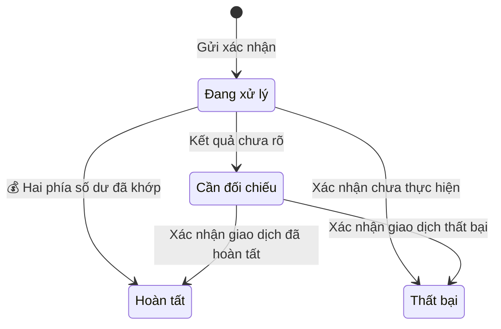

#### Trạng thái hồ sơ nhận tiền VlinkPay

Trạng thái này được theo dõi riêng với điểm và yêu cầu rút; quy tắc hồ sơ áp dụng E20.

| Trạng thái hiện tại | Sự kiện | Trạng thái mới |
| :--- | :--- | :--- |
| Chưa có hồ sơ | Chủ tài khoản nộp hồ sơ | Chờ duyệt |
| Chờ duyệt | VlinkPay phê duyệt | Đã duyệt |
| Chờ duyệt | VlinkPay từ chối và nêu lý do | Bị từ chối |
| Đã duyệt / Bị từ chối | Chủ tài khoản sửa và nộp lại hồ sơ | Chờ duyệt |

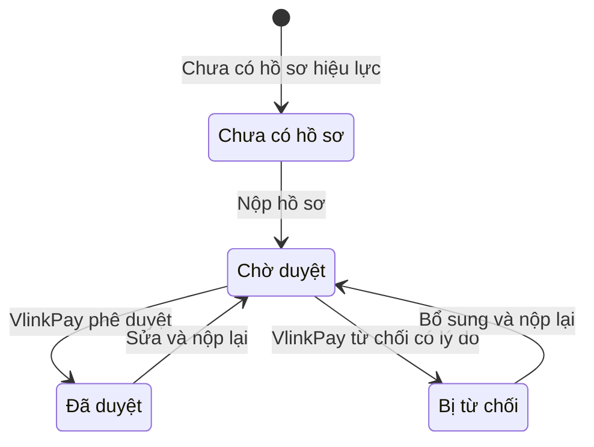

#### Trạng thái yêu cầu rút

| Trạng thái hiện tại | Sự kiện | Trạng thái mới |
| :--- | :--- | :--- |
| Đang chuẩn bị | Thiếu hồ sơ hoặc đích nhận chưa đủ điều kiện | Cần hoàn thiện hồ sơ; chưa giữ điểm |
| Đang chuẩn bị / Cần hoàn thiện hồ sơ | Hồ sơ hoặc đích nhận đang chờ duyệt | Chờ xác minh; chưa giữ điểm |
| Chờ xác minh | Hồ sơ bị từ chối | Cần hoàn thiện hồ sơ; chưa giữ điểm |
| Chờ xác minh / Cần hoàn thiện hồ sơ | Điều kiện nhận tiền đã đạt | Đang chuẩn bị để kiểm tra lại yêu cầu |
| Đang chuẩn bị | Yêu cầu hợp lệ được chấp nhận | Đã tiếp nhận; điểm được giữ |
| Đã tiếp nhận | VlinkPay bắt đầu xử lý | Đang thanh toán |
| Đang thanh toán / Cần đối chiếu | VlinkPay xác nhận đã thanh toán | Đã trả |
| Đang thanh toán | Chưa rõ kết quả | Cần đối chiếu |
| Đang thanh toán / Cần đối chiếu | VlinkPay xác nhận thất bại | Thất bại; điểm xử lý theo E24 |

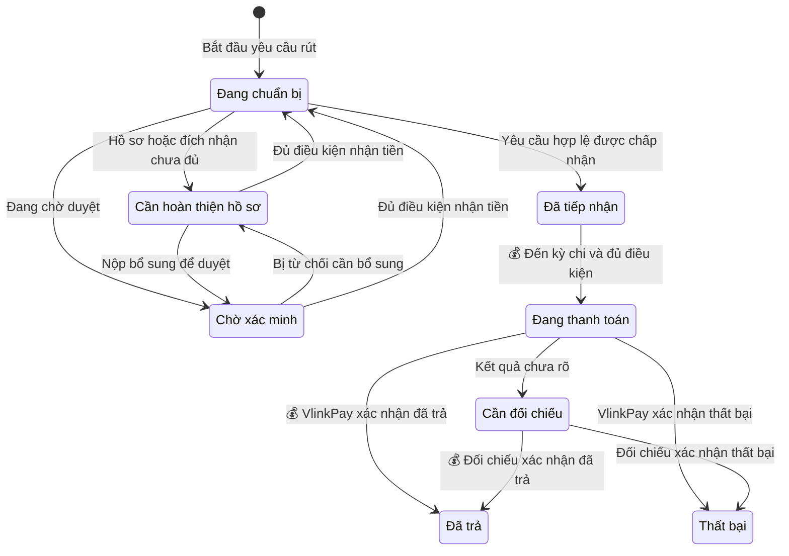

### Quy tắc nghiệp vụ

#### A. Điều kiện tham gia và kích hoạt

- **A1. Phạm vi và tham gia:** Cả tài khoản cá nhân (Personal) và doanh nghiệp (Business) trên Nexora đều được sở hữu, quản lý OneQR, tham gia hiển thị quảng cáo, tích lũy, đổi/chuyển điểm và yêu cầu rút qua VlinkPay. Hai loại tài khoản đều được đăng và quản lý nội dung quảng cáo của mình theo chính sách từng kênh; chính sách thu phí áp dụng G32, G39–G40.

  Gói OneQR hiện tại bao gồm quảng cáo tại Deal Nearby, Search Deals và Khám phá. Chủ tài khoản đồng ý và kích hoạt thì tự tham gia tích lũy, không có nút bật/tắt kiếm tiền riêng. Chủ tài khoản chưa đồng ý thì chưa thể kích hoạt; quyền tắt quảng cáo của gói trả phí tương lai chưa được cung cấp.
- **A2. Ngành hoặc lĩnh vực hoạt động:** Chủ tài khoản Personal hoặc Business chọn ngành chính và có thể chọn nhiều ngành phụ phù hợp với hoạt động của mình. Nếu chọn Khác, chủ tài khoản nhập mô tả để vận hành phân loại. Nexora dùng lại thông tin của đúng tài khoản tham gia; thay đổi ngành phải được xác nhận phân loại và lưu lịch sử.
- **A3. Danh mục ngành:** Vận hành quản lý danh mục có thể mở rộng với tên tiếng Việt và tiếng Anh, bao phủ làm đẹp, ăn uống, y tế, dịch vụ nhà cửa, xe cộ, bán lẻ, dịch vụ chuyên môn, du lịch, sự kiện, giáo dục, gia đình và thú cưng. Hệ thống hiển thị trạng thái phân loại và kênh báo sai cho chủ tài khoản.
- **A4. Đồng ý điều khoản:** Hệ thống hiển thị điều khoản hiện hành và ô đồng ý chưa chọn sẵn, nêu rõ quảng cáo và tự tham gia tích lũy. Khi chủ tài khoản đồng ý, Nexora lưu tài khoản Personal hoặc Business tham gia, người chấp thuận, quyền chấp thuận của người đó, thời điểm, phiên bản điều khoản và các ngành đã chọn. Bằng chứng đồng ý được liên kết với QR thuộc tài khoản đó.
- **A5. Hồ sơ nhận tiền chỉ yêu cầu khi rút:** Nexora không đặt hồ sơ thuế, xác minh nhận tiền hoặc phương thức nhận tiền VlinkPay làm điều kiện kích hoạt và bắt đầu tích lũy. Cá nhân dùng OneQR và tham gia quảng cáo bằng tài khoản Personal của mình, không phải tạo Business hoặc nộp hồ sơ doanh nghiệp để có QR. Hồ sơ nhận tiền được hoàn thiện hoặc dùng lại trong luồng rút theo E20; không thêm bước xét duyệt kiếm tiền riêng trước khi tham gia.

#### B. Bảo vệ chủ QR và ghi nhận điểm

- **B6. Chặn nhóm ngành:** Hệ thống dùng ngành chính và ngành phụ đã xác nhận, ánh xạ vào nhóm ngành chuẩn NEXORA. Trong phiên OneQR của cá nhân hoặc doanh nghiệp, hệ thống loại nội dung bên thứ ba cùng nhóm với một ngành của chủ QR khỏi Deal Nearby, Search Deals và Khám phá. Search vẫn áp bộ lọc khi khách tìm đúng ngành; quảng cáo trả phí không được vượt bộ lọc. Hệ thống dùng ID ngành ổn định, giữ nguồn theo G30 và nhận diện nội dung tài trợ theo G39.
- **B7. Phân loại chưa chắc chắn:** Khi thiếu ngành, ngành đang xét hoặc chưa xác định được nội dung có cạnh tranh hay không, hệ thống tạm không hiển thị nội dung bên thứ ba chưa được xác định an toàn trong phiên đó. Vận hành quản lý quan hệ giữa các ngành, lưu quyết định lọc và xử lý báo sai; thay đổi danh mục không được âm thầm làm sai phân loại đã có.
- **B8. Sự kiện tạo điểm:** Hệ thống chỉ ghi điểm cho hành động hợp lệ theo chính sách chiến dịch, có nguồn và vượt kiểm tra trùng lặp tại G31–G32, G35. Quét QR, mở danh sách hoặc một lượt hiển thị riêng lẻ không tự tạo điểm. Hệ thống chuẩn bị nguồn điểm giới thiệu riêng, có thể cấu hình cho chương trình tương lai. Nguồn này chưa được cộng điểm hoặc cấp quyền đổi, chuyển, rút khi chương trình chưa được xác định và phê duyệt.
- **B9. Sổ điểm và duyệt:** Nexora ghi điểm nguyên vào trạng thái chờ duyệt cho tài khoản Personal hoặc Business sở hữu QR đã được xác minh, sau đó xét theo chính sách chiến dịch. Lịch sử phải truy được nguồn chương trình, mã sự kiện, QR và tài khoản sở hữu, thời điểm, phiên bản mức điểm hoặc chính sách, số điểm và trạng thái. Sự kiện gửi lại không tạo khoản điểm mới; cách đối chiếu màn hình thực hiện theo G36.
- **B10. Điều chỉnh và khiếu nại:** Hệ thống lưu lý do khi từ chối, giữ, điều chỉnh hoặc đảo điểm do trùng lặp, gian lận, hoàn tiền hay sai sót. Hệ thống dùng giao dịch điều chỉnh liên kết, giữ lịch sử gốc và cung cấp kênh khiếu nại. Cách thu hồi khi điểm đã dùng phải được xác định theo chính sách; không tự trừ số dư không liên quan. Thời hạn gửi và phản hồi khiếu nại theo G37.

#### C. Nguồn và quyền sử dụng số dư

- **C11. Ví thu nhập:** Hệ thống chỉ cộng điểm tài khoản tự kiếm từ quảng cáo đủ điều kiện và các nguồn bổ sung đã được bật theo chính sách riêng. Chỉ phần đã duyệt còn khả dụng được dùng; điểm chờ duyệt, đang giữ, đã dùng hoặc đã thanh toán không tham gia số dư thao tác. Hệ thống hiển thị số dư điểm kèm giá trị tương đương theo tỷ lệ tại D14.
- **C12. Credit nhận từ người khác:** Hệ thống cộng vào ví sử dụng và ghi riêng nguồn nhận. Trong giai đoạn đầu, người nhận chỉ được sử dụng credit này, không được rút tiền hoặc chuyển tiếp. Credit nhận không vào ví thu nhập và không được tính là điểm tự kiếm.
- **C13. Các nguồn credit còn lại:** Hệ thống ghi riêng credit đổi từ điểm của mình và credit đã nạp. Credit đã đổi không quay lại số dư đủ điều kiện rút; quyền của credit đã nạp theo chính sách nạp tương ứng. Hệ thống không gộp các nguồn để mở rộng quyền rút hoặc chuyển.

#### D. Đổi và chuyển điểm

- **D14. 💰 Quy đổi:** Hệ thống áp dụng **100 ONEQR Points = 1 credit = $1 giá trị quy đổi hoặc sử dụng**. Khi chủ tài khoản đổi điểm, hệ thống trừ điểm khả dụng và cộng credit vào ví sử dụng của chính tài khoản đó cùng một giao dịch; không hoàn tất chỉ một phía. Hệ thống không tự áp mức tối thiểu chuyển điểm cho thao tác đổi.
- **D15. Điều kiện mở đổi:** Trước khi mở thao tác đổi và sử dụng credit, vận hành phải xác định sản phẩm được hỗ trợ và chính sách hoàn hoặc đổi ngược.
- **D16. Ngưỡng chuyển:** Người gửi phải chọn tài khoản nhận đủ điều kiện và nhập ít nhất **1.000 điểm nguyên đã duyệt còn khả dụng** mỗi lần, tương đương $10. Hệ thống từ chối số dư thiếu, số điểm dưới ngưỡng hoặc tài khoản nhận không hợp lệ.
- **D17. 💰 Ghi nhận chuyển:** Trước xác nhận, hệ thống cho người gửi kiểm tra danh tính người nhận và số credit tương ứng. Khi thành công, hệ thống đồng thời trừ điểm ví thu nhập người gửi và cộng credit ví sử dụng người nhận theo D14. Hệ thống lưu hai bên, số lượng, nguồn, thời điểm, trạng thái và mã chống xử lý trùng; một yêu cầu không được ghi nhận hai lần.
- **D18. Chuyển lỗi hoặc tranh chấp:** Hệ thống hiển thị kết quả rõ ràng và đối chiếu yêu cầu gốc nếu chưa biết kết quả. Trước phát hành, vận hành phải có cách xử lý chuyển nhầm, tranh chấp và đảo giao dịch. Hệ thống không tự lấy tiền không liên quan để bù hoặc mặc định chuyển lại khi chưa xác định kết quả.

#### E. Yêu cầu rút tiền

- **E19. Ngưỡng và nguồn rút:** Chủ tài khoản chỉ được bắt đầu yêu cầu rút khi có từ **10.000 điểm đã duyệt, chưa dùng và còn khả dụng, tương đương $100**. Số điểm yêu cầu phải đạt ngưỡng và không vượt phần khả dụng. Credit trong ví sử dụng không được tính vào ngưỡng, kể cả credit nhận từ người khác.

  Ngưỡng điểm OneQR được xét riêng với hạn mức VlinkPay. VlinkPay áp dụng cấu hình theo loại tài khoản Personal hoặc Business và phương thức nhận được hỗ trợ. Đạt ngưỡng OneQR chưa bảo đảm yêu cầu được VlinkPay chấp nhận.

- **E20. Hồ sơ nhận tiền qua VlinkPay:** Trong luồng rút, chủ tài khoản hoàn thiện hoặc dùng lại hồ sơ VlinkPay đúng chủ hưởng theo F27. Mỗi chủ hưởng dùng bộ giấy tờ tương ứng với cá nhân hoặc doanh nghiệp trong bảng dưới đây. VlinkPay thu hoặc dùng lại thông tin người nhận, mã số thuế, mẫu thuế phù hợp và thông tin xác minh theo yêu cầu áp dụng.

| Nội dung hồ sơ | Cá nhân | Doanh nghiệp |
| :--- | :--- | :--- |
| Loại chứng từ trên giao diện VlinkPay hiện có | SSN — số an sinh xã hội. | Được chọn SSN hoặc EIN — mã số thuế doanh nghiệp. |
| Số và ảnh chứng từ | Số SSN và mặt trước chứng từ SSN. | Số và chứng từ tương ứng với SSN hoặc EIN đã chọn. |
| Khi thêm tài khoản ngân hàng Mỹ | Khai tên chủ tài khoản. | Khai tên doanh nghiệp. |

VlinkPay quản lý một hồ sơ chứng từ đang hiệu lực cho mỗi tài khoản nhận tiền. Hồ sơ mới nộp ở trạng thái chờ duyệt; hồ sơ thiếu, đang chờ hoặc bị từ chối chưa đáp ứng điều kiện rút. Khi chủ tài khoản sửa và nộp lại, hồ sơ quay về chờ duyệt, kể cả hồ sơ trước đó đã được duyệt. Hồ sơ còn giá trị được dùng lại; việc mở luồng OneQR không buộc nộp lại giấy tờ đã được xác minh.

Đích nhận tiền được kiểm tra riêng với hồ sơ chứng từ. Với các phương thức VlinkPay hiện có, ngân hàng Mỹ cần tài khoản ngân hàng được duyệt; khi thêm ngân hàng, hai loại tài khoản đều cung cấp thông tin ngân hàng và ảnh séc đã hủy (*voided check*). Form ngân hàng dùng lại chứng từ đã nộp.

Zelle dùng chung điều kiện ngân hàng đã duyệt; crypto hoặc nhận USDT cần địa chỉ ví được duyệt đúng mạng lưới. Các điều kiện này là căn cứ tích hợp; OneQR chỉ cung cấp phương thức đã có hợp đồng và cấu hình hỗ trợ. Dữ liệu hồ sơ được bảo vệ theo F27.

- **E21. Xem trước:** Trước xác nhận, Nexora hiển thị số điểm sẽ dùng, giá trị quy đổi, phí áp dụng đã được xác nhận, số tiền nhận và phương thức nhận qua VlinkPay. Hệ thống không tự đặt phí, loại tiền, tỷ lệ chia hoặc cam kết thời gian nhận tiền chưa có chính sách.
- **E22. Giữ điểm đúng lúc:** Hệ thống chỉ giữ điểm khi yêu cầu hợp lệ được chấp nhận; việc mở màn hình hoặc bổ sung hồ sơ chưa làm giữ điểm. Sau khi giữ, cùng số điểm không được đổi, chuyển hoặc dùng cho yêu cầu rút khác. Hệ thống kiểm tra lại số dư tại thời điểm chấp nhận.
- **E23. 💰 Xác nhận thanh toán:** VlinkPay thực hiện rút tiền; Nexora chỉ hiển thị đã trả khi có kết quả thanh toán cuối cùng được xác nhận từ VlinkPay. Nexora liên kết mã yêu cầu OneQR với tham chiếu VlinkPay, lưu trạng thái, số điểm, giá trị, phí và lịch sử đối chiếu. Xếp kỳ chi hoặc chuyển yêu cầu sang VlinkPay chưa đồng nghĩa đã trả. Timeout hoặc chưa có phản hồi là kết quả cần đối chiếu, chưa phải bằng chứng thanh toán thất bại.
- **E24. Lỗi và đảo sau rút:** Hệ thống hoàn tất hoặc giải phóng điểm đang giữ theo kết quả cuối cùng và chính sách lỗi, đảo đã được phê duyệt. Hệ thống không vừa trả tiền vừa hoàn điểm cho cùng nghĩa vụ, không chi trùng khi nhận phản hồi lặp và không tự thu hồi từ khoản tiền không liên quan.

#### F. Quản trị, điều khoản và ngôn ngữ

- **F25. Chính sách và quyền:** Chỉ người được phân quyền mới được quản lý ngành, mức điểm, quyền của từng nguồn, điều chỉnh và điều khoản. Hệ thống lưu người sửa, thời điểm, nội dung trước/sau và phiên bản áp dụng; thay đổi chính sách không được ghi đè lịch sử giao dịch.
- **F26. Chống dùng trùng:** Hệ thống kiểm soát các thao tác đổi, chuyển và rút đồng thời trên cùng điểm. Mỗi giao dịch có mã nhận diện; lần gửi lại hoặc kiểm tra trạng thái không làm trừ điểm, cộng credit, giữ điểm hay thanh toán thêm lần nữa.
- **F27. Dữ liệu và điều khoản:** Chủ tài khoản chỉ quản lý OneQR, nội dung quảng cáo và số dư thuộc quyền trên tài khoản Nexora tham gia. Nexora gắn QR, nguồn sự kiện, điểm, credit và giao dịch với đúng chủ sở hữu Personal hoặc Business; không tự gộp số dư cá nhân với doanh nghiệp. Yêu cầu rút phải đối chiếu đúng tài khoản nhận tiền VlinkPay của chủ hưởng; không dùng hồ sơ người khác chỉ vì cùng thiết bị hoặc phiên đăng nhập.

  Hệ thống giới hạn quyền truy cập dữ liệu thuế và danh tính. Điều khoản kích hoạt phải bao phủ quảng cáo, ngành, điểm, quy đổi, chuyển, ví sử dụng, rút qua VlinkPay, điều chỉnh, khiếu nại, thay đổi chính sách, đóng tài khoản và số dư còn lại; hoàn thiện câu chữ áp dụng trước phát hành.
- **F28. Ngôn ngữ:** Hệ thống cung cấp đầy đủ tiếng Việt và tiếng Anh đã được rà soát cho các luồng, lỗi và thay đổi chính sách. Ngôn ngữ khác có thể dùng Google Dịch tùy chọn, được ghi rõ là dịch tự động. Khi dịch vụ dịch không hoạt động, hai ngôn ngữ chính vẫn dùng được; điều khoản cuối cùng phải xác định ngôn ngữ có giá trị áp dụng.

#### G. Quy tắc kế thừa từ tài liệu cũ

- **G29. Xác minh nguồn:** Hệ thống phát hành mã công khai ngẫu nhiên, không chứa thông tin cá nhân; máy chủ xác minh chủ QR, tài khoản, vị trí/kênh và chiến dịch trước khi ghi điểm. Hệ thống không tin quyền hoặc chủ nguồn do trình duyệt tự khai. Mã hết hạn hoặc bị thu hồi không tạo nguồn mới; lịch sử đã ghi vẫn được giữ. Khi không xác minh được nguồn, hệ thống ghi chưa xác định thay vì suy đoán bằng IP hoặc dấu vết thiết bị.
- **G30. Ranh giới phiên:** Hệ thống theo dõi riêng mã giới thiệu tài khoản đầu tiên, nguồn sự kiện hiện tại và nguồn giao dịch đã khóa. Cách giữ hoặc nối nguồn áp dụng theo bảng dưới đây; không có nút bỏ bộ lọc bảo vệ trong phiên QR.

| Tình huống | Cách hệ thống xử lý nguồn |
| :--- | :--- |
| Khách chuyển màn hình, đăng nhập, đăng xuất hoặc đổi ngôn ngữ trong cùng hành trình QR | Hệ thống giữ nguồn và bộ lọc. Khi đăng nhập, hệ thống nối phiên khách đã xác minh vào đúng tài khoản, không nhân đôi sự kiện hoặc quyền lợi. |
| Khách quét QR của tài khoản khác | Hệ thống mở ngữ cảnh mới cho hoạt động tiếp theo, giữ nguyên nguồn giao dịch đã khóa. |
| Khách chủ động mở NEXORA, ứng dụng, website, mạng xã hội hoặc đường dẫn độc lập | Hệ thống không tự mang bộ lọc của chủ QR trước đó. Nguồn dịch vụ còn hạn vẫn được xét theo G33. |
| Khách chuyển thiết bị | Hệ thống chỉ nối nguồn qua cùng tài khoản đã xác thực hoặc mã tiếp tục dùng một lần còn hạn 24 giờ. Cài ứng dụng không tự bảo đảm giữ được nguồn. |
| Hệ thống không nối hoặc xác minh được nguồn | Hệ thống hiển thị nguồn chưa xác định và xử lý theo G29. |

- **G31. Loại trừ tự tạo thu nhập:** Nội dung của chính chủ QR tại vị trí riêng của mình không tạo phí quảng cáo mạng hoặc điểm thu nhập cho chủ QR. Hệ thống loại lượt tự bấm, lượt giả hoặc bị ép buộc, giao dịch thử, can thiệp theo dõi nguồn và thu nhập vòng giữa các bên cùng chủ sở hữu. Với chiến dịch dịch vụ, giao dịch của chính người giới thiệu hoặc nhân viên doanh nghiệp đích không tạo thưởng; đánh giá tốt hay xấu cũng không phải điều kiện thưởng. Dùng chung IP hoặc thiết bị chỉ là dấu hiệu cần kiểm tra, chưa đủ để kết luận gian lận.
- **G32. Hiệu lực và ngân sách:** Sự kiện phải thuộc chiến dịch đang hiệu lực, đúng vị trí, vượt bộ lọc và có nguồn ngân sách phù hợp. Với chiến dịch dùng ngân sách, hệ thống kiểm tra hạn mức ngày và tổng, kể cả các sự kiện đồng thời. Hết ngân sách thì dừng phân phối trả phí và tạo giữ chỗ mới; khoản đã giữ hợp lệ tiếp tục theo chính sách đã lưu. Sang ngày mới không đặt lại tổng ngân sách.
- **G33. Nguồn của chiến dịch dịch vụ:** Khi chiến dịch tính theo dịch vụ hoàn tất được mở, hệ thống chọn và khóa nguồn theo bảng dưới đây. Điều kiện khách áp dụng G41 và phần ngân sách áp dụng G42. Các thời hạn này không áp mặc định cho lượt bấm quảng cáo và không tự mở chương trình điểm giới thiệu tương lai tại B8.

| Giai đoạn | Điều kiện nguồn dịch vụ |
| :--- | :--- |
| Tạo nguồn ứng viên | Hệ thống ghi nguồn khi khách chủ động mở đích hợp lệ, không chỉ xem thẻ hoặc quảng cáo trong danh sách. Nguồn có hiệu lực 30 × 24 giờ; tải lại trang hoặc mở lại cùng nguồn trong cùng phiên không gia hạn. |
| Chọn nguồn | Hệ thống chọn nguồn hợp lệ gần nhất cho đúng doanh nghiệp đích. Nếu trùng thời điểm, hệ thống dùng thứ tự sự kiện do máy chủ cấp; truy cập trực tiếp, tìm kiếm tự nhiên hoặc đăng nhập không tự xóa nguồn còn hạn. |
| Khóa nguồn | Hệ thống khóa khi lịch hẹn được xác nhận; nếu không có lịch hẹn thì khóa khi đơn hàng được xác nhận trước thanh toán. Lấy hoặc lưu ưu đãi chưa khóa nguồn; nguồn hết hạn đúng mốc kết thúc thời hạn, không khóa được tại mốc đó. |
| Hoàn tất hoặc dời lịch | Giao dịch phải hoàn tất và thanh toán trước mốc 60 × 24 giờ từ lúc khóa. Dời lịch giữ nguyên nguồn và hạn; QR mới không thay nguồn đã khóa. |
| Hủy, hết hạn hoặc đặt lại | Hệ thống giải phóng phần giữ chỗ khi hủy hoặc hết hạn. Lần đặt lại có bản ghi mới, xét nguồn còn hạn và liên kết với lần hủy để kiểm tra lạm dụng. |

- **G34. Đối soát và lịch chi:** Khoản dịch vụ theo G33 được xét khả dụng sau 14 × 24 giờ từ mốc muộn hơn giữa hoàn tất dịch vụ và thanh toán được quyết toán, khi không còn giữ kiểm tra. Lịch xử lý chi kế thừa là thứ Ba hàng tuần theo America/Chicago; hệ thống xét các yêu cầu đã được chấp nhận và đủ điều kiện tại mốc 00:00 cùng ngày theo E19–E22. Hệ thống không tự rút toàn bộ số dư khi chủ tài khoản chưa gửi yêu cầu. Lượt bấm quảng cáo cần thời hạn duyệt riêng của chiến dịch; không tự áp thời hạn dịch vụ cho mọi lượt bấm.
- **G35. Chống lượt bấm lặp:** Với mô hình trả phí kế thừa, banner chỉ ghi một lượt bấm hợp lệ cho mỗi khách hoặc phiên và nhà quảng cáo trong 24 giờ. Thẻ tài trợ chỉ ghi một lượt bấm hợp lệ cho mỗi khách hoặc phiên và ưu đãi trong 24 giờ. Lượt bấm phải mở chi tiết hoặc nút hành động thật; tải trước, công cụ thu thập tự động, bấm đúp và tải lại không tạo thêm sự kiện đủ điều kiện. Giao dịch dịch vụ chống trùng theo lịch hẹn hoặc đơn hàng, không dùng cửa sổ lượt bấm thay cho kiểm tra giao dịch.
- **G36. Màn hình đối chiếu:** Chủ QR xem được lượt truy cập, hành động đủ điều kiện, các trạng thái điểm và lịch sử theo QR, vị trí/kênh, chiến dịch và khoảng thời gian. Mỗi khoản truy được sự kiện, nguồn, chính sách, thời điểm và lý do trạng thái; người xem chỉ nhận dữ liệu thuộc quyền, không được xem toàn bộ hồ sơ khách. Khi tải số dư hoặc lịch sử lỗi, hệ thống hiển thị lỗi và cho thử lại, không thay lỗi bằng số dư 0. Nếu giữ dữ liệu trước đó, hệ thống cho biết thời điểm cập nhật.
- **G37. Khiếu nại:** Khi điểm bị giữ hoặc điều chỉnh, hệ thống thông báo lý do phù hợp và cho gửi yêu cầu kiểm tra trong 30 ngày. Vận hành có mục tiêu phản hồi đầu tiên trong 5 ngày làm việc. Hệ thống bảo vệ thông tin chống gian lận nhạy cảm và giữ lịch sử xử lý.
- **G38. In và chia sẻ QR:** Chủ tài khoản được in hoặc chia sẻ nhiều bản QR, không phải đăng ký từng nơi đặt. Mã theo vị trí/kênh là tùy chọn để đối chiếu. Người phát hành phải có quyền dùng vị trí/kênh, không giả mạo hoặc đánh lừa khách. Lời mời có thưởng phải thông báo người giới thiệu có thể nhận phí khi phát sinh hoạt động đủ điều kiện.
- **G39. Giai đoạn phân phối miễn phí:** Kế thừa quyết định 30 tháng 9 cho các kênh NEXORA và Nổi bật trong giai đoạn 1: chưa thu phí phân phối, không lấy ngân sách OneQR để tự thu tiền. Nổi bật miễn phí dùng nhãn Nổi bật; nhãn tài trợ chỉ dùng khi có nội dung được tài trợ. Quyền tham gia điểm theo A1 vẫn giữ; chỉ sự kiện có nguồn thưởng và chính sách hợp lệ mới được ghi điểm. Nguồn cấp điểm trong giai đoạn miễn phí phải được xác định, không tự coi phí quảng cáo cũ là tiền đã thu.
- **G40. Căn cứ tài chính của luồng thu phí:** Khi luồng thu phí được mở theo chính sách, hệ thống kế thừa căn cứ ngày 21 tháng 9 trong bảng dưới đây. Bảng này không tự bật thu phí trong giai đoạn miễn phí tại G39, không thay đơn vị điểm tại D14 và không mở Sponsor hoặc bán voucher trả trước. Hệ thống lưu căn cứ áp dụng với sự kiện; không lấy tỷ lệ 70% của bản trước thay cho phần chia ngày 21 tháng 9.

| Hoạt động trong luồng thu phí | Phí nhà quảng cáo | Phần của chủ QR |
| :--- | :--- | :--- |
| Lượt bấm banner tài trợ hợp lệ | $0.40 mỗi lượt bấm hợp lệ. | 40% phí hợp lệ. |
| Lượt bấm thẻ tài trợ Deal Nearby / Explore | $0.25 mỗi lượt bấm hợp lệ. | 35% phí hợp lệ; nguồn cũ ghi làm tròn theo cent. |
| Lượt bấm thẻ tài trợ Search Deals | $0.30 mỗi lượt bấm hợp lệ. | 35% phí hợp lệ. |
| Dịch vụ hoàn tất và thanh toán của khách mới đủ điều kiện | 10% giá trị dịch vụ đủ điều kiện sau giảm giá. | 50% phí dịch vụ tương ứng. |
| Dịch vụ của khách quay lại đủ điều kiện tại G33 | 5% khi chiến dịch bật nhóm này. | 50% phí dịch vụ tương ứng. |

Cơ sở phí là tiền dịch vụ đã thanh toán sau mọi giảm giá và hoàn tiền; loại thuế, tip, phụ phí, hàng bán lẻ, cọc chưa quyết toán và tiền bán gift card. Dịch vụ thanh toán bằng gift card được tính lúc sử dụng, tránh tính hai lần khi bán và dùng thẻ. Với giảm giá toàn hóa đơn, hệ thống phân bổ theo tỷ trọng giá trị dòng dịch vụ trước giảm; phần cent dư theo thứ tự dòng cố định.

Phí dịch vụ được làm tròn tới cent; trường hợp đúng nửa cent thì làm tròn lên. Bảng phí không tự cho phép cộng phí lượt bấm và phí dịch vụ cho cùng hành trình khi chiến dịch chưa chấp thuận mô hình đó. Quy đổi các phần phí còn lẻ sang điểm nguyên được nêu tại Phụ lục, không tự chọn cách làm tròn.

- **G41. Khách của chiến dịch dịch vụ:** Khách mới là người chưa có dịch vụ hoàn tất và thanh toán tại bất kỳ chi nhánh nào của doanh nghiệp đích, gồm lịch sử POS đã nhập được xác minh. Có tài khoản hoặc lịch hẹn chưa hoàn tất chưa làm mất trạng thái khách mới; thiếu lịch sử thì hệ thống ghi chưa xác minh. Khách quay lại chỉ đủ điều kiện khi không có dịch vụ hoàn tất và thanh toán tại doanh nghiệp đích trong ít nhất 90 × 24 giờ, đồng thời chiến dịch bật nhóm này. Mỗi khách tại một doanh nghiệp chỉ có một quyền lợi đầu tiên, sau đó tối đa một quyền lợi quay lại trong mỗi khoảng 90 ngày.

  Hệ thống kiểm tra quyền lợi lúc khóa nguồn và kiểm tra lại khi hoàn tất. Nếu nhiều giao dịch cùng tranh một quyền lợi, giao dịch được máy chủ xác nhận đủ điều kiện trước được hưởng; các giao dịch còn lại giải phóng giữ chỗ. Khách đang hoạt động vẫn có thể dùng ưu đãi hợp lệ nhưng không tạo phí hoặc thưởng của mô hình dịch vụ này.

- **G42. 💰 Giữ ngân sách dịch vụ:** Trước khi khóa nguồn, hệ thống cần giá đủ rõ để giữ phí tối đa trong hạn mức ngày và tổng; chưa biết giá thì báo chưa bảo đảm thưởng. Ngân sách ngày gắn với ngày giữ chỗ theo múi giờ chiến dịch; chuyển ngày không xóa khoản giữ. Khi giá tăng, doanh nghiệp phải xác nhận và hệ thống bổ sung giữ chỗ trước khi thực hiện; thiếu ngân sách thì phần tăng không tính phí hoặc thưởng và phải được thông báo rõ. Khi giá giảm, hệ thống giải phóng phần dư.

  Với luồng thu phí, chủ quảng cáo xác nhận việc cấp ngân sách; hệ thống không tự nạp thêm hoặc trừ ngân hàng. Hệ thống giữ ngân sách khi khóa, chỉ trừ phí khi giao dịch đủ điều kiện và không thu lần nữa tại POS. Thu nhập được chi chỉ dựa trên phí đã thu, đã đối soát; việc dừng chiến dịch chỉ chặn giữ chỗ mới, khoản đã giữ hợp lệ tiếp tục theo chính sách đã lưu.

- **G43. 💰 Hoàn tiền dịch vụ:** Khi có hoàn tiền một phần hoặc toàn bộ, hệ thống tính lại tổng căn cứ, phí và quyền lợi còn hợp lệ rồi ghi phần chênh lệch liên kết với giao dịch gốc. Mỗi sự kiện hoàn hoặc đảo có mã riêng; gửi lại không tạo thêm điều chỉnh. Nếu khoản dịch vụ đã rút rồi mới bị hoàn tiền, hệ thống ghi điều chỉnh âm để bù từ thu nhập tương lai và tạm ngừng rút đến khi đủ điều kiện. Hệ thống không tự trích ngân hàng hoặc lấy credit không liên quan để bù; cách xử lý điểm đã đổi hoặc đã chuyển cần chính sách riêng tại B10.

### Ví dụ

Các phép quy đổi và ngưỡng dưới đây áp dụng quy tắc đã chốt; số dư và số điểm thao tác là tình huống minh họa độc lập.

| Tình huống | Kết quả |
| :--- | :--- |
| Search Deals thu $0.30, phần chủ QR 35% theo G40 | Căn cứ tài chính là $0.105, tương đương 10,5 điểm theo D14. Bộ mới dùng điểm nguyên; chưa tự ghi 10 hoặc 11 điểm khi chưa có cách xử lý được xác nhận. |
| Cá nhân có 10.000 điểm khả dụng nhưng hồ sơ VlinkPay còn chờ duyệt | Nexora hướng dẫn theo E20, chưa chấp nhận yêu cầu và chưa giữ điểm theo E22. |
| Doanh nghiệp có 10.000 điểm khả dụng, hồ sơ VlinkPay và đích nhận đã được duyệt | Chủ tài khoản được tiếp tục kiểm tra hạn mức và xác nhận yêu cầu theo E19–E23; có hồ sơ đã duyệt chưa đồng nghĩa tiền đã trả. |
| Tài khoản Personal hoặc Business đã chọn ngành chính, đồng ý điều khoản nhưng chưa có hồ sơ nhận tiền | Tài khoản có thể kích hoạt và tham gia tích lũy theo A1–A5; hồ sơ nhận tiền được yêu cầu khi rút theo E20. |
| Có 2.000 điểm khả dụng, đổi 1.000 điểm | 💰 Ví thu nhập còn 1.000 điểm; ví sử dụng của mình tăng 10 credit, tương đương $10. |
| Có 2.000 điểm khả dụng, chuyển 1.000 điểm cho tài khoản hợp lệ | 💰 Người gửi còn 1.000 điểm; người nhận có thêm 10 credit trong ví sử dụng. |
| Người gửi nhập 999 điểm | Hệ thống từ chối do chưa đạt D16; hai phía không thay đổi số dư. |
| Có 9.999 điểm khả dụng và 300 credit nhận từ người khác | Chủ tài khoản chưa đạt E19; credit nhận không bù vào ngưỡng rút. |
| Có 10.000 điểm khả dụng, bắt đầu rút nhưng hồ sơ nhận tiền còn thiếu | Chủ tài khoản được bắt đầu hoàn thiện hồ sơ; hệ thống chưa giữ điểm trước khi yêu cầu hợp lệ được chấp nhận. |
| Có 12.000 điểm khả dụng, yêu cầu rút 10.000 điểm được chấp nhận | Hệ thống giữ 10.000 điểm, tương đương $100 trước phí nếu có; còn 2.000 điểm khả dụng. Chưa ghi đã trả khi thiếu xác nhận cuối cùng từ VlinkPay. |
| Có 12.000 điểm khả dụng; yêu cầu rút 10.000 điểm vừa được chấp nhận, đồng thời gửi lệnh đổi 3.000 điểm | Lệnh đổi bị từ chối vì chỉ còn 2.000 điểm khả dụng; hệ thống không dùng lại phần đang giữ. |

### Tiêu chí nghiệm thu

#### Kích hoạt và ngành

- [ ] Personal sở hữu và quản lý OneQR của mình được theo A1.
- [ ] Người có quyền trên Business quản lý OneQR của doanh nghiệp được theo A1.
- [ ] Cả hai loại tài khoản đều được tham gia hiển thị quảng cáo theo A1.
- [ ] Cá nhân không phải tạo tài khoản Business để tham gia theo A5.
- [ ] Hệ thống chặn kích hoạt khi thiếu ngành chính theo A2.
- [ ] Hệ thống chặn kích hoạt khi chủ tài khoản chưa chủ động đồng ý theo A4.
- [ ] Hệ thống lưu đúng người, tài khoản tham gia và phiên bản đồng ý theo A4.
- [ ] Kích hoạt thành công tự đưa tài khoản vào chương trình theo A1.
- [ ] Hệ thống không yêu cầu hồ sơ nhận tiền trước khi tham gia theo A5.
- [ ] Hệ thống chặn cả nhóm ngành đã ánh xạ, kể cả khi tìm đúng ngành hoặc ưu tiên trả phí, theo B6.
- [ ] Hệ thống giữ lại nội dung chưa xác định an toàn theo B7.

#### Đăng và quản lý quảng cáo

- [ ] Personal đăng và quản lý nội dung quảng cáo thuộc tài khoản của mình được theo A1, F27.
- [ ] Người có quyền trên Business đăng và quản lý nội dung của doanh nghiệp được theo A1, F27.
- [ ] Người dùng không sửa hoặc dùng ngân sách quảng cáo của tài khoản không thuộc quyền theo F27.
- [ ] Phân phối nội dung áp dụng điều kiện và ngân sách của kênh theo G32, G39–G40.
- [ ] Quyền đăng quảng cáo không vượt bộ lọc ngành theo B6–B7.

#### Điểm và số dư

- [ ] Nguồn tạo điểm được máy chủ xác minh theo G29.
- [ ] Đăng nhập, đăng xuất hoặc đổi ngôn ngữ không làm mất nguồn và bộ lọc của hành trình theo G30.
- [ ] Sự kiện tự tạo thu nhập bị loại theo G31.
- [ ] Sự kiện đồng thời không vượt ngân sách theo G32.
- [ ] Chiến dịch dịch vụ khóa và giữ đúng nguồn theo G33.
- [ ] Tải lại trang và dời lịch không gia hạn nguồn hoặc hạn hoàn tất theo G33.
- [ ] Hệ thống xác minh khách mới trên toàn doanh nghiệp đích theo G41.
- [ ] Các giao dịch đồng thời không cùng nhận một quyền lợi dịch vụ theo G41.
- [ ] Hệ thống bổ sung hoặc giải phóng giữ chỗ đúng khi giá dịch vụ đổi theo G42.
- [ ] Hoàn tiền dịch vụ ghi đúng phần chênh lệch theo G43.
- [ ] Thời hạn dịch vụ không bị áp cho lượt bấm quảng cáo theo G34.
- [ ] Lượt bấm trả phí chống lặp theo G35.
- [ ] Chủ QR đối chiếu được nguồn và trạng thái theo G36.
- [ ] Sự kiện hợp lệ tạo đúng một khoản chờ duyệt theo B8–B9.
- [ ] Điểm được ghi đúng chủ QR Personal hoặc Business theo B9, F27.
- [ ] Quét QR hoặc mở danh sách riêng lẻ không tạo điểm theo B8.
- [ ] Hệ thống có nguồn điểm giới thiệu riêng, có thể cấu hình theo B8.
- [ ] Nguồn giới thiệu chưa được phê duyệt không tạo điểm theo B8.
- [ ] Chủ tài khoản xem được căn cứ và lý do điều chỉnh theo B9–B10.
- [ ] Hệ thống chỉ cho thao tác trên điểm khả dụng theo C11.
- [ ] Ví thu nhập hiển thị số dư điểm kèm giá trị tương đương theo C11.
- [ ] Các nguồn credit được ghi riêng theo C12–C13.
- [ ] Credit nhận không được rút hoặc chuyển tiếp theo C12.

#### Đổi và chuyển

- [ ] Chủ tài khoản Personal và Business đều đổi, chuyển điểm được khi đáp ứng D14–D18.
- [ ] Đổi điểm cho kết quả đúng tỷ lệ tại D14.
- [ ] Giao dịch đổi cập nhật đủ hai phía theo D14.
- [ ] Hệ thống chỉ mở đổi cho sản phẩm được hỗ trợ theo D15.
- [ ] Hệ thống chỉ mở đổi khi có chính sách hoàn hoặc đổi ngược theo D15.
- [ ] Số điểm chuyển dưới ngưỡng bị từ chối theo D16.
- [ ] Người gửi được kiểm tra đúng người nhận trước xác nhận theo D17.
- [ ] Giao dịch chuyển cộng credit đúng ví sử dụng người nhận theo D17.
- [ ] Kết quả chưa rõ được đối chiếu theo D18.

#### Rút tiền

- [ ] Chủ tài khoản Personal và Business đều yêu cầu rút được khi đáp ứng E19–E24.
- [ ] Hệ thống kiểm tra ngưỡng và nguồn điểm theo E19.
- [ ] Hệ thống kiểm tra hạn mức VlinkPay riêng với ngưỡng điểm OneQR theo E19.
- [ ] Tài khoản nhận tiền VlinkPay được đối chiếu đúng chủ hưởng theo F27.
- [ ] Personal được hướng dẫn bộ hồ sơ cá nhân theo E20.
- [ ] Business được hướng dẫn bộ hồ sơ doanh nghiệp theo E20, gồm lựa chọn SSN hoặc EIN.
- [ ] Hồ sơ còn giá trị bên VlinkPay được dùng lại theo E20.
- [ ] Hồ sơ thiếu có chỉ dẫn bổ sung rõ ràng.
- [ ] Hồ sơ chờ duyệt chưa được coi là đủ điều kiện rút theo E20.
- [ ] Hồ sơ bị từ chối có lý do và hướng dẫn sửa theo E20.
- [ ] Hồ sơ đã sửa phải được duyệt lại trước khi đáp ứng điều kiện rút theo E20.
- [ ] Đích nhận tiền được kiểm tra riêng với hồ sơ chứng từ theo E20.
- [ ] Chủ tài khoản xem được bản quy đổi và phí theo E21.
- [ ] Hệ thống chỉ giữ điểm sau khi chấp nhận yêu cầu hợp lệ theo E22.
- [ ] Việc bổ sung hoặc chờ duyệt hồ sơ chưa làm giữ điểm theo E22.
- [ ] Yêu cầu OneQR và giao dịch VlinkPay có tham chiếu liên kết theo E23.
- [ ] Kết quả đã trả có xác nhận cuối cùng từ VlinkPay theo E23.
- [ ] Kỳ chi chỉ xử lý yêu cầu đã được chấp nhận theo G34.
- [ ] Điểm của yêu cầu lỗi được xử lý theo chính sách tại E24.
- [ ] Hoàn tiền dịch vụ sau khi đã rút được bù vào thu nhập tương lai theo G43.

#### Quản trị và giao diện

- [ ] Hệ thống giữ riêng số dư và giao dịch của từng tài khoản theo F27.
- [ ] Các thao tác đồng thời không dùng cùng điểm hai lần theo F26.
- [ ] Phản hồi hoặc yêu cầu lặp không làm thay đổi số dư thêm lần nữa theo F26.
- [ ] Dữ liệu thuế và danh tính chỉ hiển thị cho người có quyền theo F27.
- [ ] Tiếng Việt và tiếng Anh thể hiện cùng quy tắc theo F28.
- [ ] Dịch tự động lỗi không làm gián đoạn hai ngôn ngữ chính theo F28.
- [ ] Giao diện trên điện thoại và máy tính có trạng thái đang tải, chưa có dữ liệu và lỗi kết nối rõ ràng.
- [ ] Lỗi tải không hiển thị thành số dư 0 theo G36.
- [ ] Khiếu nại theo đúng thời hạn tại G37.
- [ ] In hoặc chia sẻ thêm bản QR không tạo thêm điều kiện đăng ký theo G38.
- [ ] Nổi bật miễn phí và nội dung tài trợ được nhận diện đúng theo G39.

### Tình huống ngoại lệ và cách xử lý

| Tình huống | Cách xử lý | Bên xử lý |
| :--- | :--- | :--- |
| Chủ tài khoản chưa đồng ý điều khoản | Hệ thống giữ trạng thái chưa kích hoạt theo A1, A4. | Chủ tài khoản |
| Không xác minh được nguồn QR | Hệ thống không suy đoán người hưởng từ IP hoặc dấu vết thiết bị theo G29. | Hệ thống / vận hành |
| Giao dịch dịch vụ hủy hoặc quá hạn | Hệ thống giải phóng giữ chỗ và không tạo điểm dịch vụ theo G33. | Hệ thống |
| Chiến dịch hết ngân sách | Hệ thống dừng phát trả phí và giữ chỗ mới; xử lý khoản đã giữ hợp lệ theo G32. | Hệ thống |
| Giá dịch vụ thay đổi sau khi giữ chỗ | Hệ thống áp dụng G42 và thông báo phần chưa được bảo đảm. | Doanh nghiệp / hệ thống |
| Dịch vụ hoàn tiền sau khi đã rút | Hệ thống điều chỉnh theo G43, không tự trích ngân hàng. | Hệ thống / vận hành |
| Ngành Khác hoặc phân loại đang xét | Vận hành duyệt ngành; hệ thống chỉ phân phối nội dung đã xác định an toàn theo B7. | Vận hành |
| Sự kiện trùng hoặc bị loại sau kiểm tra | Hệ thống giữ lịch sử và lý do theo B9–B10. | Hệ thống / vận hành |
| Điểm không đủ khi xác nhận đổi hoặc chuyển | Hệ thống từ chối thao tác và cập nhật số dư hiển thị theo C11, F26. | Hệ thống |
| Người nhận không hợp lệ | Hệ thống yêu cầu chọn lại theo D16. | Người gửi |
| Chuyển nhầm hoặc có tranh chấp | Hỗ trợ tiếp nhận, đối chiếu theo D18; không tự lấy số dư khác để bù. | Hỗ trợ / vận hành |
| Chủ tài khoản đủ ngưỡng nhưng thiếu hồ sơ nhận tiền | Hệ thống hướng dẫn đúng bộ hồ sơ theo E20, chưa giữ điểm theo E22. | Chủ tài khoản / VlinkPay |
| Hồ sơ nhận tiền hoặc đích nhận đang chờ duyệt | Nexora hiển thị chờ xác minh và chưa chấp nhận yêu cầu theo E20–E22. | VlinkPay |
| Hồ sơ bị từ chối hoặc được sửa sau khi đã duyệt | Chủ tài khoản bổ sung và gửi duyệt lại theo E20; yêu cầu chưa hợp lệ không làm giữ điểm theo E22. | Chủ tài khoản / VlinkPay |
| Đủ điểm OneQR nhưng vượt hạn mức VlinkPay | Nexora nêu điều kiện chưa đạt theo E19; không coi ngưỡng điểm là bảo đảm rút thành công. | Chủ tài khoản / VlinkPay |
| Không đối chiếu được chủ tài khoản nhận tiền | Hệ thống chưa tiếp nhận yêu cầu rút theo F27 và chỉ rõ phần cần xác minh. | Chủ tài khoản / hỗ trợ |
| Mất phản hồi của giao dịch | Hệ thống tra cứu giao dịch gốc theo D18 hoặc E23 trước khi xử lý tiếp. | Nexora / VlinkPay đối với rút tiền |
| Thanh toán thất bại hoặc bị đảo | Hệ thống áp chính sách tại E24 và giữ lịch sử liên kết. | Vận hành / VlinkPay |
| Đóng tài khoản còn số dư hoặc giao dịch chưa xong | Vận hành xử lý theo điều khoản đã công bố tại F27; không tự coi số dư đã hết quyền. | Vận hành |
| Google Dịch không hoạt động | Hệ thống duy trì hai ngôn ngữ chính theo F28. | Hệ thống |

### Câu hỏi thường gặp

**Cá nhân có được dùng OneQR, tham gia quảng cáo và rút tiền không?**

Có. Personal và Business của Nexora cùng thuộc phạm vi tại A1; cá nhân dùng tài khoản của mình theo A5. Đổi/chuyển theo D14–D18; rút qua VlinkPay theo E19–E24.

**Bật quảng cáo trên OneQR và đăng quảng cáo của mình khác nhau thế nào?**

Chủ QR tham gia hiển thị quảng cáo để nhận điểm theo A1, B8–B9. Nhà quảng cáo đăng nội dung để được phân phối theo chính sách của kênh. Nội dung tự quảng bá không tự tạo thu nhập cho chính chủ QR theo G31.

**Có phải làm hồ sơ thuế và xác minh nhận tiền trước khi tham gia không?**

Không. Tài khoản tham gia qua bước kích hoạt tại A1–A5; hồ sơ nhận tiền chỉ được yêu cầu trong luồng rút tại E20.

**Có cần bật kiếm tiền riêng sau khi kích hoạt OneQR không?**

Không. Gói hiện tại tự đưa tài khoản vào chương trình theo A1.

**Cá nhân và doanh nghiệp có phải nộp cùng bộ giấy tờ khi rút không?**

Không. VlinkPay áp dụng nhánh hồ sơ tại E20; chủ tài khoản xem bảng ở quy tắc này để biết bộ giấy tờ tương ứng.

**Đã có hồ sơ VlinkPay được duyệt thì có phải nộp lại cho OneQR không?**

Hồ sơ còn giá trị được dùng lại theo E20. Nếu thay đổi hồ sơ, chủ tài khoản cần chờ duyệt lại theo quy tắc đó.

**Đổi điểm và chuyển điểm khác nhau ở đâu?**

Đổi điểm đưa credit vào ví sử dụng của mình; chuyển điểm đưa credit vào ví sử dụng của người nhận. Cách ghi nhận nằm tại D14 và D17.

**Credit người khác gửi có được rút hoặc chuyển tiếp không?**

Không trong giai đoạn đầu; quyền của nguồn này nằm tại C12.

**Đạt ngưỡng rút là tiền đã được trả chưa?**

Chưa. Chủ tài khoản cần hoàn thiện luồng yêu cầu rút; hệ thống xác nhận kết quả theo E20–E24.

**Phần cũ còn dùng không?**

Có. Bộ ngày 27 tháng 10 được ưu tiên; phần chưa đề cập kế thừa nguồn cũ tương thích tại G29–G43. Ngưỡng rút và cách tham gia cũ đã được thay bằng A1, E19.

### Tính năng liên quan

| Tính năng | Mối liên hệ với tài liệu này |
| :--- | :--- |
| [Promotion và quảng cáo](https://github.com/vlink-group/VlinkPay/blob/main/nexora/docs/business/promotion-publishing-ads.md) | Cung cấp chiến dịch và hoạt động làm căn cứ xét điểm. Nội dung cũ về chia tiền cần được đối chiếu với chính sách điểm trong bản này trước khi tích hợp. |
| [Ads Credit](https://github.com/vlink-group/VlinkPay/blob/main/nexora/docs/business/merchant-ads-credit.md) | Là nghiệp vụ nạp và sử dụng ngân sách quảng cáo; không tự đồng nhất số dư cũ với hai ví OneQR khi chưa có chính sách tích hợp. |
| [Sponsor Override](https://github.com/vlink-group/VlinkPay/blob/main/nexora/docs/business/oneqr-sponsor-override.md) | Là chính sách thu nhập theo quan hệ giới thiệu riêng; không tự chuyển thành nguồn điểm giới thiệu hoặc quyền rút trong bản này. |
| OneQR và Discovery | Giữ nguồn chủ QR và áp bộ lọc ngành trong phiên khám phá. Chưa có tài liệu kèm theo được chọn làm nguồn cho thay đổi lần này. |
| Xác minh và rút tiền qua VlinkPay | Cung cấp hồ sơ cá nhân/doanh nghiệp, điều kiện của đích nhận, hạn mức và kết quả rút. Chưa có tài liệu hợp đồng tích hợp OneQR–VlinkPay kèm theo; căn cứ code hiện có nằm tại Phụ lục. |

### Phụ lục

#### Các nội dung cần hoàn thiện trước phát hành

Quyết định tại A1–F28 ưu tiên bộ ngày 27 tháng 10 và bổ sung phạm vi ngày 28 tháng 10. G29–G43 kế thừa nguồn cũ cho phần bộ mới chưa đề cập. Các mục dưới đây chỉ giữ phần còn thiếu hoặc chưa khớp giữa các nguồn.

| Nội dung | Cần hoàn thiện | Phụ trách |
| :--- | :--- | :--- |
| Điểm và nguồn thưởng giai đoạn miễn phí | Xác định nguồn cấp ngân sách và mức điểm từng sự kiện trong giai đoạn phân phối miễn phí tại G39. Không tự lấy phí chưa thu làm nguồn thưởng. | PO / vận hành |
| Quy đổi căn cứ tài chính sang điểm nguyên | Bảng phí và phần chia đã có tại G40. Cần xác nhận cách xử lý trường hợp như $0.105 tương đương 10,5 điểm, trong khi bộ mới yêu cầu điểm nguyên; không tự chọn làm tròn. | PO / vận hành |
| Duyệt điểm từ lượt bấm | Cần thời hạn duyệt điểm từ lượt bấm; 14 ngày kế thừa tại G34 chỉ có căn cứ cho khoản dịch vụ. | PO / vận hành |
| Nguồn giới thiệu | Mức thưởng, điều kiện, thời gian duyệt và quyền đổi, chuyển, rút; hiện chưa bật nguồn này. | PO |
| Đổi và sử dụng credit | Sản phẩm được dùng và chính sách hoàn hoặc đổi ngược. | PO / vận hành |
| Chuyển điểm | Đối tượng nhận đủ điều kiện, giới hạn ngoài mức tối thiểu đã chốt, xử lý chuyển nhầm, tranh chấp và đảo. | PO / vận hành / đối tác |
| OneQR cá nhân và quảng cáo | Vị trí truy cập trên giao diện Personal; phạm vi chức năng của từng kênh quảng cáo; cách chuyển OneQR đã tồn tại sang điều khoản mới. Quyền tham gia đã chốt tại A1, không đưa lại thành điều kiện phải tạo Business. | PO / đội phát triển |
| Cá nhân chưa có ngành hoạt động | Cách chọn/phân loại ngành cho cá nhân chưa hoạt động kinh doanh để áp dụng A2, B6–B7; không tự gán ngành của doanh nghiệp khác. | PO / vận hành |
| Tích hợp rút qua VlinkPay | Cách liên kết và đối chiếu tài khoản Nexora–VlinkPay, API bàn giao yêu cầu, tra cứu/callback, thời điểm chấp nhận và giữ điểm, giá trị hoặc tài sản được ghi nhận. Không tự coi API thanh toán/nạp hiện có là API rút OneQR. | PO / đội tích hợp VlinkPay |
| Phương thức và điều kiện nhận tiền | Chọn phương thức VlinkPay hỗ trợ cho OneQR, loại tiền nhận, phí và cách tra cứu hạn mức theo loại tài khoản. Lịch xử lý yêu cầu kế thừa tại G34; thời điểm nhận tiền cần xác nhận với VlinkPay. | PO / VlinkPay |
| Kiểm tra loại chứng từ qua API | Xác nhận hoặc bổ sung kiểm tra loại chứng từ theo loại tài khoản trong luồng tích hợp. Giao diện VlinkPay đã giới hạn lựa chọn; API nộp hồ sơ hiện chưa kiểm tra điều kiện này, theo phần giới hạn xác minh bên dưới. | Đội tích hợp VlinkPay |
| Lỗi và điều chỉnh | Hoàn thiện xử lý lỗi đổi, chuyển, rút và thu hồi điểm đã đổi hoặc đã chuyển. Hoàn tiền dịch vụ sau rút đã có căn cứ tại G43. | PO / vận hành / đối tác |
| Điều khoản cuối cùng | Câu chữ áp dụng, thay đổi chính sách, ngôn ngữ có giá trị áp dụng, đóng tài khoản và số dư còn lại. | PO / bộ phận phụ trách điều khoản |
| Nếu có di trú số dư cũ | Chỉ khi có yêu cầu di trú, phải đối chiếu sổ và cấu trúc dữ liệu trước. Không tự chuyển số dư Referral Rewards hiện có sang ví OneQR. | PO / vận hành / đội phát triển |

#### Nguồn PO và thứ tự áp dụng

| Nguồn | Vai trò |
| :--- | :--- |
| Bổ sung phạm vi của PO ngày 28 tháng 10 năm 2026 và làm rõ trong phiên cập nhật | Xác nhận cả Personal và Business trên Nexora được dùng OneQR và tham gia quảng cáo; rút tiền qua VlinkPay. Khác biệt hồ sơ nhận tiền được đối chiếu code VlinkPay tại phần tham chiếu bên dưới. |
| [Bộ OneQR cũ và phụ lục nhúng](references/oneqr-legacy/NEXORA-OneQR-Master-Ba-Dev-QR.html) | Kế thừa xác minh nguồn, nguồn dịch vụ, 14 ngày cho dịch vụ, lịch chi thứ Ba, khiếu nại và đối chiếu màn hình. Không giữ ngưỡng $25 hoặc quy trình bật kiếm tiền cũ. |
| [Ads/Referral/Revenue ngày 21 tháng 9](references/NEXORA-OneQR-Ads-Referral-Revenue-Policy.html) | Kế thừa loại trừ tự tạo thu nhập, chiến dịch/ngân sách, lượt bấm hợp lệ, bảng phí và phần chia cho luồng thu phí. |
| [Điều khoản kiếm tiền cũ](references/NEXORA-OneQR-Monetization-Sponsor-Terms.html) | Kế thừa quyền in/chia sẻ QR, trách nhiệm về vị trí/kênh và các hành vi bị cấm. |
| [Sổ giao dịch và vận hành](references/oneqr-legacy/NEXORA-OneQR-Ledger-Payout-CRM-Operations.html) | Kế thừa liên kết phiên, sự kiện, chiến dịch, lịch sử và quyền đối chiếu; phần CRM/Sponsor không được tự nhập vào ví điểm. |
| [Community — quyết định bổ sung đến 30 tháng 9](references/oneqr-legacy/community/brief-tong.md) | Kế thừa quyết định chặn cả nhóm và giai đoạn phân phối miễn phí; không phục hồi công tắc quảng cáo cũ. |
| [Bộ ngành chuẩn NEXORA](references/oneqr-legacy/community/06-bo-nganh-nghe-chuan.md) | Danh mục chung với ID ổn định, dùng ánh xạ nhóm của ngành chính/phụ. |
| [App khách hàng — nguồn và ngữ cảnh tiệm](references/oneqr-legacy/community/07-app-khach-hang-nexora.md) | Phân biệt ngữ cảnh QR đang mở, giao diện NEXORA độc lập và mã giới thiệu tài khoản đầu tiên. |
| [Yêu cầu phát triển song ngữ ngày 27/10](references/oneqr-points/NEXORA_ONEQR_Dev_Requirements_EN_VI.docx) | Nguồn chính cho quy tắc sản phẩm; phần Việt và Anh mô tả cùng hành vi. |
| [Yêu cầu phát triển tiếng Anh ngày 27/10](references/oneqr-points/NEXORA_ONEQR_Developer_Requirements.docx) | Bản tiếng Anh dùng đối chiếu thuật ngữ và yêu cầu triển khai. |
| [Chính sách và ví — prototype](references/oneqr-points/NEXORA_ONEQR_Chinh_sach_Va_Vi.html) | Minh họa vị trí, điều khoản, hai ví và thao tác; số dư mẫu, giới hạn nhập và giao dịch mô phỏng không chứng minh chức năng đã triển khai. |

Phạm vi rà soát gồm các file rời, bộ OneQR tổng hợp và trang nhúng, Community, bộ bàn giao ngày 27 tháng 10 và bộ quảng cáo/ví điểm. Các nghiệp vụ Loyalty, POS, tip, lương và SMS chỉ được dùng để phân biệt phạm vi, không nhập quy tắc của chúng vào điểm OneQR.

Thứ tự áp dụng: bổ sung trực tiếp về tài khoản Nexora cá nhân/doanh nghiệp, quyền dùng OneQR và quảng cáo, rút qua VlinkPay và hồ sơ khi rút; tiếp đến bộ yêu cầu ngày 27 tháng 10; sau đó nguồn cũ cho nội dung bộ mới chưa đề cập. Khi nhiều nguồn cũ cùng nói một nội dung, dùng quyết định mới hơn trong đúng phạm vi nghiệp vụ. Tài liệu yêu cầu quyết định hành vi; prototype không chứng minh chức năng đã triển khai.

Bộ mới thay nút bật/tắt kiếm tiền riêng bằng kích hoạt kèm tham gia và thay ngưỡng $25 bằng yêu cầu rút tại E19. Nguồn cũ bổ sung lịch chi và thời hạn dịch vụ đúng phạm vi G34; thời hạn này chỉ áp dụng cho khoản dịch vụ. Các tỷ lệ 70% cũ không thay phần chia ngày 21 tháng 9 tại G40. Các chương trình Loyalty, Sponsor, Referral Rewards và Ads Credit vẫn giữ sổ, quyền và chính sách riêng.

#### Tham chiếu mã nguồn và giới hạn xác minh

Đối chiếu chỉ đọc ngày 28 tháng 10 năm 2026 trên các revision tham chiếu từ `staging` nêu dưới đây. Lần cập nhật tài liệu này không fetch lại mã nguồn; các revision này không đại diện cho phiên bản mới nhất trên remote.

| Nguồn | Revision và nội dung đã đọc |
| :--- | :--- |
| Nexora frontend | [`4285b725`](https://github.com/vlink-group/vlink-nexora-fe/commit/4285b725dcd71d9d12724dbd9f1b70de613ef92b): đọc route OneQR, repository và hook quản lý; đường truy cập hiện có dùng thông tin doanh nghiệp. |
| Nexora backend | [`86c3f94c`](https://github.com/vlink-group/vlink-nexora/commit/86c3f94c7d2ccf660761867b34153a04c6afe88e): đọc bộ phân giải chủ OneQR, Ads Credit, điều kiện mua Featured và giao diện tích hợp VlinkPay. Các phần này hiện còn gắn quyền với doanh nghiệp; chưa xác nhận mô hình ví điểm OneQR đã triển khai. |
| VlinkPay frontend | [`303fb494`](https://github.com/vlink-group/vlinkpay-web-app/commit/303fb494561582e7ffe7b498632596df6ff46176): đọc `tax-id.util.ts`, form hồ sơ chứng từ, form ngân hàng Mỹ và màn hình rút. Xác nhận lựa chọn SSN cho Personal, SSN/EIN cho Business và cách dùng lại hồ sơ. |
| VlinkPay backend | [`6cdb0010`](https://github.com/vlink-group/vlinkpay-service/commit/6cdb0010499a31985eb859ef6fd288b642dd95ea): đọc tạo/sửa hồ sơ, truy vấn hồ sơ hiệu lực, kiểm tra trước khi rút, thông tin ngân hàng và hạn mức theo loại tài khoản. Xác nhận hồ sơ cần được duyệt, sửa phải duyệt lại và đích nhận được kiểm tra riêng. |

Khác biệt lựa chọn loại chứng từ tại E20 đã được xác nhận trên giao diện VlinkPay. API tạo/sửa hồ sơ hiện kiểm tra loại chứng từ thuộc danh sách cho phép và dữ liệu bắt buộc, chưa kiểm tra loại đó theo Personal hoặc Business. Điều kiện rút phía backend dùng hồ sơ đang hiệu lực đã được duyệt; không phân luồng duyệt SSN và EIN song song. Tích hợp trực tiếp từ Nexora cần xử lý khoảng trống kiểm tra loại chứng từ trước khi mở sử dụng.

Các điều kiện hồ sơ VlinkPay là hành vi hiện có được đối chiếu code; quyền dùng OneQR và quảng cáo của Personal là phạm vi cần mở rộng trên Nexora. Chưa tìm thấy các tên ví điểm/kiếm tiền OneQR trong phạm vi tìm kiếm trên; kết quả này không thay cho kiểm thử toàn bộ hệ thống.

Chưa xác minh hợp đồng bàn giao giá trị điểm và yêu cầu rút OneQR sang VlinkPay; API thanh toán hoặc cấu hình nhận tiền hiện có chưa chứng minh luồng này đã chạy. Chưa kiểm thử API hoặc giao dịch thật cho mô hình mới. Các luồng và trạng thái OneQR trong tài liệu là yêu cầu triển khai, chưa phải cam kết chức năng đã có trên staging.

Thuật ngữ đã được đối chiếu với glossary của workspace. ONEQR Points và credit sử dụng ở đây theo bộ PO mới; chưa có căn cứ đồng nhất chúng với token hoặc VPC Credit của VlinkPay.
