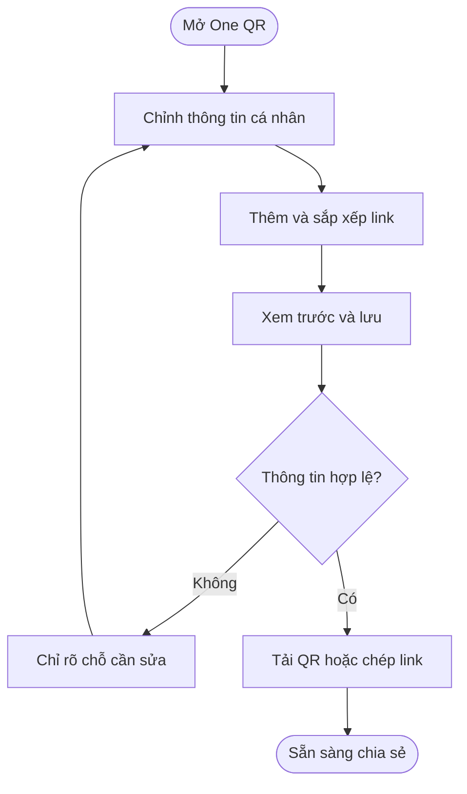
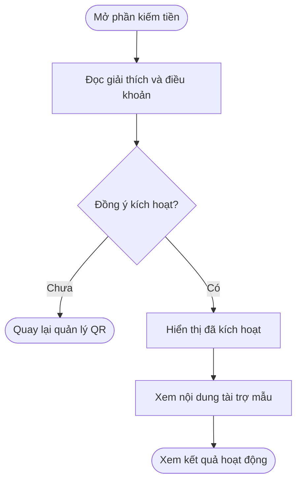
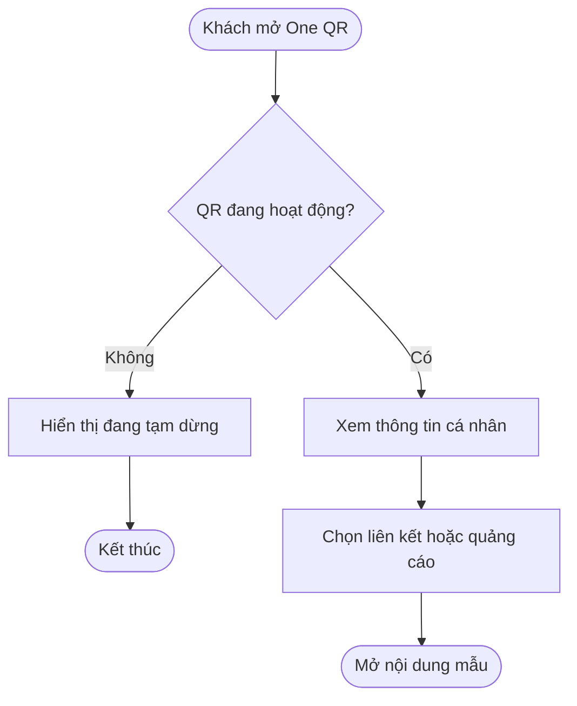
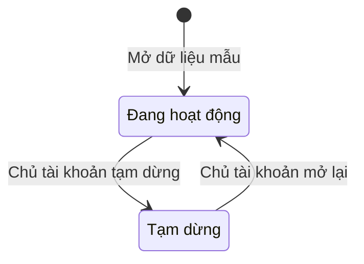
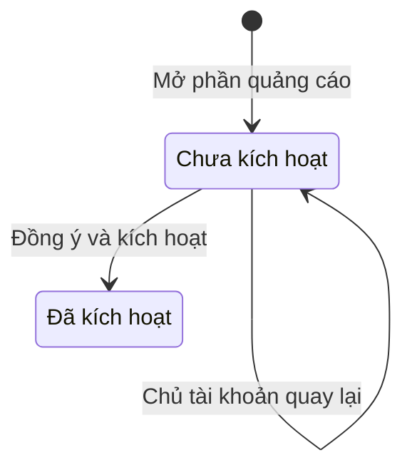

## Bàn giao thiết kế prototype One QR Personal

**Cập nhật lần cuối:** 28/10/2026

**Đối tượng đọc:** PO, người thiết kế, người dựng prototype và đội phát triển

**Trạng thái:** Đang rà soát — PO đã duyệt định hướng mở Personal; người dùng đã chốt nhóm sidebar One QR; danh sách trường và bố cục chi tiết đang đề xuất.

**Bản chia sẻ:** [Tài liệu trên GitHub](https://github.com/vlink-group/VlinkPay/blob/docs/1599-oneqr-earnings-points/nexora/docs/business/oneqr-personal-prototype-handoff.md)
**Ticket:** [#2420 — Mở One QR và quảng cáo kiếm tiền cho Personal](https://github.com/vlink-group/vlink-nexora/issues/2420)

### Tóm tắt nhanh

| Nội dung | Ý chính |
|---|---|
| Mục đích | Thiết kế One QR gọn cho cá nhân và khu vực quảng cáo giúp chủ QR kiếm tiền. |
| Luồng cần thể hiện | Chủ tài khoản cấu hình → xem trước → chia sẻ QR → khách mở trang cá nhân và nội dung quảng cáo. |
| Điều đã duyệt | Personal thuộc phạm vi sử dụng; cách sở hữu và ghi nhận theo A1–A2; bộ lọc ngành theo B3–B4. |
| Điều cần phân biệt | Danh sách trường và thiết kế dưới đây là đề xuất. Quét mã không đồng nghĩa đã kiếm được tiền; xem D10. |
| Bàn giao lần này | Bản mô tả để bên nhận tiếp tục làm prototype, chưa có prototype hoàn chỉnh và chưa mô tả tính năng đã chạy trên production. |

### Tổng quan

One QR Personal giúp người dùng tập hợp thông tin, liên kết và nội dung quảng cáo trên một trang cá nhân có thể chia sẻ bằng QR. Chủ tài khoản quản lý trang của mình; khách quét mã để xem và chọn nội dung. Bên nhận bàn giao cần dựng hai màn hình có thể thao tác để người dùng và PO đánh giá phạm vi trước khi triển khai sản phẩm.

Hiện tại, luồng quản lý One QR trong code tham chiếu gắn với Business. Personal đã có màn hình My QR phục vụ các QR chuyên biệt. Đề xuất dưới đây bổ sung trải nghiệm One QR cá nhân; các điểm khác với yêu cầu đã duyệt phải giữ nhãn đề xuất khi trình PO.

### Khái niệm chính

| Thuật ngữ | Ý nghĩa |
|---|---|
| Personal | Tài khoản cá nhân trên Nexora. |
| Business | Tài khoản doanh nghiệp hoặc tiệm trên Nexora. |
| Chủ QR | Cá nhân hoặc doanh nghiệp sở hữu One QR. |
| Bật quảng cáo kiếm tiền | Chủ QR tham gia hiển thị nội dung quảng cáo để có cơ hội được ghi nhận thu nhập theo chính sách. |
| Đăng quảng cáo trả phí | Người quảng cáo tạo nội dung hoặc chiến dịch để quảng bá. Đây là vai trò khác với chủ QR hiển thị quảng cáo. |
| Prototype | Bản mô phỏng giao diện và thao tác dùng để duyệt thiết kế; dữ liệu không đại diện cho giao dịch thật. |

### Vai trò người dùng

| Vai trò | Việc cần thực hiện |
|---|---|
| Chủ tài khoản Personal | Cấu hình trang, chia sẻ QR, kích hoạt quảng cáo và xem thông tin riêng của mình. |
| Khách quét mã | Xem trang công khai và mở liên kết hoặc nội dung quảng cáo. |
| PO | Duyệt trường thông tin, chức năng và cách trình bày. |
| Người dựng prototype | Thể hiện các màn hình, trạng thái và thao tác mô phỏng trong phạm vi bàn giao. |

### Thông tin và chức năng đề xuất

#### Trang khách nhìn thấy khi quét QR

Toàn bộ danh sách dưới đây là đề xuất thiết kế, chưa phải danh sách trường đã được PO duyệt.

| Thành phần | Nội dung | Cách thể hiện đề xuất |
|---|---|---|
| Tên hiển thị | Tên cá nhân lấy sẵn từ hồ sơ | Bắt buộc; cho phép chủ tài khoản chỉnh sửa tên dùng trên trang QR. |
| Ảnh đại diện | Ảnh từ hồ sơ | Tùy chọn; dùng ảnh mặc định khi chưa có ảnh. |
| Giới thiệu ngắn | Một đoạn giới thiệu bản thân | Tùy chọn; bỏ phần này khỏi trang nếu để trống. |
| Các liên kết | Website, mạng xã hội hoặc đường dẫn khác | Tùy chọn; mỗi liên kết có tên hiển thị và đường dẫn; chủ tài khoản được sắp xếp thứ tự. |
| Nhận thanh toán | Liên kết tới trang thanh toán cá nhân đã cấu hình | Tùy chọn; dùng lại cấu hình hiện có nếu chức năng này được chọn cho lần đầu. |
| Nội dung quảng cáo | Khu vực quảng cáo theo trạng thái tham gia | Có nhãn tài trợ rõ ràng; xem C7 và D10. |

Không tự đưa số điện thoại, email đăng nhập hoặc địa chỉ riêng lên trang. Nếu PO bổ sung liên hệ trực tiếp, phải có lựa chọn công khai rõ ràng của chủ tài khoản.

#### Màn hình quản lý của Personal

| Nhóm | Chức năng cần mô phỏng |
|---|---|
| Nội dung trang | Sửa tên hiển thị, ảnh đại diện và giới thiệu ngắn. |
| Danh sách liên kết | Thêm, sửa, bỏ liên kết và đổi thứ tự. |
| Xem trước | Xem đúng nội dung công khai trước khi lưu hoặc chia sẻ. |
| Mã và đường dẫn | Tải QR, sao chép link và chia sẻ. |
| Hoạt động của QR | Tạm dừng và mở lại QR. |
| Quảng cáo kiếm tiền | Mở từ One QR → Quảng cáo; xem giải thích, đọc điều khoản, đồng ý và kích hoạt; thể hiện rõ trạng thái đã kích hoạt. |
| Kết quả hoạt động | Xem lượt quét, lượt bấm, thu nhập quảng cáo và lịch sử liên quan theo C8. |

#### Thông tin của Business không đưa vào mẫu Personal ban đầu

Mẫu Personal không cần form tên tiệm, địa chỉ tiệm, giờ mở cửa, Station hoặc danh sách thợ. Các tab quản lý Owner, Staff, POS, Check-in và Review tiệm không thuộc thiết kế lần này. Việc chọn ngành chỉ để phục vụ chặn đối thủ không đưa vào luồng Personal theo B4.

#### Sidebar dùng chung cho Personal

Người dùng yêu cầu bổ sung nhóm sau cho cả Personal chưa phải thợ, chưa liên kết salon và Personal đã liên kết salon:

```text
One QR
  One QR
  Tip QR
  Accept Payment
  Referral Link
  Quảng cáo
```

Tip QR dùng lại phần My QR hiện có của thợ. Accept Payment mở QR thanh toán cá nhân và lối vào cấu hình phương thức nhận tiền. Referral Link dùng lại liên kết giới thiệu hiện có. Mục Quảng cáo mở phần kích hoạt và kết quả kiếm tiền của tài khoản cá nhân. Khi chưa có salon hợp lệ, Tip QR hiển thị hướng dẫn phù hợp; các công cụ cá nhân còn lại không lấy việc liên kết salon làm điều kiện mở màn hình.

Nhãn mới nhất là Accept Payment, thay cho đề xuất Payment Methods trước đó. Vị trí nhóm mới thay cho đề xuất đặt One QR bên trong My QR.

#### Hai màn hình cần dựng

| Màn hình | Bố cục và thao tác |
|---|---|
| Quản lý One QR Personal | Mở từ One QR → One QR. Hiển thị QR, link chia sẻ, trạng thái mã; các phần Thông tin, Liên kết và Kết quả hoạt động của QR. Phần kích hoạt và thu nhập quảng cáo mở từ One QR → Quảng cáo. Có nút lưu và xem trước. |
| Trang công khai | Ưu tiên giao diện điện thoại. Hiển thị ảnh, tên, giới thiệu, các liên kết và khu vực tài trợ. Chỉ đưa dữ liệu công khai theo C6. |

Trên máy tính, có thể đặt bản xem trước cạnh phần cấu hình. Trên điện thoại, các phần xếp dọc và thao tác chính phải dễ chọn. Giao diện nên bám phong cách Nexora hiện có; tên và thứ tự nhóm sidebar dùng đúng cấu trúc đã nêu.

Nhãn giao diện ưu tiên tiếng Anh Mỹ, như “My One QR”, “Edit profile”, “Links”, “Earn with ads”, “Preview” và “Sponsored”. Nội dung giải thích bàn giao dùng tiếng Việt.

### Các luồng từ đầu đến cuối

Các thao tác chi tiết trong phần này phục vụ dựng prototype và cần PO duyệt theo phạm vi tại phụ lục.

#### Luồng cấu hình và chia sẻ One QR

**Người thực hiện chính:** Chủ tài khoản Personal.
**Kích hoạt:** Người dùng chọn One QR → One QR trên sidebar.
**Kết quả:** Người dùng xem được trang đã cấu hình và chia sẻ mã.

**User stories**

- Là chủ tài khoản Personal, tôi muốn chỉnh thông tin và liên kết để khách thấy đúng nội dung tôi muốn chia sẻ.
- Là chủ tài khoản, tôi muốn được chỉ rõ đường dẫn chưa hợp lệ để sửa trước khi lưu.

| Bước | Ai | Hành động | Hệ thống phản hồi |
|---|---|---|---|
| 1 | Chủ tài khoản | Mở One QR | Hệ thống hiển thị dữ liệu mẫu gắn với tài khoản đang dùng. |
| 2 | Chủ tài khoản | Sửa thông tin và danh sách liên kết | Hệ thống cập nhật bản xem trước. |
| 3 | Chủ tài khoản | Chọn lưu | Hệ thống báo trường còn thiếu hoặc đường dẫn chưa hợp lệ; dữ liệu hợp lệ được lưu trong bản mô phỏng. |
| 4 | Chủ tài khoản | Tải QR hoặc sao chép link | Hệ thống cung cấp mã và đường dẫn tới trang công khai của prototype. |



#### Luồng kích hoạt quảng cáo kiếm tiền

**Người thực hiện chính:** Chủ tài khoản Personal.
**Kích hoạt:** Người dùng chọn One QR → Quảng cáo trên sidebar.
**Kết quả:** Prototype thể hiện sự đồng ý và trạng thái đã kích hoạt.

**User stories**

- Là chủ tài khoản Personal, tôi muốn hiểu cách tham gia trước khi kích hoạt quảng cáo.
- Là chủ tài khoản, tôi muốn quay lại khi chưa đồng ý để tiếp tục quản lý QR của mình.

| Bước | Ai | Hành động | Hệ thống phản hồi |
|---|---|---|---|
| 1 | Chủ tài khoản | Mở phần Quảng cáo kiếm tiền | Hệ thống giải thích quyền tham gia theo A2 và giới hạn theo D10. |
| 2 | Chủ tài khoản | Đọc điều khoản và chọn đồng ý | Hệ thống thể hiện lựa chọn của người dùng theo C7. |
| 3 | Chủ tài khoản | Chọn kích hoạt hoặc quay lại | Hệ thống hiển thị trạng thái tương ứng; prototype không phát sinh giao dịch theo D9. |
| 4 | Chủ tài khoản | Xem trang công khai và kết quả hoạt động | Hệ thống thể hiện nội dung tài trợ mẫu cùng dữ liệu riêng theo C8. |



#### Luồng khách mở trang công khai

**Người thực hiện chính:** Khách quét mã.
**Kích hoạt:** Khách quét QR hoặc mở link.
**Kết quả:** Khách xem đúng trang cá nhân và mở được nội dung mẫu.

**User stories**

- Là khách, tôi muốn xem thông tin và liên kết của cá nhân để chọn đúng nội dung cần mở.
- Là khách, tôi muốn nhận biết nội dung tài trợ và được thông báo rõ khi mã đang tạm dừng.

| Bước | Ai | Hành động | Hệ thống phản hồi |
|---|---|---|---|
| 1 | Khách | Quét QR hoặc mở link | Hệ thống xác định trang cá nhân và trạng thái QR. |
| 2 | Hệ thống | Kiểm tra QR | Hệ thống hiển thị trang đang hoạt động hoặc thông báo tạm dừng. |
| 3 | Khách | Chọn liên kết hoặc nội dung tài trợ | Hệ thống mở đích mẫu; cách mô phỏng tuân theo D9–D10. |



### Cấu hình và quản trị

- Là PO, tôi muốn phân biệt phần đã duyệt và phần đề xuất để quyết định phạm vi lần phát hành đầu.
- Là người dựng prototype, tôi muốn mô phỏng được QR tạm dừng, quảng cáo chưa kích hoạt và trạng thái trống để trình bày đầy đủ.
- Là người vận hành, tôi muốn cách áp dụng bộ lọc ngành tuân theo B3–B4 khi tính năng được triển khai.

Prototype không cần xây màn hình quản trị chiến dịch, danh mục ngành hoặc hệ thống thanh toán thật.

### Vòng đời trạng thái

Các trạng thái sau dùng để trình bày prototype, chưa quy định vòng đời dữ liệu phía máy chủ.

| Đối tượng | Trạng thái hiện tại | Thao tác | Trạng thái sau |
|---|---|---|---|
| One QR | Đang hoạt động | Chủ tài khoản tạm dừng mã | Tạm dừng |
| One QR | Tạm dừng | Chủ tài khoản mở lại mã | Đang hoạt động |
| Tham gia quảng cáo | Chưa kích hoạt | Chủ tài khoản đồng ý và kích hoạt | Đã kích hoạt |
| Tham gia quảng cáo | Chưa kích hoạt | Chủ tài khoản quay lại | Chưa kích hoạt |





### Quy tắc nghiệp vụ

#### A Phạm vi đã duyệt

- **A1. Sở hữu One QR:** Mỗi tài khoản Personal có One QR riêng, được cấu hình và chia sẻ mà không cần tạo Business hoặc liên kết với tiệm.
- **A2. Kiếm tiền từ quảng cáo:** Personal được bật tính năng quảng cáo để kiếm tiền; hệ thống phải ghi nhận thu nhập cho đúng tài khoản sở hữu QR.

#### B Bộ lọc ngành đã duyệt

- **B3. Business:** Hệ thống phân loại ngành nghề để chặn quảng cáo đối thủ cùng ngành trên One QR của tiệm.
- **B4. Personal:** Hệ thống không áp dụng bộ lọc chặn quảng cáo đối thủ theo ngành. Quyết định này không miễn các chính sách kiểm duyệt và phân phối quảng cáo chung.

#### C Đề xuất cho thiết kế

- **C5. Thông tin gọn:** Mẫu Personal dùng danh sách trường tại phần Thông tin và chức năng đề xuất; trạng thái bắt buộc hoặc tùy chọn trong bảng cần PO duyệt.
- **C6. Công khai dữ liệu:** Trang khách chỉ hiển thị thông tin được chọn công khai. Thu nhập, lịch sử giao dịch, hồ sơ xác minh và thông tin nhận tiền thuộc phần riêng của chủ tài khoản.
- **C7. Kích hoạt quảng cáo:** Prototype có phần giải thích, ô đồng ý chưa chọn sẵn và nút kích hoạt. Nội dung tài trợ mang nhãn rõ ràng. Thao tác tắt quảng cáo chưa được xác định trong phạm vi này.
- **C8. Kết quả hoạt động:** Prototype thể hiện lượt quét, lượt bấm và khu vực thu nhập riêng của chủ QR. Khi chưa chốt đơn vị và cách ghi nhận, dùng trạng thái trống hoặc ghi rõ dữ liệu minh họa.

#### D Giới hạn của bản bàn giao

- **D9. Mô phỏng:** Prototype chỉ mô phỏng thao tác; không dùng tài khoản thật, gọi giao dịch nhận tiền, tạo chiến dịch thật hoặc làm thay đổi số dư thật.
- **D10. Thu nhập:** Prototype không coi quét QR, mở trang hoặc bấm nội dung là bằng chứng được trả tiền. Cơ chế xét hoạt động hợp lệ và ghi nhận thuộc nghiệp vụ kiếm tiền liên quan.
- **D11. Quảng cáo trả phí:** Yêu cầu kích hoạt quảng cáo kiếm tiền không tự quyết định giao diện tạo chiến dịch quảng cáo trả phí. Bên nhận không tự bổ sung luồng này vào prototype.

### Tiêu chí nghiệm thu prototype

#### Phạm vi và thông tin

- [ ] Bản trình PO ghi rõ các đề xuất chưa duyệt theo C5.
- [ ] Màn hình quản lý thể hiện quyền sử dụng theo A1.
- [ ] Trang công khai phân tách dữ liệu đúng C6.
- [ ] Mẫu Personal áp dụng B4.

#### Thao tác

- [ ] Chủ tài khoản chỉnh được thông tin mẫu.
- [ ] Chủ tài khoản thêm, sửa và bỏ liên kết mẫu được.
- [ ] Chủ tài khoản đổi được thứ tự liên kết.
- [ ] Bản xem trước cập nhật theo nội dung đã chỉnh.
- [ ] Nút tải hoặc chia sẻ QR có phản hồi rõ ràng trong bản mô phỏng.
- [ ] Trạng thái tạm dừng và mở lại thể hiện được trên trang công khai.
- [ ] Luồng quảng cáo thể hiện đúng đề xuất C7.
- [ ] Khu vực kết quả hoạt động tuân theo C8.

#### Trình bày

- [ ] Bên nhận bàn giao đủ màn hình quản lý và trang công khai.
- [ ] Trang công khai dùng được trên điện thoại mà không tràn ngang.
- [ ] Các nội dung tài trợ được nhận biết rõ.
- [ ] Prototype tuân theo D9–D11.

### Ngoại lệ và xử lý

| Tình huống | Cách thể hiện trong prototype | Người xử lý |
|---|---|---|
| Thiếu tên hoặc liên kết sai | Hệ thống chỉ rõ trường cần sửa; giữ nội dung đang nhập. | Chủ tài khoản |
| Chưa thêm liên kết | Trang chỉ hiển thị các phần còn đủ dữ liệu; phần quản lý có lời nhắc thêm liên kết. | Chủ tài khoản |
| Chưa cấu hình nhận thanh toán | Trang công khai bỏ chức năng nhận thanh toán khỏi danh sách. | Chủ tài khoản |
| Chưa đồng ý quảng cáo | Hệ thống giữ trạng thái chưa kích hoạt. | Chủ tài khoản |
| Đã kích hoạt nhưng chưa có quảng cáo | Trang vẫn dùng được; không hiển thị ô quảng cáo rỗng. | Hệ thống |
| QR đang tạm dừng | Trang công khai thông báo mã đang tạm dừng. | Chủ tài khoản |

### Câu hỏi thường gặp

**PO đã duyệt toàn bộ trường và màn hình trong tài liệu chưa?**
Chưa. Các quyết định đã duyệt nằm ở A1–A2 và B3–B4; các lựa chọn cần chốt được tập hợp trong phụ lục.

**Personal có cần form dài như Business không?**
Đề xuất dùng mẫu gọn tại phần Thông tin và chức năng đề xuất; phần riêng của tiệm được loại khỏi mẫu ban đầu.

**Lần này bên nhận cần làm sản phẩm thật hay prototype?**
Bên nhận tiếp tục thiết kế prototype để review và xin PO duyệt; tuân theo D9. Việc triển khai sản phẩm là bước tiếp theo sau khi chốt phạm vi.

### Tính năng liên quan

- **One QR Business:** Trải nghiệm hiện có để tham khảo bố cục cấu hình, mã QR và bản xem trước.
- **[Sidebar Personal](personal-sidebar-menu.md):** Nhóm One QR với năm mục con dùng chung cho Personal chưa liên kết và đã liên kết salon.
- **My QR và thanh toán cá nhân:** Nguồn chức năng nhận tip, thanh toán và giới thiệu để dùng lại trong nhóm mới.
- **[Kiếm tiền từ quảng cáo qua OneQR — ticket #1599](https://github.com/vlink-group/vlink-nexora/issues/1599):** Phạm vi liên quan đến điều kiện ghi nhận và quản lý thu nhập. Bản bàn giao này không đặt mức thưởng, tỷ lệ quy đổi hoặc điều kiện rút tiền mới.

### Phụ lục

#### Những điểm cần duyệt

| Nội dung | Cần chốt | Người quyết định |
|---|---|---|
| Trường trên trang công khai | Danh sách trường, trường bắt buộc và cách dùng lại hồ sơ theo C5. | Người dùng và PO |
| Danh sách chức năng lần đầu | Có đưa nhận thanh toán vào mẫu đầu hay chỉ thông tin, liên kết và quảng cáo. | Người dùng và PO |
| Kích hoạt quảng cáo | Nội dung điều khoản, cách thể hiện đồng ý và hành vi sau kích hoạt theo C7. | PO |
| Kết quả hoạt động | Đơn vị, nhãn và mức chi tiết của khu vực thu nhập theo C8. | PO |
| Phạm vi triển khai | Chốt thiết kế sau khi review prototype; tài liệu này chưa thay cho yêu cầu triển khai đã duyệt đầy đủ. | Người dùng và PO |

#### Tham chiếu nghiệp vụ và kỹ thuật

| Nguồn | Thông tin được dùng |
|---|---|
| [Ticket #2420](https://github.com/vlink-group/vlink-nexora/issues/2420), đối chiếu ngày 28/10/2026 | Nội dung mở One QR Personal và quảng cáo kiếm tiền; phân biệt bộ lọc ngành giữa Business và Personal. |
| Trao đổi PO được người dùng cung cấp ngày 28/10/2026 | PO đồng ý đề xuất; yêu cầu tiệm phân ngành để chặn đối thủ, Personal không áp dụng bộ lọc này. |
| Danh sách đề xuất trong cuộc trao đổi trước khi bàn giao | Nguồn của các trường và chức năng đang chờ duyệt; không dùng để xác nhận PO đã duyệt chi tiết. |
| [Frontend tham chiếu](https://github.com/vlink-group/vlink-nexora-fe/commit/6506048c31d9e82dadd20837e77c6ab111d4d55f) | Nhánh `origin/staging` đang có; đọc `src/components/touchpoints/oneqr/OneQrConfigForm.tsx`, `OneQrPreview.tsx` và `src/components/staff-dashboard/views/StaffMyQR.tsx` để đối chiếu cấu hình và QR cá nhân hiện hữu. |
| [Backend tham chiếu](https://github.com/vlink-group/vlink-nexora/commit/9089c1b780b1836ce1e81918565c30cab5de4f6b) | Nhánh `origin/staging` đang có; `backend/src/Application/Features/Merchant/OneQr/OneQrBusinessResolver.cs` và `backend/src/Domain/Entities/BusinessOneQr.cs` cho thấy quyền quản lý và dữ liệu One QR hiện gắn với doanh nghiệp. |
| Glossary của VlinkPay trong workspace | Đối chiếu cách dùng thuật ngữ; các khái niệm riêng của One QR được giải thích tại phần Khái niệm chính. |

Các tham chiếu code trên là commit đã có tại máy khi đối chiếu, không khẳng định là bản mới nhất trên remote. Quyền truy cập các link GitHub phụ thuộc quyền của bên nhận.

#### Đầu ra bàn giao cho bên dựng prototype

1. Hai màn hình có thể thao tác theo phần Hai màn hình cần dựng, có bản xem trên điện thoại và máy tính; bổ sung sidebar cho hai trạng thái Personal theo cấu trúc đã chốt.
2. Một đường dẫn review hoặc gói file có thể mở độc lập, kèm hướng dẫn mở ngắn gọn.
3. Các trạng thái và thao tác trong ba luồng chính được mô phỏng rõ ràng.
4. Danh sách Những điểm cần duyệt được giữ để người dùng và PO tiếp tục quyết định.
