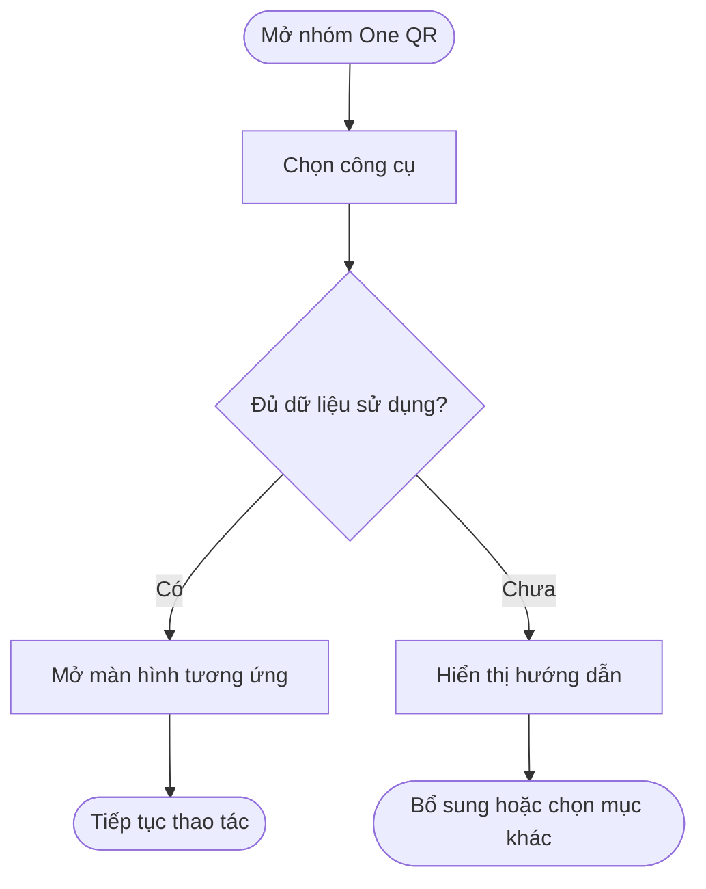
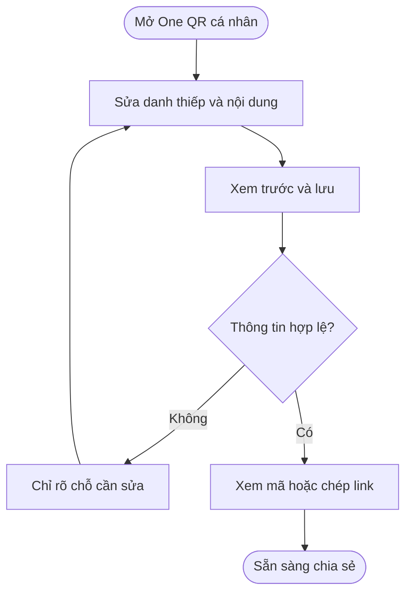
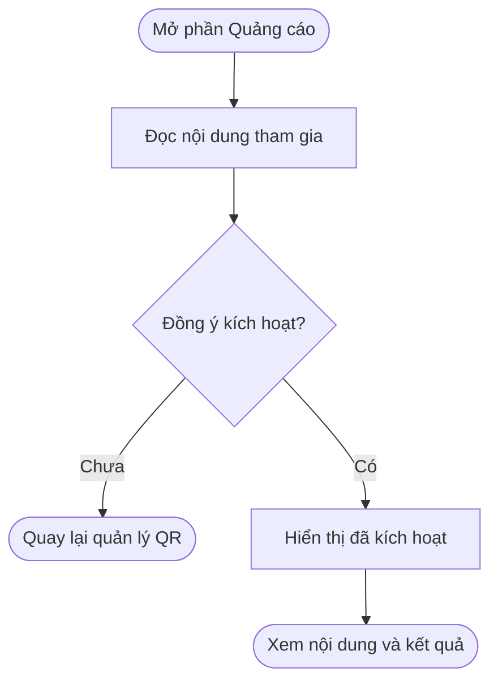
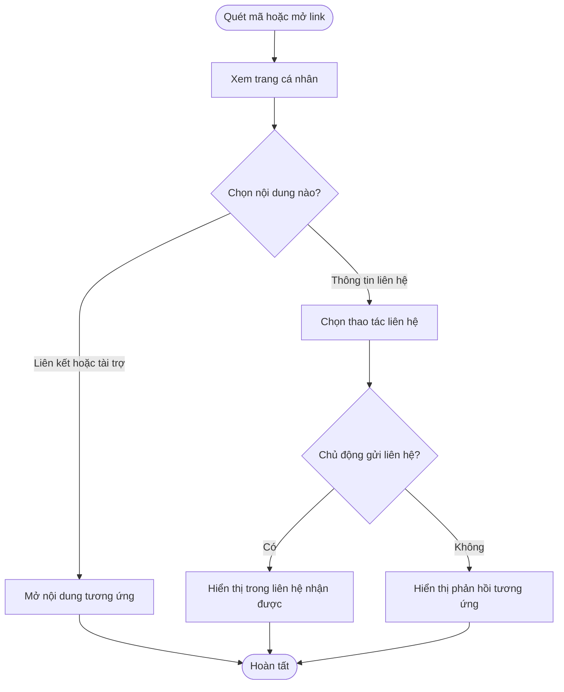
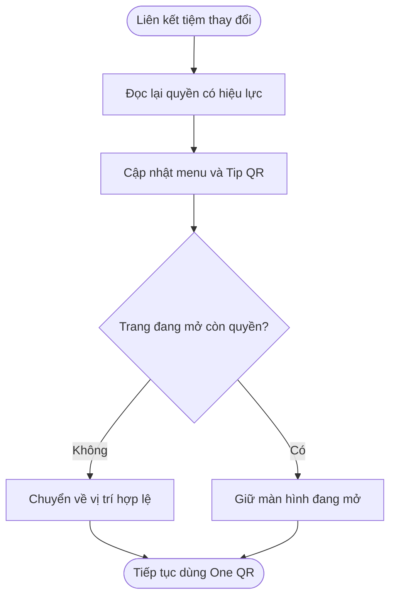
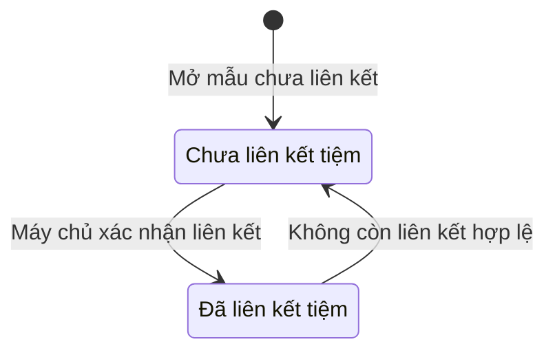
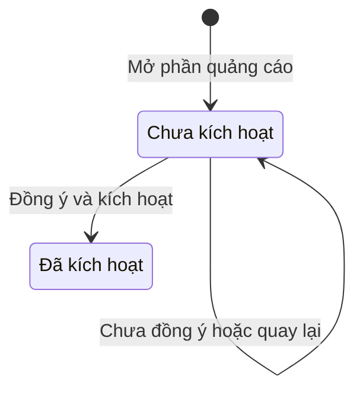

## One QR cho tài khoản Personal — sidebar và màn hình quản lý

**Cập nhật lần cuối:** 28/10/2026

**Đối tượng đọc:** PO, người thiết kế, người dựng prototype và đội phát triển

**Trạng thái:** Đang rà soát — PO đã duyệt mở One QR và quảng cáo kiếm tiền cho Personal. Tài liệu tổng hợp các yêu cầu giao diện mới nhất để duyệt thiết kế.

**Bản chia sẻ:** [Tài liệu trên GitHub](https://github.com/vlink-group/VlinkPay/blob/docs/1599-oneqr-earnings-points/nexora/docs/business/oneqr-personal.md)

**Ticket:** [#2420 — Mở One QR và quảng cáo kiếm tiền cho Personal](https://github.com/vlink-group/vlink-nexora/issues/2420)

### Tóm tắt nhanh

| Nội dung | Ý chính |
|---|---|
| Mục đích | Personal có One QR riêng để chia sẻ thông tin, liên kết và tham gia quảng cáo kiếm tiền. |
| Nơi truy cập | Bổ sung nhóm One QR trên sidebar cho cả cá nhân chưa liên kết tiệm và thợ đã liên kết tiệm. |
| Luồng chính | Mở từ sidebar → sửa nội dung → xem trước và lưu → chia sẻ QR; phần quảng cáo có luồng kích hoạt riêng. |
| Thiết kế | Dùng bố cục One QR Business đã có, điều chỉnh theo mục Thiết kế One QR cá nhân; áp dụng phạm vi tại A1–A4. |
| Trạng thái | Đã có prototype để review; chưa xác nhận triển khai trên sản phẩm. Quét QR không tự tạo thu nhập, theo D15. |

### Tổng quan

One QR Personal giúp cá nhân tập hợp thông tin và liên kết trên một trang có thể chia sẻ bằng QR. Chủ tài khoản quản lý nội dung, phương thức nhận tiền, liên kết giới thiệu và quảng cáo của mình. Sidebar bổ sung nhóm One QR để truy cập các công cụ này tại một nơi.

Tài liệu tập trung vào One QR cá nhân; phần sidebar xác định vị trí truy cập và cách dùng lại chức năng hiện có. Các menu làm việc tại tiệm chỉ được đưa vào để thể hiện sự khác nhau giữa hai trạng thái Personal.

Code tham chiếu hiện gắn phần quản lý One QR với Business. Những nội dung dưới đây là yêu cầu thiết kế và phạm vi prototype; nguồn đối chiếu nằm trong phụ lục.

### Khái niệm chính

| Thuật ngữ | Ý nghĩa |
|---|---|
| Personal chưa liên kết tiệm | Cá nhân chưa có liên kết tiệm có hiệu lực, gồm người chưa phải thợ. |
| Personal đã liên kết tiệm | Cá nhân có liên kết tiệm hợp lệ và dùng chức năng làm việc theo quyền. Loại tài khoản vẫn là Personal. |
| One QR cá nhân | Mã dẫn đến trang thông tin và các liên kết của chủ tài khoản. |
| Danh thiếp cá nhân | Nơi quản lý tên hiển thị, giới thiệu và thông tin muốn công khai trên trang QR. |
| Tip QR | Mục dùng lại chức năng QR nhận tip trong My QR hiện có của thợ. |
| Accept Payment | Mục quản lý QR nhận thanh toán cá nhân và các phương thức nhận tiền. |
| Referral Link | Mục sử dụng liên kết giới thiệu hiện có của tài khoản. |
| Quảng cáo | Mục tham gia hiển thị nội dung tài trợ và xem kết quả kiếm tiền của chủ QR. |
| Prototype | Bản mô phỏng giao diện và thao tác để duyệt thiết kế, dùng dữ liệu mẫu. |

### Người dùng và trách nhiệm

| Người dùng | Trách nhiệm |
|---|---|
| Chủ tài khoản Personal | Sửa nội dung, chọn thông tin công khai, chia sẻ QR và kích hoạt quảng cáo. |
| Người quét mã | Xem trang cá nhân, chọn liên kết hoặc chia sẻ lại thông tin liên hệ. |
| PO | Duyệt thiết kế, câu chữ và các điểm còn mở trong phụ lục. |
| Người thiết kế và đội phát triển | Dùng prototype để đối chiếu giao diện và xác định phần cần dùng lại hoặc mở rộng. |

### Sidebar: bổ sung nhóm One QR

#### Cấu trúc và màn hình đích

Nhóm One QR có năm mục con theo thứ tự sau:

```text
One QR
  One QR
  Tip QR
  Accept Payment
  Referral Link
  Quảng cáo
```

| Mục con | Màn hình đích | Chưa liên kết tiệm | Đã liên kết tiệm |
|---|---|---|---|
| One QR | Quản lý trang One QR cá nhân | Sử dụng được | Cùng chức năng cá nhân |
| Tip QR | QR nhận tip dùng lại từ My QR của thợ | Hiển thị tình trạng và hướng dẫn theo B7 | Hiển thị QR theo tiệm và quyền hợp lệ |
| Accept Payment | QR nhận thanh toán và cấu hình phương thức nhận tiền | Sử dụng được; thiếu cấu hình thì hướng dẫn bổ sung | Dùng thông tin nhận tiền của chính cá nhân |
| Referral Link | Liên kết giới thiệu và công cụ chia sẻ | Sử dụng được khi đã có liên kết hợp lệ | Dùng liên kết thuộc tài khoản |
| Quảng cáo | Kích hoạt và xem kết quả quảng cáo kiếm tiền | Sử dụng được | Cùng chức năng cá nhân |

#### Hai trạng thái sidebar

| Vị trí | Personal chưa liên kết tiệm | Personal đã liên kết tiệm |
|---|---|---|
| Đầu menu | Dashboard, Community | Dashboard, Community |
| Nhóm bổ sung | One QR và năm mục con ở trên | One QR và năm mục con ở trên |
| Công cụ làm việc | Hiển thị theo quyền hiện có | My Workspace gồm My Salons, My Earnings, My Reviews, Report; tiếp theo là My Tickets, My Calendar, Tips, Transactions |
| Cuối menu | Profile, Sign Out | Profile, Sign Out |

Nhóm mới được đặt sau Community. Vị trí các menu ngoài One QR là bố cục để review, không mở rộng quyền quản lý tiệm. Cách chuyển các lối vào cũ thực hiện theo B8; cách đánh dấu và thu gọn menu thực hiện theo B9.

### Thiết kế One QR cá nhân

#### Bố cục giữ từ One QR Business

Màn hình **One QR của tôi** giữ bố cục quản lý hiện có và thay nội dung cho phù hợp với cá nhân.

| Khu vực | Nội dung và thao tác |
|---|---|
| Hoạt động hôm nay | Lượt quét QR, lượt bấm liên kết và lượt lưu liên hệ. Prototype ghi rõ dữ liệu minh hoạ. |
| Thẻ QR cá nhân | Tên One QR, mã QR, đường dẫn; các nút Xem QR, Sao chép URL và Xem bản in. |
| Nội dung hiển thị | Danh sách nội dung với biểu tượng, tên, URL, bật/tắt, đổi thứ tự và xoá; có ô thêm liên kết, Thêm nội dung và Khôi phục mẫu. |
| Cấu hình | Tên One QR, Lời chào và nút Lưu thay đổi. |
| Xem trước | Trang cá nhân trên điện thoại, cập nhật theo nội dung đang chỉnh. |
| Thông tin dùng chung | Danh thiếp cá nhân được dùng cho trang QR, vCard, thẻ trong ví điện thoại và thông tin liên hệ. |
| Hiệu quả One QR | Lượt quét, lượt bấm và lượt lưu liên hệ trong 30 ngày; phân bố lượt bấm theo nội dung. |
| Liên hệ nhận được | Danh sách người chủ động gửi thông tin qua trang QR; có trạng thái trống. |

Ba cột chỉnh sửa gồm **Nội dung hiển thị – Cấu hình – Xem trước**. Trên màn hình nhỏ, các phần xếp lại để đọc và thao tác được.

#### Phần loại bỏ khi chuyển từ Business

- Bỏ bước chọn ngành và liên kết **Change industry**.
- Bỏ toàn bộ tab **Customer, Staff, Owner** ở phần chỉnh sửa và bản xem trước.
- Bỏ trường **Identity** và các lựa chọn đi kèm.
- Bỏ nội dung mặc định dành cho tiệm: giờ mở cửa, địa chỉ tiệm, Station, danh sách nhân viên, dịch vụ, đánh giá tiệm và luồng sau khi làm dịch vụ.

Thông tin tiệm đã liên kết có thể xuất hiện trong phần giới thiệu của thợ; đây không phải một trang cấu hình Business khác.

#### Thông tin cá nhân và câu chữ

| Nội dung | Cách dùng trong thiết kế |
|---|---|
| Tiêu đề trang quản lý | “One QR của tôi”. |
| Mô tả | “Một mã QR để chia sẻ thông tin và các liên kết của bạn.” |
| Tên One QR | Tên để chủ tài khoản nhận biết QR, ví dụ “NGUYỄN MINH AN — One QR”. |
| Tên hiển thị | Tên cá nhân từ hồ sơ; chủ tài khoản có thể chỉnh trong Danh thiếp cá nhân. |
| Ảnh đại diện | Dùng ảnh hồ sơ hoặc ảnh mặc định khi chưa có ảnh. |
| Lời chào | Nội dung ngắn do cá nhân tự viết, ví dụ “Xin chào, mình là An. Rất vui được kết nối với bạn!”. |
| Giới thiệu | Đoạn “Đôi nét về tôi”; bỏ phần này trên trang công khai nếu để trống. |
| Danh sách nội dung | Dùng tiêu đề “Các liên kết của tôi”; từng nội dung có tên và URL. |
| Email và số điện thoại | Tuỳ chọn; có lựa chọn công khai riêng trong Danh thiếp cá nhân, theo C11. |
| Thông tin không có dữ liệu | Bỏ thành phần tương ứng trên trang công khai; màn hình quản lý hướng dẫn bổ sung khi cần. |

Nhãn menu giữ nguyên theo cấu trúc sidebar. Nội dung trong prototype dùng tiếng Việt để review; câu chữ giới thiệu nói về cá nhân đang sở hữu QR.

#### Hai mẫu nội dung

Các liên kết dưới đây là nội dung mẫu để review, người dùng có thể chỉnh hoặc bỏ theo C10.

| Thành phần | Personal chưa liên kết tiệm | Thợ đã liên kết tiệm |
|---|---|---|
| Giới thiệu | Giới thiệu bản thân và các kênh cá nhân | Giới thiệu bản thân, có thể kèm tên tiệm đang làm việc |
| Liên kết mẫu | Hồ sơ cá nhân, Instagram của tôi, Gửi thanh toán, Tham gia cùng tôi | Gửi tip cho tôi, Đặt lịch với tôi tại tiệm, Instagram của tôi, Gửi thanh toán |
| Liên kết đặt lịch | Chủ tài khoản có thể tự thêm URL hợp lệ | Dùng liên kết đặt lịch tại tiệm đã có; không tạo chức năng đặt lịch riêng cho thợ trong phạm vi này |
| Nội dung nhận tip | Áp dụng B7 | Dùng lại QR nhận tip của cá nhân theo tiệm hợp lệ |

#### Trang công khai và bản xem trước

| Thành phần | Nội dung |
|---|---|
| Đầu trang | Ảnh đại diện, tên hiển thị và lời chào. |
| Thao tác liên hệ | Lưu liên hệ, Thêm vào ví, Gửi liên hệ và Chia sẻ; nút gọi/nhắn tin chỉ có khi đủ thông tin công khai. |
| Các liên kết | Chỉ hiển thị nội dung đang bật và đủ dữ liệu theo C10. |
| Giới thiệu | Đoạn giới thiệu của cá nhân; thông tin tiệm theo mẫu đã liên kết nếu được sử dụng. |
| Nội dung tài trợ | Có nhãn rõ ràng và áp dụng C12. |
| Cuối trang | Lối thêm trang cá nhân vào màn hình chính. |

Trang công khai ưu tiên hiển thị trên điện thoại. Thông tin riêng và thông tin được phép chia sẻ thực hiện theo C11.

#### Quảng cáo và các công cụ dùng lại

| Màn hình | Phạm vi |
|---|---|
| Quảng cáo | Giải thích tham gia kiếm tiền, lựa chọn đồng ý, nút kích hoạt, trạng thái và khu vực kết quả/thu nhập. |
| Tip QR | Dùng lại My QR nhận tip của thợ; có hướng dẫn khi chưa đủ điều kiện theo B7. |
| Accept Payment | QR nhận tiền của cá nhân và danh sách phương thức nhận tiền trong cùng màn hình. |
| Referral Link | Liên kết giới thiệu của tài khoản, thao tác sao chép và thêm liên kết này vào One QR. |

### Các luồng từ đầu đến cuối

#### Luồng 1: Mở công cụ từ sidebar

**Người thực hiện:** Chủ tài khoản Personal.

**Bắt đầu:** Người dùng mở nhóm One QR.

**Kết quả:** Hệ thống mở đúng màn hình hoặc hướng dẫn bổ sung dữ liệu.

**Nhu cầu người dùng:**

- Là cá nhân, tôi muốn tìm QR và các công cụ liên quan tại cùng một nhóm để dễ sử dụng.
- Là cá nhân chưa liên kết tiệm, tôi muốn biết tình trạng Tip QR để tiếp tục dùng các mục còn lại.

| Bước | Ai | Hành động | Phản hồi hệ thống |
|---|---|---|---|
| 1 | Chủ tài khoản | Mở nhóm và chọn mục con | Hệ thống đánh dấu mục đang chọn theo B9. |
| 2 | Hệ thống | Kiểm tra dữ liệu và quyền của chức năng | Hệ thống mở màn hình; thiếu dữ liệu thì hướng dẫn theo B6–B7. |
| 3 | Chủ tài khoản | Tiếp tục thao tác hoặc chọn mục khác | Hệ thống giữ các công cụ cá nhân theo A1. |



#### Luồng 2: Cấu hình và chia sẻ One QR

**Người thực hiện:** Chủ tài khoản Personal.

**Bắt đầu:** Người dùng chọn One QR → One QR.

**Kết quả:** Người dùng lưu nội dung và xem mã hoặc đường dẫn để chia sẻ.

**Nhu cầu người dùng:**

- Là cá nhân, tôi muốn sửa danh thiếp và các liên kết để người quét mã thấy đúng nội dung tôi muốn chia sẻ.
- Là cá nhân, tôi muốn được chỉ rõ thông tin chưa hợp lệ để sửa trước khi lưu.

| Bước | Ai | Hành động | Phản hồi hệ thống |
|---|---|---|---|
| 1 | Chủ tài khoản | Sửa Danh thiếp cá nhân, tên One QR và lời chào | Hệ thống cập nhật bản xem trước. |
| 2 | Chủ tài khoản | Thêm, sửa, bật/tắt, đổi biểu tượng, đổi thứ tự hoặc xoá nội dung | Hệ thống phản ánh thay đổi theo C10. |
| 3 | Chủ tài khoản | Chọn Lưu thay đổi | Hệ thống kiểm tra tên và URL; báo lỗi hoặc xác nhận lưu. |
| 4 | Chủ tài khoản | Chọn Xem QR, Sao chép URL hoặc Xem bản in | Prototype cung cấp phản hồi tương ứng; giới hạn theo D14. |



#### Luồng 3: Kích hoạt quảng cáo kiếm tiền

**Người thực hiện:** Chủ tài khoản Personal.

**Bắt đầu:** Người dùng chọn One QR → Quảng cáo.

**Kết quả:** Hệ thống thể hiện lựa chọn tham gia và trạng thái đã kích hoạt.

**Nhu cầu người dùng:**

- Là cá nhân, tôi muốn hiểu việc tham gia trước khi đồng ý hiển thị quảng cáo.
- Là cá nhân chưa muốn tham gia, tôi muốn quay lại quản lý QR mà không bị buộc kích hoạt.

| Bước | Ai | Hành động | Phản hồi hệ thống |
|---|---|---|---|
| 1 | Chủ tài khoản | Mở Quảng cáo và đọc nội dung tham gia | Hệ thống hiển thị giải thích và lựa chọn đồng ý theo C12. |
| 2 | Chủ tài khoản | Chọn đồng ý và kích hoạt, hoặc quay lại | Hệ thống giữ trạng thái chưa kích hoạt hoặc chuyển sang đã kích hoạt. |
| 3 | Chủ tài khoản | Xem kết quả và bản xem trước | Hệ thống trình bày nội dung tài trợ, dữ liệu và trạng thái trống theo C12–C13. |



#### Luồng 4: Người quét mã mở trang cá nhân

**Người thực hiện:** Người quét QR hoặc mở đường dẫn.

**Bắt đầu:** Người dùng truy cập One QR của cá nhân.

**Kết quả:** Người dùng xem thông tin công khai và chọn nội dung cần mở.

**Nhu cầu người dùng:**

- Là người quét mã, tôi muốn nhận biết cá nhân sở hữu QR và chọn đúng liên kết cần dùng.
- Là người quét mã, tôi muốn phân biệt nội dung tài trợ với liên kết cá nhân.

| Bước | Ai | Hành động | Phản hồi hệ thống |
|---|---|---|---|
| 1 | Người quét mã | Quét QR hoặc mở đường dẫn | Hệ thống hiển thị trang cá nhân theo C10–C11. |
| 2 | Người quét mã | Chọn liên kết, thao tác liên hệ hoặc nội dung tài trợ | Prototype thể hiện đích đến hoặc phản hồi mẫu theo D14. |
| 3 | Người quét mã | Chủ động gửi thông tin liên hệ | Prototype thêm liên hệ mẫu vào phần Liên hệ nhận được của chủ QR. |



#### Luồng 5: Cập nhật khi thay đổi liên kết tiệm

**Người thực hiện:** Hệ thống và chủ tài khoản Personal.

**Bắt đầu:** Máy chủ xác nhận thay đổi liên kết tiệm theo luồng hiện có.

**Kết quả:** Menu làm việc và Tip QR cập nhật; dữ liệu cá nhân được giữ theo B5.

**Nhu cầu người dùng:**

- Là cá nhân đã liên kết tiệm, tôi muốn thấy chức năng làm việc đúng quyền của mình.
- Là cá nhân rời tiệm, tôi muốn tiếp tục sử dụng One QR của mình.

| Bước | Ai | Hành động | Phản hồi hệ thống |
|---|---|---|---|
| 1 | Hệ thống | Đọc lại liên kết và quyền có hiệu lực | Hệ thống cập nhật menu làm việc và trạng thái Tip QR theo B6–B7. |
| 2 | Hệ thống | Kiểm tra màn hình theo tiệm đang mở | Hệ thống đưa người dùng về vị trí hợp lệ nếu đã mất quyền và thông báo rõ. |
| 3 | Chủ tài khoản | Tiếp tục dùng nhóm One QR | Hệ thống giữ dữ liệu cá nhân theo B5. |



### Cấu hình và quản trị

- Là người thiết kế, tôi muốn dùng cùng một bố cục One QR cho hai trạng thái Personal để review phần khác nhau theo tiệm.
- Là đội phát triển, tôi muốn dùng lại các màn hình trong B8 để giữ một nguồn dữ liệu cho mỗi công cụ.
- Là PO, tôi muốn xem các điểm còn mở trong một danh sách ở phụ lục để duyệt thiết kế.

### Vòng đời trạng thái

Các trạng thái dưới đây phục vụ hiển thị; việc xác nhận liên kết tiệm vẫn theo hệ thống hiện có.

| Đối tượng | Trạng thái hiện tại | Sự kiện | Trạng thái sau |
|---|---|---|---|
| Liên kết tiệm | Chưa liên kết | Máy chủ xác nhận có liên kết hợp lệ | Đã liên kết |
| Liên kết tiệm | Đã liên kết | Máy chủ xác nhận không còn tiệm hợp lệ | Chưa liên kết |
| Quảng cáo | Chưa kích hoạt | Người dùng chưa đồng ý hoặc quay lại | Chưa kích hoạt |
| Quảng cáo | Chưa kích hoạt | Người dùng đồng ý và kích hoạt | Đã kích hoạt |





### Quy tắc nghiệp vụ

#### A. Phạm vi One QR Personal

- **A1. Sử dụng độc lập:** Mỗi Personal có One QR riêng và nhóm menu tại phần Sidebar. Việc mở One QR, Accept Payment, Referral Link và Quảng cáo không yêu cầu tạo Business, trở thành thợ hoặc liên kết tiệm.
- **A2. Quảng cáo kiếm tiền:** Personal được tham gia hiển thị quảng cáo; kết quả và thu nhập phải thuộc đúng tài khoản sở hữu QR.
- **A3. Bộ lọc ngành:** Personal không áp dụng bộ lọc chặn đối thủ theo ngành. Chính sách kiểm duyệt và phân phối chung vẫn áp dụng; Business tiếp tục xử lý ngành theo phạm vi riêng.
- **A4. Giao diện cá nhân:** Thiết kế giữ các khu vực được liệt kê trong phần Thiết kế One QR cá nhân, loại bỏ đúng danh sách đã nêu và dùng câu chữ về cá nhân. Tên và thứ tự năm mục sidebar theo cấu trúc tại phần Sidebar.

#### B. Dùng lại chức năng và quyền theo tiệm

- **B5. Dữ liệu cá nhân:** Liên kết hoặc rời tiệm không tự tạo One QR mới, đổi mã giới thiệu, xoá phương thức nhận tiền hay gộp thu nhập với tiệm. Quyền xem lịch sử làm việc tiếp tục theo chính sách của dữ liệu đó.
- **B6. Kiểm tra quyền:** Chức năng làm việc và QR theo tiệm chỉ sử dụng khi máy chủ xác nhận có quyền hợp lệ. Liên kết đang chờ hoặc lỗi tải quyền không được coi là đã liên kết.
- **B7. Tip QR:** Mục này luôn xuất hiện trong nhóm. Khi chưa có QR hợp lệ, màn hình nêu rõ tình trạng và hướng dẫn liên kết hoặc chờ xác nhận; có nhiều tiệm thì chọn trong các tiệm được phép. Hệ thống không dùng QR của người hoặc tiệm khác để thay thế.
- **B8. Một nơi quản lý:** Tip QR dùng lại My QR của thợ; Accept Payment dùng lại QR thanh toán và cấu hình phương thức nhận tiền; Referral Link dùng lại liên kết giới thiệu. Chuyển các lối vào này sang nhóm mới và bỏ mục sidebar trùng, gồm My QR và Payout Methods cũ; đường dẫn cũ được giữ hoặc chuyển hướng phù hợp.
- **B9. Điều hướng:** Nhóm cha cho mở hoặc thu gọn; mục đang chọn được đánh dấu rõ. Menu trên máy tính và điện thoại dùng cùng cấu trúc và quyền.

#### C. Nội dung, thông tin công khai và quảng cáo

- **C10. Nội dung hiển thị:** Chủ tài khoản được thêm, sửa, xoá, đổi thứ tự và bật/tắt liên kết. Nội dung muốn hiển thị cần có tên và URL hợp lệ. Chức năng thanh toán hoặc nhận tip trên trang chỉ xuất hiện khi có cấu hình phù hợp; mã QR giữ nguyên khi sửa nội dung.
- **C11. Công khai dữ liệu:** Trang QR chỉ đưa ra thông tin chủ tài khoản chọn chia sẻ. Email đăng nhập, số điện thoại và địa chỉ riêng không được tự công khai. Thu nhập, lịch sử giao dịch, hồ sơ xác minh và thông tin nhận tiền chi tiết thuộc khu vực riêng; trang nhận thanh toán chỉ hiển thị dữ liệu cần thiết theo cấu hình nhận tiền.
- **C12. Kích hoạt quảng cáo:** Người dùng đọc nội dung tham gia và chủ động chọn đồng ý; ô đồng ý ban đầu để trống, nút kích hoạt chỉ dùng được khi đã đồng ý. Nội dung quảng cáo mang nhãn tài trợ. Khi chưa có quảng cáo phù hợp, trang vẫn dùng được và không để ô quảng cáo trống.
- **C13. Kết quả hoạt động:** Chỉ chủ tài khoản xem khu vực kết quả và thu nhập. Prototype dùng dữ liệu minh hoạ hoặc trạng thái chưa có dữ liệu; không trình bày số mẫu như số dư thật.

#### D. Giới hạn prototype

- **D14. Mô phỏng thao tác:** Prototype dùng dữ liệu mẫu và phản hồi trong bản xem trước; không thực hiện thanh toán, gửi tip, thay đổi số dư, liên kết tiệm hoặc tạo chiến dịch thật.
- **D15. Ghi nhận thu nhập:** Quét QR, mở trang hoặc bấm nội dung không tự chứng minh đã được trả tiền. Cơ chế điểm, điều kiện hợp lệ và rút tiền được tham chiếu ở tài liệu liên quan; tài liệu này không đặt mức thưởng hoặc tỷ lệ quy đổi mới.
- **D16. Phạm vi quảng cáo:** Tab Quảng cáo trong mẫu này phục vụ hiển thị quảng cáo để kiếm tiền. Việc tạo chiến dịch quảng cáo trả phí thuộc phạm vi khác.

### Tiêu chí nghiệm thu thiết kế

#### Sidebar và hai trạng thái Personal

- [ ] Cả hai mẫu có nhóm menu theo A1 và A4.
- [ ] Tip QR thể hiện đúng trường hợp chưa có tiệm theo B7.
- [ ] Các lối vào cũ được xử lý theo B8.
- [ ] Mục đang chọn và menu trên điện thoại đáp ứng B9.
- [ ] Thay đổi liên kết tiệm giữ dữ liệu theo B5.

#### Màn hình One QR

- [ ] Bố cục và các thành phần bị loại bỏ đúng A4.
- [ ] Danh thiếp cá nhân chỉnh được thông tin mẫu.
- [ ] Các thao tác quản lý liên kết đáp ứng C10.
- [ ] Bản xem trước cập nhật khi người dùng sửa nội dung.
- [ ] Lưu thay đổi chỉ rõ tên hoặc URL chưa hợp lệ.
- [ ] Xem QR, sao chép URL và xem bản in có phản hồi.
- [ ] Trang công khai xử lý thông tin theo C11.
- [ ] Bản xem trên điện thoại không tràn ngang.

#### Quảng cáo và dữ liệu mẫu

- [ ] Kích hoạt quảng cáo đáp ứng C12.
- [ ] Kết quả và thu nhập đáp ứng C13.
- [ ] Nội dung tài trợ được nhận biết rõ.
- [ ] Mọi thao tác trong prototype tuân theo D14–D16.

### Ngoại lệ và xử lý

| Tình huống | Phản hồi mong muốn | Người xử lý |
|---|---|---|
| Thiếu tên hoặc URL không hợp lệ | Hệ thống chỉ rõ trường cần sửa và giữ nội dung đang nhập. | Chủ tài khoản |
| Chưa thêm liên kết | Trang công khai vẫn hiển thị phần đủ dữ liệu; phần quản lý nhắc thêm nội dung. | Chủ tài khoản |
| Chưa cấu hình nhận thanh toán | Accept Payment hướng dẫn bổ sung; liên kết trên trang công khai áp dụng C10. | Chủ tài khoản |
| Chưa có liên kết giới thiệu | Referral Link thông báo chưa có dữ liệu và cho thử lại. | Hệ thống và chủ tài khoản |
| Đang chờ tiệm xác nhận | Tip QR thể hiện tình trạng chờ theo B6–B7. | Tiệm và chủ tài khoản |
| Không tải được quyền theo tiệm | Hệ thống cho thử lại; việc mở chức năng tuân theo B6. | Hệ thống |
| Chưa đồng ý quảng cáo | Hệ thống giữ trạng thái chưa kích hoạt theo C12. | Chủ tài khoản |
| Đã kích hoạt nhưng chưa có quảng cáo hoặc thu nhập | Trang xử lý theo C12–C13. | Hệ thống |

### Câu hỏi thường gặp

**One QR và Tip QR có cùng mục đích không?**
One QR mở trang thông tin và liên kết của cá nhân. Tip QR mở chức năng nhận tip đã có; cách dùng lại thực hiện theo B8.

**Cá nhân có cần nhập thông tin dài như doanh nghiệp không?**
Danh thiếp và cấu hình dùng các trường tại phần Thiết kế One QR cá nhân. Các thành phần riêng của Business được loại bỏ theo A4.

**Đã có thể coi đây là thiết kế được PO duyệt toàn bộ chưa?**
PO đã duyệt định hướng mở Personal và quảng cáo kiếm tiền. Thiết kế đang được review; các nội dung còn cần chốt nằm trong phụ lục.

### Tính năng liên quan

- **[OneQR — Tham gia, tích luỹ, đổi điểm và rút tiền](https://github.com/vlink-group/VlinkPay/blob/docs/1599-oneqr-earnings-points/nexora/docs/business/business-oneqr-earnings.md):** Tham chiếu cơ chế điểm, số dư và rút tiền cho D15. Các lựa chọn giao diện và ngành của Personal áp dụng A3–A4 trong tài liệu này.
- **One QR Business:** Nguồn bố cục chỉnh nội dung, cấu hình và xem trước; chưa có tài liệu giao diện riêng đi kèm trong phạm vi gộp này.
- **My QR và phương thức nhận tiền của thợ:** Nguồn chức năng dùng lại theo B8; các màn hình code được dẫn trong phụ lục.

### Phụ lục

#### Những điểm cần duyệt

| Nội dung | Cần chốt | Người quyết định |
|---|---|---|
| Câu chữ và trường cá nhân | Nội dung mặc định, trường bắt buộc, tuỳ chọn ảnh đại diện và cách chọn công khai thông tin liên hệ. | Người dùng và PO |
| Các menu ngoài One QR | Vị trí các công cụ làm việc trong hai mẫu sidebar. | Người dùng và PO |
| Tip QR và Accept Payment | Cách hướng dẫn khi chưa liên kết tiệm; bố trí phần QR và phương thức nhận tiền. | Người dùng và PO |
| Kích hoạt quảng cáo | Nội dung điều khoản, bằng chứng đồng ý khi triển khai và cách trình bày kết quả. | PO |
| Các thao tác bổ sung | Có bổ sung tải QR, tạm dừng/mở lại QR và thao tác tắt quảng cáo trong phạm vi tiếp theo hay không. | Người dùng và PO |
| Phạm vi phát hành | Chốt thiết kế sau khi review prototype, trước khi triển khai sản phẩm. | Người dùng và PO |

Các yêu cầu đã nêu rõ ở A1–A4 và cấu trúc năm mục sidebar không được đưa lại thành câu hỏi phạm vi.

#### Prototype và cách mở

- [Prototype sidebar và One QR Personal](assets/oneqr-personal/oneqr-personal-prototype.html): tải file HTML rồi mở bằng trình duyệt; tài nguyên giao diện cần kết nối Internet.
- Dùng lựa chọn ở cuối bản mẫu để đổi giữa cá nhân chưa liên kết tiệm và thợ đã liên kết tiệm.
- Có thể thử sửa danh thiếp, thêm/sửa/bật/tắt/sắp xếp liên kết, lưu thay đổi, xem QR và kích hoạt quảng cáo.
- Bản mẫu có màn hình phụ cho năm mục menu. Một số thao tác như bản in, ví điện thoại và liên kết đích được thể hiện bằng phần xem trước.
- Các thao tác bổ sung trong danh sách Những điểm cần duyệt chưa phải chức năng đã có trong prototype.

#### Tham chiếu nghiệp vụ và kỹ thuật

| Nguồn | Nội dung đối chiếu |
|---|---|
| [Ticket #2420](https://github.com/vlink-group/vlink-nexora/issues/2420) và trao đổi PO ngày 28/10/2026 | Định hướng mở One QR và quảng cáo kiếm tiền cho Personal; khác biệt bộ lọc ngành giữa Business và Personal. |
| Yêu cầu trực tiếp ngày 28/10/2026 | Nhóm sidebar, dùng lại My QR, thêm Quảng cáo, giữ bố cục Business và loại bỏ các thành phần tại phần thiết kế. |
| HTML tham chiếu `html/pages/qr-stations.html` của bộ mẫu Taxiq | Nguồn bố cục thẻ QR, ba cột chỉnh sửa, thông tin dùng chung, hiệu quả và liên hệ nhận được. File tham chiếu hiện chỉ có ở local, chưa được chia sẻ kèm. |
| [Frontend tham chiếu](https://github.com/vlink-group/vlink-nexora-fe/commit/6506048c31d9e82dadd20837e77c6ab111d4d55f) | `origin/staging` đang có; phần cấu hình và bản xem trước One QR nằm tại `src/components/touchpoints/oneqr/OneQrConfigForm.tsx` và `OneQrPreview.tsx`. |
| Cùng commit frontend | `src/components/staff-dashboard/constants.tsx` và `layout/StaffSidebar.tsx` thể hiện menu hiện có; `views/StaffMyQR.tsx` chứa nhận tip, thanh toán và giới thiệu; `views/StaffPay.tsx` quản lý phương thức nhận tiền. |
| Cùng commit frontend | `src/app/AppRouter.tsx` và `src/app/RequireStaffReady.tsx` thể hiện khu vực Personal đang dùng chung với thợ. Khi mở rộng cần đáp ứng A1 và B6. |
| [Backend tham chiếu](https://github.com/vlink-group/vlink-nexora/commit/9089c1b780b1836ce1e81918565c30cab5de4f6b) | `origin/staging` đang có; `backend/src/Application/Features/Merchant/OneQr/OneQrBusinessResolver.cs` và `backend/src/Domain/Entities/BusinessOneQr.cs` thể hiện One QR đang gắn với doanh nghiệp. |
| Cùng commit backend | `backend/src/Application/Features/Staff/Commands/SetupStaffProfile/SetupStaffProfileCommandHandler.cs` cho phép có hồ sơ thợ trước khi liên kết tiệm; sự tồn tại của hồ sơ không thay cho quyền làm việc. |
| Glossary VlinkPay | Đã đối chiếu tên nghiệp vụ; các khái niệm riêng của Nexora được giải thích tại phần Khái niệm chính. |

Các commit tham chiếu là bản đã có tại máy khi lập tài liệu, chưa xác nhận là mới nhất trên remote. Các link GitHub yêu cầu quyền truy cập tương ứng.
