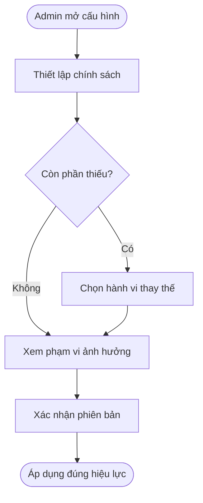
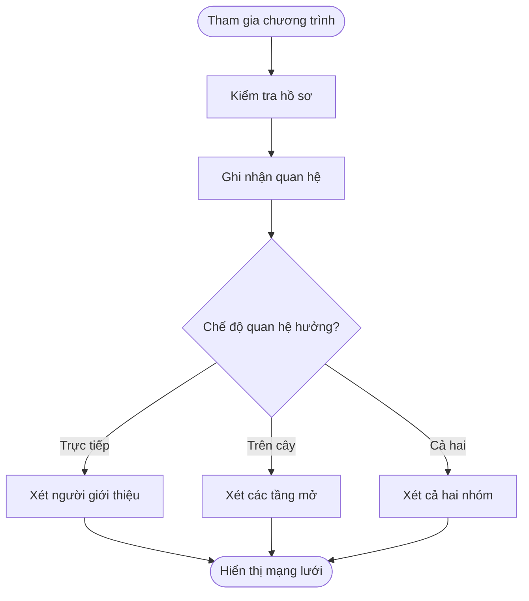
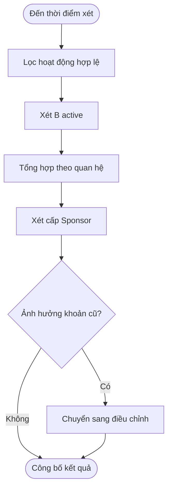
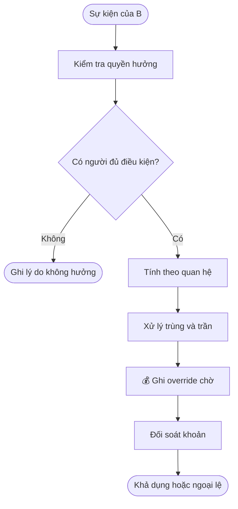
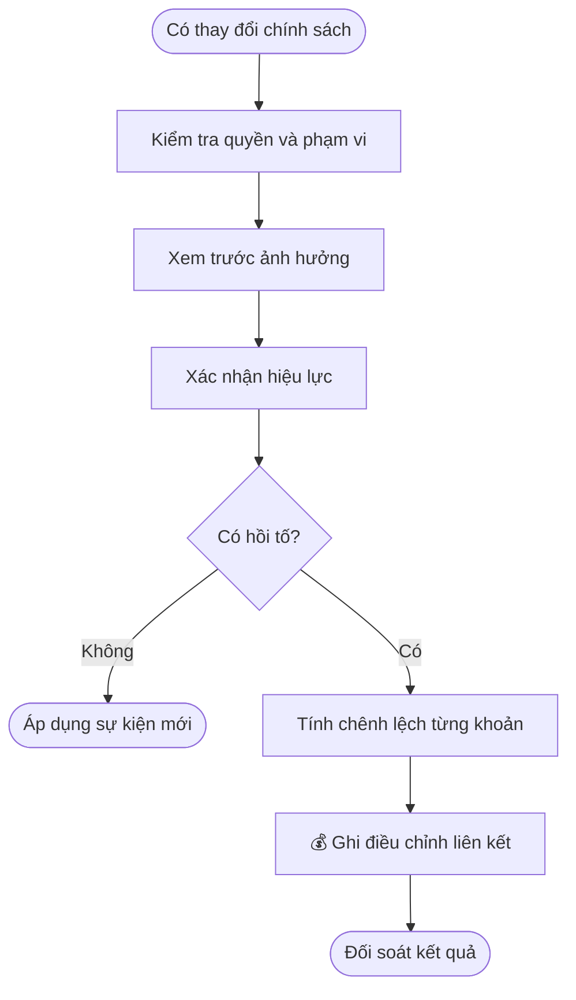
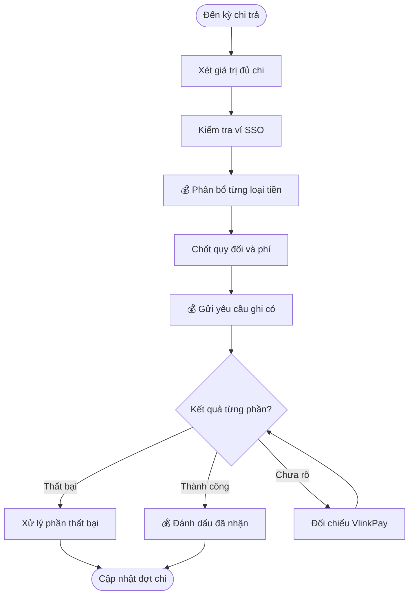
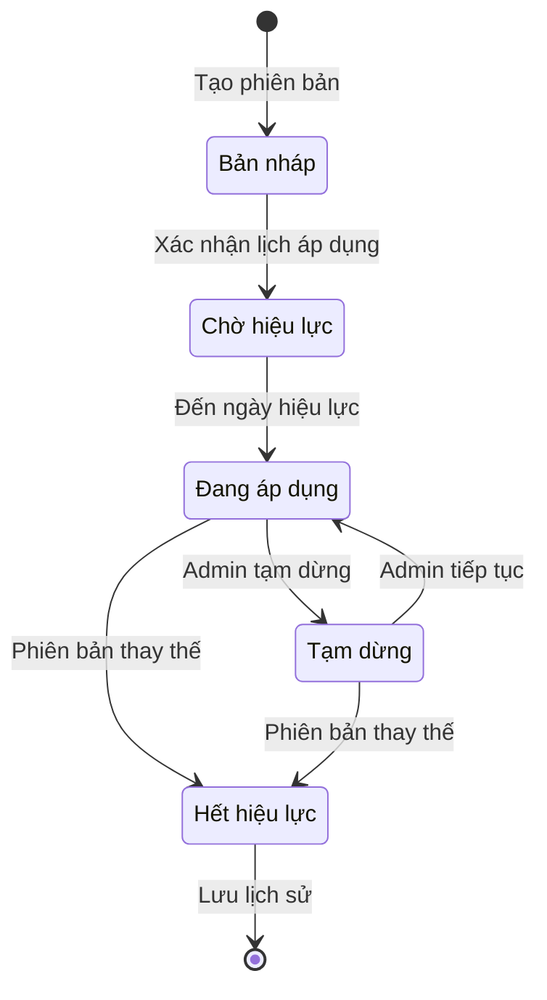
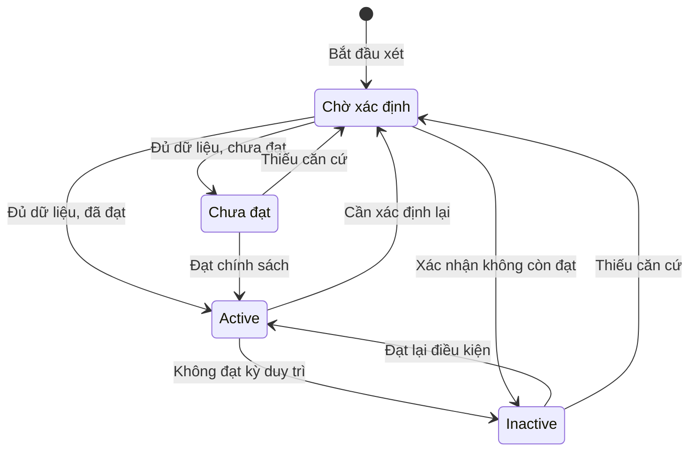
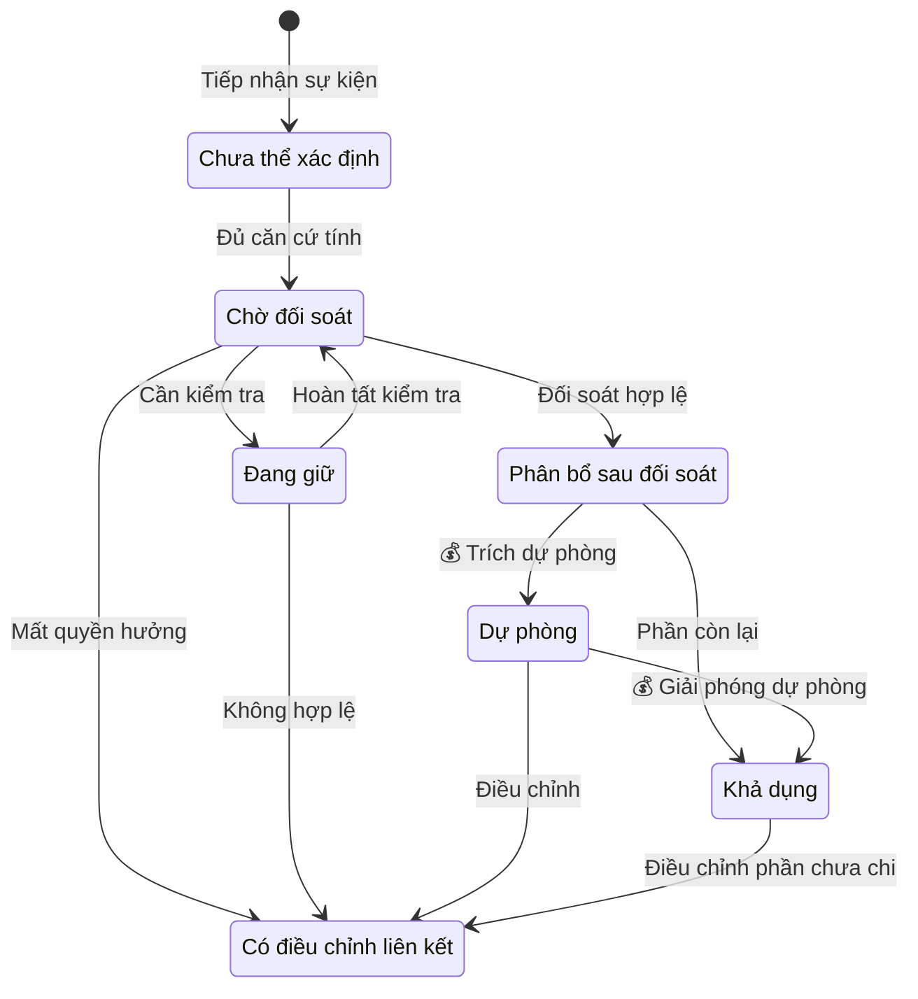
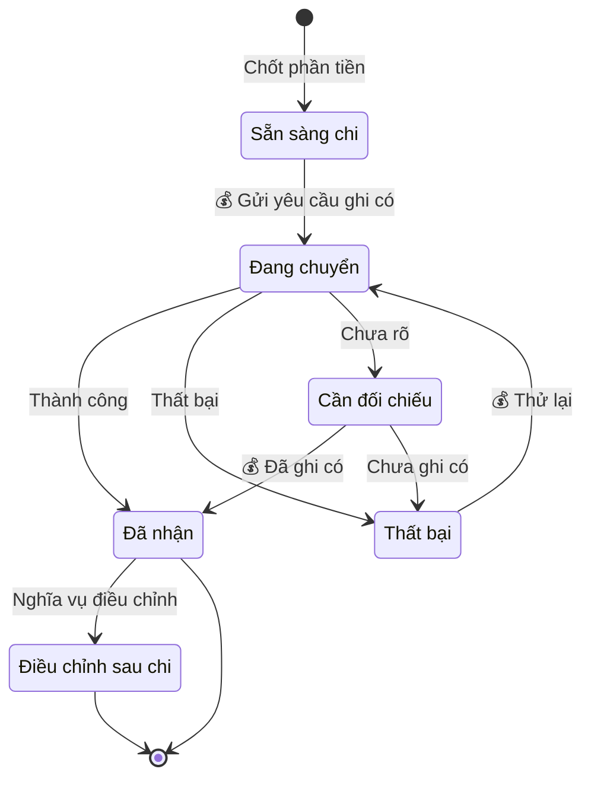

## OneQR Sponsor — Quan hệ hưởng, cấp Sponsor và chi trả Override

**Cập nhật lần cuối:** 13 tháng 10 năm 2026
**Đối tượng đọc:** Người phụ trách sản phẩm, BA, QA, quản trị viên vận hành, bộ phận hỗ trợ, đội phát triển giao diện và máy chủ
**Trạng thái:** Đang rà soát (Review)

---

### Tóm tắt nhanh

OneQR Sponsor trả cho Sponsor một phần thu nhập (Sponsor Override) khi tài khoản B mà họ giới thiệu hoặc nằm phía trên trên cây affiliate tạo hoạt động OneQR thực tế và đủ điều kiện.

| Giai đoạn | Điều gì xảy ra | Tiền đã vào ví VlinkPay chưa? |
| :--- | :--- | :--- |
| 1. Xác lập quan hệ | B đăng ký qua link/QR của A hoặc nằm dưới A trên cây. | Chưa |
| 2. Xét B active và cấp | Hệ thống xét B theo chính sách hoạt động, xét cấp Sponsor của A. | Chưa |
| 3. Ghi override | B tạo sự kiện đủ điều kiện → hệ thống tính và ghi khoản chờ đối soát. | Chưa |
| 4. Đối soát | Khoản được giữ, trích dự phòng hoặc chuyển thành khả dụng. | Chưa |
| 5. Chi trả | Phần khả dụng được chia theo loại tiền và gửi yêu cầu ghi có. | **Chỉ khi VlinkPay xác nhận ghi có** |

Bốn điều không được hiểu sai:

1. **Có quan hệ, B active hay lên cấp đều không tự tạo tiền** — chỉ sự kiện đủ điều kiện mới tạo override (quy tắc C11).
2. **Người giới thiệu đã xác lập với B không bao giờ đổi** — không có chức năng đổi Sponsor (quy tắc A4).
3. Tiền luôn về ví VlinkPay liên kết SSO của chính Sponsor (quy tắc F26).
4. Mọi con số (kỳ xét, ngưỡng, tỷ lệ, số cấp) do Admin cấu hình — không có mặc định 90 ngày hay 10%.

> Tài liệu mô tả **yêu cầu cần triển khai**, chưa phải hành vi đang chạy. Nexora hiện mới có link/QR giới thiệu và đăng ký có mã giới thiệu (xem Phụ lục → Hiện trạng code).

---

### Tổng quan

OneQR Sponsor nhằm khuyến khích người tham gia phát triển mạng lưới dùng OneQR thực tế, bằng cách chia thu nhập override từ hoạt động đủ điều kiện của tài khoản B cho Sponsor. Hệ thống cho phép Admin cấu hình ai được hưởng (người giới thiệu trực tiếp, người phía trên cây hay cả hai), điều kiện B active, cấp Sponsor, công thức tính, đối soát, dự phòng, cũng như loại tiền nhận và tỷ lệ phân bổ. Sponsor thuộc mọi loại tài khoản theo dõi mạng lưới, cấp, từng khoản override và lịch sử nhận tiền. Nexora ghi nhận, đối soát và điều phối chi trả; VlinkPay xác nhận kết quả ghi có vào ví.

**Ngoài phạm vi:** đổi Sponsor (mọi màn hình yêu cầu, duyệt hay cấu hình cho phép đổi), nạp Ads Credit, Campaign Manager, Discovery, trang doanh nghiệp theo template, loyalty của khách, xây lại affiliate/KYC/KYB/ví VlinkPay, rút tiền về ngân hàng. Thu nhập QR trực tiếp của QR Host thuộc tài liệu Business OneQR Earnings.

---

### Khái niệm chính

#### Các bên trong quan hệ

| Thuật ngữ | Định nghĩa |
| :--- | :--- |
| B (Tài khoản nguồn) | Tài khoản có hoạt động OneQR được xét để tạo quyền hưởng cho Sponsor. |
| Sponsor (Người hưởng, A) | Tài khoản được xét hưởng từ B theo quan hệ trực tiếp, vị trí trên cây, hoặc cả hai. |
| Người giới thiệu trực tiếp | Người mà hệ thống affiliate ghi nhận đã giới thiệu B. Cố định sau khi xác lập. |
| Người phía trên cây | Người nằm trên B trong cây affiliate được chương trình dùng. Tầng 1 là nút cha trực tiếp. |

**Người giới thiệu trực tiếp và người phía trên cây có thể là hai người khác nhau.**

| | Người giới thiệu trực tiếp | Người phía trên cây |
| :--- | :--- | :--- |
| Căn cứ | Ai đã mời B | B nằm ở đâu trên cây |
| Số lượng | Đúng một người | Nhiều người, theo tầng |
| Xét khi Admin chọn | Trực tiếp hoặc Cả hai | Trên cây hoặc Cả hai |

#### Trạng thái và cấp

| Thuật ngữ | Định nghĩa |
| :--- | :--- |
| B active | B đạt chính sách hoạt động của chương trình Sponsor. Khác trạng thái tài khoản đăng nhập được. |
| Cấp Sponsor | Kết quả xét điều kiện của A, quyết định A được hưởng từ những tầng nào và tỷ lệ bao nhiêu. |
| Tầng | Khoảng cách giữa A và B trên cây. Cấp là thuộc tính của A; tầng là vị trí tương đối giữa A và B. |
| Kỳ xét | Khoảng thời gian dùng để đánh giá B active hoặc cấp. Khác thời gian chờ đối soát. |

#### Tiền

| Thuật ngữ | Định nghĩa |
| :--- | :--- |
| Sự kiện đủ điều kiện | Hoạt động OneQR của B có phí hợp lệ, được chính sách chọn làm cơ sở tạo override. |
| Sponsor Override | Phần thu nhập của Sponsor từ một sự kiện đủ điều kiện. Tách riêng với Publisher Share của B và thu nhập QR trực tiếp của A. |
| Căn cứ tính | Giá trị chính sách chọn để tính override, ví dụ phí sự kiện hợp lệ. |
| Hold (Đang giữ) | Khoản bị giữ lại để kiểm tra. |
| Dự phòng | Phần được trích giữ theo chính sách, có thời hạn và điều kiện giải phóng. |
| Ví VlinkPay SSO | Ví được hệ thống xác nhận thuộc đúng tài khoản Sponsor đã liên kết SSO. |

**Hai tỷ lệ khác nhau, không dùng thay cho nhau:**

| | Tỷ lệ override | Tỷ lệ phân bổ tiền nhận |
| :--- | :--- | :--- |
| Quyết định | Sponsor được hưởng bao nhiêu | Phần được chi chia sang các loại tiền thế nào |
| Áp dụng lúc | Khi tính khoản override | Sau đối soát, dự phòng và khấu trừ |
| Ràng buộc | Theo quan hệ, cấp, tầng | Tổng các loại tiền bằng 100% |

#### Chính sách

| Thuật ngữ | Định nghĩa |
| :--- | :--- |
| Phiên bản chính sách | Một bộ cấu hình có phạm vi và ngày hiệu lực. |
| Chính sách được lưu theo khoản | Quan hệ, tầng, cấp, căn cứ, tỷ lệ và phiên bản đã dùng để tính một khoản. Dùng để giải thích và điều chỉnh về sau. |
| Hồi tố | Xét lại sự kiện trước ngày hiệu lực, trong phạm vi Admin cho phép. Hồi tố tạo khoản chênh lệch, không xoá lịch sử. |

---

### Vai trò người dùng

| Vai trò | Trách nhiệm |
| :--- | :--- |
| Sponsor | Tham gia, hoàn thiện hồ sơ, chia sẻ link/QR, theo dõi mạng lưới, cấp, override và tiền nhận. |
| B | Dùng OneQR và tạo hoạt động thực tế. B không tự đánh dấu mình active. |
| Chủ doanh nghiệp (Business Owner) | Đại diện Business tham gia và xem dữ liệu Sponsor của Business. |
| Staff / Partner | Tham gia bằng tài khoản riêng của mình (quy tắc G33). |
| Admin được phân quyền | Thiết lập, phát hành chính sách; xử lý hồi tố, ngoại lệ, đối soát và chi trả. |
| Bộ phận hỗ trợ (Support) | Giải thích trạng thái và tra cứu cho Sponsor. |
| Nexora | Xác định người hưởng, ghi sổ, đối soát và điều phối chi trả. |
| VlinkPay | Xác nhận ví, loại tiền hỗ trợ và kết quả ghi có từng phần. |

---

### Luồng nghiệp vụ đầu cuối

#### Luồng 1: Cấu hình và phát hành chính sách Sponsor

**Người thực hiện chính:** Admin
**Điểm bắt đầu:** Admin tạo chương trình hoặc thay đổi chính sách.
**Kết quả:** Một phiên bản chính sách có phạm vi, ngày hiệu lực và lịch sử thay đổi.

**Nhu cầu người dùng:**
- **Là** Admin, **tôi muốn** cấu hình quan hệ, điều kiện và cách tính thưởng, **để** vận hành chương trình theo từng giai đoạn.
- **Là** Admin, **tôi muốn** thấy phần cấu hình còn thiếu và chọn cách chương trình vận hành khi đó, **để** không bị buộc phải tắt chương trình.
- **Là** Admin, **tôi muốn** xem phạm vi ảnh hưởng trước khi phát hành, **để** kiểm soát khoản điều chỉnh.

| Bước | Ai | Hành động | Phản hồi hệ thống |
| :--- | :--- | :--- | :--- |
| 1 | Admin | Chọn phạm vi tài khoản và chế độ quan hệ hưởng. | Hệ thống hiển thị tách biệt người giới thiệu và các tầng trên cây có thể cấu hình. |
| 2 | Admin | Thiết lập B active, cấp, công thức, giới hạn và xử lý trùng. | Hệ thống kiểm tra dữ liệu mâu thuẫn và tổng nguồn chi (quy tắc C13). |
| 3 | Admin | Thiết lập đối soát, dự phòng, loại tiền và tỷ lệ nhận. | Hệ thống khoá nơi nhận là ví SSO và kiểm tra tổng tỷ lệ bằng 100% (F26, F28). |
| 4 | Admin | Chọn hành vi khi thiếu cấu hình, ngày hiệu lực và hồi tố. | Hệ thống chỉ rõ bước nào tiếp tục, bước nào chờ (H35). |
| 5 | Admin | Xem trước tác động và xác nhận phát hành. | Hệ thống lưu phiên bản cùng người thao tác, lý do và thời điểm (D17). |
| 6 | Hệ thống | Áp dụng khi đến ngày hiệu lực. | Hệ thống tính sự kiện mới theo phiên bản mới; chỉ xét lại khoản cũ trong phạm vi hồi tố (D19). |

#### Luồng 2: Tham gia và xác lập quan hệ hưởng

**Người thực hiện chính:** Sponsor, B
**Điểm bắt đầu:** Sponsor tham gia chương trình; B đăng ký qua link/QR hoặc xuất hiện trong cây affiliate.
**Kết quả:** Có quan hệ đã xác nhận để xét hưởng. Chưa phát sinh override.

**Nhu cầu người dùng:**
- **Là** Sponsor, **tôi muốn** biết điều kiện tham gia và hồ sơ/ví còn thiếu, **để** hoàn thiện trước khi nhận tiền.
- **Là** người giới thiệu, **tôi muốn** chia sẻ link/QR và thấy B được ghi nhận đúng người mời, **để** kiểm tra căn cứ hưởng.
- **Là** Sponsor trên cây, **tôi muốn** biết B thuộc tầng nào và vì sao tôi được hay chưa được xét, **để** hiểu phạm vi quyền lợi.
- **Là** B, **tôi muốn** được báo khi mã giới thiệu không hợp lệ, **để** đăng ký đúng nguồn.

| Bước | Ai | Hành động | Phản hồi hệ thống |
| :--- | :--- | :--- | :--- |
| 1 | Sponsor | Mở chương trình, đọc chính sách, chấp thuận điều khoản. | Hệ thống kế thừa xác minh và SSO có sẵn, ghi thời điểm và phiên bản điều khoản. |
| 2 | Sponsor, B | Sponsor chia sẻ link/QR; B đăng ký qua nguồn đó. | Hệ thống affiliate ghi nhận người giới thiệu (A2). |
| 3 | Hệ thống | Lấy người giới thiệu trực tiếp và đường dẫn phía trên cây của B. | Hệ thống kiểm tra đúng cây, đúng tài khoản và trạng thái quan hệ. |
| 4 | Hệ thống | Áp dụng chế độ quan hệ hưởng Admin đã chọn. | Hệ thống lập danh sách Sponsor ứng viên (A3). |
| 5 | Sponsor | Xem danh sách B và điều kiện còn thiếu. | Hệ thống hiển thị loại quan hệ, tầng, ngày hiệu lực và trạng thái của từng B. |

#### Luồng 3: Xét B active và cấp Sponsor

**Người thực hiện chính:** Hệ thống
**Điểm bắt đầu:** Có hoạt động mới, đến kỳ xét, hoặc chính sách thay đổi.
**Kết quả:** B và A có kết quả xét rõ ràng: đã đạt, còn thiếu gì, ngày xét tiếp.

**Nhu cầu người dùng:**
- **Là** Sponsor, **tôi muốn** biết B nào active, B nào chưa đạt và lý do, **để** theo dõi điều kiện tạo quyền hưởng.
- **Là** Sponsor, **tôi muốn** xem cấp hiện tại và tiến độ từng tiêu chí, **để** biết còn thiếu gì cho cấp tiếp theo.
- **Là** Admin, **tôi muốn** cấu hình cách duy trì active và lên/xuống cấp, **để** áp dụng quyền hưởng nhất quán.

| Bước | Ai | Hành động | Phản hồi hệ thống |
| :--- | :--- | :--- | :--- |
| 1 | Hệ thống | Thu thập hoạt động hợp lệ trong kỳ xét. | Hệ thống loại các hành động không phải hoạt động OneQR (B7). |
| 2 | Hệ thống | Xét từng tiêu chí active của B. | Hệ thống ghi giá trị đạt được, ngưỡng yêu cầu và kỳ xét (B6). |
| 3 | Hệ thống | Tổng hợp B theo quan hệ được cấu hình. | Hệ thống đếm mỗi B theo cách đếm trong cấu hình (B9). |
| 4 | Hệ thống | Xét cấp của A. | Hệ thống ghi cấp, ngày hiệu lực, phạm vi hưởng và lý do tăng/giảm/giữ cấp (B8). |
| 5 | Sponsor | Xem kết quả và tiến độ. | Hệ thống hiển thị riêng B active, cấp Sponsor và khoản override. |
| 6 | Hệ thống | Xử lý khi B inactive hoặc A xuống cấp. | Hệ thống áp dụng tác động đã cấu hình; nếu cần xét lại khoản cũ thì chuyển sang Luồng 5. |

#### Luồng 4: Tính và theo dõi Sponsor Override

**Người thực hiện chính:** Hệ thống
**Điểm bắt đầu:** B tạo một sự kiện đủ điều kiện.
**Kết quả:** Khoản override được ghi đúng người, đúng quan hệ, đúng số tiền và giải thích được.

**Nhu cầu người dùng:**
- **Là** Sponsor, **tôi muốn** biết mỗi khoản đến từ B nào, theo quan hệ nào, tính ra sao, **để** đối chiếu thu nhập.
- **Là** Sponsor thuộc cả hai nhóm quan hệ, **tôi muốn** thấy quy tắc trùng đã áp dụng thế nào, **để** kiểm tra phần được cộng hoặc ưu tiên.
- **Là** Sponsor, **tôi muốn** phân biệt khoản chờ, giữ, dự phòng, khả dụng và đã nhận, **để** không hiểu sai số dư.

| Bước | Ai | Hành động | Phản hồi hệ thống |
| :--- | :--- | :--- | :--- |
| 1 | Hệ thống | Xác nhận sự kiện, B nguồn và căn cứ tính. | Hệ thống bỏ qua scan, xem menu, lượt bấm (B7). |
| 2 | Hệ thống | Xác định Sponsor ứng viên tại thời điểm xét quyền. | Hệ thống lưu quan hệ, tầng, active, cấp và phiên bản đã dùng (C14). |
| 3 | Hệ thống | Tính khoản theo từng quan hệ/tầng, xử lý người trùng. | Hệ thống lưu phần được chọn và lý do loại phần còn lại (A5). |
| 4 | Hệ thống | Áp giới hạn và kiểm tra nguồn chi. | Hệ thống áp trần theo cấu hình (C13). |
| 5 | Hệ thống | 💰 Ghi khoản override "Chờ đối soát". | Hệ thống gắn mã tham chiếu sự kiện, B, người nhận, căn cứ, tỷ lệ, phiên bản. Chưa ghi có ví. |
| 6 | Hệ thống, vận hành | Đối soát. | Khoản hợp lệ được chia dự phòng/khả dụng; khoản cần kiểm tra bị giữ; khoản không hợp lệ được điều chỉnh (E22, E23). |
| 7 | Sponsor | Xem tổng quan và chi tiết. | Hệ thống hiển thị override tách khỏi thu nhập QR trực tiếp (C16, G32). |

#### Luồng 5: Thay đổi chính sách và hồi tố

**Người thực hiện chính:** Admin
**Điểm bắt đầu:** A lên/xuống cấp, B inactive, hoặc Admin phát hành chính sách có hồi tố.
**Kết quả:** Thay đổi có hiệu lực rõ ràng; phần lịch sử cần xét lại được điều chỉnh đúng chênh lệch.

**Nhu cầu người dùng:**
- **Là** Admin, **tôi muốn** xem phạm vi ảnh hưởng trước khi hồi tố, **để** đối soát được khoản điều chỉnh.
- **Là** Sponsor, **tôi muốn** biết khoản cũ có bị xét lại không, **để** đối chiếu điều chỉnh.
- **Là** Admin, **tôi muốn** chạy lại một đợt xét mà không tạo trùng khoản, **để** khôi phục xử lý an toàn.

| Bước | Ai | Hành động | Phản hồi hệ thống |
| :--- | :--- | :--- | :--- |
| 1 | Admin | Đề nghị thay đổi chính sách, kèm lý do. | Hệ thống kiểm tra quyền của Admin. |
| 2 | Admin | Chọn ngày hiệu lực và tác động lên khoản cũ. | Hệ thống tách sự kiện mới khỏi phần hồi tố và liệt kê sự kiện/người nhận bị ảnh hưởng (D19). |
| 3 | Admin | Xem trước và xác nhận. | Hệ thống lưu chính sách trước/sau, người thao tác, lý do, thời điểm (D17). |
| 4 | Hệ thống | Áp dụng cho sự kiện mới và phạm vi hồi tố. | Hệ thống giữ nguyên kết quả của sự kiện ngoài phạm vi (D18). |
| 5 | Hệ thống | 💰 Ghi chênh lệch cho từng người nhận. | Hệ thống tạo khoản điều chỉnh liên kết khoản gốc (D20). |
| 6 | Vận hành | Xử lý khoản đã chi. | Hệ thống ghi nghĩa vụ thu hồi theo chính sách (E24). |

#### Luồng 6: Chi trả vào ví VlinkPay SSO bằng nhiều loại tiền

**Người thực hiện chính:** Hệ thống
**Điểm bắt đầu:** Đến kỳ chi hoặc đạt điều kiện chi đã cấu hình.
**Kết quả:** Sponsor nhận đúng số đơn vị từng loại tiền, hoặc thấy rõ phần đang chờ, thất bại hay đã nhận.

**Nhu cầu người dùng:**
- **Là** Sponsor, **tôi muốn** thấy số tiền đủ chi, loại tiền, tỷ lệ, quy đổi và số thực nhận, **để** đối chiếu từng phần.
- **Là** Admin, **tôi muốn** cấu hình loại tiền và tỷ lệ nhận mà không đổi công thức override, **để** quản lý hình thức chi trả.
- **Là** Sponsor, **tôi muốn** thấy kết quả từng phần khi chỉ một phần chuyển thành công, **để** theo dõi phần còn chờ.

| Bước | Ai | Hành động | Phản hồi hệ thống |
| :--- | :--- | :--- | :--- |
| 1 | Hệ thống | Xét điều kiện chi, hold, dự phòng, khấu trừ và ngưỡng. | Hệ thống tính phần đủ chi theo chính sách Sponsor (E21). |
| 2 | Hệ thống | Xác nhận ví SSO và loại tiền ví nhận được. | Hệ thống báo phần cần bổ sung nếu ví chưa đủ điều kiện (F26). |
| 3 | Hệ thống | 💰 Phân bổ giá trị đủ chi theo tỷ lệ tiền nhận. | Hệ thống lưu phiên bản phân bổ và giá trị từng loại trước quy đổi (F27). |
| 4 | Hệ thống | Chốt số đơn vị mỗi loại tiền. | Hệ thống lưu tỷ giá, phí, làm tròn và phần lẻ (F28). |
| 5 | Hệ thống | 💰 Gửi yêu cầu ghi có từng phần sang VlinkPay. | Hệ thống đánh dấu mỗi phần "Đang chuyển" với tham chiếu riêng. |
| 6 | VlinkPay | Trả kết quả từng phần. | Hệ thống chỉ đánh dấu "Đã nhận" cho phần VlinkPay xác nhận (F29, F30). |
| 7 | Sponsor | Xem lịch sử chi trả. | Hệ thống hiển thị từng loại tiền, số đơn vị, tỷ lệ, quy đổi, phí, thời điểm và trạng thái. |

---

### Cấu hình và quản trị

- **Là** Admin, **tôi muốn** cấu hình chính sách theo phạm vi và ngày hiệu lực, **để** từng nhóm tài khoản nhận đúng quyền lợi.
- **Là** Admin, **tôi muốn** xem trước kết quả trên dữ liệu minh hoạ, **để** kiểm tra trước khi phát hành.
- **Là** Sponsor, **tôi muốn** xem chính sách đang áp dụng cho mình, **để** hiểu quyền lợi theo đúng thời điểm.

#### Danh mục cấu hình

| Nhóm cấu hình | Admin thiết lập | Quy tắc |
| :--- | :--- | :--- |
| Tham gia | Loại tài khoản, nhóm áp dụng, điều kiện xác minh/thuế. | A1 |
| Quan hệ hưởng | Trực tiếp / Trên cây / Cả hai; cây được dùng; các tầng được xét. | A3 |
| Trùng người hưởng | Cộng, ưu tiên một quan hệ, hoặc lấy khoản cao hơn; xử lý khi bằng nhau. | A5 |
| B active | Loại sự kiện, số lượng, ngưỡng doanh thu/phí, kết hợp tất cả/bất kỳ, kỳ xét, múi giờ, duy trì, kích hoạt lại. | B6 |
| Cấp Sponsor | Số và tên cấp, điều kiện từng cấp, kỳ xét, lên/xuống cấp, tầng hưởng của từng cấp. | B8, B9 |
| Công thức override | Loại sự kiện, căn cứ tính, tỷ lệ theo quan hệ/cấp/tầng. | C12 |
| Nguồn chi và giới hạn | Tổng phần Sponsor, trần theo sự kiện/kỳ/tài khoản, thứ tự áp trần, phần không có người hưởng. | C13 |
| Thời điểm xét quyền | Mốc dùng để xác định quan hệ, cấp, active và phiên bản cho một sự kiện. | C14 |
| Hiệu lực và hồi tố | Ngày hiệu lực, có hồi tố không, khoảng thời gian, loại thay đổi được hồi tố. | D17–D19 |
| Đối soát và chi trả | Thời gian chờ, hold, kỳ chi, ngưỡng, điều kiện hồ sơ, xử lý tiền chưa đủ ngưỡng. | E21 |
| Dự phòng và thu hồi | Tỷ lệ, thời hạn, điều kiện giải phóng, thứ tự bù trừ, chuyển nghĩa vụ còn thiếu. | E22–E24 |
| Tiền nhận | Loại tiền VlinkPay hỗ trợ, tỷ lệ từng loại, phạm vi và ngày hiệu lực. | F26–F28 |
| Cấu hình chưa đủ | Trạng thái chương trình, hành vi từng bước, chính sách thay thế. | H35, H36 |

#### Màn hình cần có

| Người dùng | Màn hình | Nội dung chính |
| :--- | :--- | :--- |
| Sponsor | Tổng quan Sponsor | Trạng thái tham gia, cấp, số B active, override theo trạng thái, việc cần hoàn thiện. |
| Sponsor | Mạng lưới của tôi | Từng B, loại quan hệ, tầng, ngày hiệu lực, trạng thái active và lý do. |
| Sponsor | Cấp và quyền lợi | Tiến độ từng tiêu chí, kỳ xét, ngày xét tiếp, tầng được hưởng. |
| Sponsor | Chi tiết override | B nguồn, sự kiện, quan hệ/tầng, căn cứ, tỷ lệ, xử lý trùng, trần, trạng thái, điều chỉnh. |
| Sponsor | Lịch sử nhận tiền | Ví SSO, giá trị đủ chi, từng loại tiền, tỷ lệ, số đơn vị, quy đổi, phí, kết quả từng phần. |
| Admin | Chính sách Sponsor | Các nhóm cấu hình, kiểm tra hợp lệ, xem trước, phiên bản, phạm vi. |
| Admin | Quan hệ và ngoại lệ | Tra cứu nguồn giới thiệu/cây, lý do chưa active, hold, hồi tố, đối soát, chi trả. |

Tên màn hình là tên nghiệp vụ đề xuất. Vị trí menu sẽ theo cấu trúc sản phẩm khi triển khai.

---

### Vòng đời trạng thái

Các trạng thái dưới đây là trạng thái nghiệp vụ cần có. Tên kỹ thuật sẽ theo contract khi triển khai.

#### Phiên bản chính sách

| Trạng thái hiện tại | Sự kiện | Trạng thái mới | Ghi chú |
| :--- | :--- | :--- | :--- |
| Bản nháp | Admin xác nhận ngày áp dụng | Chờ hiệu lực | Có thể hiệu lực ngay nếu chọn ngày hiện tại. |
| Chờ hiệu lực | Đến ngày hiệu lực | Đang áp dụng | Phần chưa đủ xử lý theo H35. |
| Đang áp dụng | Admin tạm dừng | Tạm dừng | Tác động lên khoản cũ theo cấu hình. |
| Tạm dừng | Admin tiếp tục | Đang áp dụng | Không tự hồi tố cho thời gian tạm dừng. |
| Đang áp dụng / Tạm dừng | Phiên bản thay thế có hiệu lực | Hết hiệu lực | Vẫn được các khoản lịch sử tham chiếu. |

#### B active

| Trạng thái hiện tại | Sự kiện | Trạng thái mới | Ghi chú |
| :--- | :--- | :--- | :--- |
| Chờ xác định | Đủ dữ liệu, đã đạt | Active | Lưu ngày và phiên bản xét. |
| Chờ xác định | Đủ dữ liệu, chưa đạt | Chưa đạt | Hiển thị tiêu chí còn thiếu. |
| Chưa đạt | Đạt chính sách | Active | — |
| Active | Không đạt kỳ duy trì | Inactive | Chỉ khi chính sách yêu cầu duy trì. |
| Inactive | Đạt lại điều kiện | Active | Không tự hồi tố quyền cũ. |
| Bất kỳ | Thiếu dữ liệu hoặc chính sách | Chờ xác định | Hiển thị lý do; không tự gán active. |

#### Khoản override

Sau đối soát, một khoản có thể tách thành phần dự phòng và phần khả dụng. Đó là hai phần của cùng một khoản, không phải hai lần ghi nhận.

| Trạng thái hiện tại | Sự kiện | Trạng thái mới | Ghi chú |
| :--- | :--- | :--- | :--- |
| Chưa thể xác định | Đủ căn cứ tính | Chờ đối soát | Chưa phải tiền chắc chắn được hưởng. |
| Chờ đối soát | Cần kiểm tra | Đang giữ | Khác dự phòng (E22). |
| Đang giữ | Hoàn tất kiểm tra | Chờ đối soát | — |
| Chờ đối soát | Đối soát hợp lệ | Phân bổ sau đối soát | — |
| Phân bổ sau đối soát | 💰 Trích phần dự phòng | Dự phòng | Có thời hạn và điều kiện giải phóng. |
| Phân bổ sau đối soát | Phần còn lại | Khả dụng | Đủ điều kiện xét chi. |
| Dự phòng | 💰 Đủ điều kiện giải phóng | Khả dụng | — |
| Chờ đối soát / Đang giữ / Dự phòng / Khả dụng | Mất quyền hưởng hoặc kết luận không hợp lệ | Có điều chỉnh liên kết | Ghi bút toán liên kết khoản gốc; không xoá lịch sử. |

#### Từng phần chuyển tiền

Phần khả dụng được chia theo loại tiền. Mỗi phần có trạng thái riêng; một đợt chi chỉ hoàn tất khi mọi phần đã xử lý xong.

| Trạng thái hiện tại | Sự kiện | Trạng thái mới | Ghi chú |
| :--- | :--- | :--- | :--- |
| Sẵn sàng chi | 💰 Gửi yêu cầu ghi có | Đang chuyển | Chưa phải đã nhận. |
| Đang chuyển | VlinkPay xác nhận thành công | Đã nhận | — |
| Đang chuyển | VlinkPay xác nhận thất bại | Thất bại | — |
| Đang chuyển | Kết quả chưa rõ | Cần đối chiếu | Không gửi lại như khoản mới (F30). |
| Cần đối chiếu | 💰 Đối chiếu thấy đã ghi có | Đã nhận | — |
| Cần đối chiếu | Đối chiếu thấy chưa ghi có | Thất bại | — |
| Thất bại | 💰 Thử lại đúng phần đó | Đang chuyển | — |
| Đã nhận | Phát sinh nghĩa vụ điều chỉnh | Điều chỉnh sau chi | Giữ lịch sử đã chi (E24). |

---

### Quy tắc nghiệp vụ

Đây là nơi duy nhất mỗi quy tắc được phát biểu đầy đủ. Các phần khác tham chiếu theo mã.

#### A. Tham gia và quan hệ hưởng

1. **A1 — Mọi loại tài khoản được tham gia:** Personal, Business, Staff/Partner đều được làm Sponsor. Hồ sơ, chấp thuận điều khoản và điều kiện nhận tiền được xét trên chính tài khoản đó. Tham gia chưa có nghĩa là đủ điều kiện nhận tiền.
2. **A2 — Nguồn quan hệ:** Hệ thống chỉ dùng người giới thiệu và cây do hệ thống affiliate xác nhận. Tên, email, vị trí hiển thị hay mã lưu trên trình duyệt không được dùng làm căn cứ. Hệ thống chặn tự giới thiệu và quan hệ vòng lặp theo chính sách nguồn.
3. **A3 — Chế độ quan hệ hưởng:** Admin chọn Trực tiếp, Trên cây hoặc Cả hai, và chọn các tầng được xét. Ở chế độ Trực tiếp, nếu B không có người giới thiệu thì hệ thống không chọn người thay thế.
4. **A4 — Sponsor cố định:** Người giới thiệu đã xác lập với B được giữ vĩnh viễn. Hệ thống không có chức năng yêu cầu, duyệt hay cấu hình đổi Sponsor. B mở link/QR khác, đăng ký lại, inactive rồi active lại, hay Admin đổi chính sách, cấp, hồi tố — đều giữ nguyên người giới thiệu. Chế độ A3 chỉ quyết định quyền hưởng.
5. **A5 — Trùng người hưởng:** Khi một người vừa là người giới thiệu vừa nằm trên cây, Admin chọn một trong ba cách: cộng hai khoản, ưu tiên một loại quan hệ, hoặc lấy khoản cao hơn. Hệ thống lưu phần được chọn và lý do loại phần còn lại.

#### B. B active và cấp Sponsor

6. **B6 — B active do Admin định nghĩa:** Admin cấu hình loại sự kiện, số lượng, ngưỡng doanh thu/phí, kỳ xét, active một lần hay duy trì định kỳ, điều kiện inactive và kích hoạt lại. Không có giá trị mặc định nào. Mốc 90 ngày trong chính sách nguồn nói về khách quay lại, không phải thời hạn active của B.
7. **B7 — Chỉ hoạt động OneQR thực tế mới được tính:** Đăng ký tài khoản, nạp Ads Credit, lượt scan, xem menu hay lượt bấm analytics không chứng minh B hoạt động. Trạng thái đăng nhập, tổng "active" của mạng lưới VlinkPay hay KYC cũng không thay thế B active.
8. **B8 — Cấp Sponsor do Admin cấu hình:** Admin đặt số cấp, điều kiện từng cấp, kỳ xét, lên/xuống cấp và tầng được hưởng của từng cấp. Số cấp, ngưỡng và tỷ lệ trong prototype Sponsor Level Flow chỉ là minh hoạ.
9. **B9 — Đếm B không trùng:** Một B thuộc cả hai loại quan hệ của cùng một A chỉ được đếm theo cách cấu hình nêu rõ.
10. **B10 — Thu nhập trực tiếp tách khỏi cấp:** Cấp Sponsor không ảnh hưởng thu nhập QR trực tiếp của A.

#### C. Tính override

11. **C11 — Chỉ sự kiện tạo tiền:** Mỗi khoản override cần một sự kiện đủ điều kiện và một quyền hưởng hợp lệ tại thời điểm xét. Có quan hệ, B active hay đạt cấp đều không tự tạo tiền.
12. **C12 — Căn cứ và tỷ lệ do Admin cấu hình:** Admin đặt căn cứ tính và tỷ lệ theo quan hệ, cấp, tầng. Căn cứ tính không bao gồm toàn bộ hoá đơn, thuế, tip, tiền nạp chưa tiêu hay Publisher Share của B, trừ khi chính sách ghi rõ. Hệ thống không tự áp một tỷ lệ cho mọi tầng.
13. **C13 — Nguồn chi và giới hạn:** Admin cấu hình tổng phần Sponsor, trần theo sự kiện/kỳ/tài khoản và thứ tự áp trần. Khi tổng các tầng vượt nguồn chi, hệ thống báo cấu hình không hợp lệ hoặc áp trần đã định. Hệ thống không giảm Publisher Share của B để bù và không chuyển phần dư sang người khác.
14. **C14 — Thời điểm xét quyền:** Hệ thống xác định quan hệ, tầng, active, cấp và phiên bản theo mốc Admin cấu hình, rồi lưu cùng khoản. Sự kiện đến muộn vẫn dùng mốc này.
15. **C15 — Chống ghi trùng:** Cùng một sự kiện gửi lại nhiều lần chỉ tạo một khoản cho mỗi quyền hưởng, kể cả khi chế độ A5 là cộng.
16. **C16 — Tách các loại thu nhập:** Override, Publisher Share của B và thu nhập QR trực tiếp của A được ghi, đối soát và hiển thị thành các phần riêng.

#### D. Chính sách, hiệu lực và hồi tố

17. **D17 — Phiên bản có dấu vết:** Mỗi chính sách có phạm vi, ngày hiệu lực và thứ tự ưu tiên khi chồng nhau. Hệ thống lưu bản trước/sau, người thao tác, lý do và thời điểm.
18. **D18 — Không viết lại lịch sử:** Sửa chính sách không sửa khoản đã ghi.
19. **D19 — Hồi tố chỉ khi Admin cho phép:** Admin chọn khoảng thời gian, loại sự kiện và trạng thái khoản được hồi tố. Lên cấp, xuống cấp, B inactive và sửa công thức được cấu hình riêng. Mặc định, lên cấp không hồi tố và xuống cấp không thu hồi.
20. **D20 — Điều chỉnh là chênh lệch:** Hệ thống chỉ ghi phần chênh lệch, liên kết với khoản gốc. Chạy lại một đợt xét không tạo khoản trùng.

#### E. Đối soát, dự phòng và điều chỉnh

21. **E21 — Thông số riêng của Sponsor:** Thời gian chờ, hold, kỳ chi, ngưỡng chi và điều kiện hồ sơ được cấu hình riêng. Hệ thống không kế thừa các giá trị của Business OneQR Earnings.
22. **E22 — Hold khác dự phòng:** Hold giữ khoản cần kiểm tra. Dự phòng trích giữ một phần theo chính sách. Cả hai đều chưa phải tiền trong ví.
23. **E23 — Hoàn/đảo theo phần mất quyền:** Refund một phần chỉ điều chỉnh phần override tương ứng. Hệ thống không vừa giảm khoản chưa chi vừa thu hồi lại cùng phần đó.
24. **E24 — Thu hồi sau chi:** Hệ thống ghi nghĩa vụ thu hồi liên kết đợt chi gốc và bù trừ theo chính sách. Hệ thống chỉ coi ví đã bị trừ khi có giao dịch ví được xác nhận.
25. **E25 — Sponsor bị đình chỉ hoặc thiếu hồ sơ:** Hệ thống xử lý quyền mới và khoản đang chờ theo cấu hình. Hệ thống không chuyển phần tiền đó cho Sponsor khác.

#### F. Chi trả

26. **F26 — 💰 Nơi nhận cố định:** Tiền chỉ chi vào ví VlinkPay liên kết SSO của chính tài khoản Sponsor. Admin không cấu hình được tài khoản ngân hàng hay ví nhập tay. Đăng nhập SSO thành công chưa chứng minh ví nhận được mọi loại tiền.
27. **F27 — Hai bước tính tách biệt:** Bước 1 dùng tỷ lệ override để tính giá trị hưởng. Bước 2, sau đối soát, dự phòng và khấu trừ, dùng tỷ lệ phân bổ tiền nhận để chia sang các loại tiền. Đổi tỷ lệ này không đổi tỷ lệ kia.
28. **F28 — Phân bổ theo giá trị:** Tổng tỷ lệ tiền nhận bằng 100%. Số đơn vị mỗi loại tính theo tỷ giá, độ chính xác, phí và làm tròn đã xác nhận. Hệ thống lưu các giá trị này và xử lý phần lẻ minh bạch.
29. **F29 — 💰 Chỉ "Đã nhận" khi VlinkPay xác nhận:** Mỗi phần chuyển có tham chiếu riêng. Hệ thống chỉ đánh dấu phần nào VlinkPay đã xác nhận ghi có.
30. **F30 — Đối chiếu trước khi thử lại:** Kết quả chưa rõ phải được đối chiếu với VlinkPay trước. Hệ thống chỉ thử lại phần đã xác nhận thất bại.
31. **F31 — Không tự đổi loại tiền:** Khi một loại tiền không được ví hỗ trợ hoặc chuyển thất bại, hệ thống không dồn tỷ lệ sang loại khác. Mọi thay đổi phân bổ cho phần chưa chi phải theo chính sách và có dấu vết.

#### G. Dữ liệu và quyền

32. **G32 — Sponsor chỉ thấy dữ liệu cần thiết:** Sponsor xem thông tin B và sự kiện đủ để hiểu quyền lợi. Sponsor không xem hồ sơ khách, hoá đơn đầy đủ, giấy tờ xác minh hay số dư ví của B.
33. **G33 — Phân quyền theo tài khoản:** Staff không xem thu nhập Sponsor của Business; tư cách Sponsor của Staff xét trên tài khoản riêng. Ví Business không dùng để chi cho Staff. Support không đổi Sponsor và không sửa tỷ lệ, số tiền khi không có quyền.
34. **G34 — Lịch sử thao tác:** Hệ thống lưu lịch sử xác lập quan hệ, thay đổi chính sách tiền, hồi tố và xác nhận tài khoản nhận.

#### H. Cấu hình thiếu hoặc sai

35. **H35 — Admin quyết định hành vi khi thiếu cấu hình:** Admin chọn giữ chính sách trước, dùng chính sách thay thế, hoặc tiếp tục ghi nhận quan hệ/hoạt động trong khi một bước chờ bổ sung. Chương trình không bắt buộc phải tắt.
36. **H36 — Thiếu khác sai:** Tổng tỷ lệ sai, loại tiền không được hỗ trợ hay công thức không xác định vẫn là cấu hình không hợp lệ. Khoản không đủ căn cứ ở trạng thái "Chưa thể xác định" kèm lý do. Hệ thống không coi khoản đó bằng 0, không coi là đã trả, và không tự điền giá trị.

> 💡 **Quan trọng:** A4, C11, F26 và F29 ảnh hưởng trực tiếp đến tiền và quyền hưởng.

---

### Ví dụ

**Chỉ để minh hoạ — không phải giá trị cấu hình.**

| Tình huống | Kết quả |
| :--- | :--- |
| B đăng ký qua link của A nhưng chưa có sự kiện đủ điều kiện. | A có quan hệ, override = $0 (C11). |
| Căn cứ $100; tỷ lệ trực tiếp 10%, tầng 1 trên cây 5%; A ở cả hai nhóm; chế độ **cộng**. | A nhận $10 + $5 = $15. |
| Như trên, chế độ **ưu tiên trực tiếp**. | A nhận $10. |
| Như trên, chế độ **lấy cao hơn**. | A nhận $10. |
| Người giới thiệu là C, cha trên cây là D; chế độ **Trực tiếp**. | Chỉ C được xét; D không được xét. |
| Phần đủ chi $100; phân bổ Loại X 70%, Loại Y 30%. | Hai phần giá trị $70 và $30 trước quy đổi. Số đơn vị thực nhận phụ thuộc tỷ giá và phí (F28), không phải 70 đơn vị X và 30 đơn vị Y. |
| Phần X ghi có thành công, phần Y timeout. | X = Đã nhận. Y = Cần đối chiếu; chỉ Y được xử lý tiếp (F30). |
| Sự kiện $100 bị refund $40, override chưa chi. | Chỉ phần override tương ứng $40 được điều chỉnh (E23). |

---

### Tiêu chí nghiệm thu

Đây là điều kiện nghiệm thu cho chức năng cần triển khai. Chưa tiêu chí nào được kiểm chứng trên môi trường thật.

#### Tham gia và quan hệ

- [ ] Personal, Business, Staff/Partner đều tham gia được theo quyền tài khoản (A1).
- [ ] Kết quả xác minh có sẵn được kế thừa đúng tài khoản (A1).
- [ ] Khi người giới thiệu khác cha trên cây, ba chế độ quan hệ cho đúng danh sách ứng viên (A3).
- [ ] Cấp Sponsor và tầng trên cây hiển thị thành hai thông tin riêng (B8).
- [ ] Không có màn hình, API hay cấu hình nào cho phép đổi Sponsor (A4).
- [ ] **Given** B đã có người giới thiệu là C, **when** B mở link/QR của A rồi đăng ký hoặc đăng nhập lại, **then** người giới thiệu vẫn là C (A4).
- [ ] **Given** B inactive, **when** B active lại, **then** người giới thiệu không đổi và không tạo lượt giới thiệu mới (A4).

#### B active và cấp

- [ ] B active được tính theo loại sự kiện, ngưỡng và kỳ xét đã cấu hình (B6).
- [ ] Mỗi B chưa đạt hoặc inactive có lý do cụ thể (B6).
- [ ] Hệ thống không áp dụng mốc 90 ngày khi Admin không cấu hình (B6).
- [ ] Đăng ký, nạp credit, scan hay lượt bấm không làm B active (B7).
- [ ] Cấp, tiến độ và tầng hưởng phản ánh chính sách đang hiệu lực (B8).
- [ ] Một B không bị đếm hai lần ngoài cấu hình (B9).

#### Tính và ghi override

- [ ] Mỗi khoản truy được B, sự kiện, quan hệ, tầng, cấp, căn cứ, tỷ lệ, trần và phiên bản (C14).
- [ ] Không có khoản nào được tạo chỉ từ đăng ký hoặc nạp credit (C11).
- [ ] Ba chế độ xử lý trùng cho đúng kết quả như bảng Ví dụ (A5).
- [ ] **Given** cùng một sự kiện được gửi hai lần, **when** hệ thống xử lý, **then** chỉ có một khoản cho mỗi quyền hưởng (C15).
- [ ] Override hiển thị tách khỏi Publisher Share của B và thu nhập trực tiếp của A (C16).
- [ ] Tổng phân bổ cho các tầng khớp nguồn chi đã cấu hình (C13).

#### Chính sách và hồi tố

- [ ] Thay đổi chính sách chỉ áp dụng từ ngày hiệu lực (D17).
- [ ] Hồi tố chỉ chạm sự kiện trong phạm vi Admin chọn (D19).
- [ ] Khoản điều chỉnh liên kết khoản gốc (D20).
- [ ] Chạy lại một đợt xét không tạo khoản trùng (D20).
- [ ] Mọi thay đổi chính sách và hồi tố có lịch sử người thao tác, lý do, thời điểm (D17, G34).

#### Đối soát, dự phòng và điều chỉnh

- [ ] Thời gian chờ, kỳ chi, ngưỡng, dự phòng lấy từ cấu hình Sponsor, không lấy từ Business OneQR Earnings (E21).
- [ ] Refund toàn phần và một phần tạo điều chỉnh đúng phạm vi (E23).
- [ ] Một phần đã giảm trước khi chi không bị thu hồi thêm sau khi chi (E23).
- [ ] Thu hồi sau chi được ghi là nghĩa vụ, chưa hiển thị "đã trừ ví" khi chưa có giao dịch ví xác nhận (E24).

#### Chi trả

- [ ] Nơi nhận luôn là ví VlinkPay SSO của đúng tài khoản Sponsor (F26).
- [ ] Admin không lưu được cấu hình tiền nhận có tổng tỷ lệ khác 100% (F28).
- [ ] Đổi tỷ lệ tiền nhận không làm đổi số tiền override (F27).
- [ ] Mỗi loại tiền hiển thị giá trị phân bổ, số đơn vị, tỷ giá, phí và làm tròn (F28).
- [ ] Số liệu chi trả đối chiếu khớp với giao dịch ví (F28).
- [ ] Chỉ phần được VlinkPay xác nhận mới hiển thị "Đã nhận" (F29).
- [ ] **Given** một phần timeout, **when** hệ thống xử lý lại, **then** hệ thống đối chiếu trước và không chuyển lại phần đã thành công (F30).

#### Cấu hình thiếu

- [ ] Admin chọn được hành vi khi cấu hình chưa đủ (H35).
- [ ] Chương trình không tự tắt chỉ vì thiếu cấu hình (H35).
- [ ] Khoản chưa tính hoặc chưa chi được có lý do rõ (H36).

#### Quyền và giao diện

- [ ] Sponsor chỉ thấy dữ liệu B và sự kiện theo G32.
- [ ] Staff không thấy thu nhập Sponsor của Business (G33).
- [ ] Các màn hình dùng được trên điện thoại và desktop.
- [ ] Mọi chuỗi giao diện có cả EN và VI.
- [ ] Ngày giờ, tiền và trạng thái hiển thị đúng định dạng; tiếng Việt viết đầy đủ "tháng".
- [ ] Giao diện không hiển thị mã kỹ thuật hoặc dữ liệu demo như kết quả thật.

---

### Tình huống ngoại lệ

| Tình huống | Cách xử lý | Bên xử lý |
| :--- | :--- | :--- |
| Người giới thiệu khác cha trên cây | Xét theo chế độ A3; hiển thị hai loại quan hệ riêng. | Hệ thống |
| A vừa giới thiệu B vừa nằm trên cây | Áp dụng A5; lưu phần được chọn. | Hệ thống |
| B không có người giới thiệu nhưng có tuyến trên | Chế độ Trên cây/Cả hai xét tuyến trên; chế độ Trực tiếp không chọn người thay (A3). | Hệ thống |
| B đã có Sponsor rồi mở link/QR của người khác | Giữ Sponsor đã xác lập (A4). | Hệ thống |
| B inactive rồi active lại | Giữ người giới thiệu; xét lại quyền hưởng theo cấu hình (A4, B6). | Hệ thống |
| Sponsor bị đình chỉ hoặc thiếu hồ sơ nhận tiền | Xử lý theo E25; hiển thị lý do. | Vận hành |
| Dữ liệu cây hoặc hoạt động chưa đồng bộ | Đặt "Chờ xác định", không đặt "Chưa đạt" (H36). | Hệ thống, vận hành |
| B chỉ đăng ký, nạp credit hoặc có traffic giả | Không tạo override (B7). | Hệ thống, vận hành |
| Sự kiện đến muộn hoặc được xác nhận lại | Dùng mốc xét quyền C14; kiểm tra khoản cũ trước khi ghi (C15). | Hệ thống |
| Refund làm B không còn đạt ngưỡng active | Xét lại active; tách điều chỉnh sự kiện bị hoàn với tác động lên khoản khác (E23). | Hệ thống |
| A xuống cấp hoặc B inactive khi tiền đang chờ | Áp dụng tác động đã cấu hình; không mặc định xoá khoản đã ghi (D19). | Hệ thống |
| Tổng các tầng vượt nguồn chi | Báo cấu hình không hợp lệ hoặc áp trần (C13). | Admin |
| Tổng tỷ lệ tiền nhận khác 100% | Báo cấu hình không hợp lệ (F28, H36). | Admin |
| Không có ví SSO đúng chủ thể, hoặc ví thiếu loại tiền | Hiển thị lý do chưa chi phần liên quan (F26, F31). | Sponsor, VlinkPay, Admin |
| Tỷ giá thay đổi trước khi chuyển | Dùng tỷ giá tại thời điểm chốt và lưu lại (F28). | Nexora, VlinkPay |
| Một loại tiền thành công, loại khác thất bại | Đợt chi ở trạng thái thành công một phần; chỉ xử lý lại phần thất bại (F30). | Vận hành |
| Chuyển tiền timeout hoặc phản hồi đến lặp | Tra cứu theo tham chiếu, không tạo yêu cầu mới (F30). | Nexora, VlinkPay |
| Refund sau khi đã chi nhiều loại tiền | Ghi nghĩa vụ liên kết đợt chi gốc (E24); quy tắc định giá xem Quyết định còn mở. | Vận hành |
| Không có chính sách phù hợp hoặc thiếu trường | Áp dụng H35, H36. | Admin, hệ thống |

---

### Câu hỏi thường gặp

**H: B đăng ký qua link của tôi thì tôi có tiền ngay không?**
Đ: Không. Quan hệ chỉ là căn cứ xét hưởng. Tiền chỉ phát sinh khi B tạo sự kiện đủ điều kiện (C11).

**H: Tôi có phải trực tiếp giới thiệu B mới được hưởng không?**
Đ: Tuỳ chế độ Admin chọn: Trực tiếp, Trên cây hoặc Cả hai (A3).

**H: B active có nghĩa là có thu nhập trong 90 ngày không?**
Đ: Không. Admin cấu hình loại hoạt động, ngưỡng và kỳ xét (B6).

**H: Tôi vừa giới thiệu B vừa ở trên cây thì được hai khoản không?**
Đ: Tuỳ cấu hình: cộng, ưu tiên một loại, hoặc lấy khoản cao hơn (A5).

**H: Lên cấp có được tính lại tiền cũ không?**
Đ: Chỉ khi Admin cho phép hồi tố và sự kiện nằm trong phạm vi (D19).

**H: Có đổi được Sponsor của B không?**
Đ: Không. Người giới thiệu đã xác lập là cố định (A4).

**H: Tôi nhận tiền ở đâu, bằng loại tiền nào?**
Đ: Vào ví VlinkPay liên kết SSO của bạn (F26). Loại tiền và tỷ lệ do Admin cấu hình (F28).

**H: Tỷ lệ phân bổ tiền nhận có phải tỷ lệ hoa hồng không?**
Đ: Không. Hai tỷ lệ dùng cho hai bước khác nhau (F27).

**H: Admin chưa cấu hình đủ thì chương trình có bị tắt không?**
Đ: Không nhất thiết. Admin chọn hành vi; khoản thiếu căn cứ sẽ hiển thị đang chờ gì (H35, H36).

---

### Tính năng liên quan

| Tính năng | Liên hệ |
| :--- | :--- |
| Affiliate — quan hệ giới thiệu | Cung cấp người giới thiệu và cây làm căn cứ xét hưởng. |
| [Promotion và quảng cáo](https://raw.githubusercontent.com/vlink-group/VlinkPay/main/nexora/docs/business/promotion-publishing-ads.md) | Cung cấp sự kiện đủ điều kiện và điều chỉnh liên quan. |
| [Business OneQR Earnings](https://github.com/vlink-group/VlinkPay/blob/docs/promotion-code-skill-audit/nexora/docs/business/business-oneqr-earnings.md) | Thu nhập QR trực tiếp của doanh nghiệp. Có thể tham khảo cách đối soát, nhưng không kế thừa thông số (E21). |
| [Ads Credit](https://raw.githubusercontent.com/vlink-group/VlinkPay/main/nexora/docs/business/merchant-ads-credit.md) | Nguồn tiền của bên chạy quảng cáo. Tiền nạp chưa dùng không tạo override (B7). |
| Ví VlinkPay liên kết SSO | Nhận tiền và xác nhận kết quả ghi có từng loại tiền. |

---

### Phụ lục

#### Quyết định còn mở

Mọi con số vận hành (kỳ xét, ngưỡng, tỷ lệ, số cấp, dự phòng) do Admin cấu hình và không thuộc danh sách này. Các mục dưới đây là thiết kế/tích hợp chưa được chốt.

| Hạng mục | Cần quyết định | Phụ trách |
| :--- | :--- | :--- |
| Nguồn quan hệ affiliate | Hệ thống nào giữ và khoá người giới thiệu; thời điểm khoá; cây nào được dùng; xử lý tài khoản đăng ký bằng mã mặc định. | TL, Tích hợp VlinkPay |
| Cấu hình ban đầu | Hành vi khi chính sách đầu tiên chưa tồn tại; sự kiện chờ được xử lý thế nào sau khi bổ sung cấu hình (H35). | PO |
| Nguồn sự kiện | Sự kiện nào có phí hợp lệ; nguồn dữ liệu sự kiện cho override. | PO, TL |
| Ví và loại tiền | Ví đúng chủ thể cho từng loại tài khoản; danh mục tiền VlinkPay nhận được; API ghi có nhiều loại tiền và tra cứu kết quả. | Tích hợp VlinkPay |
| Quy đổi và phí | Nguồn tỷ giá, thời điểm chốt, phí, độ chính xác, xử lý phần lẻ. | PO, Tích hợp VlinkPay |
| Thu hồi sau chi | Cách định giá và bù trừ khi đã chi nhiều loại tiền; có API trừ ví hay không. | PO, Tích hợp VlinkPay |
| Quyền vận hành | Phân quyền Admin/Support, quy trình xử lý tranh chấp. | PO |

#### Nguồn và thứ tự ưu tiên

Khi các nguồn mâu thuẫn, áp dụng theo thứ tự: quyết định nghiệp vụ đã chốt trong tài liệu này → cấu hình Admin đang hiệu lực → nguyên tắc còn phù hợp trong bộ HTML nguồn. Tỷ lệ và ngưỡng trong HTML không trở thành giá trị mặc định.

| Nguồn | Dùng để làm gì |
| :--- | :--- |
| [Ads/Referral Revenue Policy — 21/09](https://raw.githubusercontent.com/vlink-group/VlinkPay/main/nexora/docs/business/references/NEXORA-OneQR-Ads-Referral-Revenue-Policy.html) | Bối cảnh sự kiện hợp lệ, các phần tiền, refund/reversal. Tỷ lệ và quan hệ cố định trong đó đã được thay bằng cấu hình Admin. |
| [Sponsor Level Flow](https://raw.githubusercontent.com/vlink-group/VlinkPay/main/nexora/docs/business/references/NEXORA-OneQR-Sponsor-Level-Flow.html) | Nguyên tắc B hoạt động thật và quyền theo cấp. Ngưỡng mẫu và bảng B gán sẵn không phải logic production. |
| [Monetization & Sponsor Terms](https://raw.githubusercontent.com/vlink-group/VlinkPay/main/nexora/docs/business/references/NEXORA-OneQR-Monetization-Sponsor-Terms.html) | Quyền hưởng, điều kiện, lịch sử thu nhập. Tỷ lệ demo không phải mặc định. |
| `NEXORA-Promotion-Owner-Guide.html`, `NEXORA-Salon-Research-and-Template-Brief.md`, `OneQR-2.2-Prototype.html` | Được nhắc trong HTML nguồn nhưng chưa có trong bộ tài liệu; không coi là đã xuất bản. |

#### Hiện trạng code (đối chiếu ngày 5/10/2026)

**Kết luận:** Nexora đã có nền tảng giới thiệu và tích hợp VlinkPay để kế thừa. Chưa có phần nào của chương trình Sponsor Override trong giao diện, máy chủ, dữ liệu hay hợp đồng API.

| Nguồn | Phiên bản |
| :--- | :--- |
| Giao diện Nexora | `staging` tại [`27c5ebc`](https://github.com/vlink-group/vlink-nexora-fe/tree/27c5ebcaa4d86b30bc2e965e7c3df8cfee06fc8e) |
| Máy chủ Nexora | `staging` tại [`a7a46d3`](https://github.com/vlink-group/vlink-nexora/tree/a7a46d314036f9d83c910aead411182480249bea) |
| Giới hạn | Chỉ đọc mã nguồn và hợp đồng API. Không gọi API live, không kiểm thử UI, không giao dịch. Chưa kiểm chứng cách VlinkPay lưu/khoá quan hệ. |

**Thành phần đã có — chứng minh gì và không chứng minh gì:**

| Thành phần | Đã có | Chưa chứng minh | Căn cứ |
| :--- | :--- | :--- | :--- |
| Link/QR giới thiệu | Tạo, sao chép, tải QR; chọn nhánh trái/phải. | Nhánh trái/phải không phải cấp hay tầng hưởng. Chưa có màn hình mạng lưới Sponsor. | [AffiliateLinkPanel.tsx](https://github.com/vlink-group/vlink-nexora-fe/blob/27c5ebcaa4d86b30bc2e965e7c3df8cfee06fc8e/src/components/settings/AffiliateLinkPanel.tsx), [ReferralGatewayPanel.tsx](https://github.com/vlink-group/vlink-nexora-fe/blob/27c5ebcaa4d86b30bc2e965e7c3df8cfee06fc8e/src/components/dashboard/overview/ReferralGatewayPanel.tsx) |
| Giữ mã trước đăng ký | Mã và nhánh lưu theo phiên tab; mã mới trong URL thay mã cũ; form khoá trường khi mã đến từ URL. | Đây là đầu vào trước đăng ký, không phải quan hệ đã khoá (A4). | [affiliateReferral.ts](https://github.com/vlink-group/vlink-nexora-fe/blob/27c5ebcaa4d86b30bc2e965e7c3df8cfee06fc8e/src/utils/affiliateReferral.ts), [RegisterWizard.tsx](https://github.com/vlink-group/vlink-nexora-fe/blob/27c5ebcaa4d86b30bc2e965e7c3df8cfee06fc8e/src/components/RegisterWizard.tsx), [StepCredentials.tsx](https://github.com/vlink-group/vlink-nexora-fe/blob/27c5ebcaa4d86b30bc2e965e7c3df8cfee06fc8e/src/components/register/steps/StepCredentials.tsx) |
| Đăng ký có giới thiệu | Gửi mã và nhánh; BE kiểm tra mã qua VlinkPay, tạo tài khoản SSO. Không gửi mã → dùng mã mặc định trong cấu hình. | Không gửi mã không có nghĩa là không có người giới thiệu. Chưa có luồng cho Staff/Partner. | [apiAuthAdapter.ts](https://github.com/vlink-group/vlink-nexora-fe/blob/27c5ebcaa4d86b30bc2e965e7c3df8cfee06fc8e/src/auth/adapters/apiAuthAdapter.ts), [SignUpCommand.cs](https://github.com/vlink-group/vlink-nexora/blob/a7a46d314036f9d83c910aead411182480249bea/backend/src/Application/Features/Auth/Commands/Register/SignUpCommand.cs) |
| Số liệu mạng lưới VlinkPay | Lớp gọi nội bộ lấy mã/link/QR, tổng thành viên, tổng active, tổng ATM. | Chưa có endpoint Nexora hay FE gọi. Chỉ là số tổng, không có danh sách B, tầng hay lịch sử. Tổng active ≠ B active (B7). | [GetNetworkTreeQueryHandler.cs](https://github.com/vlink-group/vlink-nexora/blob/a7a46d314036f9d83c910aead411182480249bea/backend/src/Application/Features/VlinkPay/Queries/Dashboard/GetNetworkTreeQueryHandler.cs), [VlinkPayNetworkTreeDto.cs](https://github.com/vlink-group/vlink-nexora/blob/a7a46d314036f9d83c910aead411182480249bea/backend/src/Application/Features/VlinkPay/DTOs/VlinkPayNetworkTreeDto.cs) |
| Analytics OneQR | Ghi lượt bấm module theo doanh nghiệp, module, phiên. | Không tính hay ghi override. Chống lặp lượt bấm không thay chống ghi trùng khoản thưởng (C15). | [TrackOneQrModuleClickCommand.cs](https://github.com/vlink-group/vlink-nexora/blob/a7a46d314036f9d83c910aead411182480249bea/backend/src/Application/Features/Public/OneQr/Commands/TrackOneQrModuleClick/TrackOneQrModuleClickCommand.cs) |
| SSO và thanh toán ví | Điều hướng SSO; thanh toán bằng ví VlinkPay, trong đó có mua Ads Credit. | Thanh toán từ ví không phải ghi có thu nhập vào ví. Chưa có chi Sponsor hay phân bổ nhiều loại tiền. | [ecosystem.ts](https://github.com/vlink-group/vlink-nexora-fe/blob/27c5ebcaa4d86b30bc2e965e7c3df8cfee06fc8e/src/data/repositories/ecosystem.ts), [PurchaseAdsCreditWithWalletCommand.cs](https://github.com/vlink-group/vlink-nexora/blob/a7a46d314036f9d83c910aead411182480249bea/backend/src/Application/Features/AdsCredit/Commands/PurchaseAdsCreditWithWallet/PurchaseAdsCreditWithWalletCommand.cs), [AdsCreditTopUpSettler.cs](https://github.com/vlink-group/vlink-nexora/blob/a7a46d314036f9d83c910aead411182480249bea/backend/src/Application/Features/AdsCredit/Services/AdsCreditTopUpSettler.cs) |

Trường người giới thiệu/KYC trong hồ sơ, cấu hình module OneQR của Admin, incentive POS và vị trí quảng cáo được tài trợ đều thuộc nghiệp vụ khác, không phải Sponsor Override.

**Khoảng trống so với yêu cầu:**

| Nhóm nghiệm thu | Phần còn thiếu |
| :--- | :--- |
| Tham gia và quan hệ | Chương trình tham gia Sponsor; contract quan hệ trực tiếp/tuyến trên; bằng chứng khoá quan hệ tại hệ thống nguồn. |
| B active và cấp | Toàn bộ chính sách, tiến độ và xử lý xét active/cấp theo sự kiện OneQR. |
| Chính sách và hồi tố | Toàn bộ cấu hình Sponsor, phiên bản, hồi tố, hành vi thiếu cấu hình. |
| Tính và ghi override; Đối soát | Sổ override, chống trùng, chia nguồn chi, refund, nghĩa vụ thu hồi. |
| Chi trả | Contract ghi có Sponsor, phân bổ nhiều loại tiền, quy đổi/phí, tham chiếu từng phần, đối chiếu trước khi thử lại. |
| Quyền và giao diện | Toàn bộ màn hình Sponsor và Admin; chưa kiểm chứng responsive, EN/VI, phân quyền. |

#### Tham chiếu kỹ thuật

Các điểm tích hợp hiện có, chỉ để định vị — không phải đề xuất API Sponsor:

| Điểm tích hợp | Hành vi đã đọc |
| :--- | :--- |
| `POST /api/v1/authentication/signup` | Nhận mã giới thiệu và nhánh; kiểm tra mã qua VlinkPay. Chưa có API Nexora kiểm tra mã riêng. |
| VlinkPay `/commissions/trees/dashboard-network-tree` | Đường dẫn hệ thống ngoài do lớp tích hợp gọi; trả số tổng, không đủ xác định người hưởng theo từng B/tầng. |
| `POST /api/v1/oneqr/{businessSlug}/track` | Ghi lượt bấm analytics; không tạo override. |
| [Hợp đồng API Nexora](https://github.com/vlink-group/vlink-nexora/blob/a7a46d314036f9d83c910aead411182480249bea/backend/src/Web/wwwroot/api/specification.json) | Không có endpoint cho tham gia, active/cấp, chính sách, override hay chi Sponsor. Đây là kiểm chứng contract trong repository, không xác nhận API đang chạy. |
