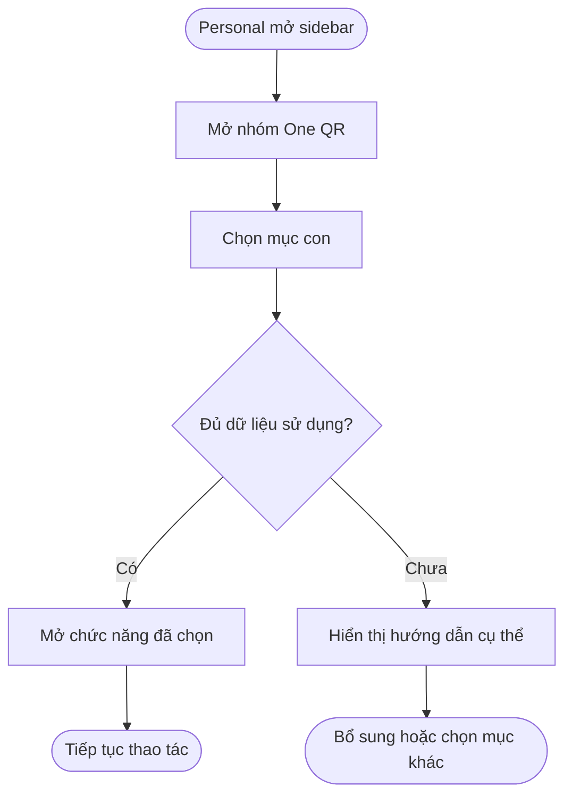
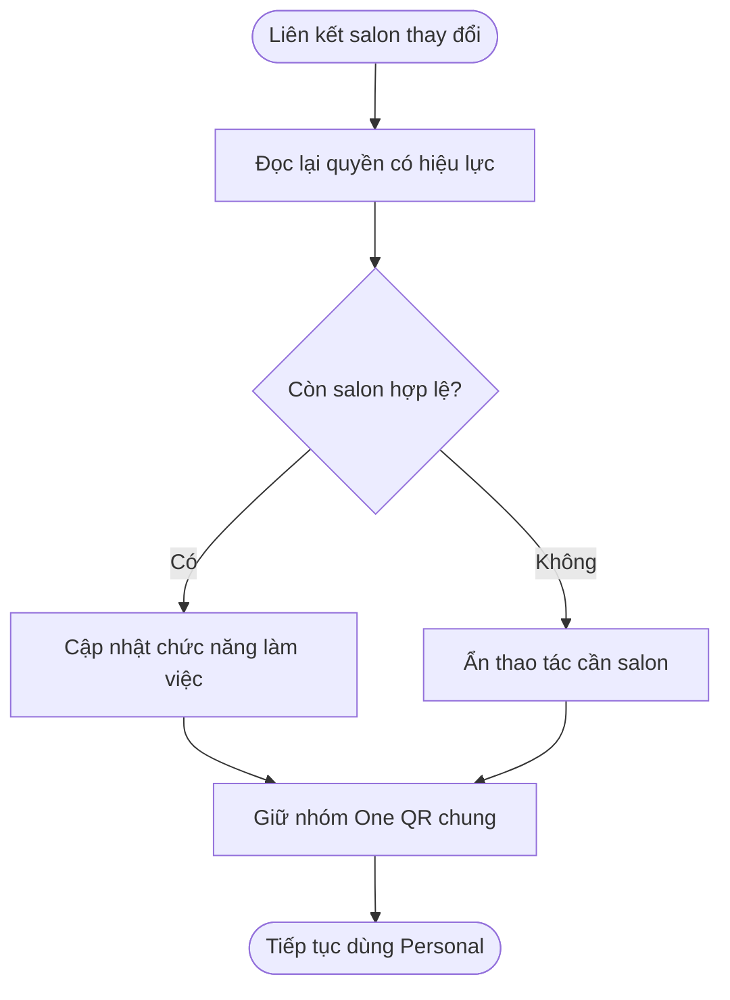
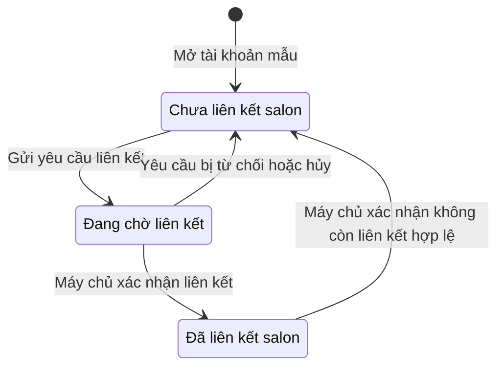

## Sidebar cho tài khoản Personal

**Cập nhật lần cuối:** 28/10/2026

**Đối tượng đọc:** PO, người thiết kế, người dựng prototype và đội phát triển

**Trạng thái:** Nhóm One QR và năm mục con đã được người dùng yêu cầu; bố cục các menu còn lại là đề xuất để review.

**Bản chia sẻ:** [Tài liệu trên GitHub](https://github.com/vlink-group/VlinkPay/blob/docs/1599-oneqr-earnings-points/nexora/docs/business/personal-sidebar-menu.md)

### Tóm tắt nhanh

| Nội dung | Ý chính |
|---|---|
| Mục đích | Bổ sung nhóm One QR cho Personal chưa liên kết salon và Personal đã liên kết salon. |
| Cấu trúc đã chốt | One QR → One QR, Tip QR, Accept Payment, Referral Link, Quảng cáo. |
| Dùng lại chức năng | Tip QR, QR nhận thanh toán và liên kết giới thiệu lấy từ My QR hiện có của thợ. |
| Phân quyền | Nhóm menu dùng chung; chức năng cần salon xử lý theo A3 và B5. Mở menu không tạo khoản thu nhập hay giao dịch. |
| Trạng thái bàn giao | Tài liệu yêu cầu và mockup sơ bộ để review, chưa phải xác nhận đã triển khai trên sản phẩm. |

### Tổng quan

Sidebar Personal giúp cá nhân tìm QR và các công cụ nhận tiền, giới thiệu tại một nhóm thống nhất. Nhóm One QR xuất hiện trên cả hai trạng thái liên kết salon. Cá nhân chọn mục cần dùng; hệ thống mở đúng màn hình và kiểm tra quyền theo tính năng. Người thiết kế dùng cấu trúc này để dựng hai trạng thái sidebar; đội phát triển dùng lại các phần đang có.

Yêu cầu mới nhất dùng nhãn **Accept Payment** thay cho đề xuất Payment Methods trước đó. Phần cấu hình phương thức nhận tiền nằm trong luồng Accept Payment. Vị trí One QR trong My QR ở bản bàn giao trước được thay bằng cấu trúc dưới đây.

### Khái niệm chính

| Thuật ngữ | Ý nghĩa |
|---|---|
| Personal chưa liên kết salon | Cá nhân chưa có liên kết salon có hiệu lực; gồm người chưa phải là thợ. |
| Personal đã liên kết salon | Cá nhân có ít nhất một liên kết salon có hiệu lực và dùng chức năng làm việc theo quyền. |
| One QR | Nhóm menu mới; cũng là tên mục con mở trang quản lý One QR cá nhân. |
| Tip QR | Mục mở chức năng QR nhận tip của My QR hiện có. |
| Accept Payment | Mục mở QR nhận thanh toán cá nhân và lối cấu hình phương thức nhận tiền. |
| Referral Link | Mục mở liên kết giới thiệu của tài khoản. |
| Quảng cáo | Mục bật quảng cáo hiển thị trên QR và xem kết quả kiếm tiền của cá nhân. |

Tình trạng liên kết salon không thay đổi loại tài khoản Personal. Người đã có hồ sơ thợ nhưng chưa có salon đang liên kết vẫn dùng nhóm One QR chung.

### Vai trò người dùng

| Vai trò | Trách nhiệm |
|---|---|
| Personal chưa liên kết salon | Dùng các công cụ cá nhân và xem hướng dẫn khi chức năng cần salon chưa sẵn sàng. |
| Personal đã liên kết salon | Dùng công cụ cá nhân và các chức năng làm việc tại salon theo quyền. |
| PO và người dùng | Review cách bố trí, điều hướng và trạng thái chưa có dữ liệu. |
| Người dựng prototype | Thể hiện đủ hai trạng thái và năm mục con; dùng dữ liệu mô phỏng. |

### Cấu trúc sidebar

#### Nhóm One QR đã được yêu cầu

```text
One QR
  One QR
  Tip QR
  Accept Payment
  Referral Link
  Quảng cáo
```

| Mục con | Khi mở | Personal chưa liên kết salon | Personal đã liên kết salon |
|---|---|---|---|
| One QR | Quản lý thông tin, liên kết, chia sẻ mã và quảng cáo kiếm tiền của cá nhân | Mở được theo A1 | Mở cùng chức năng cá nhân theo A1 |
| Tip QR | Dùng lại phần QR nhận tip trong My QR của thợ | Hiển thị hướng dẫn phù hợp theo A3 | Hiển thị QR và tình trạng theo salon hợp lệ |
| Accept Payment | QR nhận thanh toán cá nhân; có lối vào cấu hình phương thức nhận tiền | Mở được; thiếu cấu hình thì hướng dẫn bổ sung | Dùng lại thông tin nhận tiền của chính cá nhân |
| Referral Link | Liên kết và công cụ chia sẻ giới thiệu hiện có | Mở được; thiếu mã thì báo đúng trạng thái | Dùng cùng liên kết thuộc tài khoản |
| Quảng cáo | Bật quảng cáo và xem kết quả kiếm tiền | Mở được với tài khoản cá nhân | Dùng cùng chức năng kiếm tiền của cá nhân |

#### Personal chưa liên kết salon

Nhóm One QR là yêu cầu đã chốt. Các mục khác trong sơ đồ là bố cục đề xuất, chưa chốt thay đổi toàn bộ điều hướng hiện có.

```text
Thông tin tài khoản Personal

Dashboard
Community
One QR
  One QR
  Tip QR
  Accept Payment
  Referral Link
  Quảng cáo
Profile

Sign Out
```

#### Personal đã liên kết salon

Các chức năng làm việc dùng tên đang có. Nhóm One QR được đặt sau Community; phần trùng lặp được xử lý theo B6.

```text
Thông tin tài khoản Personal

Dashboard
Community
One QR
  One QR
  Tip QR
  Accept Payment
  Referral Link
  Quảng cáo
My Workspace
  My Salons
  My Earnings
  My Reviews
  Report
My Tickets
My Calendar
Tips
Transactions
Profile

Sign Out
```

Liên kết về trang chủ sản phẩm, menu tài khoản và các tiện ích hiện có được giữ theo phạm vi đang dùng. Sơ đồ tập trung vào điều hướng chức năng, không đề xuất thêm quyền quản lý Business.

### Các luồng từ đầu đến cuối

#### Luồng mở công cụ từ nhóm One QR

**Người thực hiện chính:** Tài khoản Personal ở một trong hai trạng thái liên kết.
**Kích hoạt:** Người dùng mở sidebar.
**Kết quả:** Người dùng đến đúng màn hình hoặc nhận hướng dẫn cụ thể.

**User stories**

- Là cá nhân, tôi muốn tìm các công cụ QR, nhận tiền và giới thiệu trong cùng một nhóm để dễ sử dụng.
- Là cá nhân chưa liên kết salon, tôi muốn biết vì sao chưa có Tip QR để không bị chặn các chức năng khác.

| Bước | Ai | Hành động | Hệ thống phản hồi |
|---|---|---|---|
| 1 | Personal | Mở sidebar | Hệ thống hiển thị nhóm One QR theo A1–A2. |
| 2 | Personal | Mở nhóm và chọn một mục con | Hệ thống đánh dấu mục được chọn theo C8. |
| 3 | Hệ thống | Kiểm tra dữ liệu và quyền của chức năng | Hệ thống mở màn hình hoặc hướng dẫn bổ sung theo A3–A4. |
| 4 | Personal | Đổi sang mục con khác | Hệ thống giữ quyền truy cập các mục còn lại và dữ liệu của tài khoản theo B7. |



#### Luồng thay đổi liên kết salon

**Người thực hiện chính:** Personal.
**Kích hoạt:** Máy chủ xác nhận thay đổi liên kết salon.
**Kết quả:** Menu làm việc và dữ liệu salon cập nhật; công cụ cá nhân được giữ theo B7.

**User stories**

- Là cá nhân mới liên kết salon, tôi muốn thấy các chức năng làm việc mình được phép dùng.
- Là cá nhân đã rời salon, tôi muốn tiếp tục dùng QR cá nhân và xem dữ liệu cũ trong quyền còn được phép.

| Bước | Ai | Hành động | Hệ thống phản hồi |
|---|---|---|---|
| 1 | Personal hoặc salon | Hoàn tất thao tác liên kết theo luồng hiện có | Máy chủ trả tình trạng và quyền có hiệu lực. |
| 2 | Hệ thống | Đọc lại liên kết | Hệ thống cập nhật nhóm làm việc và Tip QR theo B5. |
| 3 | Personal | Tiếp tục dùng nhóm One QR | Hệ thống giữ các công cụ cá nhân theo B7. |
| 4 | Hệ thống | Phát hiện trang salon đang mở không còn quyền | Hệ thống đưa người dùng về vị trí hợp lệ và thông báo rõ. |



### Cấu hình và quản trị

- Là người dựng prototype, tôi muốn mở rộng nhóm One QR để người review thấy đủ năm mục con.
- Là PO, tôi muốn xem hai sidebar cạnh nhau để đánh giá phần dùng chung và phần phụ thuộc salon.
- Là đội phát triển, tôi muốn dùng lại các màn hình hiện có theo D9 để tránh tạo thêm nơi quản lý cùng dữ liệu.

### Vòng đời trạng thái

Đây là nhóm trạng thái phục vụ hiển thị menu; quyền cuối cùng lấy từ kết quả máy chủ theo B5.

| Trạng thái hiển thị | Điều kiện | Cách thể hiện |
|---|---|---|
| Chưa liên kết salon | Chưa có liên kết có hiệu lực | Dùng mẫu Personal chưa liên kết. |
| Đang chờ liên kết | Yêu cầu chưa được xác nhận | Giữ nhóm One QR; Tip QR hiển thị tình trạng chờ. |
| Đã liên kết salon | Có liên kết hợp lệ | Dùng mẫu có chức năng làm việc theo quyền. |



### Quy tắc nghiệp vụ

#### A Nhóm One QR dùng chung

- **A1. Đối tượng:** Sidebar của mọi tài khoản Personal đều có nhóm One QR, gồm cả người chưa phải thợ, chưa liên kết salon và người đã liên kết salon.
- **A2. Mục con và thứ tự:** Nhóm có đúng năm mục theo thứ tự One QR, Tip QR, Accept Payment, Referral Link, Quảng cáo. Nhãn mới nhất là Accept Payment; cấu hình Payment Methods nằm trong Accept Payment.
- **A3. Tip QR khi chưa có salon:** Mục Tip QR vẫn hiện. Nếu chưa có QR nhận tip hợp lệ, màn hình nêu tình trạng và hướng dẫn liên kết hoặc chờ xác nhận; không tạo QR của salon khác để thay thế.
- **A4. Công cụ cá nhân:** One QR, Accept Payment, Referral Link và Quảng cáo không lấy việc trở thành thợ hoặc liên kết salon làm điều kiện mở màn hình. Chức năng thiếu dữ liệu riêng hướng dẫn bổ sung tại đúng nơi; thao tác tài chính vẫn tuân điều kiện nghiệp vụ tương ứng.

#### B Dữ liệu và quyền

- **B5. Quyền theo salon:** Hệ thống chỉ cho thao tác làm việc và dùng QR theo salon khi máy chủ xác nhận có quyền hợp lệ. Liên kết đang chờ hoặc lỗi tải quyền không được tự coi là đã có quyền.
- **B6. Một nơi truy cập:** Chuyển lối vào My QR hiện có sang các mục tương ứng trong nhóm mới; cấu hình nhận tiền được mở từ Accept Payment. Bỏ các lối vào sidebar trùng chức năng sau khi chuyển; giữ chức năng và đường dẫn cũ có thể truy cập hoặc được chuyển hướng phù hợp.
- **B7. Dữ liệu cá nhân:** Việc liên kết hoặc rời salon không tự tạo QR cá nhân mới, đổi mã giới thiệu, xóa phương thức nhận tiền hay gộp thu nhập với salon. Quyền xem lịch sử làm việc tiếp tục theo chính sách của dữ liệu đó.

#### C Hiển thị

- **C8. Điều hướng:** Nhóm cha mở hoặc thu gọn các mục con; mục con đang mở được đánh dấu rõ. Sidebar trên máy tính và menu mở từ điện thoại dùng cùng cấu trúc và quyền.

#### D Phạm vi bàn giao

- **D9. Dùng lại chức năng:** Tip QR dùng lại My QR của thợ; Accept Payment dùng lại QR thanh toán cá nhân và cấu hình nhận tiền; Referral Link dùng lại liên kết giới thiệu. One QR và Quảng cáo là các chức năng cá nhân cần mở rộng theo yêu cầu đã duyệt. Mục Quảng cáo phục vụ hiển thị quảng cáo để kiếm tiền; chưa tự bổ sung chức năng tạo chiến dịch trả phí.
- **D10. Bản mô phỏng:** Mockup chỉ thể hiện vị trí và phản hồi điều hướng. Mở trang, chọn menu hoặc thao tác mẫu không tạo giao dịch, thu nhập hay liên kết salon thật.

### Tiêu chí nghiệm thu

#### Hai trạng thái Personal

- [ ] Personal chưa liên kết salon thấy nhóm theo A1.
- [ ] Personal đã liên kết salon thấy nhóm theo A1.
- [ ] Nhãn và thứ tự năm mục đúng A2.
- [ ] Tip QR chưa đủ dữ liệu xử lý đúng A3.
- [ ] Các công cụ cá nhân áp dụng A4.

#### Điều hướng và dữ liệu

- [ ] Các lối vào dùng lại chức năng đúng D9.
- [ ] Sidebar không còn lối vào trùng sau khi chuyển theo B6.
- [ ] Thay đổi salon giữ dữ liệu cá nhân theo B7.
- [ ] Trang theo salon kiểm tra quyền theo B5.
- [ ] Mục đang chọn được đánh dấu theo C8.
- [ ] Menu trên điện thoại có đủ năm mục theo C8.

### Ngoại lệ và xử lý

| Tình huống | Phản hồi mong muốn | Người xử lý |
|---|---|---|
| Chưa cấu hình nhận tiền | Accept Payment hiển thị hướng dẫn bổ sung phương thức của cá nhân. | Chủ tài khoản |
| Chưa có mã giới thiệu | Referral Link báo chưa có liên kết và cho thử lại; không tự tạo mã giả. | Hệ thống và chủ tài khoản |
| Đang chờ salon duyệt | Tip QR hiển thị trạng thái chờ theo A3. | Salon và chủ tài khoản |
| Có nhiều salon | Tip QR cho chọn salon và hiển thị đúng QR theo quyền của salon đó. | Chủ tài khoản |
| Không còn salon hợp lệ | Nhóm One QR vẫn hiện; phần theo salon phản hồi đúng tình trạng hiện tại. | Hệ thống |
| Không tải được trạng thái liên kết | Hệ thống cho thử lại; không tự cấp quyền thao tác làm việc. | Hệ thống |

### Câu hỏi thường gặp

**Người chưa phải thợ có thấy Tip QR không?**
Có. Cách thể hiện khi chưa có QR nhận tip thực hiện theo A3.

**Payment Methods còn là mục riêng trên sidebar không?**
Yêu cầu mới nhất dùng Accept Payment theo A2; việc chuyển lối vào cấu hình thực hiện theo B6.

**One QR trong nhóm có phải là QR nhận tip cũ không?**
Hai mục có mục đích khác nhau: One QR mở trang cá nhân và quảng cáo; Tip QR dùng lại chức năng nhận tip theo D9.

### Tính năng liên quan

- **[One QR Personal](oneqr-personal-prototype-handoff.md):** Mô tả nội dung trang QR cá nhân, quảng cáo và hai màn hình quản lý, công khai. Tài liệu sidebar này xác định vị trí truy cập mới nhất.
- **My QR của thợ:** Nguồn chức năng nhận tip, QR thanh toán và liên kết giới thiệu hiện có để dùng lại.
- **[Ticket #2420](https://github.com/vlink-group/vlink-nexora/issues/2420):** Yêu cầu mở One QR và quảng cáo kiếm tiền cho Personal; tài liệu sidebar bổ sung cách truy cập.

### Phụ lục

#### Những điểm cần duyệt

| Nội dung | Phạm vi cần review | Người quyết định |
|---|---|---|
| Các menu ngoài One QR | Danh sách và thứ tự Dashboard, Community, My Workspace cùng các mục làm việc trong hai mẫu sidebar. | Người dùng và PO |
| Màn hình Accept Payment | Cách đặt phần QR nhận tiền và lối vào cấu hình phương thức trong cùng luồng. | Người dùng và PO |
| Trạng thái Tip QR | Câu hướng dẫn và thao tác tiếp theo khi chưa liên kết hoặc đang chờ duyệt. | Người dùng và PO |

Nhóm One QR, năm mục con và việc áp dụng cho cả hai trạng thái Personal đã được người dùng nêu rõ; không đưa lại các điểm này thành câu hỏi phạm vi.

#### Tham chiếu kỹ thuật

| Nguồn | Nội dung đối chiếu |
|---|---|
| Yêu cầu trực tiếp ngày 28/10/2026 | Phiên bản cuối gồm One QR, Tip QR, Accept Payment, Referral Link và Quảng cáo; Tip QR dùng lại My QR của thợ. |
| Frontend `origin/staging` tại `6506048c31d9e82dadd20837e77c6ab111d4d55f` | `src/components/staff-dashboard/constants.tsx`, `layout/StaffSidebar.tsx` cho thấy nhóm My Workspace, My QR và Payout Methods hiện có. |
| Cùng commit frontend | `src/components/staff-dashboard/views/StaffMyQR.tsx` có các tab nhận tip, giới thiệu và thanh toán; có thể dùng lại khi tách lối vào. |
| Cùng commit frontend | `src/app/AppRouter.tsx` và `src/app/RequireStaffReady.tsx` cho thấy Personal đang dùng chung khu vực thợ; phần kiểm tra sẵn sàng hiện trả nội dung trực tiếp. |
| Cùng commit frontend | `src/components/staff-dashboard/views/StaffPay.tsx` quản lý phương thức nhận tiền; cấu hình hiện dùng hồ sơ thợ về mặt kỹ thuật. Cần bảo đảm A4 khi mở cho Personal chưa liên kết. |
| Backend `origin/staging` tại `9089c1b780b1836ce1e81918565c30cab5de4f6b` | `backend/src/Application/Features/Staff/Commands/SetupStaffProfile/SetupStaffProfileCommandHandler.cs` có thể tạo hồ sơ mà chưa liên kết salon. Không dùng riêng sự tồn tại của hồ sơ này để suy ra quyền làm việc tại tiệm. |
| Glossary VlinkPay và phần Khái niệm chính | Dùng thống nhất tên tài khoản, tên chức năng và cách phân biệt dữ liệu cá nhân với dữ liệu theo salon. |

Các commit trên là nguồn đang có khi lập tài liệu, chưa xác nhận là bản mới nhất trên remote. Các mẫu sidebar là đề xuất thiết kế, không phải kết quả kiểm thử production.
