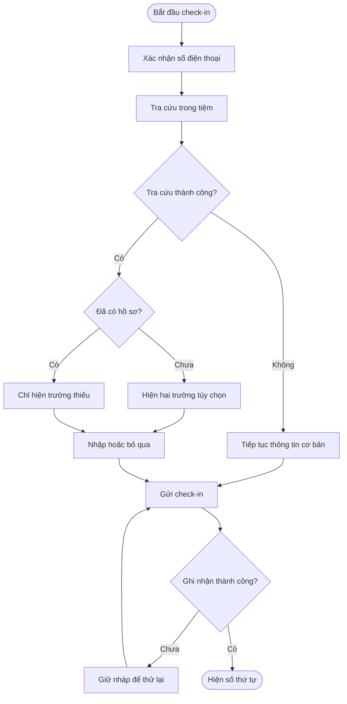
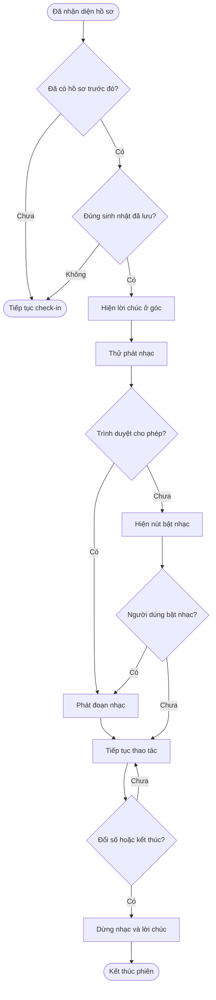
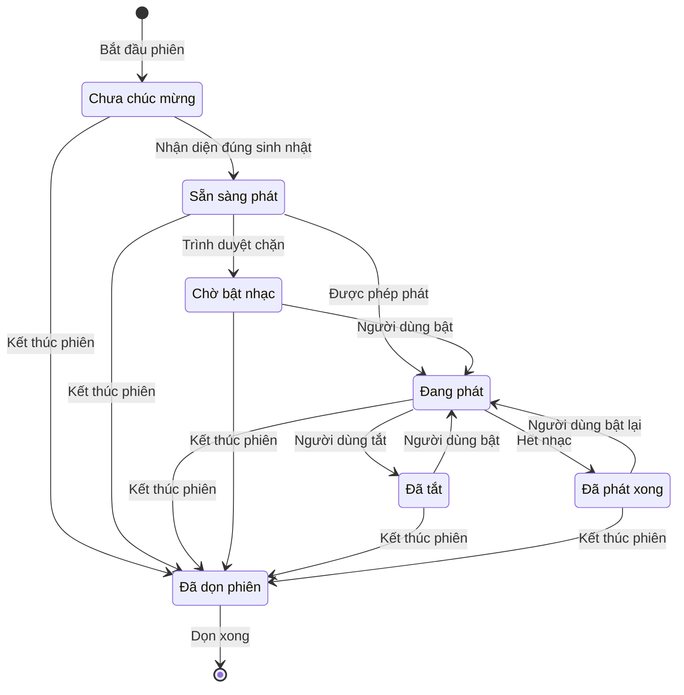

## Check-in — Sinh nhật và nguồn khách biết đến tiệm

**Cập nhật lần cuối:** 19/10/2026\
**Đối tượng:** Đội sản phẩm, chủ tiệm, lễ tân, phát triển và kiểm thử\
**Trạng thái:** Draft

---

### Tóm tắt nhanh

| Nội dung | Kết luận |
| :--- | :--- |
| Mục đích | Thu thập thông tin còn thiếu và chúc mừng sinh nhật khách ngay trong check-in. |
| Dòng dữ liệu | Xác nhận số → nhận diện hồ sơ → hiện trường còn thiếu và lời chúc phù hợp → lưu khi check-in thành công. |
| Điều phải hiểu đúng | Sinh nhật chỉ gồm ngày/tháng; hai trường đều tùy chọn; dữ liệu đã có được giữ nguyên. |
| Thời điểm chúc mừng | Ngay khi nhận diện khách đã có hồ sơ tại tiệm và hôm nay là sinh nhật đã lưu. |
| Tình trạng | Đây là yêu cầu cần triển khai; chưa phải kết quả kiểm thử hoặc xác nhận đã chạy trên staging. |

### Tổng quan

Tính năng này giúp tiệm bổ sung sinh nhật và kênh khách biết đến tiệm mà không hỏi lại thông tin đã có. Khách tự nhập trên điện thoại hoặc kiosk; lễ tân có thể nhập giúp trên POS. Khi nhận diện đúng dịp sinh nhật của khách đã có hồ sơ, hệ thống mở đoạn nhạc Happy Birthday và có thể hiện lời chúc nhỏ ở góc màn hình.

Người dùng đã chốt hai điểm khi lập tài liệu: chúc mừng ngay sau khi nhận diện khách, và khách cũ được hiểu là đã có hồ sơ tại tiệm. Khách không cần từng hoàn tất dịch vụ để đáp ứng điều kiện này.

#### Phạm vi màn hình

| Nơi sử dụng | Nội dung cần bổ sung |
| :--- | :--- |
| Khách check-in trên điện thoại | Trường còn thiếu, nhạc sinh nhật và nút điều khiển. |
| Kiosk mở bằng link public | Cùng nội dung trên, tự dọn dữ liệu khi đổi khách. |
| Thiết bị Self Check-in | Cùng nội dung trên cho thiết bị đã ghép với tiệm. |
| POS → Check-in tại quầy | Lễ tân thấy các trường còn thiếu và điều khiển nhạc. |
| Danh sách lịch hẹn bên trong check-in | Khách vẫn được nhập thông tin còn thiếu trước nút check-in nhanh. |

Cả giao diện một trang và từng bước đều thuộc phạm vi. Màn đặt lịch, checkout trực tiếp, báo cáo nguồn khách, cấu hình sinh nhật của chương trình tích điểm và màn chỉnh sửa hồ sơ khách không thuộc lần triển khai này.

### Khái niệm chính

| Thuật ngữ | Định nghĩa trong tính năng |
| :--- | :--- |
| Hồ sơ khách tại tiệm | Hồ sơ được tìm theo tiệm và số điện thoại đã chuẩn hóa, có xét mã quốc gia. |
| Khách mới | Người chưa có hồ sơ khớp tại tiệm ở lần nhận diện hiện tại. |
| Khách cũ | Người đã có hồ sơ khớp tại tiệm, kể cả hồ sơ tạo từ lịch hẹn hoặc nhập dữ liệu. |
| Sinh nhật | Ngày và tháng sinh; không yêu cầu năm sinh. |
| Nguồn khách biết đến tiệm | Kênh khiến khách biết tiệm và ghé sử dụng dịch vụ. |
| Nguồn tạo hồ sơ | Cách hệ thống ghi nhận hồ sơ, chẳng hạn cuộc gọi, web hoặc nhập thủ công. |
| Phiên check-in | Từ khi bắt đầu nhập số đến khi hoàn tất, hủy, đổi số hoặc chuyển sang khách khác. |

Nguồn khách biết đến tiệm và nguồn tạo hồ sơ là hai thông tin khác nhau. Việc chọn Facebook không đổi nguồn tạo hồ sơ trước đây của khách.

### Vai trò người dùng

| Vai trò | Trách nhiệm |
| :--- | :--- |
| Khách | Xác nhận số điện thoại, bổ sung thông tin tùy chọn và chủ động bật/tắt nhạc. |
| Lễ tân hoặc nhân viên có quyền thao tác POS | Nhập giúp khách trên màn Check-in, điều khiển nhạc khi cần. |
| Chủ tiệm | Sử dụng dữ liệu khách trong phạm vi quyền hiện có; không cần thiết lập cấu hình mới cho ticket này. |
| Đội phát triển và kiểm thử | Bảo đảm dữ liệu đúng hồ sơ và phần chúc mừng không cản check-in. |

### Quy trình từ đầu đến cuối

#### Quy trình 1: Nhận diện và bổ sung thông tin còn thiếu

**Người thực hiện chính:** Khách hoặc lễ tân.\
**Bắt đầu khi:** Người thao tác xác nhận số điện thoại.\
**Kết quả:** Các thông tin khách muốn bổ sung được lưu cùng lần check-in thành công.

**Câu chuyện người dùng:**

- Là khách mới, tôi muốn thấy hai trường tùy chọn để cung cấp thông tin nếu muốn.
- Là khách cũ, tôi muốn chỉ được hỏi thông tin còn thiếu để check-in nhanh hơn.
- Là khách có lịch hẹn, tôi muốn bổ sung thông tin ngay tại danh sách lịch hẹn mà vẫn giữ cách check-in nhanh.
- Là lễ tân, tôi muốn dữ liệu của số cũ được dọn khi sửa số để tránh ghi nhầm hồ sơ.

| Bước | Ai | Hành động | Phản hồi hệ thống |
| :--- | :--- | :--- | :--- |
| 1 | Khách/lễ tân | Nhập, xem lại và xác nhận số | Hệ thống tra cứu hồ sơ trong tiệm. |
| 2 | Hệ thống | Xác định hồ sơ và thông tin đã có | Hệ thống chọn các trường cần hiển thị theo A1–A4. |
| 3 | Khách/lễ tân | Nhập thông tin tùy chọn hoặc bỏ qua | Hệ thống kiểm tra các giá trị được nhập theo B5–B7. |
| 4 | Khách/lễ tân | Chọn dịch vụ hoặc lịch hẹn rồi check-in | Hệ thống ghi nhận lượt đến và bổ sung hồ sơ theo B8–B10. |
| 5 | Hệ thống | Trả kết quả thành công | Hệ thống tiếp tục màn cảm ơn và cơ chế kết thúc phiên hiện có. |
| 6 | Hệ thống | Gặp lỗi khi gửi | Hệ thống giữ thông tin đang nhập để người thao tác thử lại. |

#### Quy trình 2: Chúc mừng ngay khi nhận diện sinh nhật

**Người thực hiện chính:** Hệ thống; khách/lễ tân điều khiển âm thanh.\
**Bắt đầu khi:** Kết quả tra cứu xác nhận khách cũ có sinh nhật hôm nay.\
**Kết quả:** Khách nhận lời chúc và có thể nghe hoặc tắt nhạc trong khi tiếp tục check-in.

**Câu chuyện người dùng:**

- Là khách cũ có sinh nhật hôm nay, tôi muốn nhận lời chúc ngay khi tiệm nhận diện hồ sơ của mình.
- Là khách hoặc lễ tân, tôi muốn tắt/mở nhạc ngay trên màn hình mà không mất thông tin đang nhập.
- Là khách dùng trình duyệt chặn âm thanh, tôi muốn vẫn thấy lời chúc và có nút chủ động bật nhạc.
- Là người tiếp theo sử dụng kiosk, tôi muốn bắt đầu phiên riêng mà không còn nhạc hoặc lời chúc của người trước.

| Bước | Ai | Hành động | Phản hồi hệ thống |
| :--- | :--- | :--- | :--- |
| 1 | Hệ thống | Nhận kết quả hồ sơ | Hệ thống đánh giá điều kiện theo C11–C13. |
| 2 | Hệ thống | Nhận diện đúng sinh nhật | Hệ thống mở phần chúc mừng theo C14; người thao tác vẫn dùng form. |
| 3 | Hệ thống | Thử phát nhạc | Nếu trình duyệt cho phép, nhạc bắt đầu; nếu bị chặn, hệ thống hiện nút Bật nhạc. |
| 4 | Khách/lễ tân | Bấm Tắt nhạc hoặc Bật nhạc | Hệ thống đổi trạng thái âm thanh theo thao tác. |
| 5 | Khách/lễ tân | Tiếp tục check-in | Hệ thống xử lý check-in độc lập với âm thanh theo C15–C16. |
| 6 | Hệ thống | Kết thúc phiên hoặc đổi khách | Hệ thống dừng toàn bộ âm thanh và lời chúc theo C17. |

### Cấu hình và quản trị hệ thống

Ticket không thêm màn cấu hình cho tiệm. Danh sách nguồn dùng chung gồm Facebook, Instagram, Google, bạn bè/người thân giới thiệu, đi ngang tiệm và Khác.

- Là chủ tiệm, tôi muốn các màn check-in dùng cùng danh sách nguồn để dữ liệu thống nhất.
- Là người thao tác, tôi muốn nút âm thanh chỉ tác động phiên đang dùng để tránh làm thay đổi thiết bị khác.

### Vòng đời trạng thái

Trạng thái dưới đây thuộc phần chúc mừng trong phiên, không phải trạng thái mới của hồ sơ khách hay đơn dịch vụ.

| Trạng thái hiện tại | Sự kiện | Trạng thái tiếp theo |
| :--- | :--- | :--- |
| Chưa chúc mừng | Hồ sơ đủ điều kiện | Sẵn sàng phát |
| Sẵn sàng phát | Trình duyệt cho phép | Đang phát |
| Sẵn sàng phát | Trình duyệt chặn | Chờ bật nhạc |
| Đang phát | Người thao tác tắt | Đã tắt |
| Đã tắt / Chờ bật nhạc / Đã phát xong | Người thao tác bật | Đang phát |
| Đang phát | Hết đoạn nhạc | Đã phát xong |
| Mọi trạng thái | Đổi số, đổi tiệm hoặc kết thúc phiên | Đã dọn phiên |

### Quy tắc nghiệp vụ

#### A. Nhận diện và hiển thị

1. **A1 — Phạm vi hồ sơ:** Hệ thống nhận diện khách theo tiệm và số điện thoại đã chuẩn hóa. Khách cũ là người đã có hồ sơ khớp trước lần nhận diện, không phụ thuộc lịch sử hoàn tất dịch vụ.
2. **A2 — Khách mới:** Hệ thống hiện cả Sinh nhật và Bạn biết đến tiệm qua đâu? khi xác nhận chưa có hồ sơ.
3. **A3 — Khách cũ:** Hệ thống ẩn riêng từng trường đã có dữ liệu; nếu đủ cả hai thì ẩn toàn bộ phần bổ sung. Ngày sinh đầy đủ đã lưu cũng được xem là đã có sinh nhật.
4. **A4 — Tra cứu chưa xác minh:** Hệ thống chưa hiện các trường bổ sung hoặc chúc mừng khi tra cứu đang chạy hoặc bị lỗi. Khi tra cứu lỗi, người thao tác vẫn được check-in cơ bản và có thể thử tra cứu lại.

#### B. Nhập và lưu dữ liệu

5. **B5 — Sinh nhật tùy chọn:** Khách có thể bỏ trống cả ngày và tháng. Nếu nhập, khách phải chọn đủ cặp ngày/tháng hợp lệ; hệ thống chấp nhận 29/02 và không yêu cầu năm.
6. **B6 — Nguồn tùy chọn:** Khách có thể bỏ trống hoặc chọn một trong sáu nguồn đã nêu. Khác là một lựa chọn có sẵn, không kèm ô mô tả tự do trong ticket này.
7. **B7 — Thời điểm kiểm tra:** Hệ thống chỉ chặn phần gửi khi khách đã nhập giá trị không hợp lệ; việc bỏ trống hai thông tin không làm thay đổi điều kiện check-in hiện có.
8. **B8 — Ghi nhận cùng lượt đến:** Hệ thống chỉ lưu thông tin bổ sung khi check-in thành công. Hủy phiên hoặc check-in thất bại không tạo cập nhật riêng cho hai thông tin này.
9. **B9 — Bảo toàn dữ liệu:** Hệ thống chỉ điền trường đang thiếu tại thời điểm ghi. Dữ liệu đã có, kể cả dữ liệu được cập nhật trên thiết bị khác sau lúc tra cứu, không bị thay thế hay xóa bởi check-in.
10. **B10 — Đồng nhất đường gửi:** Hệ thống áp dụng B5–B9 cho khách vãng lai, khách check-in từ lịch hẹn và nút check-in nhanh trong danh sách lịch hẹn của phiên. Hệ thống giữ nguyên nguồn tạo hồ sơ.

#### C. Chúc mừng sinh nhật

11. **C11 — Điều kiện:** Hệ thống chỉ chúc mừng khi nhận diện khách cũ và ngày/tháng sinh nhật đã lưu khớp ngày hiện tại tại tiệm. Ngày/tháng vừa nhập trong phiên không tự làm phát sinh lời chúc của phiên đó.
12. **C12 — Ngày tại tiệm:** Hệ thống lấy ngày theo múi giờ của tiệm và quy tắc dự phòng hiện có. Ngày trên điện thoại hoặc máy chủ không tự thay thế ngày tại tiệm.
13. **C13 — Sinh nhật 29/02:** Hệ thống chúc mừng vào đúng 29/02; ticket này không tự chuyển sang 28/02 hoặc 01/03 trong năm không nhuận.
14. **C14 — Bắt đầu và điều khiển:** Hệ thống bắt đầu phần chúc mừng ngay khi nhận diện đủ điều kiện, thử mở nhạc Happy Birthday và cung cấp nút Bật nhạc/Tắt nhạc. Nếu trình duyệt chặn, người thao tác có thể chủ động bật; check-in vẫn tiếp tục.
15. **C15 — Không lặp ngoài ý muốn:** Hệ thống chỉ tự khởi động lời chúc một lần cho cùng hồ sơ trong một phiên. Tra cứu lại, chuyển bước hoặc thử gửi lại không tự bật nhạc sau khi người thao tác đã tắt. Người thao tác được chủ động bật lại.
16. **C16 — Không cản thao tác:** Phần chúc mừng nằm gọn ở góc; hiệu ứng là phần bổ sung tùy chọn. Hệ thống giữ các trường nhập, nút check-in và số thứ tự dễ nhìn, dễ bấm. Hệ thống không giữ khách ở màn hình để chờ nhạc kết thúc.
17. **C17 — Dọn phiên:** Hệ thống dừng nhạc và dọn lời chúc khi đổi số đã xác nhận, đổi tiệm, chọn check-in người khác, hủy, kết thúc, tự quay về hoặc rời màn. Khi trang chuyển nền, hệ thống dừng nhạc và không tự phát lại khi quay lại.

#### D. Trải nghiệm và phạm vi dữ liệu

18. **D18 — Dữ liệu tối thiểu:** Màn tự check-in chỉ cần biết trường nào còn thiếu và có sinh nhật hôm nay hay không. Hệ thống không cần gửi lại ngày sinh đầy đủ hoặc nguồn đã lưu cho màn công khai.
19. **D19 — Thiết bị và ngôn ngữ:** Hệ thống hỗ trợ mobile, tablet, bàn phím và hai ngôn ngữ hiện có. Khi người dùng giảm chuyển động, lời chúc vẫn đọc được mà không cần hiệu ứng động.
20. **D20 — Số dùng chung:** Tính năng tiếp tục dùng hồ sơ khớp với số điện thoại của tiệm. Chọn check-in người khác dừng chúc mừng cho người đã nhận diện; ticket này không tạo cơ chế phân biệt nhiều người trong cùng một hồ sơ số điện thoại.

### Ví dụ

| Tình huống | Kết quả mong đợi |
| :--- | :--- |
| Chưa có hồ sơ | Hiện cả hai trường theo A2. |
| Đã có sinh nhật, chưa có nguồn | Chỉ hiện nguồn theo A3. |
| Đã có nguồn, chưa có sinh nhật | Chỉ hiện sinh nhật theo A3. |
| Đã có đủ hai thông tin | Không hiện phần bổ sung theo A3. |
| Hồ sơ đã có sinh nhật hôm nay nhưng chưa có nguồn | Hệ thống chúc mừng theo C11; khách vẫn có thể nhập nguồn. |
| Khách mới nhập sinh nhật đúng hôm nay | Hệ thống lưu khi check-in thành công theo B8; không chúc mừng từ dữ liệu vừa nhập theo C11. |
| Khách tắt nhạc rồi chọn lịch hẹn | Hệ thống giữ nhạc tắt theo C15. |

### Tiêu chí chấp nhận

#### Hiển thị và ghi nhận

- [ ] AC01: Khi nhận diện khách mới, hai trường tùy chọn xuất hiện theo A2.
- [ ] AC02: Khi hồ sơ chỉ có sinh nhật, chỉ trường nguồn xuất hiện theo A3.
- [ ] AC03: Khi hồ sơ chỉ có nguồn, chỉ trường sinh nhật xuất hiện theo A3.
- [ ] AC04: Khi hồ sơ có đủ thông tin, phần bổ sung không xuất hiện theo A3.
- [ ] AC05: Khi hồ sơ có ngày sinh đầy đủ, trường sinh nhật được ẩn theo A3.
- [ ] AC06: Khi bỏ trống cả hai trường, check-in vẫn thành công theo B5–B7.
- [ ] AC07: Khi chọn 29/02, hệ thống chấp nhận theo B5.
- [ ] AC08: Khi chọn ngày không tồn tại, hệ thống báo lỗi theo B7.
- [ ] AC09: Khi check-in thất bại, hồ sơ chưa được bổ sung theo B8.
- [ ] AC10: Khi dữ liệu được thêm từ thiết bị khác, check-in không ghi đè theo B9.
- [ ] AC11: Khi dùng nút check-in nhanh của lịch hẹn, thông tin đã nhập được gửi theo B10.
- [ ] AC12: Khi sửa số, kết quả hồ sơ cũ không còn áp dụng theo A1 và C17.
- [ ] AC13: Khi tra cứu lỗi, check-in cơ bản vẫn dùng được theo A4.

#### Chúc mừng và kết thúc phiên

- [ ] AC14: Khi hồ sơ cũ có sinh nhật hôm nay, phần chúc mừng xuất hiện trước khi gửi check-in theo C11 và C14.
- [ ] AC15: Khi ngày tại tiệm khác ngày trên thiết bị, điều kiện dùng ngày tại tiệm theo C12.
- [ ] AC16: Khi trình duyệt chặn âm thanh, nút Bật nhạc xuất hiện theo C14.
- [ ] AC17: Khi bấm Tắt nhạc, âm thanh dừng theo C14.
- [ ] AC18: Khi tra cứu hoặc render lại, âm thanh không tự phát lần nữa theo C15.
- [ ] AC19: Khi bấm Bật nhạc, âm thanh có thể phát lại trong phiên theo C14–C15.
- [ ] AC20: Khi chuyển khách hoặc kết thúc phiên, âm thanh dừng theo C17.
- [ ] AC21: Khi khách tiếp tục thao tác, phần chúc mừng không che nút hoặc trường nhập theo C16.
- [ ] AC22: Khi năm không nhuận, hồ sơ 29/02 được xử lý theo C13.
- [ ] AC23: Khi dùng chế độ giảm chuyển động, lời chúc vẫn dùng được theo D19.
- [ ] AC24: Khi khách chưa từng hoàn tất dịch vụ nhưng đã có hồ sơ, hệ thống vẫn xét sinh nhật theo A1.
- [ ] AC25: Khi chuyển trang xuống nền rồi mở lại, âm thanh xử lý theo C17.

### Trường hợp ngoại lệ và cách xử lý

| Tình huống | Cách xử lý | Người xử lý |
| :--- | :--- | :--- |
| Hồ sơ có tên trống | Hệ thống vẫn nhận diện bằng hồ sơ khớp theo A1; người thao tác bổ sung tên theo form hiện có. | Hệ thống/khách |
| Không tra cứu được hồ sơ | Áp dụng A4; người thao tác tiếp tục hoặc thử tra cứu lại. | Hệ thống/khách |
| Hai thiết bị bổ sung cùng lúc | Áp dụng B9; giá trị được ghi hợp lệ trước được giữ lại. | Hệ thống |
| Mất mạng khi gửi | Áp dụng B8; hệ thống giữ nháp và cơ chế thử lại hiện có. | Khách/lễ tân |
| Trình duyệt hoặc thiết bị không phát được âm thanh | Áp dụng C14 và C16; lời chúc và check-in vẫn sử dụng được. | Hệ thống |
| Hồ sơ có sinh nhật khác dữ liệu khách muốn sửa | Check-in giữ dữ liệu theo B9; dùng quy trình quản lý hồ sơ hiện có để xử lý ngoài ticket. | Nhân viên có quyền |
| Khách dùng chung số điện thoại | Áp dụng D20. | Khách/lễ tân |

### Câu hỏi thường gặp

**Hỏi: Khách có phải hoàn tất dịch vụ một lần rồi mới được nghe nhạc không?**\
Đáp: Không. Điều kiện nhận diện dùng định nghĩa khách cũ tại A1, đã được người dùng chốt.

**Hỏi: Nhạc bắt đầu sau khi check-in thành công không?**\
Đáp: Nhạc được thử phát ngay khi nhận diện đủ điều kiện theo C14.

**Hỏi: Thu thập sinh nhật có tự cộng điểm hoặc gửi tin nhắn sinh nhật không?**\
Đáp: Ticket chỉ bao gồm thu thập và chúc mừng tại màn check-in. Việc đồng bộ chương trình tích điểm hoặc gửi tin nhắn cần phạm vi riêng.

**Hỏi: Nguồn đã chọn có được đổi trong check-in không?**\
Đáp: Check-in chỉ bổ sung phần thiếu theo B9; không mở lại trường đã có để sửa.

### Tính năng liên quan

- [Tài liệu kỹ thuật](technical.md): mô tả dữ liệu, API và cách phát nhạc đáp ứng các quy tắc trên.
- [Kế hoạch triển khai](implementation-plan.md): chia việc và xác định kiểm chứng local/staging.
- [Review số điện thoại và lịch hẹn](https://github.com/vlink-group/VlinkPay/blob/c28eb5766e31a33d897d4b8b6877e400775d7e7b/nexora/docs/business/pos-checkin-phone-review-appointment.md): quy trình xác nhận số và sử dụng lịch hẹn cần được giữ lại.
- [Check-in dùng chung](https://github.com/vlink-group/VlinkPay/blob/c28eb5766e31a33d897d4b8b6877e400775d7e7b/nexora/docs/business/references/POS-CheckIn-Single-Page-Spec.md): tham chiếu lịch sử cho hai kiểu giao diện; hiện trạng được xác minh bằng code trong phụ lục.

### Phụ lục

#### Các quyết định còn mở

| Mã | Nội dung cần quyết định | Đề xuất để triển khai | Người phụ trách |
| :--- | :--- | :--- | :--- |
| OD1 | Bản nhạc và thời lượng chính thức | Dùng đoạn Happy Birthday không lời, tổng hợp bằng trình duyệt, tối đa 12 giây. Đây là lựa chọn thiết kế của người soạn, chưa phải yêu cầu đã được người dùng duyệt. | Đội sản phẩm |
| OD2 | Có dùng hiệu ứng động hay chỉ lời chúc | Lời chúc nhỏ và trang trí nhẹ ở góc; bỏ chuyển động khi người dùng yêu cầu. | Đội sản phẩm/UI |

Các điểm còn mở không thay đổi hai quyết định đã chốt về thời điểm chúc mừng và định nghĩa khách cũ. Thiết kế kỹ thuật dùng phương án đề xuất tại OD1–OD2 để đủ chi tiết cho việc ước tính.

#### Tài liệu và mã nguồn đối chiếu

- [Ticket #2042](https://github.com/vlink-group/vlink-nexora/issues/2042): yêu cầu đã bổ sung ngày 19/10/2026; hai câu trả lời trong phiên này làm rõ thời điểm và định nghĩa khách cũ.
- Backend `staging`: `7475c0a43420b9ed136900371c8aaef8196c850d`; frontend `staging`: `8f76a1274e0a5c22cacdc36d24c57e9e8715ce42`. Đầu nhánh remote đã được đối chiếu cùng ngày; chưa chứng minh bản đang deploy trùng hai commit này.
- [Hồ sơ khách hiện tại](https://github.com/vlink-group/vlink-nexora/blob/7475c0a43420b9ed136900371c8aaef8196c850d/backend/src/Domain/Entities/Customer.cs): có ngày sinh đầy đủ và nguồn tạo hồ sơ; chưa có nguồn khách biết đến tiệm.
- [Phiên check-in hiện tại](https://github.com/vlink-group/vlink-nexora-fe/blob/8f76a1274e0a5c22cacdc36d24c57e9e8715ce42/src/components/checkin/useCheckInSession.ts): có đường gửi khách vãng lai, lịch hẹn và check-in nhanh.
- Thuật ngữ đối chiếu theo `vlinkpay-docs/docs/glossary.md` trong workspace. Glossary chưa có mục riêng cho các khái niệm mới của ticket; định nghĩa áp dụng được đặt tại Khái niệm chính, không tự chỉnh sửa repository glossary trong tác vụ tài liệu này.
