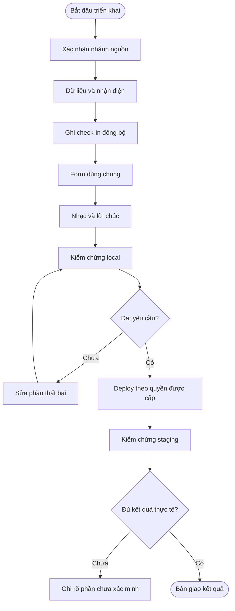
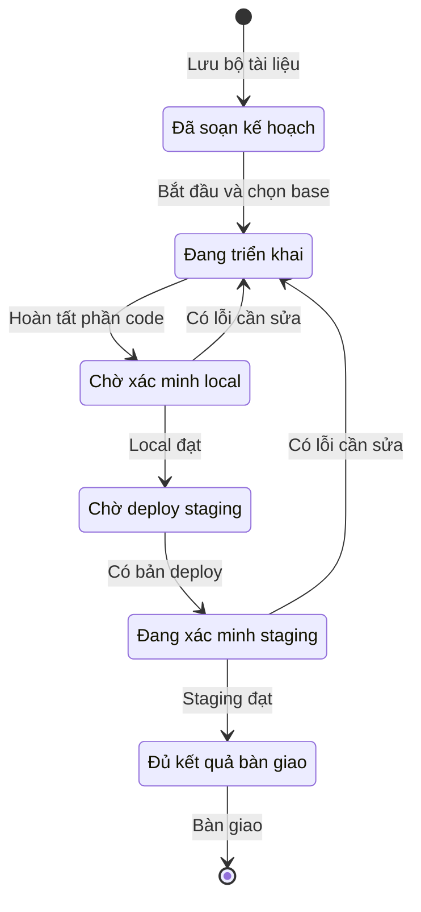

# Check-in #2042 — Kế hoạch triển khai

> Dành cho người triển khai: thực hiện từng task với skill `superpowers:executing-plans`. Chỉ dùng quy trình nhiều agent khi người dùng yêu cầu. Đọc cả business và technical trước khi sửa code; các ô dưới đây là việc dự kiến, chưa phải kết quả đã hoàn tất.

**Cập nhật lần cuối:** 20/10/2026\
**Đối tượng:** Phát triển backend/frontend, kiểm thử và người review\
**Trạng thái:** Draft\
**Bản chia sẻ:** [Tài liệu trên GitHub](https://github.com/vlink-group/VlinkPay/blob/docs/2042-checkin-birthday-source/nexora/docs/checkin-birthday-source-2042/implementation-plan.md)

**Goal — Mục tiêu:** Thu thập thông tin còn thiếu và chúc mừng đúng sinh nhật ngay khi nhận diện khách đã có hồ sơ tại tiệm.

**Architecture — Kiến trúc:** Backend trả profile tối thiểu và ghi bổ sung trong cùng giao dịch check-in. Frontend dùng chung session, input và audio controller cho mọi bề mặt và hai layout.

**Tech Stack:** .NET 8, EF Core/PostgreSQL, React 18, TypeScript, Vite, TanStack Query, Vitest hiện có và Web Audio.

**Spec — Tài liệu đầu vào:** Bộ business và technical cùng thư mục; liên kết và phiên bản nguồn tại Phụ lục.

---

### Tóm tắt nhanh

| Nội dung | Kế hoạch |
| :--- | :--- |
| Thứ tự | Xác minh nhánh → backend → frontend → âm thanh → local → staging. |
| Phạm vi | Bốn nơi check-in, hai layout, khách vãng lai và check-in từ lịch hẹn. |
| Điều phải giữ | Chỉ bổ sung dữ liệu trống; lời chúc bắt đầu khi nhận diện; mọi lỗi âm thanh không cản check-in. |
| Thời gian AI dự kiến | 14–20 giờ làm việc sau khi có quyền truy cập và môi trường chạy được. |
| Tình trạng | Đã triển khai, kiểm tra local và mở PR backend trước, frontend sau vào staging để review. Chưa merge/deploy staging. Các ô kế hoạch giữ vai trò yêu cầu công việc; kết quả nằm trong evidence. |

### Tổng quan

Kế hoạch này triển khai yêu cầu đã chốt của ticket #2042 theo từng phần có kết quả kiểm chứng được. Backend phải sẵn sàng trước khi frontend sử dụng metadata mới. Người triển khai kiểm tra local bằng build, kiểm chứng API và trình duyệt, sau đó kiểm tra lại trên bản staging thực sự được deploy.

Ước tính tăng so với mức 8–12 giờ ban đầu vì phạm vi đã thêm điều kiện hiện trường theo hồ sơ, lookup đúng ngày sinh nhật, âm thanh ngay khi nhận diện và các tình huống dọn phiên trên nhiều thiết bị.

### Khái niệm chính

| Thuật ngữ | Ý nghĩa |
| :--- | :--- |
| Task | Một phần thay đổi có đầu ra và điều kiện kiểm chứng riêng. |
| Local | Giao diện chạy trên máy phát triển; kiểm chứng backend mới cần API và DB dành riêng cho phát triển. |
| Staging | Bản frontend/backend đã deploy lên môi trường staging, có ghi lại phiên bản thực tế. |
| Evidence | Ảnh, log, ghi nhận request hoặc kết quả kiểm chứng thực sự đã thực hiện. |

### Vai trò người dùng

| Vai trò | Công việc |
| :--- | :--- |
| Người dùng | Chọn base branch khi bắt đầu sửa ứng dụng; review bản chạy theo hướng nhạc và hiệu ứng đã chốt. |
| AI triển khai | Sửa code đúng nhánh, tự kiểm tra từng phần và lưu evidence đúng nơi. |
| Người có quyền triển khai | Review/merge/deploy qua quy trình dự án khi được yêu cầu. |
| Người kiểm thử | Chạy ma trận local/staging và ghi rõ giới hạn thiết bị thực tế. |

### Ràng buộc chung — Global Constraints

- Phạm vi nghiệp vụ áp dụng theo business A1–D22; nhạc ngắn, nhẹ nhàng và hiệu ứng vừa phải, dễ thương đã chốt tại QD1–QD2. Nguồn và bố cục theo QD3; MP3 người dùng cung cấp theo QD4.
- Chỉ làm trong primary checkout; không tạo hoặc sử dụng worktree.
- Trước khi sửa code, hỏi base branch cho backend và frontend; chờ câu trả lời rõ ràng. Tác vụ lập tài liệu hiện tại không cần hỏi nhánh.
- Tên task branch: `enhance/2042-checkin-birthday-source`; dùng cùng tên tại hai repository nếu phù hợp.
- Không sửa/commit trực tiếp trên `dev`, `staging`, `master`; không tự merge hoặc deploy từ kế hoạch này.
- Sau khi có task branch frontend hợp lệ, kiểm tra duy nhất `VITE_API_BASE_URL=https://staging-api.nexoratouch.com` trong `.env.development`; giữ biến khác. Chỉ dùng API khác khi người dùng chỉ định cho lần triển khai đó.
- Dữ liệu mới nullable và backward compatible; không đổi `DateOfBirth`, `Source` hoặc nguồn sinh nhật của Loyalty.
- Tài liệu nguồn giữ ở thư mục docs chung; không đưa vào commit ứng dụng. Test mới ở `test/scripts/`; evidence ở `test/evidence/`, dùng đường dẫn tuyệt đối trong Phụ lục.
- Backend không có test project theo hướng dẫn hiện có; kế hoạch không tạo backend unit test/project. Kiểm chứng backend bằng build, API và kiểm tra dữ liệu.
- Chỉ commit code/migration/generated API contract được phép; không commit test, tài liệu nguồn, environment hoặc proxy. Chỉ commit khi người dùng yêu cầu, ngoại trừ publication tài liệu được workspace cho phép sẵn.
- Không dùng workflow OpenSpec, user-story approval hay `feature-focused-tester` thuộc nhóm đã bị workspace loại trừ.
- UI dùng EN/VI, tên khách viết hoa, số khách hiển thị theo chuẩn Mỹ; không sửa cơ chế chuẩn hóa số ngoài phạm vi.

### Trọng tâm review — Review Focus

1. Hồ sơ có tên trống, được import hoặc chưa từng hoàn tất dịch vụ vẫn phải được nhận diện đúng.
2. Kết quả lookup và `resume()` trả chậm sau khi đổi số không được phát nhạc hoặc gán nháp cho khách mới.
3. Ngày tại tiệm khác UTC/thiết bị và trường hợp 29/02 phải cho kết quả theo business C12–C13.
4. Hai thiết bị ghi cùng hồ sơ hoặc hồ sơ đã có ngày sinh đầy đủ không được bị ghi đè.
5. Check-in nhanh, booking legacy và nhóm dùng chung số phải giữ đúng hồ sơ, dữ liệu tùy chọn và cleanup âm thanh.

Mỗi mục có ca kiểm chứng cụ thể ở Task 2–7; không chỉ review bằng cách đọc diff.

### Quy trình từ đầu đến cuối

#### Quy trình triển khai và xác minh

**Người thực hiện chính:** AI triển khai và người có quyền môi trường.\
**Bắt đầu khi:** Người dùng yêu cầu bắt đầu sửa code và đã chọn base branch.\
**Kết quả:** Các yêu cầu có kết quả kiểm chứng trên local và staging, hoặc có giới hạn được báo rõ.

**Câu chuyện người dùng:**

- Là người giao việc, tôi muốn biết task nào đã xong và được kiểm chứng ở đâu để review đúng tiến độ.
- Là người review, tôi muốn mỗi task có hợp đồng đầu vào/đầu ra rõ ràng để không phải đoán giữa backend và frontend.
- Là người dùng cuối, tôi muốn các lỗi phần bổ sung không làm mất khả năng check-in hiện có.

| Bước | Ai | Hành động | Kết quả |
| :--- | :--- | :--- | :--- |
| 1 | Người dùng/AI | Chốt base và chuẩn bị task branch | Task 1 có bằng chứng trạng thái nhánh. |
| 2 | AI backend | Hoàn tất dữ liệu, lookup và ghi check-in | Task 2–3 có hợp đồng và kiểm chứng API. |
| 3 | AI frontend | Nối dữ liệu, form và âm thanh | Task 4–5 chạy được cùng backend mới. |
| 4 | AI kiểm thử | Kiểm chứng tích hợp local | Task 6 có kết quả theo ma trận. |
| 5 | Người có quyền | Deploy phiên bản được review | Có phiên bản để kiểm tra staging. |
| 6 | AI/người kiểm thử | Kiểm chứng lại trên staging | Task 7 có kết quả thực tế và giới hạn. |



#### Task 1: Chuẩn bị nhánh và điều kiện triển khai

**Files:** Chưa sửa file ứng dụng trong bước kiểm tra; sau khi có task branch frontend hợp lệ, chỉ chỉnh biến API local theo ràng buộc chung nếu cần.

**Interfaces:** Nhận base branch của từng repository từ người dùng; tạo task branch hợp lệ và danh sách phiên bản dùng để triển khai.

- [ ] Hỏi base branch cho backend và frontend khi bắt đầu implementation, không dùng `staging` mặc định của tài liệu để tự suy ra base code.
- [ ] Kiểm tra remote, nhánh hiện tại và working tree; bảo toàn `.env.development` đang có thay đổi cùng các thay đổi khác của người dùng.
- [ ] Chuyển base đã được chọn, ghi lại SHA, tạo task branch và xác minh nhánh hiện tại trước khi sửa file.
- [ ] Đối chiếu lại các file trong technical với base thực tế. Nếu khác `staging` đã khảo sát, ghi rõ chênh lệch ảnh hưởng.
- [ ] Xác định API/DB local cho migration và test. Mặc định frontend local dùng staging API; để kiểm chứng backend mới trước deploy cần người dùng chỉ định API local hoặc endpoint môi trường dành riêng có thể truy cập.
- [ ] Đọc định hướng QD1–QD2, nguồn nhạc QD4 và mặc định âm thanh/hiệu ứng trong technical; triển khai theo đó, tinh chỉnh khi nghe và xem thực tế.

**Kết quả đạt:** Có task branch sạch về phạm vi, phiên bản base và môi trường đủ để kiểm chứng. Nếu thiếu API/DB local, tiếp tục phần không phụ thuộc và ghi rõ Task 6 chưa thể đánh dấu hoàn tất.

#### Task 2: Dữ liệu, ba lookup và API chi tiết

**Files backend — sửa:**

- `backend/src/Domain/Entities/Customer.cs`
- `backend/src/Domain/Constants/DomainErrorCode.cs`
- `backend/src/Infrastructure/Data/Configurations/Database/CustomerConfiguration.cs`
- `backend/src/Application/Features/Pos/Public/CheckIn/Queries/GetPublicCheckInCustomerLookup/GetPublicCheckInCustomerLookupQuery.cs`
- `backend/src/Application/Features/Pos/SelfCheckIn/Queries/GetSelfCheckInCustomerLookup/GetSelfCheckInCustomerLookupQuery.cs`
- `backend/src/Web/Controllers/Merchant/PosCheckInController.cs`
- `backend/src/Application/Features/Pos/Customers/Queries/GetPosCustomerDetail/GetPosCustomerDetailQuery.cs`

**Files backend — mới/sinh:**

- `backend/src/Domain/Enums/CustomerAcquisitionSource.cs`
- `backend/src/Application/Features/Pos/CheckIn/Common/CustomerCheckInDetailsInput.cs`
- `backend/src/Application/Features/Pos/CheckIn/Common/CheckInCustomerProfileReader.cs`
- `backend/src/Application/Features/Pos/CheckIn/Queries/GetCheckInCustomerProfile/GetCheckInCustomerProfileQuery.cs`
- `backend/src/Infrastructure/Migrations/<timestamp>_AddCustomerCheckInDetails.cs` và Designer/snapshot do EF sinh.

**Interfaces:** Nhận định nghĩa T1–T5; tạo `CustomerAcquisitionSource`, `CustomerCheckInDetailsInput`, `CheckInCustomerProfileDto` và `CheckInCustomerProfileReader.ReadAsync(...)` đúng technical.

- [ ] Trước thay đổi, ghi nhận ba lookup hiện thiếu metadata và hồ sơ tên trống không được trả đúng; dùng API/DB phát triển, không tạo backend test project.
- [ ] Thêm ba field nullable và enum năm nguồn đúng mã technical; `Other=4`. Không backfill hoặc đổi field cũ.
- [ ] Thêm validator dùng chung cho cặp ngày/tháng và enum theo bảng lỗi technical.
- [ ] Thêm reader ưu tiên ngày sinh đầy đủ, dùng timezone resolver và `nowUtc` được caller truyền.
- [ ] Mở rộng public/device lookup, thêm minimal query quầy; không sửa `CustomerLookupResolver` đang dùng chung public booking.
- [ ] Bổ sung tháng/ngày sinh và nguồn vào API chi tiết khách có đăng nhập; kiểm chứng giá trị mới, null, sinh nhật cũ và giới hạn quyền/tiệm theo TC25.
- [ ] Sinh migration bằng workflow EF hiện có và review rằng chỉ ba cột, constraint cùng snapshot liên quan thay đổi.
- [ ] Trên DB phát triển, kiểm chứng null/null, 29/02, 31/04, một cột null và enum ngoài tập hợp bằng API/constraint; hoàn nguyên dữ liệu mẫu nếu cần.
- [ ] Kiểm chứng hồ sơ tên trống và hồ sơ chưa có lượt hoàn tất trả `customerExists=true`; không có hàng Customer trả null hợp lệ.
- [ ] Kiểm chứng mốc UTC cố định bằng gọi reader trong debugger/immediate evaluation tại local: `2026-10-20T02:00:00Z`, tiệm `America/Chicago`, sinh nhật 19/10 phải là true; sinh nhật 20/10 là false. Đây là kiểm chứng có mốc, không đổi đồng hồ server staging.
- [ ] Kiểm chứng 29/02 vào ngày `2028-02-29` tại tiệm là true và ngày `2027-02-28` tại tiệm là false.

**Lệnh tại `backend/`:**

```bash
dotnet ef migrations add AddCustomerCheckInDetails --project src/Infrastructure --startup-project src/Web --context ApplicationDbContext
dotnet build Nexora.sln
```

**Kết quả đạt:** Build không có lỗi/cảnh báo bị coi là lỗi; migration đúng phạm vi; lookup chỉ trả dữ liệu trong DTO minimal, chứng minh Review Focus 1 và 3.

#### Task 3: Ghi bổ sung trên sáu đường check-in

**Files backend — sửa:**

- `backend/src/Application/Features/Pos/Orders/Common/PosCheckInOrderScaffold.cs`
- `backend/src/Application/Features/Pos/Orders/Commands/CheckInOrder/CheckInOrderCommand.cs`
- `backend/src/Application/Features/Pos/SelfCheckIn/Commands/SelfCheckInOrder/SelfCheckInOrderCommand.cs`
- `backend/src/Application/Features/Pos/Public/CheckIn/Commands/PublicCheckInOrder/PublicCheckInOrderCommand.cs`
- `backend/src/Application/Features/Pos/Bookings/Commands/CheckInBooking/CheckInBookingCommand.cs`
- `backend/src/Application/Features/Pos/SelfCheckIn/Commands/SelfCheckInBooking/SelfCheckInBookingCommand.cs`
- `backend/src/Application/Features/Pos/Public/CheckIn/Commands/PublicCheckInBooking/PublicCheckInBookingCommand.cs`
- `backend/src/Web/Controllers/Public/PublicPosCheckInController.cs`
- `backend/src/Web/Controllers/Merchant/PosBookingsController.cs`
- `backend/src/Web/Controllers/Pos/PosSelfCheckInController.cs` nếu cần response annotations hoặc mapping.

**Files backend — mới/sinh:**

- `backend/src/Application/Features/Pos/CheckIn/Common/CustomerCheckInDetailsWriter.cs`
- `backend/src/Web/wwwroot/api/specification.json` sinh lại.
- `backend/src/Web/wwwroot/api/web-api-client.ts` được cùng NSwag workflow sinh lại, đang được Git theo dõi.

**Interfaces:** Nhận input/enum từ Task 2; tạo `CustomerCheckInDetailsWriter.ApplyMissingAsync(...)` với tham số audit như technical; cả sáu lệnh nhận `CustomerDetails?`.

- [ ] Ghi nhận request cũ không có `customerDetails` trên cả sáu đường trước thay đổi để có đối chiếu backward compatibility.
- [ ] Thêm input/validator và mapping đủ từ HTTP DTO tới command, nhất là hai mapping public đang thực hiện thủ công.
- [ ] Bổ sung transaction trong mỗi vòng retry của scaffold; truyền phần bổ sung và audit tới writer.
- [ ] Giữ các thuộc tính mới của `PosCheckInOrderRequest` tùy chọn; kiểm tra caller `CreateDirectCheckoutOrderCommand` vẫn compile và giữ hành vi khi không gửi phần bổ sung.
- [ ] Sau SaveChanges và trước commit, gọi writer có điều kiện null tại DB; cập nhật audit bằng `LastModified`, `LastModifiedBy` đúng convention.
- [ ] Nối writer trong ba booking handler; giữ nguyên phân biệt `items=null` và `items=[]`.
- [ ] Khi booking legacy có phần bổ sung nhưng thiếu CustomerId, resolve từ snapshot số của booking và gắn hồ sơ trong transaction; map Public → Web, Staff → Manual, Voice → Call. Client cũ không có phần bổ sung hoặc chỉ có object rỗng giữ đường legacy.
- [ ] Kiểm chứng cố tình thất bại trước commit tại DB local: không còn order/phần bổ sung được ghi riêng; giữ side effect bên ngoài transaction.
- [ ] Gửi hai request bổ sung nguồn khác nhau cùng hồ sơ thiếu nguồn: chỉ giá trị ghi trước tồn tại, không bị request sau thay thế. Lặp lại với cặp sinh nhật.
- [ ] Gửi sinh nhật khác vào hồ sơ đã có DateOfBirth: giữ nguyên cả ngày sinh cũ và không tạo cặp thay thế.
- [ ] Kiểm chứng public retry trả lại lượt đã tạo và không tăng TotalVisit vì writer; kiểm chứng booking chỉ có một lượt.
- [ ] Tạo active visit bằng request không có `customerDetails`, rồi gửi public request có phần bổ sung: giữ một lượt nhưng lưu được phần thiếu trong transaction. Lặp lại với nhánh public trả lại booking đã check-in; không tái gửi SMS vì writer.
- [ ] Chạy Debug build với NSwag hiện có, review diff cả specification.json và web-api-client.ts. Không dùng `SkipNSwag=True` để tuyên bố hợp đồng đã được cập nhật.

**Kết quả đạt:** Sáu đường POST có bằng chứng dữ liệu; client cũ hoạt động; không có update tách khỏi transaction, chứng minh Review Focus 4–5.

#### Task 4: Nối profile, form và check-in nhanh trên frontend

**Files frontend:** Đúng danh sách “Frontend: đơn vị thiết kế” của technical, trừ ba file audio/celebration thuộc Task 5. Ba source phải xét riêng: `usePublicCheckInSource.ts`, `useKioskCheckInSource.ts`, `usePosCheckInSource.ts`.

**Files kiểm chứng mới, ngoài repository:** `vitest.config.ts`, `profile.test.ts`, `details.test.ts`, `session.test.tsx` trong thư mục scripts của ticket ở Phụ lục.

**Interfaces:** Tạo `normalizeCheckInCustomerProfile(raw): CheckInProfileState` tại `data/repositories/checkInCustomerProfile.ts`; tạo `buildCustomerCheckInDetails(profile, draft): CustomerCheckInDetailsInput | undefined` và `validateCustomerCheckInDetails(draft)` tại `components/checkin/customerCheckInDetails.ts`. Error shape của validator: `{ birthday?: 'incomplete' | 'invalid'; acquisitionSource?: 'invalid' }`.

- [ ] Tạo cấu hình Vitest ngoài repository bằng object export, `root` trỏ frontend, `test.include` trỏ tuyệt đối tới test ticket, `environment='jsdom'`, setup dùng `src/setupTests.ts`, alias `@` trỏ `src` và `esbuild.jsx='automatic'`. Cấu hình không ghi lại vào repository.
- [ ] Viết assertion hợp đồng trước khi nối code: null hợp lệ thành khách mới; profile tên trống vẫn `customerExists=true`; lỗi query không được normalize thành khách mới.
- [ ] Viết assertion payload: profile đã có sinh nhật chỉ gửi nguồn; profile đủ dữ liệu trả undefined; ngày/tháng cùng trống hợp lệ; 31/04 và cặp thiếu bị từ chối; 29/02 hợp lệ.
- [ ] Viết assertion danh sách nguồn chỉ có năm lựa chọn theo B6; gửi Other đúng mã hợp đồng và từ chối giá trị ngoài tập hợp.
- [ ] Chạy test mới và xác nhận thất bại đúng vì chức năng chưa tồn tại.
- [ ] Thêm enum/label, API types, normalizer, repository và hook. Device phải giữ metadata thay vì chỉ lấy tên; query quầy mới độc lập query lịch sử. Profile key gồm scope, số chuẩn hóa và recognitionKey; không dùng placeholder từ epoch trước.
- [ ] Thêm profile và nháp vào session, cùng generation nhận diện. Snapshot `birthdayEligibleAtRecognition` lấy từ lookup thành công đầu tiên, kể cả false/null-customer; refetch sau POST không đổi snapshot. Kết quả A về muộn sau khi đổi B không được áp dụng.
- [ ] Seed cache A có birthday=true hoặc customer=null, rồi thử A→B→A và hủy/nhận diện lại A: chỉ response mạng của epoch mới được resolved. Ca qua ngày và hồ sơ được tạo từ máy khác phải cập nhật điều kiện đúng.
- [ ] Thêm component trường tùy chọn ở một trang, bước tên của wizard và một khối chung trong danh sách lịch hẹn, gồm cả chế độ embedded.
- [ ] Áp dụng bố cục T13 và ngưỡng màn hình của D21: Phone/Name hai cột, nhóm Birthday MM/DD và Found us via ngay dưới, SMS bên dưới. Wizard giữ bước xác nhận Phone và dùng cùng nhóm bổ sung dưới Name; chỉ render trường còn thiếu.
- [ ] Dùng placeholder MM/DD và tên tháng viết tắt Jan–Dec theo D22 cho cả EN/VI. Dùng một chevron 16px cách mép phải 12px, padding phải ít nhất 36px; native select dùng custom chevron theo T13.
- [ ] Nối cùng builder/validator vào `submit()` và `checkInBooking()`. Với quầy check-in nhanh, gửi body có `customerDetails` và không tự thêm `items=[]`.
- [ ] Thêm EN/VI, trạng thái disabled, nhãn tùy chọn, lỗi dễ hiểu và query invalidation sau thành công.
- [ ] Chạy lại test hợp đồng tới khi đạt; kiểm tra repository tests/hook callers hiện có khi đổi method.

**Ví dụ assertion bắt buộc:**

```ts
expect(validateCustomerCheckInDetails({ birthdayMonth: 2, birthdayDay: 29 })).toEqual({})
expect(validateCustomerCheckInDetails({ birthdayMonth: 4, birthdayDay: 31 })).toEqual({ birthday: 'invalid' })
expect(validateCustomerCheckInDetails({ birthdayMonth: 2 })).toEqual({ birthday: 'incomplete' })
expect(buildCustomerCheckInDetails(profileWithBirthday, {
  birthdayMonth: 1, birthdayDay: 1, acquisitionSource: CustomerAcquisitionSource.Google,
})).toEqual({ acquisitionSource: CustomerAcquisitionSource.Google })
```

Trong test, fixture `profileWithBirthday` phải resolved, `customerExists=true`, `hasBirthday=true`, `hasAcquisitionSource=false`. Assertion bổ sung trên session phải quan sát payload `submitBooking`, không chỉ kiểm tra một helper nội bộ.

**Kết quả đạt:** Profile được nhận diện độc lập tên/lượt hoàn tất; hai layout và check-in nhanh gửi đúng phần thiếu, chứng minh Review Focus 1–2 và 5.

#### Task 5: Chúc mừng ngay khi nhận diện và điều khiển âm thanh

**Files frontend — mới:**

- `src/components/checkin/birthdayAudio.ts`
- `src/components/checkin/useBirthdayCelebration.ts`
- `src/components/checkin/parts/BirthdayCelebrationCorner.tsx`
- `public/assets/audio/happy-birthday-instrumental.mp3`: sao chép nguyên byte từ MP3 người dùng cung cấp; nguồn file ghi tại Phụ lục technical.

**Files frontend — sửa:** `src/components/checkin/CheckInSurface.tsx`, `useCheckInSession.ts`, `locales/en.json`, `locales/vi.json`.

**Files kiểm chứng mới:** `birthday.test.tsx` và `browser-checkin.mjs` trong thư mục scripts của ticket. Browser script dùng `playwright-core` hiện có qua `createRequire` từ package.json frontend; không cài thêm runner.

**Interfaces:** Controller theo technical; hook `useBirthdayCelebration({ recognitionKey, birthdayEligibleAtRecognition, suppressed }): { state, prepareFromUserGesture, turnOn, turnOff, reset }`. Snapshot eligibility là `boolean | null` do session giữ theo T6. Session nhận callback tùy chọn `onBeforePhoneLookup(nextRecognitionKey: string): void` từ Surface; hàm `prepareFromUserGesture(nextRecognitionKey)` của hook reset controller cùng khóa trước khi prepare.

- [ ] Viết assertion trước: profile sinh nhật resolved kích hoạt một lần dù query khác pending; StrictMode/refetch không kích hoạt lần hai.
- [ ] Viết assertion: Tắt nhạc rồi refetch vẫn tắt; reset trong lúc resume pending không phát; đổi số/hủy/unmount dừng mọi node.
- [ ] Viết assertion: khách mới và hồ sơ cũ thiếu birthday nhập sinh nhật hôm nay, POST thành công rồi refetch thành `isBirthdayToday=true` vẫn không phát lời chúc trong cùng phiên. Sau reset và nhận diện lại mới xét phiên mới.
- [ ] Viết assertion: prepare của thao tác xác nhận đầu tiên còn pending khi profile về; vẫn chỉ phát một lần khi resume hợp lệ. Effect nhận recognitionKey mới không được reset nhầm pending prepare của chính phiên đó.
- [ ] Viết assertion: audio tự kết thúc theo thời lượng cấu hình, không loop; chuyển động trang trí chạy một lượt rồi dừng và tắt hoàn toàn trong reduced motion.
- [ ] Viết assertion: prepare không tải MP3; chỉ yêu cầu phát đủ điều kiện mới fetch/decode asset. Kết quả fetch/decode trả sau Tắt nhạc, tab nền hoặc reset không tạo source phát muộn; lỗi tải/giải mã không chặn check-in.
- [ ] Chạy test và xác nhận thất bại đúng vì chưa có controller/hook.
- [ ] Sao chép MP3 theo QD4 vào asset frontend và kiểm tra checksum nguồn/bản sao trùng nhau; giữ nguyên toàn bộ file, không cắt hoặc mã hóa lại.
- [ ] Tạo controller Web Audio dùng context hiện có; tải asset cùng ứng dụng theo nhu cầu và gọi `decodeAudioData`, rồi phát bằng `AudioBufferSourceNode`. Mặc định phát giây 0–6, gain 0.08, fade đầu 150 ms/cuối 300 ms và không loop; handle unsupported context, resume rejection, lỗi tải/giải mã và generation pending.
- [ ] Trong xác nhận số, tạo khóa mới và dọn phiên cũ trước; gọi `onBeforePhoneLookup(nextKey)` để reset controller idempotent và prepare trong gesture; sau đó mới set khóa query. Không để lỗi prepare chặn form.
- [ ] Tạo hook phát theo snapshot eligibility vừa được chốt, không đợi `areLookupsSettled` toàn bộ query; suppress sau “check in another guest”.
- [ ] Gắn host một lần ngoài mọi nhánh phase của Surface; tránh remount vì đổi giữa lịch hẹn, form và cảm ơn.
- [ ] Thêm nút bật/tắt có nhãn truy cập; xử lý layout nhỏ, safe area và reduced motion.
- [ ] Dừng nhạc khi document hidden; quay lại không tự resume. Reset gắn với đổi số, đổi tiệm, người khác, hủy, Done, auto-return và unmount.
- [ ] Chạy test tới khi đạt, sau đó kiểm tra âm thanh thực trong trình duyệt không có cờ nới autoplay.
- [ ] Nghe và xem trên bản chạy: đúng MP3 đã chọn, đoạn đầu ngắn và âm lượng nhẹ; hình bánh sinh nhật và vài điểm lấp lánh dễ thương, chuyển động vừa phải. Đối chiếu các thông số technical và ghi rõ kết quả thực tế theo AC26–AC27.

**Kết quả đạt:** Điều kiện AC14–AC27 có kiểm chứng; Review Focus 2 và 5 được chạy cả pending result và cleanup thực.

#### Task 6: Kiểm chứng tích hợp local

**Files:** Không thêm test vào repository. Evidence lưu trong thư mục local của ticket ở Phụ lục.

**Interfaces:** Nhận backend/frontend hoàn tất Task 2–5 và môi trường thực sự chạy được.

- [ ] Chạy backend build có NSwag; kiểm tra diff generated contract đúng phạm vi và không có thay đổi môi trường.
- [ ] Chạy frontend targeted tests bằng config ngoài repository, typecheck, staging build và token lint.
- [ ] Mở giao diện local với API đã chỉ định. Nếu dùng staging API chưa có backend mới thì chỉ ghi nhận kiểm chứng bố cục/mocks, không đánh dấu kiểm chứng tích hợp đã đạt.
- [ ] Chạy ma trận trong Tiêu chí chấp nhận; ghi request/response, dữ liệu trước/sau và lỗi console/network cần thiết.
- [ ] Chạy 375×667 và 390×844; tablet 768×1024 và 1024×768. Kiểm tra nút check-in, trường và card sinh nhật không che nhau.
- [ ] Kiểm tra bố cục theo T13 ở 320 px, từ 360 px và desktop, gồm lúc thiếu cả hai trường, chỉ thiếu một trường và đủ thông tin. Mở từng select để kiểm tra tên tháng Jan–Dec trong cả EN/VI, chevron 16px/right 12px/padding phải ít nhất 36px và một mũi tên hiển thị.
- [ ] Kiểm tra luồng tiệm trên iPad dọc/ngang, cả khi menu POS bên trái mở và thu gọn. Đối chiếu độ vừa chữ trong ô tháng/số điện thoại, thẻ dịch vụ và nút Remove bên trong khung; không chỉ kiểm tra tràn chiều rộng của cả trang.
- [ ] Kiểm tra POS của chủ tiệm và nhân viên, đổi tab rồi quay lại, Done về danh sách ticket, số lượng/xóa dịch vụ, và check-in nhanh từ lịch hẹn. Ghi riêng kết quả mô phỏng iPad và kiểm tra trên thiết bị thật.
- [ ] Kiểm chứng trên trình duyệt desktop thực và Safari iPhone/iPad thực nếu có; nếu chỉ có mô phỏng viewport thì ghi rõ chưa xác minh âm thanh Safari thực.
- [ ] Kiểm chứng việc tắt/bật nhạc bằng tai và trạng thái nút. Test mock chỉ bổ sung bằng chứng về lifecycle, không thay thế kiểm tra thiết bị phát âm thanh.
- [ ] Kiểm tra Network: không có request MP3 từ prepare của khách không đủ điều kiện; khi nhận diện sinh nhật, asset cùng ứng dụng tải được và giải mã thành công. Kiểm tra bản build có asset theo đường dẫn web trong technical.
- [ ] Sửa lỗi phát hiện và chạy lại đúng ca ảnh hưởng; không chạy lặp mọi bộ test khi không có thay đổi mới.

**Lệnh tại frontend:**

```bash
pnpm exec vitest run --config /Users/loinguyen/Documents/VLINKGROUP/vlinkpay/test/scripts/nexora-2042/vitest.config.ts
pnpm typecheck
pnpm build:staging
pnpm lint:tokens
```

**Kết quả đạt:** Có kết quả thực cho từng ca local; phân biệt rõ đạt, thất bại và chưa chạy. Không dùng build thành công để suy ra API, migration hoặc âm thanh đã đúng.

#### Task 7: Phát hành và kiểm chứng staging

**Files:** Chỉ evidence staging; không tạo commit tài liệu/test trong nhánh ứng dụng.

**Interfaces:** Nhận SHA deploy backend/frontend, API staging và tài khoản/thiết bị có quyền test.

- [ ] Khi được yêu cầu commit, review staged list và stage rõ từng implementation file cùng migration/contract được phép; loại test, docs, `.env*` và proxy.
- [ ] Khi được yêu cầu PR, tạo bằng GitHub web với các mục Ticket, Đã làm, Evidence trống. Nếu tạo cả hai, staging trước, master sau và có link PR staging.
- [ ] Người có quyền deploy backend/schema trước. Xác minh hợp đồng lookup và sáu POST đã có `customerDetails` trên API staging; không suy ra phiên bản deploy từ đầu nhánh GitHub.
- [ ] Deploy frontend; ghi SHA/version của hai phía trong evidence.
- [ ] Chạy lại đầy đủ các tổ hợp thiếu dữ liệu và hai đường walk-in/booking trên bốn bề mặt, hai layout; kiểm tra cross-business và user không có quyền.
- [ ] Chạy các ca âm thanh: nhận diện trước submit, tự phát được, bị chặn, bật/tắt, đổi số, pending lookup, Done, auto-return, tab nền và khách tiếp theo.
- [ ] Kiểm tra số thứ tự, dịch vụ, thợ, lượt đến, SMS và trạng thái lịch hẹn theo luồng hiện có; không nhận diện thành công dựa trên UI đơn thuần.
- [ ] Ghi rõ ca timezone/29/02 không thể mô phỏng bằng ngày thật trên staging; dùng chứng cứ mốc cố định local, không đổi giờ môi trường dùng chung.
- [ ] Nếu cần rollback ứng dụng, quay về frontend/backend tương thích trước đó và giữ các cột nullable. Không drop cột có dữ liệu trong rollback khẩn cấp.

**Kết quả đạt:** Evidence gắn với bản deploy thực; mọi ca quan trọng có kết quả hoặc giới hạn cụ thể. Chưa có deploy/thiết bị thì trạng thái tương ứng là chưa xác minh, không phải pass.

### Cấu hình và quản trị hệ thống

Thứ tự deploy là schema/backend trước, frontend sau. Không cần đồng bộ ngày sinh sang tài khoản Loyalty để hoàn thành ticket.

- Là người vận hành, tôi muốn client cũ hoạt động sau migration để có thể quay lại bản frontend trước khi cần.
- Là người review, tôi muốn publication tài liệu nằm trong repository tài liệu và không lẫn vào code ứng dụng.

### Vòng đời trạng thái

Đây là trạng thái theo dõi kế hoạch, không thêm trạng thái domain của ứng dụng.

| Trạng thái hiện tại | Điều kiện | Trạng thái tiếp theo |
| :--- | :--- | :--- |
| Đã soạn kế hoạch | Người dùng yêu cầu triển khai và chọn base | Đang triển khai |
| Đang triển khai | Task 2–5 có kết quả | Chờ xác minh local |
| Chờ xác minh local | Task 6 đạt | Chờ deploy staging |
| Chờ deploy staging | Có bản deploy đúng | Đang xác minh staging |
| Đang xác minh staging | Task 7 đạt | Đủ kết quả bàn giao |



### Quy tắc nghiệp vụ áp dụng

Kế hoạch thực hiện toàn bộ A1–D22 trong business và T1–T13 trong technical. Không tạo thêm quy tắc nghiệp vụ riêng. Các điểm cần quyết định dùng danh sách duy nhất tại business → Các quyết định còn mở.

### Ví dụ phân bổ thời gian

Ước tính phục vụ lập lịch, không phải thời gian đã thực hiện hoặc cam kết thời điểm hoàn tất.

| Phần việc | Khoảng giờ AI dự kiến | Giả định |
| :--- | :--- | :--- |
| Backend, schema, lookup và sáu đường ghi | 4–6 | Có DB/API phát triển và không phát sinh thay đổi base lớn. |
| Frontend form, dữ liệu, nhạc và cleanup | 4–5 | Theo QD1–QD4, tái sử dụng component hiện có. |
| Test local và sửa lỗi | 3–4 | Có thể chạy cả code backend mới và frontend. |
| Test staging sau deploy | 2–3 | Có tài khoản và thiết bị cần thiết. |
| Review cuối và điều chỉnh | 1–2 | Không có yêu cầu mở rộng báo cáo/chỉnh sửa hồ sơ. |
| Tổng | 14–20 | Khoảng 2–2,5 ngày làm việc, chưa gồm chờ review/deploy/quyền truy cập. |

### Tiêu chí chấp nhận kế hoạch và ma trận kiểm chứng

#### Ma trận bắt buộc

| Nhóm ca | Dữ liệu/điều kiện | Kỳ vọng tham chiếu | Nơi kiểm |
| :--- | :--- | :--- | :--- |
| Hiện trường | Chưa có hồ sơ; thiếu cả hai; thiếu sinh nhật; thiếu nguồn; đủ cả hai | AC01–AC05 | Local + staging |
| Nhận diện | Tên trống; import; có lịch hẹn nhưng chưa hoàn tất dịch vụ | AC24, T2/T5 | Local + staging |
| Nhập ngày | Không nhập; cặp thiếu; 29/02; 31/04 | AC06–AC08 | Local + staging |
| Nguồn | Từng lựa chọn hợp lệ và mã API không hợp lệ | B6/T1–T4 | Local + staging |
| Lưu dữ liệu | Walk-in; booking có draft; check-in nhanh; client cũ không body | AC09–AC11, T10 | Local + staging |
| Dữ liệu cũ | DateOfBirth đầy đủ; nguồn đã có; hai thiết bị ghi cạnh tranh | AC05/AC10 | Local + staging |
| Lỗi gửi | Gửi thất bại trước commit; retry; public trả active visit tạo từ client cũ rồi nhận phần bổ sung mới | AC09, T10/T11 | Local fault tại DB + staging retry |
| Tra cứu | Query lỗi; kết quả chậm; A đổi B; A→B→A có cache; profile nhanh hơn catalog; refetch sau ghi | AC12/AC13/AC14, TC16/TC17 | Local + staging |
| Sinh nhật | Đúng hôm nay; khác ngày; mới nhập hôm nay; chưa có sinh nhật | C11, AC14/AC24 | Local + staging |
| Múi giờ | UTC đổi ngày trước tiệm; timezone thiếu/không hợp lệ; 29/02 | AC15/AC22 | Local có mốc cố định; staging ngày thật |
| Âm thanh | Cho phát; chặn; unsupported; bật/tắt; refetch sau mute | AC16–AC19 | Unit lifecycle + browser thật |
| Dọn phiên | Đổi số/tiệm; người khác cùng số; Cancel; Done; auto-return; unmount; tab nền | AC20/AC25 | Local + staging |
| Quyền | Merchant sai tiệm; device sai/thu hồi token; public slug không hợp lệ | T9 | Local + staging |
| Bố cục | Bốn bề mặt × hai layout; hai cột thông tin khách; chỉ hiện trường thiếu; phone/tablet/desktop; EN/VI; reduced motion | AC21/AC23/AC28, TC21 | Local + staging |
| Trường chọn | Bố cục tại 320 px và từ 360 px theo D21; Jan–Dec trong cả EN/VI; một chevron 16px, mép phải 12px, padding phải ít nhất 36px | AC28–AC30, TC21–TC23 | Local + staging |
| Phong cách chúc mừng | Nghe đoạn nhạc và xem hiệu ứng nhỏ trên thiết bị thực | AC26/AC27, TC19/TC20 | Local + staging |
| Tệp nhạc | Checksum bản sao MP3; tải theo nhu cầu; lỗi tải/giải mã; kết quả chậm sau dừng; đoạn phát 0–6 giây | QD4, T7/T8, TC10/TC19/TC24 | Local + staging |
| Hồi quy | Dịch vụ, thợ, lịch hẹn, lượt đến, SMS, số thứ tự và direct checkout dùng chung scaffold | T11 | Local + staging |

Mỗi ca theo bề mặt dùng API thực của bề mặt đó; public kiosk và public phone có thể dùng chung endpoint nhưng vẫn cần kiểm tra vòng đời khác nhau. Không cần nhân mọi trường hợp lỗi thành toàn bộ tích Descartes; ưu tiên đầy đủ đường API và mọi nhánh vòng đời âm thanh.

#### Điều kiện bàn giao

- [ ] Mọi AC trong business có task và ca kiểm chứng tương ứng.
- [ ] Backend/frontend build và kiểm chứng theo phạm vi có kết quả.
- [ ] Không có dữ liệu hồ sơ cũ bị xóa hoặc thay thế bởi check-in.
- [ ] Có kiểm chứng âm thanh trên môi trường cho phát và môi trường bị chặn.
- [ ] Có phiên bản deploy và kết quả staging; phần chưa chạy được ghi rõ.
- [ ] Không có file test, environment, proxy hoặc tài liệu bị stage vào commit ứng dụng.

### Trường hợp ngoại lệ và cách xử lý

| Tình huống | Cách tiếp tục | Người xử lý |
| :--- | :--- | :--- |
| Chưa chọn base branch | Chỉ đọc code/tài liệu; chưa sửa ứng dụng. | Người dùng/AI |
| User changes ngăn chuyển nhánh an toàn | Giữ nguyên và báo chính xác file/tình trạng cần xử lý. | Người dùng |
| Backend mới chưa có ở staging | Hoàn tất phần local có môi trường hợp lệ; Task 7 chờ bản deploy. | Người có quyền deploy |
| Không có API/DB local được chỉ định | Không tự đổi API local khỏi quy tắc; báo giới hạn tích hợp tại Task 6. | Người dùng/AI |
| Chưa có Safari thiết bị thật | Hoàn tất kiểm tra có thể làm; đánh dấu âm thanh Safari thực chưa xác minh. | Người kiểm thử |
| Người dùng đổi định hướng nhạc/hiệu ứng hoặc file nguồn | Cập nhật QD1–QD2/QD4 và xem lại Task 5 nếu phạm vi thay đổi. | Đội sản phẩm |

### Câu hỏi thường gặp

**Hỏi: Có cần chọn nhánh để viết bộ tài liệu này không?**\
Đáp: Không. Tài liệu nguồn thuộc docs chung. Nhánh ứng dụng chỉ được chọn khi người dùng yêu cầu bắt đầu sửa code.

**Hỏi: Có thể kết luận test local xong khi frontend dùng staging API cũ không?**\
Đáp: Chỉ có thể kết luận phần bố cục hoặc mock đã kiểm. Tích hợp backend mới cần môi trường thực có phiên bản mới.

### Tính năng liên quan

- [Tài liệu nghiệp vụ](https://github.com/vlink-group/VlinkPay/blob/docs/2042-checkin-birthday-source/nexora/docs/checkin-birthday-source-2042/business.md): quy tắc và tiêu chí AC01–AC30 để nghiệm thu.
- [Thiết kế kỹ thuật](https://github.com/vlink-group/VlinkPay/blob/docs/2042-checkin-birthday-source/nexora/docs/checkin-birthday-source-2042/technical.md): hợp đồng, file map và interface của các task.
- [Review số điện thoại/lịch hẹn](https://github.com/vlink-group/VlinkPay/blob/c28eb5766e31a33d897d4b8b6877e400775d7e7b/nexora/docs/business/pos-checkin-phone-review-appointment.md): phần hồi quy cần giữ trong Task 4 và Task 6–7.

### Phụ lục

#### Các quyết định còn mở

Danh sách duy nhất tại business → Các quyết định còn mở. Base branch, tài khoản test và quyền deploy là đầu vào khi thực hiện, không được tự suy ra từ tài liệu.

#### Đường dẫn làm việc

| Nội dung | Đường dẫn tuyệt đối |
| :--- | :--- |
| Backend primary checkout | `/Users/loinguyen/Documents/VLINKGROUP/vlinkpay/Nexora/vlink-nexora` |
| Frontend primary checkout | `/Users/loinguyen/Documents/VLINKGROUP/vlinkpay/Nexora/vlink-nexora-fe` |
| Bộ tài liệu nguồn | `/Users/loinguyen/Documents/VLINKGROUP/vlinkpay/docs/Nexora/checkin-birthday-source-2042/` |
| Test/script mới | `/Users/loinguyen/Documents/VLINKGROUP/vlinkpay/test/scripts/nexora-2042/` |
| Evidence local | `/Users/loinguyen/Documents/VLINKGROUP/vlinkpay/test/evidence/nexora-2042/local/` |
| Evidence staging | `/Users/loinguyen/Documents/VLINKGROUP/vlinkpay/test/evidence/nexora-2042/staging/` |

Chỉ tạo thư mục test/evidence khi thực sự chạy kiểm chứng. File browser script phải lấy thư mục evidence từ cấu hình task, không ghi ảnh vào checkout.

#### Tài liệu và phiên bản đầu vào

- [PR backend #2232](https://github.com/vlink-group/vlink-nexora/pull/2232) được tạo trước [PR frontend #1277](https://github.com/vlink-group/vlink-nexora-fe/pull/1277). Người dùng cho phép tạo PR staging để review; Task 7 chưa có bản deploy để kiểm chứng.
- Hai nhánh tính năng bắt đầu từ `master`: backend `716d2a5d09b1ae008d6e946907ca50636569d2cb`, frontend `0ee43ed25a97eff6491df1b4c300b63029222505`. Phiên bản triển khai và nhánh backend xử lý conflict được ghi tại technical → Nguồn mã và hợp đồng đã kiểm tra.
- Kết quả và giới hạn kiểm chứng: `/Users/loinguyen/Documents/VLINKGROUP/vlinkpay/test/evidence/nexora-2042/verification-result.json`. Các ca trên iPhone/iPad thật và staging chưa được xác minh.
- File MP3 người dùng cung cấp: `Serge-Quadrado--Happy-Birthday-to-You-Instrumentals.mp3`; bản sao dự kiến tại `public/assets/audio/happy-birthday-instrumental.mp3` của frontend, phục vụ tại `/assets/audio/happy-birthday-instrumental.mp3`. Thông tin nguồn và giới hạn kiểm chứng tại Phụ lục technical.
- [Business](business.md) và [technical](technical.md) là spec của kế hoạch này.
- [Ticket #2042](https://github.com/vlink-group/vlink-nexora/issues/2042); bổ sung hai câu trả lời trực tiếp trong phiên ngày 19/10/2026.
- Backend `staging`: `7475c0a43420b9ed136900371c8aaef8196c850d`; frontend `staging`: `8f76a1274e0a5c22cacdc36d24c57e9e8715ce42`. Remote đã được đối chiếu; chưa xác minh bản deploy.
- Glossary: `vlinkpay-docs/docs/glossary.md` trong workspace; các tên mới được chú giải trong hai tài liệu đầu vào.
