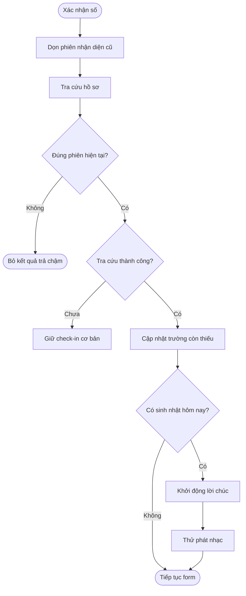
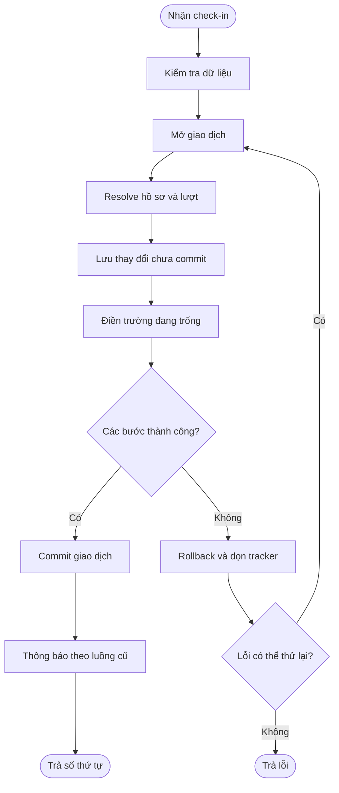
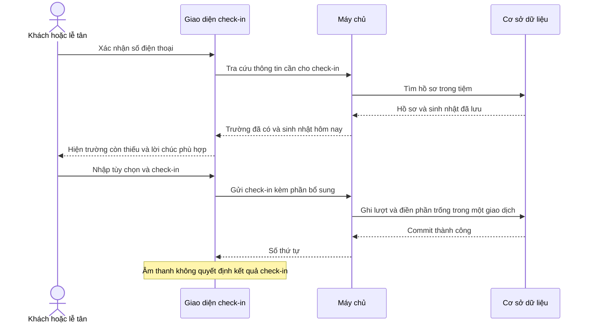
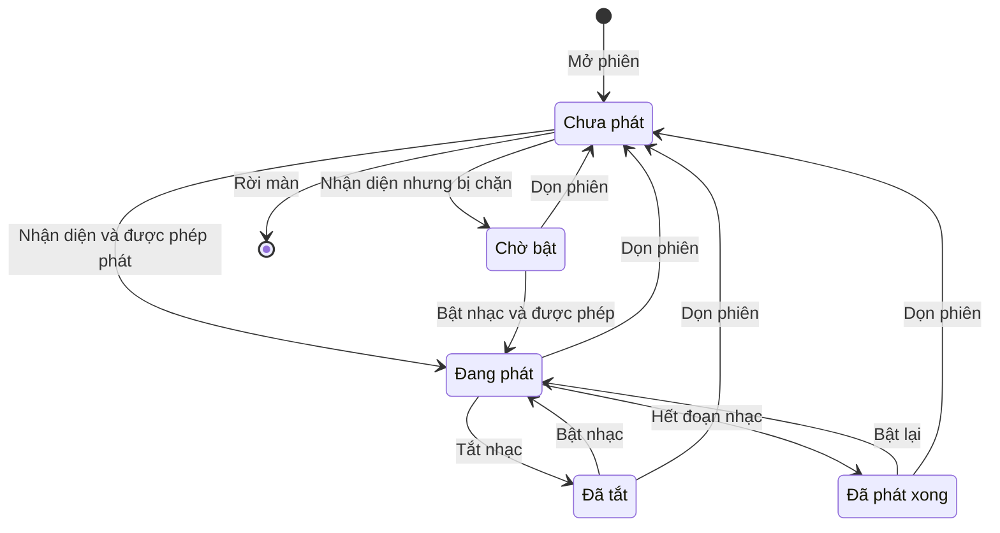

## Check-in — Thiết kế kỹ thuật cho ticket #2042

**Cập nhật lần cuối:** 20/10/2026\
**Đối tượng:** Phát triển backend/frontend, kiểm thử và người review\
**Trạng thái:** Draft\
**Bản chia sẻ:** [Tài liệu trên GitHub](https://github.com/vlink-group/VlinkPay/blob/docs/2042-checkin-birthday-source/nexora/docs/checkin-birthday-source-2042/technical.md)

---

### Tóm tắt nhanh

| Nội dung | Thiết kế đề xuất |
| :--- | :--- |
| Dữ liệu | Bổ sung ngày/tháng sinh khi chưa biết năm và nguồn khách biết đến tiệm trên cùng hồ sơ khách. |
| Dòng xử lý | Tra cứu tối thiểu → chuẩn hóa trong repository → quản lý trong phiên → lưu cùng giao dịch check-in. |
| Chúc mừng | Backend xác định sinh nhật hôm nay; frontend thử phát nhạc ngay khi nhận diện, có bật/tắt và dọn phiên. |
| Tương thích | Giữ ngày sinh đầy đủ và nguồn tạo hồ sơ; bảo toàn API cũ và các đường check-in nhanh. |
| Tình trạng | Đã commit/push và mở hai PR vào staging để review; chưa merge/deploy staging. Phụ lục ghi riêng phiên bản khảo sát và phiên bản triển khai. |

### Tổng quan

Thiết kế mở rộng phần check-in dùng chung để nhận biết thông tin còn thiếu và phát lời chúc ngay khi tìm được hồ sơ phù hợp. Backend giữ quyền quyết định điều kiện ngày sinh, quyền truy cập và việc chỉ bổ sung dữ liệu trống. Frontend dùng chung trạng thái phiên cho các màn, đồng thời tách hiển thị và bộ điều khiển âm thanh khỏi việc gửi check-in.

Hướng này được đề xuất vì giữ thông tin sinh nhật đúng với khách của từng tiệm và không phụ thuộc giờ trên thiết bị. Việc nhận diện hồ sơ không dựa vào tên có trống hay lịch sử đã hoàn tất dịch vụ.

#### Lựa chọn kiến trúc

| Lựa chọn | Đánh giá |
| :--- | :--- |
| Ngày/tháng riêng khi không có năm; dùng ngày sinh đầy đủ cũ nếu đã có | Đề xuất. Không tạo năm sinh giả và không phải thay hợp đồng ngày sinh hiện có. |
| Gán một năm cố định vào ngày sinh đầy đủ | Không chọn vì khiến dữ liệu thể hiện một năm sinh không được khách cung cấp. |
| Đưa ngày sinh đầy đủ về frontend để tự tính | Không chọn vì màn công khai chỉ cần biết có sinh nhật hôm nay; ngày tại tiệm cần do server xác định. |

### Khái niệm chính

| Khái niệm nghiệp vụ | Tên kỹ thuật đề xuất | Ý nghĩa |
| :--- | :--- | :--- |
| Hồ sơ khách tại tiệm | `Customer` | Entity hiện có, khớp theo business và số chuẩn hóa. |
| Sinh nhật chưa có năm | `BirthdayMonth`, `BirthdayDay` | Hai cột nullable mới; sử dụng khi `DateOfBirth` chưa có. |
| Nguồn khách biết đến tiệm | `AcquisitionSource` | Trường enum mới; độc lập với `Customer.Source`. |
| Thông tin phục vụ check-in | `CheckInCustomerProfileDto` | Kết quả tối thiểu cho nhận diện và điều kiện hiển thị. |
| Dữ liệu bổ sung khi gửi | `CustomerCheckInDetailsInput` | Nhóm ba trường nullable gửi trong `customerDetails`. |
| Phiên nhận diện | `recognitionKey` | Khóa nội bộ frontend gắn tiệm, số chuẩn hóa và phiên, không phải dữ liệu lưu vào hồ sơ. |

### Vai trò người dùng

| Vai trò | Ràng buộc truy cập |
| :--- | :--- |
| Khách dùng link public | Server lấy tiệm từ slug đã kiểm tra; tiếp tục áp dụng giới hạn tần suất hiện có. |
| Khách dùng thiết bị | Server lấy tiệm từ device token; không nhận business tùy ý từ body. |
| Lễ tân/nhân viên/chủ tiệm | Server kiểm tra quyền Operations của tiệm qua cơ chế hiện có. |
| Backend | Tính cờ hồ sơ, kiểm tra input và ghi dữ liệu theo giao dịch. |
| Frontend | Chỉ giữ nháp theo phiên, xử lý âm thanh độc lập và gửi đúng đường API. |

### Quy trình từ đầu đến cuối

#### Quy trình 1: Tra cứu và khởi động lời chúc

**Người thực hiện chính:** Khách/lễ tân và hệ thống.\
**Bắt đầu khi:** Người thao tác xác nhận số điện thoại.\
**Kết quả:** Phiên biết trường nào được hiện và có cần chúc mừng hay không.

**Câu chuyện người dùng:**

- Là khách, tôi muốn lời chúc bắt đầu ngay khi hồ sơ được nhận diện, kể cả danh sách dịch vụ chưa tải xong.
- Là lễ tân, tôi muốn một hồ sơ chưa có lượt phục vụ vẫn được xét đúng theo định nghĩa khách cũ.
- Là khách sửa số, tôi muốn kết quả trả chậm của số trước không đổi form và không phát nhạc sai người.

| Bước | Ai | Hành động | Kết quả kỹ thuật |
| :--- | :--- | :--- | :--- |
| 1 | Frontend | Nhận thao tác xác nhận số | Tạo khóa nhận diện mới, dọn phiên cũ, chuẩn bị audio cho khóa mới trong chính thao tác người dùng rồi kích hoạt lookup. |
| 2 | Repository/hook | Gọi lookup theo nguồn dữ liệu | Các lookup hồ sơ, lịch hẹn, lượt đang mở tiếp tục chạy song song. |
| 3 | Backend | Khớp hồ sơ và tính ngày tại tiệm | Trả kết quả tối thiểu; không phụ thuộc tên có trống. |
| 4 | Session | Nhận kết quả thuộc khóa đang hoạt động | Cập nhật điều kiện hiển thị; phát tín hiệu chúc mừng ngay khi profile thành công. |
| 5 | Bộ điều khiển audio | Nhận tín hiệu lần đầu | Thử phát; nếu không phát được thì chuyển sang trạng thái có thể bật thủ công. |
| 6 | Session | Lookup thất bại | Đánh dấu unavailable, không chặn check-in cơ bản; cho phép tra cứu lại. |



Âm thanh không chờ điều kiện `areLookupsSettled` của toàn bộ lookup. Tín hiệu nhận diện dựa trên profile query đã hoàn tất và còn đúng `recognitionKey`.

#### Quy trình 2: Lưu thông tin cùng check-in

**Người thực hiện chính:** Backend.\
**Bắt đầu khi:** Form hoặc nút check-in nhanh gửi dữ liệu.\
**Kết quả:** Lượt đến và phần bổ sung hồ sơ cùng được ghi nhận hoặc cùng bị hủy khi lỗi.

**Câu chuyện người dùng:**

- Là khách, tôi muốn lần gửi thất bại không làm lưu riêng dữ liệu hồ sơ.
- Là người dùng hai thiết bị, tôi muốn dữ liệu đã được bổ sung trước không bị lần gửi sau thay thế.
- Là khách có lịch hẹn cũ, tôi muốn phần bổ sung vẫn được lưu vào đúng hồ sơ khi lịch hẹn thiếu liên kết khách.

| Bước | Ai | Hành động | Kết quả kỹ thuật |
| :--- | :--- | :--- | :--- |
| 1 | Validator | Kiểm tra dữ liệu nhập | Chấp nhận không có `customerDetails`; kiểm tra cặp ngày/tháng và enum nếu có. |
| 2 | Handler | Mở hoặc dùng giao dịch hiện có | Mỗi lần retry số thứ tự có giao dịch riêng. |
| 3 | Handler/scaffold | Resolve khách và lượt đến | Booking thiếu liên kết được xử lý bằng số chuẩn hóa của booking. |
| 4 | Handler | Lưu bản ghi đang theo dõi | Customer mới có hàng trong DB nhưng chưa commit. |
| 5 | Helper | Bổ sung có điều kiện ở DB | Mỗi nhóm chỉ cập nhật nếu vẫn trống; ngày và tháng được cập nhật cùng câu lệnh. |
| 6 | Handler | Commit giao dịch | Sau đó mới thực hiện SMS/thông báo theo vị trí hiện có. |
| 7 | Handler | Gặp xung đột cần retry | Rollback, dọn tracker, resolve lại và thực hiện lại toàn bộ vòng. |





### Cấu hình và quản trị hệ thống

Không thêm package, dịch vụ âm thanh, bảng cấu hình tiệm hoặc cờ bật/tắt toàn hệ thống trong thiết kế này. Stack hiện có là .NET 8, EF Core/PostgreSQL, React 18, TypeScript, Vite, TanStack Query và FluentValidation.

- Là người vận hành, tôi muốn backend được triển khai trước frontend để trường mới có hợp đồng rõ ràng.
- Là người review, tôi muốn Swagger được sinh từ workflow hiện có để hợp đồng và code không lệch nhau.

### Vòng đời trạng thái

Profile lookup sử dụng `idle`, `loading`, `resolved`, `unavailable`. Audio có lifecycle riêng; không tái sử dụng trạng thái gửi API để biểu thị đang phát nhạc.

| Trạng thái audio | Sự kiện | Trạng thái mới |
| :--- | :--- | :--- |
| `idle` | Nhận diện đủ điều kiện lần đầu | `playing` hoặc `blocked` |
| `playing` | Tắt nhạc | `muted` |
| `muted`, `blocked`, `ended` | Bật nhạc bằng thao tác trực tiếp | `playing` hoặc `blocked` |
| `playing` | Hết đoạn nhạc | `ended` |
| Bất kỳ | Cleanup phiên | `idle` |



### Quy tắc nghiệp vụ và thiết kế áp dụng

Quy tắc nghiệp vụ đầy đủ nằm ở tài liệu business. Phần này định nghĩa cách thực hiện và dẫn mã quy tắc để tránh tạo bản nghiệp vụ thứ hai.

#### A. Hợp đồng hồ sơ và dữ liệu

1. **T1 — Ngày sinh hiệu lực (A3, B5):** `EffectiveBirthday(Customer)` ưu tiên `DateOfBirth.Month/Day`; nếu không có thì dùng cặp `BirthdayMonth/BirthdayDay` đầy đủ. Helper trả null khi cả hai nguồn đều không có.
2. **T2 — Nhóm thông tin thiếu (A2–A4):** Backend trả object cho mọi hồ sơ khớp, kể cả `Name` trống; trả `null` chỉ khi thực sự không có hồ sơ. Frontend phân biệt null hợp lệ với query lỗi.
3. **T3 — Ghi có điều kiện (B8–B9):** Helper cập nhật theo `Customer.Id` và `BusinessId`, trong giao dịch check-in. Hai câu `ExecuteUpdateAsync` có điều kiện riêng cho cặp sinh nhật và nguồn, tránh lost update khi hai thiết bị cùng gửi.
4. **T4 — Tương thích ngày sinh cũ (A3, B9):** Check-in không viết lại `DateOfBirth`; cặp ngày/tháng mới chỉ được điền khi `DateOfBirth`, `BirthdayMonth` và `BirthdayDay` đều null. Không backfill năm giả hoặc đổi `Source`.

#### B. Nhận diện và âm thanh

5. **T5 — Cờ theo ngày của tiệm (C11–C13):** Backend tính `isBirthdayToday` từ hồ sơ tồn tại tại thời điểm lookup và đồng hồ UTC server đổi sang timezone của tiệm. Không dùng `IsNewCustomer` theo lượt đã hoàn tất để suy ra `customerExists`.
6. **T6 — Ranh giới phiên (C11, C15, C17):** Session tăng `recognitionKey` khi thay danh tính hoặc reset; callback phải kiểm tra khóa còn hoạt động. Session chốt `birthdayEligibleAtRecognition` từ lookup thành công đầu tiên của khóa, kể cả kết quả false hoặc không có hồ sơ. Refetch/invalidation sau khi lưu không được đổi snapshot đó. Nếu lần đầu lỗi, lần thử lại thành công đầu tiên mới chốt snapshot. Kết quả cũ và React StrictMode không được tạo thêm lần tự phát.
7. **T7 — Phát trong điều kiện trình duyệt (C14):** Controller chỉ chuẩn bị/resume `AudioContext` trong thao tác xác nhận số, không tải MP3 ở bước prepare. Khi nhận diện đủ điều kiện phát, controller mới tải asset cùng ứng dụng, giải mã rồi schedule nhạc khi context dùng được. Trường hợp bị chặn hoặc tải/giải mã lỗi có nút bật thủ công và không retry tự động theo timer.
8. **T8 — Cleanup đầy đủ (C17):** Controller dừng/disconnect mọi node, hủy timer, bỏ callback đang đợi và đóng context khi unmount. Kết quả `resume()`, tải file hoặc giải mã trả chậm sau khi tắt nhạc, chuyển nền hoặc reset không được schedule node. Controller kiểm tra generation còn hoạt động trước khi phát.

#### C. Tương thích đường gửi

9. **T9 — Mở rộng có chủ đích (B10, D18):** Chỉ mở rộng lookup minimal của public/kiosk; thêm lookup minimal riêng cho quầy. Không thêm metadata mới vào `CustomerLookupResolver` đang được public booking dùng chung.
10. **T10 — Booking và retry (B8–B10):** Cả gửi draft lẫn check-in nhanh đều truyền `customerDetails`. Booking cũ thiếu `CustomerId` được resolve từ snapshot số của chính booking, không từ customer ID tự khai trong body. Nhánh public trả lại lượt đã có vẫn điền phần thiếu trong transaction khi request có phần bổ sung; không tạo lại order, tăng lượt hoặc gửi lại thông báo vì cập nhật này.
11. **T11 — Giữ side effect:** Helper không tự tăng lượt, cấp số thứ tự, gửi SMS hoặc liên kết tài khoản tích điểm. Các hành vi này tiếp tục do handler/scaffold hiện có thực hiện.
12. **T12 — Nháp và cache:** Query key của profile chứa phạm vi tiệm/thiết bị, số chuẩn hóa và `recognitionKey` mới. Mỗi lần nhận diện thực sự cần response mạng thuộc khóa đó; không dùng placeholder hoặc success trong cache của khóa trước để chốt snapshot. Sau thành công, invalidate/remove profile query liên quan; snapshot của phiên hiện tại vẫn giữ theo T6. Query catalog/lịch hẹn giữ cơ chế hiện có, không cần thêm epoch.

#### D. Bố cục và trường chọn

13. **T13 — Bố cục gọn (D21–D22):** Frontend dùng cùng component trường bổ sung và thông số select trên các bề mặt. Thiết kế cụ thể nằm ở phần “Bố cục thông tin khách và trường chọn” bên dưới.

### Ví dụ hợp đồng

Các API và trường dưới đây là hợp đồng triển khai trên nhánh local, chưa xác nhận có trên staging. Toàn bộ ví dụ dùng tên khách viết hoa và số điện thoại theo chuẩn Mỹ.

#### Kết quả lookup tối thiểu

```json
{
  "displayName": "ANNA NGUYEN",
  "customerExists": true,
  "hasBirthday": true,
  "hasAcquisitionSource": false,
  "isBirthdayToday": true
}
```

`displayName` có thể là chuỗi rỗng khi hồ sơ chưa có tên. Khi không tìm thấy hồ sơ, kết quả ứng dụng là null; ASP.NET có thể trả `204` không có body (đã quan sát ở local) hoặc `200` kèm null. Client chấp nhận cả hai. Repository chuẩn hóa thành `{ customerExists: false, hasBirthday: false, hasAcquisitionSource: false, isBirthdayToday: false }`.

Lookup không trả ngày/tháng/năm sinh, nguồn đã lưu, customer ID hoặc lịch sử dịch vụ trong DTO mới. Các thông tin lookup quầy cũ vẫn được giữ trong đường API riêng hiện có.

#### API chi tiết để đối chiếu dữ liệu

Nhân viên có quyền thao tác POS dùng `GET /api/v1/merchant/pos/{businessId}/customers/{customerId}` để đọc hồ sơ trong tiệm. Kết quả trả về bổ sung `birthdayMonth`, `birthdayDay` theo T1 và `acquisitionSource`; giữ `dateOfBirth` cùng các trường cũ. Các giá trị chưa có là null; nguồn trả chuỗi enum đã định nghĩa bên dưới.

Ví dụ phần dữ liệu liên quan khi khách chỉ cung cấp ngày/tháng:

```json
{
  "dateOfBirth": null,
  "birthdayMonth": 10,
  "birthdayDay": 19,
  "acquisitionSource": "Google"
}
```

`isNewCustomer` trong API chi tiết là trường cũ, xác định theo dịch vụ đã hoàn tất. Check-in #2042 dùng `customerExists` của lookup để phân biệt khách mới/cũ theo hồ sơ, không dùng trường cũ này. API chi tiết yêu cầu đăng nhập, quyền Operations và giới hạn cả tiệm lẫn mã khách; các lookup công khai/thiết bị vẫn dùng DTO tối thiểu theo T9.

#### Phần bổ sung trên request

```json
{
  "customerName": "ANNA NGUYEN",
  "customerPhone": "(713) 555-0123",
  "items": [],
  "customerDetails": {
    "birthdayMonth": 10,
    "birthdayDay": 19,
    "acquisitionSource": "Google"
  }
}
```

Client có thể bỏ `customerDetails` hoặc gửi null. Trong object, cặp sinh nhật có thể cùng vắng; nguồn có thể vắng độc lập. Client không gửi lại các trường đang ẩn.

#### Cấu trúc lưu trữ

| Entity/cột | Kiểu đề xuất | Quy tắc lưu |
| :--- | :--- | :--- |
| `Customer.DateOfBirth` | `DateOnly?` hiện có | Giữ nguyên; ưu tiên khi đọc sinh nhật. |
| `Customer.BirthdayMonth` | `int?` mới | 1–12 khi có cặp hợp lệ. |
| `Customer.BirthdayDay` | `int?` mới | Trong số ngày thực của tháng, dùng năm nhuận tham chiếu chỉ để kiểm tra. |
| `Customer.AcquisitionSource` | `CustomerAcquisitionSource?` mới | Enum nullable; không có giá trị mặc định giả định. |
| `Customer.Source` | `CustomerSource` hiện có | Giữ ý nghĩa và giá trị hiện tại. |

Enum mới cố định mã: `Facebook=0`, `Instagram=1`, `Google=2`, `Referral=3`, `Other=4`. JSON dùng chuỗi theo `JsonStringEnumConverter` hiện có. Validator phải từ chối giá trị ngoài tập hợp kể cả giá trị số không hợp lệ được converter chấp nhận.

Migration bổ sung ba cột nullable và check constraint: hoặc cả ngày/tháng null, hoặc cả hai non-null và tạo thành ngày hợp lệ khi kiểm tra trên năm nhuận 2000. Năm 2000 chỉ phục vụ validation/constraint, không được ghi thành năm sinh. Constraint nguồn chỉ cho phép null hoặc năm mã enum từ 0 đến 4. Không backfill dữ liệu và không thêm index cho nhu cầu lọc/báo cáo chưa có trong phạm vi.

#### Danh sách endpoint

Tất cả đường dẫn có tiền tố `/api/v1`.

| Nhóm | Method/path | Thay đổi |
| :--- | :--- | :--- |
| Public lookup | `GET /checkin/{businessSlug}/customer-lookup?phone=...` | Giữ `displayName`; thêm bốn cờ của profile. |
| Device lookup | `GET /pos-device/self-checkin/customer-lookup?phone=...` | Giữ `displayName`; thêm cùng bốn cờ. |
| Quầy lookup mới | `GET /merchant/pos/{businessId}/checkin/customer-profile?phone=...` | Trả DTO tối thiểu mới sau kiểm tra quyền Operations. |
| Chi tiết khách tại quầy | `GET /merchant/pos/{businessId}/customers/{customerId}` | Bổ sung tháng/ngày sinh và nguồn để đối chiếu hồ sơ sau lưu; có kiểm tra quyền. |
| Public walk-in | `POST /checkin/{businessSlug}/orders` | Thêm `customerDetails` ở request DTO và mapping sang command. |
| Public booking | `POST /checkin/{businessSlug}/bookings/check-in` | Thêm `customerDetails` ở request DTO và mapping sang command. |
| Device walk-in | `POST /pos-device/self-checkin/orders` | Thêm input vào command. |
| Device booking | `POST /pos-device/self-checkin/bookings/check-in` | Thêm input vào command. |
| Quầy walk-in | `POST /merchant/pos/{businessId}/orders` | Thêm input vào command. |
| Quầy booking | `POST /merchant/pos/{businessId}/bookings/{bookingId}/check-in` | Thêm input vào request DTO và command; body vẫn tùy chọn. |

Response thành công của các lệnh check-in giữ nguyên. Thông tin sinh nhật đã được nhận từ lookup; không đợi POST mới khởi động lời chúc.

#### Validation và lỗi

| Trường hợp | Kết quả đề xuất |
| :--- | :--- |
| Không gửi `customerDetails` | Chạy hợp đồng cũ. |
| Cùng bỏ ngày/tháng | Hợp lệ. |
| Chỉ có ngày hoặc tháng | HTTP 400, mã mới `POS_CHECKIN_BIRTHDAY_INCOMPLETE`. |
| 31/04, tháng 0/13 hoặc ngày không hợp lệ | HTTP 400, mã mới `POS_CHECKIN_BIRTHDAY_INVALID`. |
| 29/02 | Hợp lệ. |
| Nguồn ngoài năm lựa chọn | HTTP 400, mã mới `POS_CHECKIN_ACQUISITION_SOURCE_INVALID`. |
| Profile bị bổ sung trên thiết bị khác | POST thành công; helper giữ giá trị đã ghi trước. |
| Body booking null theo client cũ | Check-in theo nội dung đã đặt, không thêm dữ liệu hồ sơ. |

Backend dùng kiểu nullable ở input lẫn command. Không dùng `DateOnly` để nhận sinh nhật mới vì hợp đồng đó sẽ yêu cầu năm.

#### Backend: đơn vị thiết kế

Các path trong bảng này tính từ `backend/src/` của repository backend.

| Path | Trạng thái | Trách nhiệm |
| :--- | :--- | :--- |
| `Domain/Entities/Customer.cs` | Sửa | Thêm ba thuộc tính nullable. |
| `Domain/Enums/CustomerAcquisitionSource.cs` | Mới | Năm nguồn ổn định. |
| `Domain/Constants/DomainErrorCode.cs` | Sửa | Ba mã validation mới. |
| `Application/Features/Pos/CheckIn/Common/CustomerCheckInDetailsInput.cs` | Mới | Input và validator dùng chung. |
| `Application/Features/Pos/CheckIn/Common/CheckInCustomerProfileReader.cs` | Mới | Resolve hồ sơ, sinh nhật hiệu lực, ngày tại tiệm và DTO tối thiểu. |
| `Application/Features/Pos/CheckIn/Common/CustomerCheckInDetailsWriter.cs` | Mới | Hai cập nhật có điều kiện trong giao dịch đang mở. |
| `Application/Features/Pos/CheckIn/Queries/GetCheckInCustomerProfile/GetCheckInCustomerProfileQuery.cs` | Mới | Query minimal cho quầy, có kiểm tra quyền Operations. |
| `Application/Features/Pos/Orders/Common/PosCheckInOrderScaffold.cs` | Sửa | Mang input vào scaffold; bọc ghi order và phần bổ sung cùng transaction. |
| Ba nhóm command walk-in và ba command booking trong bảng API | Sửa | Validator, truyền input, áp dụng writer và giữ nguyên side effect. |
| Hai query lookup public/device trong phụ lục | Sửa | Dùng reader; không trả null chỉ vì tên trống. |
| `Application/Features/Pos/Customers/Queries/GetPosCustomerDetail/GetPosCustomerDetailQuery.cs` | Sửa | Bổ sung ba trường đọc chi tiết, giữ quyền và phạm vi tiệm hiện có. |
| Ba controller public/device/quầy và controller booking quầy | Sửa | Bổ sung mapping và endpoint minimal mới. |
| `Infrastructure/Data/Configurations/Database/CustomerConfiguration.cs` | Sửa | Check constraint cho cặp sinh nhật và nguồn. |
| `Infrastructure/Migrations/<timestamp>_AddCustomerCheckInDetails.*` | Sinh mới | Migration và snapshot bằng EF workflow hiện có. |
| `Web/wwwroot/api/specification.json` | Sinh lại | Hợp đồng API từ NSwag, không sửa tay. |
| `Web/wwwroot/api/web-api-client.ts` | Sinh lại | Client được cùng config NSwag sinh và đang được theo dõi trong Git. |

Interfaces mới đề xuất:

```csharp
public record CustomerCheckInDetailsInput
{
    public int? BirthdayMonth { get; init; }
    public int? BirthdayDay { get; init; }
    public CustomerAcquisitionSource? AcquisitionSource { get; init; }
}

public record CheckInCustomerProfileDto(
    string DisplayName, bool CustomerExists, bool HasBirthday,
    bool HasAcquisitionSource, bool IsBirthdayToday);

// Reader nhận nowUtc từ caller để mốc thời gian có thể kiểm chứng cố định.
Task<CheckInCustomerProfileDto?> ReadAsync(
    IApplicationDbContext context, Guid businessId, string phone,
    DateTime nowUtc, string defaultTimeZone, CancellationToken cancellationToken);

// Writer không SaveChanges hoặc commit hộ caller.
Task ApplyMissingAsync(
    IApplicationDbContext context, Guid businessId, Guid customerId,
    CustomerCheckInDetailsInput? details, DateTime lastModified,
    string lastModifiedBy, CancellationToken cancellationToken);
```

Reader là static helper thuộc Application; lấy timezone bằng `BookingTimeZoneLookup.ResolveZoneAsync` và `PosTimeClockOptions.DefaultTimeZone` hiện có. Caller cấp thời điểm UTC từ server. Kết quả `HasBirthday` dùng `EffectiveBirthday` theo T1; `IsBirthdayToday` so sánh cặp đó với ngày trong zone đã resolve.

Writer kiểm tra `context.CurrentTransaction` khác null trước khi ghi. Với sinh nhật, điều kiện update gồm `Id`, `BusinessId`, `DateOfBirth == null`, `BirthdayMonth == null`, `BirthdayDay == null`. Với nguồn, điều kiện gồm `Id`, `BusinessId`, `AcquisitionSource == null`. Writer dùng `ExecuteUpdateAsync` nên phải chủ động cập nhật `LastModified/LastModifiedBy` như `AuditableEntityInterceptor` hiện có. Handler truyền `_dateTime.BusinessDateTime` và `_currentUserService.UserId.ToString()`; không tự gán danh tính nhân viên cho khách công khai. Entity đã tracking không được lưu lại giá trị cũ sau cập nhật trực tiếp.

Scaffold lưu các entity được tracking trước writer, gọi writer trong cùng transaction, rồi commit. Các booking handler đã có transaction thì chèn writer sau `SaveChangesAsync` và trước `CommitAsync`. Không bắt validation/writer lỗi rồi vẫn trả thành công.

Nhánh public trả lại active visit hoặc booking đã check-in có thể nhận request mới có phần bổ sung, dù lượt trước được tạo bởi client cũ không gửi phần này. Nhánh đó mở transaction để resolve đúng Customer của lượt trong cùng tiệm và cùng số đã chuẩn hóa, gọi writer rồi commit trước khi trả kết quả. Nếu CustomerId legacy còn trống, áp dụng cách resolve snapshot như bên dưới. Nhánh không tăng lượt, không cấp lại số và không tái gửi thông báo chỉ vì bổ sung hồ sơ. Khi không có giá trị bổ sung, giữ đường trả kết quả cũ.

`PosCheckInOrderRequest` thêm `CustomerDetails?`, `DetailsLastModified?` và `DetailsLastModifiedBy?` dưới dạng tùy chọn. Ba caller check-in truyền bộ audit khi có phần bổ sung. `CreateDirectCheckoutOrderCommand` cũng dùng scaffold; caller này không cần truyền trường mới và không được bị thêm yêu cầu nhập sinh nhật/nguồn. Cần kiểm tra lại direct checkout vì transaction của scaffold là phần dùng chung.

Booking thiếu `CustomerId`: khi input có ít nhất một giá trị hợp lệ cần bổ sung, handler lấy E.164 từ cặp số snapshot của booking, gọi `CustomerMatchHelper.MatchOrCreateAsync` và gắn lại liên kết trong transaction. Nguồn tạo hồ sơ map rõ: `PosBookingSource.Public → CustomerSource.Web`, `Staff → Manual`, `Voice → Call`. Hồ sơ tìm thấy giữ nguyên nguồn cũ. Nếu snapshot không thể khớp số an toàn, handler trả lỗi số điện thoại hiện có và không tạo liên kết đoán. Luồng client cũ không gửi dữ liệu bổ sung, kể cả object rỗng, tiếp tục giữ xử lý legacy hiện có.

#### Frontend: đơn vị thiết kế

Các path tính từ `src/` của repository frontend.

| Path | Trạng thái | Trách nhiệm |
| :--- | :--- | :--- |
| `constants/customerAcquisitionSource.ts` | Mới | Enum/const và map nhãn EN/VI, không dùng nhầm `customerSource.ts`. |
| `types/repositories.ts` | Sửa | Input/profile API và payload check-in quầy/public. |
| `data/repositories/posSelfCheckIn.ts` | Sửa | Giữ được profile đầy đủ thay vì chỉ rút `displayName`; mở rộng payload device. |
| `data/repositories/checkInCustomerProfile.ts` | Mới | Chuẩn hóa DTO minimal dùng chung, không chứa React. |
| `data/repositories/publicCheckIn.ts`, `posCheckIn.ts` | Sửa | Chuẩn hóa profile và lookup quầy mới. |
| `data/repositories/posOrders.ts`, `posBooking.ts` | Sửa | Truyền phần bổ sung vào đúng endpoint. |
| `data/hooks/usePosSelfCheckIn.ts`, `usePublicCheckIn.ts`, `usePosCheckIn.ts` | Sửa | Query minimal có phạm vi và trạng thái rõ ràng. |
| `data/hooks/usePosOrders.ts`, `usePosBooking.ts`, `data/queryKeys.ts` | Sửa | Payload và invalidation profile khi check-in thành công. |
| `components/checkin/types.ts`, `sources/use*CheckInSource.ts` | Sửa | Cùng một shape profile và phần bổ sung cho ba nguồn. |
| `components/checkin/useCheckInSession.ts` | Sửa | Nháp phần thiếu, khóa nhận diện, đường submit và check-in nhanh. |
| `components/checkin/customerCheckInDetails.ts` | Mới | Validation nháp và dựng payload chỉ gồm trường còn thiếu. |
| `components/checkin/parts/CustomerCheckInDetailsFields.tsx` | Mới | Hai trường dùng chung với điều kiện hiển thị. |
| `components/checkin/parts/CustomerIdentityCard.tsx` | Sửa | Gắn component mới trong giao diện một trang. |
| `components/checkin/layouts/WizardCheckInLayout.tsx` | Sửa | Gắn component mới tại bước tên, trước chọn dịch vụ. |
| `components/checkin/parts/CheckInBookingList.tsx` | Sửa | Một khối bổ sung chung trước danh sách; không lặp trong từng lịch hẹn. |
| `components/checkin/useBirthdayCelebration.ts` | Mới | Lifecycle một lần tự phát cho một khóa nhận diện. |
| `components/checkin/birthdayAudio.ts` | Mới | Web Audio: prepare context, tải/giải mã MP3 khi cần phát, play, stop, dispose; không phụ thuộc React. |
| `components/checkin/parts/BirthdayCelebrationCorner.tsx` | Mới | Lời chúc và nút âm thanh nhỏ ở góc. |
| `components/checkin/CheckInSurface.tsx` | Sửa | Host component sinh nhật ngoài các nhánh return theo phase. |
| `locales/en.json`, `locales/vi.json` | Sửa | Nhãn trường, nguồn, lỗi và lời chúc; không hardcode câu hiển thị. |

Asset frontend tính từ repository root: `public/assets/audio/happy-birthday-instrumental.mp3` là bản sao nguyên byte của MP3 người dùng cung cấp. Đường dẫn phục vụ trên web là `/assets/audio/happy-birthday-instrumental.mp3`; thông tin nguồn nằm trong Phụ lục.

Chuẩn hóa nội bộ đề xuất:

```ts
type CheckInProfileState = {
  status: 'idle' | 'loading' | 'resolved' | 'unavailable'
  customerExists: boolean
  hasBirthday: boolean
  hasAcquisitionSource: boolean
  isBirthdayToday: boolean
  displayName: string | null
}

type CustomerCheckInDetailsInput = {
  birthdayMonth?: number | null
  birthdayDay?: number | null
  acquisitionSource?: CustomerAcquisitionSource | null
}

type BirthdayAudioController = {
  resetForRecognition(recognitionKey: string): void
  prepareFromUserGesture(): Promise<void>
  play(): Promise<'playing' | 'blocked'>
  stop(): void
  dispose(): void
}
```

`CheckInSourceResult` thêm `customerProfile`; `CheckInOrderSubmit` và `CheckInBookingSubmit` thêm `customerDetails?`. `CheckInSourceHook` nhận `(phone?: string, recognitionKey?: string)`; các profile hook dùng khóa mới theo T12. Session tạo khóa bằng `crypto.randomUUID()` cho lần xác nhận danh tính mới; refetch và chuyển layout không tự đổi khóa. Source hook có trách nhiệm mapping, không để layout tự gọi API. Với device, thêm `lookupCustomerProfile` và hook `useSelfCheckInCustomerProfile`; giữ wrapper cũ nếu còn caller thay vì đổi trả về kiểu string thành object một cách âm thầm.

Các trường chỉ render khi profile resolved. `showBirthday = !hasBirthday`; `showAcquisitionSource = !hasAcquisitionSource`. Null hợp lệ đã được repository chuyển thành profile khách mới. Khi chưa resolve hoặc unavailable, cả hai trường ẩn; lỗi lookup không làm `canSubmit` của thông tin cơ bản thất bại.

Chọn tháng/ngày bằng hai select, không dùng input date có năm. Ngày trong tháng cho phép chọn 29/02; nếu đổi tháng làm ngày đã chọn không hợp lệ, component xóa ngày và hiển thị lỗi tương ứng nếu người dùng gửi. Ô nguồn là select một lựa chọn. Nháp được dùng chung giữa hai layout và danh sách lịch hẹn; các input disable trong khi gửi.

`checkInBooking()` dùng cùng validator nháp và cùng hàm dựng `customerDetails` với `submit()`. Đường quầy không còn chỉ gọi `useCheckInBookingFromList(payload.bookingId)` khi có phần bổ sung; repository phải nhận body tùy chọn ngay cả khi không có `items`. Body thiếu `items` vẫn giữ dịch vụ đã đặt, không gửi mảng rỗng thay cho “giữ nguyên”.

#### Bố cục thông tin khách và trường chọn

Giao diện một trang chia khu vực thông tin/dịch vụ và phần tổng hợp theo chiều rộng thực tế của khối check-in. Khi khối này đủ 800 px, phần tổng hợp rộng 360 px nằm cạnh form. Khi hẹp hơn, phần tổng hợp xuống dưới để menu bên trái của POS không làm các ô bị cắt chữ. Frontend dùng container query; trình duyệt chưa hỗ trợ vẫn có bố cục một cột.

Lưới dịch vụ tự tính số cột theo khoảng trống của danh mục, mỗi thẻ tối thiểu 140 px hoặc toàn bộ chiều rộng nếu khối hẹp hơn. Cách này áp dụng riêng cho danh mục ở check-in, gồm giao diện một trang và bước Services; tránh ép bốn thẻ vào một cột nội dung hẹp trên iPad.

Từ chiều rộng màn hình 360 px, frontend triển khai D21 bằng lưới hai cột trong khối thông tin khách của giao diện một trang:

| Hàng | Cột trái | Cột phải |
| :--- | :--- | :--- |
| 1 | Phone | Name |
| 2 | Birthday: hai select MM rồi DD bằng nhau, tỷ lệ 50/50 | Found us via |
| 3 | Xác nhận SMS chiếm chiều rộng của khối | |

Các tên trong bảng là nhãn tiếng Anh; bản tiếng Việt dùng nhãn dịch tương ứng. Wizard giữ bước xác nhận Phone hiện có; bước thông tin khách đặt hàng sinh nhật/nguồn dưới Name rồi đến SMS. Danh sách lịch hẹn dùng cùng hàng trường bổ sung trước các nút check-in nhanh.

Khi chỉ thiếu một trường bổ sung, frontend chỉ render trường đó theo A3. Khi đủ cả hai thông tin, frontend bỏ cả hàng bổ sung. Component phải giữ nhãn và giá trị dễ đọc trên điện thoại, tablet và desktop.

Bên trong Birthday, hai select tháng/ngày luôn có chiều rộng bằng nhau: mỗi ô chiếm 50% phần chiều rộng còn lại sau khoảng cách giữa hai ô. Từ 360 px, frontend dùng `grid-template-columns: repeat(2, minmax(0, 1fr))` cho hàng Birthday/Found us via bên ngoài. Dưới 360 px, hai nhóm bổ sung xếp thành hai hàng theo D21; cặp MM/DD vẫn giữ tỷ lệ 50/50.

Ở màn hình 320 px, Phone và Name vẫn giữ hai cột. Frontend ẩn biểu tượng trang trí của ô Phone và giảm padding trái để số điện thoại định dạng Mỹ hiển thị đủ; từ 360 px, biểu tượng và padding trở lại như bình thường.

- Cả tiếng Anh và tiếng Việt dùng placeholder `MM` và `DD`. Danh sách tháng và giá trị đang chọn dùng cùng bộ tên tháng viết tắt kiểu Mỹ tại D22; mapping tháng 1–12 cố định, không đổi theo locale.
- Mỗi select có một chevron kích thước 16px, căn giữa theo chiều dọc và cách mép phải 12px. Nội dung được chừa ít nhất 36px bên phải.
- Với native select, frontend đặt trong wrapper relative và dùng `appearance-none pr-9` để ẩn mũi tên mặc định. Chevron dùng `pointer-events-none absolute right-3 top-1/2 h-4 w-4 -translate-y-1/2` để không chặn thao tác.
- Frontend ưu tiên component select dùng chung hiện có. Custom dropdown giữ cùng khoảng cách; nhãn, bàn phím, focus và disabled vẫn hoạt động đầy đủ.

#### Âm thanh và lời chúc

Định hướng nhạc và hiệu ứng theo QD1–QD2; bản MP3 theo QD4 của business. Các thông số dưới đây là mặc định kỹ thuật để triển khai; tài liệu không xác nhận đã nghe thử trong ứng dụng hoặc deploy.

- Nhạc: phát 6 giây đầu của MP3, bắt đầu ở giây 0 và không loop. Controller dùng `fetch` rồi `decodeAudioData` trên `AudioContext` hiện có; mỗi lần phát tạo `AudioBufferSourceNode` mới. File MP3 được giữ nguyên, không cắt hoặc mã hóa lại asset.
- Âm lượng: gain mặc định 0.08; tăng âm nhẹ trong 150 ms đầu và giảm âm trong 300 ms cuối để tránh tiếng bật đột ngột. Controller giữ giới hạn đoạn phát và không tự tăng âm lượng thiết bị.
- Tải nhạc: chỉ bắt đầu khi có yêu cầu phát cho hồ sơ đủ điều kiện. Prepare khi xác nhận số chỉ mở/resume context; khách không có sinh nhật hôm nay không tạo request MP3. Controller có thể dùng lại buffer đã giải mã trong vòng đời của nó và vẫn kiểm tra generation trước mỗi lần schedule.
- Hiệu ứng: một hình bánh sinh nhật nhỏ và tối đa 3 điểm lấp lánh cạnh lời chúc. Chuyển động nhẹ một lượt khoảng 2 giây rồi đứng yên; dùng màu dịu theo bộ màu hiện có. Người triển khai không thêm hiệu ứng phủ màn hình hoặc chuyển động liên tục.

- `CheckInSurface` sở hữu controller và host lời chúc cùng vòng đời; controller không nằm trong layout hoặc `ThankYouScreen`.
- Trong callback xác nhận số, thứ tự đồng bộ là: tạo `nextRecognitionKey` → dọn nháp và phiên cũ → gọi `onBeforePhoneLookup(nextRecognitionKey)` → kích hoạt query của khóa mới. Callback audio gọi `resetForRecognition(nextRecognitionKey)` rồi `prepareFromUserGesture()` ngay trong thao tác người dùng, không await trong luồng chuyển màn. Reset cùng khóa phải idempotent; effect nhận khóa mới không tăng generation lần nữa. Lỗi được ghi nhận trạng thái `blocked`, không tạo unhandled rejection.
- Session giữ snapshot `birthdayEligibleAtRecognition: boolean | null`; null là chưa có lookup thành công. Hook nhận snapshot, `recognitionKey` và `suppressedForAdditionalGuest`, thay vì lấy trực tiếp `isBirthdayToday` từ một query có thể refetch sau POST. Nó không tự tính ngày sinh, không đọc ngày trên thiết bị.
- Tự phát chỉ một lần cho một khóa. `Tắt nhạc` dừng ngay và giữ cờ đã tự phát; refetch không ghi đè lựa chọn này.
- `Bật nhạc` gọi `resume()` trong thao tác trực tiếp rồi phát lại đoạn từ đầu, nếu context còn dùng được. Mỗi lần phát có giới hạn thời lượng, không loop vô hạn.
- Chuẩn bị controller có generation riêng. Nếu `resume()` xong sau khi người dùng đổi số, generation cũ không được schedule node.
- Host vẫn có mặt trên form, lịch hẹn, cảnh báo lượt mở và màn cảm ơn. Khi chờ tra cứu khác, chỉ hiện lời chúc sau profile đã resolved.
- Hiệu ứng không bắt pointer; chỉ vùng nút âm thanh có tương tác. Card tránh thanh action và safe area; trên màn nhỏ có thể dùng một dải gọn thay vì phủ lên trường nhập.
- Chuyển trang nền dừng âm thanh nhưng không xóa nháp. Khi quay lại chỉ cho người dùng bật thủ công; không tự bật.
- Vòng kiosk tự về sau 8 giây trên màn cảm ơn giữ nguyên; kết thúc phiên dừng nhạc dù đoạn còn chưa hết.

Web Audio vẫn chịu chính sách autoplay. Việc chuẩn bị sau thao tác người dùng là cách tăng khả năng phát đúng thời điểm, không phải cam kết phát được trên mọi thiết bị. Nút bật thủ công là hành vi bắt buộc khi bị chặn. Tham chiếu trình duyệt nằm ở phụ lục.

### Tiêu chí chấp nhận kỹ thuật

- [ ] TC01: Reader trả profile có `customerExists=true` cho hàng Customer có tên trống, đáp ứng AC24.
- [ ] TC02: Lookup chỉ trả DTO tối thiểu theo T9 và D18; không mở rộng resolver public booking.
- [ ] TC03: Null lookup và lỗi lookup tạo hai trạng thái khác nhau, đáp ứng AC01/AC13.
- [ ] TC04: Cặp ngày/tháng validate ở cả API và constraint, đáp ứng AC07/AC08.
- [ ] TC05: DateOfBirth cũ được ưu tiên và không thay đổi sau check-in, đáp ứng AC05/AC10.
- [ ] TC06: Sáu đường POST nhận, map và ghi được cùng input, đáp ứng AC09/AC11.
- [ ] TC07: Hai request cạnh tranh giữ dữ liệu được ghi trước, đáp ứng AC10.
- [ ] TC08: Retry public hoặc booking không tạo order/lượt phụ do phần bổ sung, theo T11.
- [ ] TC09: Profile query thành công khởi động lời chúc ngay cả khi lookup khác còn pending, đáp ứng AC14.
- [ ] TC10: Kết quả lookup, `resume()` hoặc tải/giải mã MP3 trả chậm không phát nhạc sau khi tắt, chuyển nền hoặc đổi phiên, đáp ứng AC12/AC20.
- [ ] TC11: Mute không bị refetch hoặc đổi layout tự hủy, đáp ứng AC18.
- [ ] TC12: Trình duyệt chặn hoặc thiếu AudioContext vẫn cho check-in, đáp ứng AC16.
- [ ] TC13: Cleanup không để timer/node tiếp tục sau unmount, đáp ứng AC20/AC25.
- [ ] TC14: Bản sinh Swagger phản ánh input nullable và enum mới, client cũ vẫn gửi được.
- [ ] TC15: Hai layout và danh sách lịch hẹn dùng cùng component/input session, đáp ứng AC11/AC21.
- [ ] TC16: Khách mới hoặc hồ sơ vừa bổ sung sinh nhật hôm nay không bị chúc mừng sau khi POST làm refetch profile, theo C11/T6.
- [ ] TC17: Cache của phiên trước, kể cả qua nửa đêm hoặc trước khi hồ sơ được tạo từ thiết bị khác, không được chốt eligibility/điều kiện hiển thị cho phiên mới, theo T12.
- [ ] TC18: Public trả lại lượt đã có từ client cũ vẫn ghi phần thiếu bằng transaction mà không tăng lượt, theo T10.
- [ ] TC19: Controller phát đúng 6 giây đầu của asset MP3 đã chọn, không phát lặp tự động; kiểm tra nghe thực tế theo AC26.
- [ ] TC20: Hiệu ứng kết thúc chuyển động theo cấu hình, giữ trang trí tĩnh và đáp ứng AC27 cùng reduced motion.
- [ ] TC21: Khối thông tin khách đúng bố cục, tỷ lệ cột và thứ tự SMS theo T13 ở cả 320 px và từ 360 px, đáp ứng AC28.
- [ ] TC22: Birthday dùng placeholder MM/DD và cùng bộ tên tháng Jan–Dec trong cả EN/VI, đáp ứng AC29.
- [ ] TC23: Mỗi select có một chevron 16px, cách mép phải 12px và phần chữ có padding phải ít nhất 36px, đáp ứng AC30.
- [ ] TC24: Prepare khi xác nhận số không tạo request MP3; request chỉ bắt đầu khi có yêu cầu phát cho hồ sơ đủ điều kiện theo T7.
- [ ] TC25: API chi tiết trả đúng phần bổ sung sau lưu, dữ liệu null và ngày sinh cũ theo T1; không đọc được nếu thiếu quyền hoặc khách thuộc tiệm khác.

### Trường hợp ngoại lệ và cách xử lý

| Tình huống | Xử lý thiết kế | Phụ trách |
| :--- | :--- | :--- |
| Ngày UTC khác ngày tại tiệm | Dùng timezone resolver hiện có theo T5. | Backend |
| Business thiếu timezone | Dùng chuỗi fallback hiện có, cuối cùng là `PosTimeClockOptions.DefaultTimeZone`. | Backend |
| Lookup trả tên trống nhưng hồ sơ có sinh nhật | Vẫn trả object theo T2. | Backend |
| Profile resolve trước catalog | Phát lời chúc theo profile, không đợi toàn bộ query. | Frontend |
| Kết quả query A về sau khi sửa sang B | Loại theo T6; không bật nhạc A. | Frontend |
| Booking legacy thiếu CustomerId | Áp dụng T10 trong transaction khi có input bổ sung. | Backend |
| `ExecuteUpdateAsync` bỏ qua interceptor | Writer cập nhật audit fields theo convention và review riêng. | Backend |
| AudioContext bị đóng hoặc không được hỗ trợ | Giữ lời chúc tĩnh, trạng thái có thể bật hoặc không phát được; check-in vẫn dùng được. | Frontend |
| MP3 tải lỗi, giải mã lỗi hoặc trả về sau khi dừng | Áp dụng T7–T8; không phát âm thanh muộn và không chặn check-in. | Frontend |
| Metadata cũ trong cache sau lưu | Invalidate/remove đúng profile query theo T12. | Frontend |

### Câu hỏi thường gặp

**Hỏi: Vì sao thêm lookup riêng cho quầy?**\
Đáp: Lookup quầy hiện dùng resolver chia sẻ với public booking và có thể trả null khi chưa có order. Query tối thiểu mới bảo đảm nhận diện trực tiếp hồ sơ theo T2/T9 mà không đổi hành vi ngoài check-in.

**Hỏi: Có cần đồng bộ sinh nhật sang tài khoản tích điểm không?**\
Đáp: Không trong ticket này. Job sinh nhật của chương trình tích điểm đang đọc nguồn tài khoản riêng; tự đồng bộ sẽ mở rộng phạm vi và quyền cập nhật ngoài yêu cầu.

**Hỏi: Kiểm tra bằng build có đủ cho nhạc không?**\
Đáp: Không. Cần kiểm tra thao tác phát/tắt và trường hợp autoplay bị chặn trên trình duyệt thật; bản giả lập viewport chỉ chứng minh bố cục.

### Tính năng liên quan

- [Tài liệu nghiệp vụ](https://github.com/vlink-group/VlinkPay/blob/docs/2042-checkin-birthday-source/nexora/docs/checkin-birthday-source-2042/business.md): nguồn quy tắc A1–D22 và định hướng đã chốt QD1–QD4.
- [Kế hoạch triển khai](https://github.com/vlink-group/VlinkPay/blob/docs/2042-checkin-birthday-source/nexora/docs/checkin-birthday-source-2042/implementation-plan.md): thứ tự thay đổi, kiểm chứng và phát hành.
- [Check-in dùng chung](https://github.com/vlink-group/VlinkPay/blob/c28eb5766e31a33d897d4b8b6877e400775d7e7b/nexora/docs/business/references/POS-CheckIn-Single-Page-Spec.md): nền tảng lịch sử của session và layout; code hiện tại vẫn là nguồn xác nhận cấu trúc.

### Phụ lục

#### Các quyết định còn mở

Danh sách duy nhất nằm tại business → Các quyết định còn mở. Phong cách nhạc và hiệu ứng đã chốt tại QD1–QD2, file nhạc tại QD4; tài liệu này quy định các mặc định kỹ thuật để triển khai.

#### Nguồn asset âm thanh

| Nội dung | Giá trị |
| :--- | :--- |
| File do người dùng cung cấp | `Serge-Quadrado--Happy-Birthday-to-You-Instrumentals.mp3` |
| Thông tin file đầu vào | Khoảng 30,3 giây, dung lượng khoảng 1,2 MB. |
| Asset trong repository frontend | `public/assets/audio/happy-birthday-instrumental.mp3` |
| Đường dẫn trên web | `/assets/audio/happy-birthday-instrumental.mp3` |
| Cách đưa vào ứng dụng | Sao chép nguyên byte; kiểm tra checksum của file nguồn và bản sao khi triển khai. |

Đây là thông tin nguồn và thiết kế triển khai theo QD4. Tài liệu chưa ghi nhận kết quả nghe thực tế, tải asset trên bản deploy hoặc kiểm chứng autoplay.

#### Nguồn mã và hợp đồng đã kiểm tra

Mã khảo sát ban đầu ngày 19/10/2026: backend `staging` tại `7475c0a43420b9ed136900371c8aaef8196c850d`, frontend `staging` tại `8f76a1274e0a5c22cacdc36d24c57e9e8715ce42`. Bảng bên dưới mô tả đúng hai phiên bản khảo sát này.

Theo yêu cầu người dùng, nhánh triển khai bắt đầu từ `master`: backend `716d2a5d09b1ae008d6e946907ca50636569d2cb`, frontend `0ee43ed25a97eff6491df1b4c300b63029222505`. Commit tính năng backend là `535bb5e0af1876f14f024ae4aa85461dfb41907a`; frontend là `d2f8a729da7cd9e8562a90c6f101963bb2287528`.

Commit frontend `0e2cb2132d035286d230bcfd641a8740bf9be18d` bổ sung sửa bố cục từ đợt kiểm tra iPad: khối check-in chia cột theo chiều rộng còn lại và thẻ dịch vụ tự tính số cột. Kết quả kiểm tra và giới hạn được lưu riêng trong evidence `nexora-2042/ipad/`.

- [PR backend #2232](https://github.com/vlink-group/vlink-nexora/pull/2232): nhánh `enhance/2042-checkin-birthday-source-staging` được tạo từ staging `7475c0a43420b9ed136900371c8aaef8196c850d` rồi merge nhánh tính năng. Commit `fe0d2aeb547ed0c7b7054431e3746713392a44dc` giữ Direct Checkout của staging và các thay đổi của ticket.
- [PR frontend #1277](https://github.com/vlink-group/vlink-nexora-fe/pull/1277): nhánh `enhance/2042-checkin-birthday-source` vào staging. Đầu staging được đối chiếu lúc tạo PR là `bf227213a7156175aaba954b2b40273c988f5f2b`.

Cả hai PR đang chờ review, chưa merge/deploy. Kết quả kiểm chứng và các giới hạn nằm tại `/Users/loinguyen/Documents/VLINKGROUP/vlinkpay/test/evidence/nexora-2042/verification-result.json`. Tài liệu thiết kế không thay cho bằng chứng kiểm thử trên bản deploy.

| Nguồn | Điều đã xác minh |
| :--- | :--- |
| `Customer.cs`, `CustomerConfiguration.cs` | Chỉ có DateOfBirth và Source; unique key gồm tiệm, mã quốc gia, số điện thoại. |
| `GetPublicCheckInCustomerLookupQuery.cs` và `GetSelfCheckInCustomerLookupQuery.cs` | DTO chỉ có DisplayName; hiện trả null nếu tên trống. |
| `CustomerLookupResolver.cs` | Quầy và public booking dùng chung; không có lastOrder thì hiện trả null. |
| `PosCheckInOrderScaffold.cs` | Ba walk-in dùng chung resolve/create và SaveChanges; chưa có writer bổ sung. |
| Ba command CheckInBooking | Có đường transaction riêng và nhánh legacy thiếu CustomerId. |
| `PublicPosCheckInController.cs` | Mapping request sang command thủ công; thêm field chỉ trên command sẽ làm mất dữ liệu. |
| `BookingTimeZoneLookup.cs`, `PosTimeClockOptions.cs` | Có fallback timezone; default hiện hành là America/Chicago. |
| `Web/WebAPI.csproj`, `Web/config.nswag` | NSwag chạy sau Debug build, sinh `wwwroot/api/specification.json` và `wwwroot/api/web-api-client.ts`. |
| `useCheckInSession.ts` | Có submit thường, `checkInBooking()` nhanh, clearDraft và reset. |
| `CheckInSurface.tsx` | Nhiều return theo phase; host chúc mừng cần sống ngoài nhánh layout. |
| `PhoneCheckInStep.tsx` | Chỉ chuyển sau nút Continue hoặc Enter; có thao tác để chuẩn bị audio. |
| `posSelfCheckIn.ts`, `usePosSelfCheckIn.ts` | Repository/hook hiện rút lookup về chuỗi tên; phải giữ metadata mới. |

Các file nguồn trong bảng thuộc hai SHA đã nêu. Đây là đường dẫn kỹ thuật để tra cứu, không phải các file tài liệu cần publish.

#### Tài liệu nền tảng trình duyệt

- [MDN — Autoplay guide](https://developer.mozilla.org/en-US/docs/Web/Media/Guides/Autoplay): Web Audio chịu autoplay policy; không bảo đảm tự phát khi thiếu tương tác được trình duyệt chấp nhận.
- [MDN — AudioContext.resume](https://developer.mozilla.org/en-US/docs/Web/API/AudioContext/resume): thao tác resume bất đồng bộ cần xử lý kết quả trước khi phát.
- [WebKit — Chính sách tương tác người dùng trên iOS](https://webkit.org/blog/6784/new-video-policies-for-ios/): minh họa ràng buộc với media và thao tác người dùng; không được dùng riêng bài về video này để kết luận mọi phiên bản Safari sẽ phát được Web Audio.
- Glossary workspace: `vlinkpay-docs/docs/glossary.md`; tên mới được chú giải tại Khái niệm chính và không đổi tên entity/enum hiện có.
